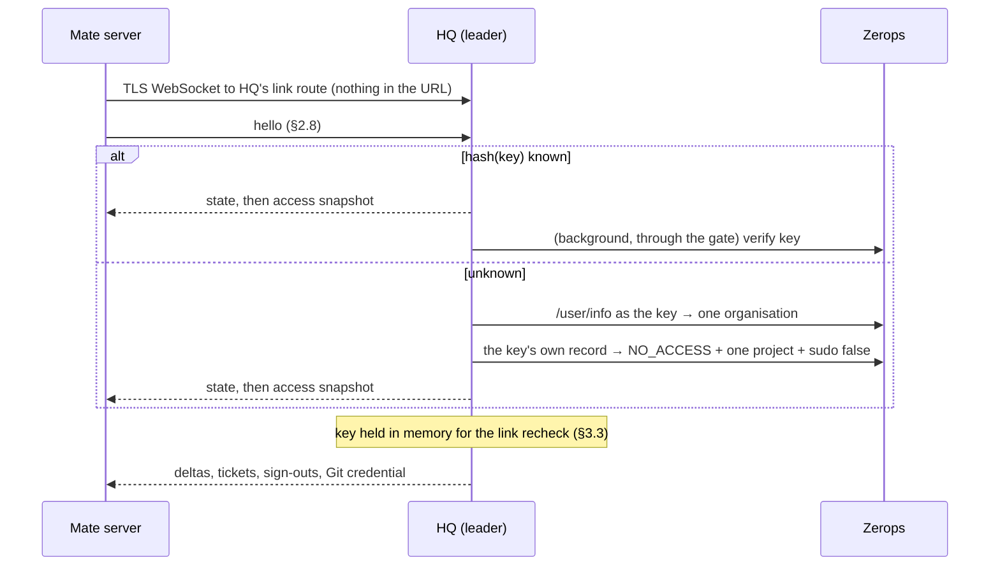

# Spec: Zerops Mate (`mate`)

Zerops Mate — `mate` in code, paths and unit names — is a fork of the open-source T3 Code that rides inside the `zcp` container. Its server runs
next to nginx and code-server and spawns the coding agent (Claude Code, Codex) with ZCP's MCP
tools attached; its client — web, desktop, mobile — is the product surface a Zerops user signs
into. Because the agent operates the project through the same `zerops_*` tools an agent in a
terminal uses, mate's UI is not a second control plane: it is a **reader** of what those tools
report. That reading contract is what this spec owns.

- Boundaries — the three rules every later section obeys, who owns which fact, and the closed
  list of mate↔zcp touchpoints — §0.
- Delivery — how the mate bundle gets into the container, the supervised process, nginx, the
  `/mate/` base path, readiness — §2.
- Trust and credentials — the four links (HQ↔Zerops, Mate↔HQ, person↔HQ, person↔Mate), every
  credential, the flows, the Chief, the residual risks and the Zerops asks — §3.
- Client flow — how a browser reaches a hosted mate: session/candidates, registration, the
  birth, the readiness probe, identity connect, new project, first prompt — §4.
- Zerops-aware client — the service map as a client projection of the Zerops API, maintained by
  native platform streams under §5.1, the server's lifecycle feed from the envelope, and the web
  surfaces that read them: service map, lifecycle strip, result cards, quick actions — §5.
- Git — each mounted dev service is its own repository, reached over a multiplexed SSH
  connection rather than the sshfs mount; multi-repo diff, the checkpoint refs a start sweeps — §6.
- The fork — Zerops Mate is a hard fork of T3 Code: frozen upstream base, four zones (import / port /
  owned / owned product), the adapter SPI between ported drivers and owned code, the upstream
  intake ritual — §7 (rules and measurements live in the fork: `../z3/docs/internals/zerops/`).
- Agent authorization — the agent CLI signs in from inside mate: a self-verified agent-auth feed,
  the platform flag written by the mate server through the Zerops API, server-driven login sessions
  whose parsed prompts (URL, device code) reach the client as actions, and sign-out — §8.
- Clients on Zerops only — desktop as a pure hosted client, the activity relay re-shelled for
  Zerops with project-bound environment links, T3 Connect reach gone — §9.
- Related: `docs/spec-workflows.md` (the envelope/plan/atom pipeline that produces the
  state), `docs/spec-work-session.md` (per-PID session, compaction survival).

---

## 0. Boundaries

Four rules bound every later section. A section that describes another mechanism is superseded
by the ownership table below.

1. **Identity is the client's.** The user's Zerops token exists only in the client. The client
   reads and writes the platform with it: organizations, projects, services, processes, subdomains,
   user-data, and the platform's push channel. HQ sees the access token once per HQ session, for one
   identity read, and keeps nothing (§3.7); a Mate's server never sees it. The container's project
   key is the project's: zcp operates the project with it, and the mate server uses it for its own
   flag write (§8.1) and presents it only to HQ, in its link's first frame (§3.5).
2. **Mate's clients reach the container only through the mate server.** Threads, the agent, git,
   the browser viewport. code-server and SSH are the platform's own doors and stay outside mate.
3. **zcp does not distinguish its caller.** Two entry points, stdio MCP and CLI. No layer exists for
   mate; mate adds no dependency to zcp. zcp knows mate as a unit it installs and supervises (§2),
   as a reader of the envelope it already emits (§1), and as two CLI subcommands mate spawns. `zcp
   studio watch` is the Zerops Studio extension's transport; mate does not consume it.
4. **Recover automatically; never let a clock or a hidden fix stand in for an owner's answer**
   (the owner, 2026-10-05: "problém mám s automatickými opakováními jako třeba to, že se na FE
   nastavilo a čekalo, že něco proběhne do 30 min, nebo že se magicky dělo něco v Gitee — ne to, že
   se něco automaticky opakuje a vyrovnává se stavem, který vzniká, a je to jeho legitimní řešení,
   jako že se automaticky obnoví session"). Wanted, in the client, the server and zcp alike:
   recovery with clear logic — renewing a session, reconnecting, re-subscribing, re-reading, running
   an idempotent step again after a transient failure (the network, a timeout, a 5xx, the network
   back, a tab woken) — bounded in rate, not in count (a backoff up to a steady cap), paused while
   nothing needs it, visible while it runs ("Reconnecting…", with a way to try now), and ended
   only by a definitive refusal, visibly, with a manual _Try again_. Forbidden: a clock
   standing in for an owner's answer ("after 30 min assume it ended"); a side effect nobody asked
   for — a timer that silently compares and fixes, the Gitea era's magic; retrying a definitive
   refusal; and repeating a non-idempotent side effect without first reading its own handle.

Every fact has one owner and one path to the client:

| Fact | Owner | Path to the client |
|---|---|---|
| identity | Zerops API, user token | client; HQ once per HQ session (§3.7) |
| membership, roles | Zerops API, HQ's organisation key | HQ; to a Mate as its access list (§3.9) |
| what exists in the project, its status, its subdomains | Zerops API, user token | client projection (§5.1) |
| live platform observations | native platform websocket plus direct bootstrap/repair, user token | shared client read model (§5.1) |
| what the platform is doing now | Zerops API, user token | client overlay (§5.4) |
| where the agent is in the workflow | the envelope in a tool result | mate server reducer → lifecycle feed (§1, §5.2) |
| which services are mounted | the container's mount table | mate server (§6.1) |
| agent sign-in | the agent CLI's own status + the platform flag | mate server feed (§8) |
| thread state | mate server, `~/.t3` | mate server |
| the agent's browser | zcp, in the container | the agent via `zerops_browser`; the user via the viewport stream relayed by the mate server (§5, Browser surface) |

Touchpoints between mate and zcp, closed list:

- the envelope carried in tool results (§1);
- `zcp` argv, a closed list (MA-6): `zcp mate status` / `zcp mate update` (§2.9 MU-2), `zcp studio
  console serve`, the loopback data console the mate server hosts and brokers (§5.7), `zcp version`,
  `zcp lease release` (a conversation's archive, `docs/spec-workflows.md` §8 DP-35) and
  `zcp self restart` (§2.9 step 7, MU-4). The mate server runs no other `zcp` argv; the agent
  sign-in flag it writes through the Zerops API (§8.1);
- `zcp init` installing and supervising the mate unit, and the contract that goes with it (§2.8);
- the agent-browser daemon's published stream port, `~/.agent-browser/default.stream`, on
  localhost — read by the mate server, never written by it, unknown to zcp as a mate concern;
- two conventions mate reads: the `ZCP_AGENT_OAUTH_*` / `ZCP_AGENT_TOKEN_*` flags and `ZCP_API_KEY`
  in the platform env store (§8.1, §3.5; those keys only, never another value in that file) and the
  `/var/www/<host>` sshfs layout (§6.1);
- the Mate's Git credential file the mate server writes and zcp reads (§3.3, §10.10).

Anything else is a violation and needs this section changed first.

### Invariants

| ID | Invariant |
|---|---|
| MA-6 | `apps/server/src/zerops/**` spawns `zcp` with no argv outside the closed list `mate status`, `mate update` (§2.9 MU-2), `studio console serve`, `version`, `lease release --branch <branch> [--repo <repo URL>] --json` (`docs/spec-workflows.md` §8 DP-35: on a conversation's archive, never `--force`, gated on `zcp version` ≥ 9.223.0), and `self restart --json` (§2.9 step 7, MU-4: once the Mate has drained, gated on `zcp version` ≥ 9.226.0). `scripts/mate-boundaries.test.ts`. |
| MA-7 | The Mate server sends `ZCP_API_KEY` only to HQ, in the first frame of its link, and to Zerops, for its own flag write (§8.1); it never forwards it anywhere else. Test to be written (`ZeropsHqLink`). |

## 1. Envelope on the wire

The mate client rebuilds a thread's lifecycle state by reducing over the provider's tool-result
stream. It never reads `.zcp/state` and never calls the Zerops API for lifecycle: the
`workflow.StateEnvelope` a workflow-aware tool already computes **is** the state. For that to
work the envelope has to survive the trip from the MCP handler, through the provider CLI, to
the mate server's reducer.

### 1.0 Two carriers, one reducer

The envelope always travels **inside the result text**, as verbatim JSON. Which of two
carriers a tool uses follows from the shape of its answer:

| The result text is | Carrier |
|---|---|
| prose (rendered markdown) | a trailing fenced ```` ```json zcp-envelope ```` block (§1.1) |
| one JSON document | a top-level `envelope` key beside the tool's own fields (§1.2) |

A JSON document cannot take the fence — appending one would stop it parsing as JSON — and prose
has no top-level key to hang the envelope from. Hence two carriers, one reducer (§1.3).

### 1.1 The fenced block (prose results)

A prose tool result's text ends with exactly one fenced code block whose info string is
`json zcp-envelope`:

````
## Status

Phase: develop-active
… rendered markdown guidance …

```json zcp-envelope
{"phase":"develop-active","environment":"container",…}
```
````

- The body is the `workflow.StateEnvelope` as **compact single-line JSON** (`json.Marshal`).
  Serialization is deterministic — the type sorts its slices at construction and
  `encoding/json` sorts map keys — so identical state produces identical bytes and a reducer
  can dedupe by content.
- Nothing but whitespace follows the closing fence.
- The producer is `workflow.AppendEnvelope`; the reference reducer is
  `workflow.ExtractEnvelope`. A mate client implements the same rule in TypeScript.

Appending over a text that already **ends** with an envelope block replaces that block rather
than adding a second, so a producer chain cannot emit two trailing envelopes. A block embedded
earlier in the text is content, not structure, and is left alone.

### 1.2 The `envelope` key (JSON-document results)

A tool whose result text is one JSON document carries the envelope as a top-level `envelope`
key, a sibling of the fields it already returned:

```json
{"status":"ACTIVE","targetService":"apidev","workSessionState":{"status":"open"},"envelope":{"phase":"develop-active",…}}
```

Every pre-existing field keeps its name, shape and position — the envelope is an **added key,
never a reshape**. A result whose envelope computation failed omits the key entirely
(`omitempty`), leaving the document byte-identical to what the tool produced before it carried
an envelope at all. Producers are the `*Response` wrapper types in `internal/tools`, each
embedding its underlying `ops.*` result so the existing fields stay flat;
`TestJSONCarriers_WireContract` pins both halves for every one of them.

### 1.3 The reducer rule

One reducer reads both carriers, in this order:

1. **JSON carrier first.** If the whole text parses as a JSON object, take its top-level
   `envelope`. Trying this first means a fence that appears inside one of the document's string
   values — a captured log tail, say — cannot outrank the real envelope.
2. **Otherwise the fence.** Scan for lines that consist solely of the opening fence. The match
   is **line-anchored**: a fence mentioned mid-line (prose describing this format) is text.
   The **last** complete block wins — a transcript may concatenate several tool results, and
   the newest state is the last envelope in it.
3. A malformed envelope is **ignored** — the reducer keeps its previous state rather than
   adopting it. That covers a JSON document with no `envelope` key, an unterminated block, and
   a block whose body does not parse.

### 1.4 Which tools carry it

| Tool | Result | Carrier |
|---|---|---|
| `zerops_workflow action="status"` | prose | fence — the canonical lifecycle carrier (P4 recovery primitive) |
| `zerops_workflow workflow="develop" action="start"` | prose | fence — seeds a new thread's strip without a second call |
| `zerops_workflow action="close"` | prose (terse) | fence — so the strip sees the transition |
| `zerops_deploy` (local, ssh, and both git-push routes) | JSON | `envelope` key |
| `zerops_verify` (single and all-services) | JSON | `envelope` key |
| `zerops_import` | JSON | `envelope` key |
| `zerops_mount` (mount, unmount, status) | JSON | `envelope` key |
| `zerops_lease` (acquire, status, release) | JSON | `envelope` key — built after the operation, so the reducer sees the new lease set at once |
| `zerops_workflow` bootstrap `start`/`complete`/`skip`/`status` | JSON | `envelope` key |
| `zerops_standup` | JSON | `envelope` key |

The three prose carriers route through `tools.statusResult` / `tools.briefingResult` /
`tools.withFreshEnvelope`; the first two render and append from the *same* envelope, so the
markdown and the machine-readable state can never describe different moments. The JSON carriers
each call `tools.freshEnvelope` **after** their mutation has succeeded, so the envelope describes
the state that mutation produced.

Only `action="status"` carries the work session's whole deploy and verify history. Every other
carrier keeps each host's last deploy and last verify attempt, and every host that has one
(`tools.replyEnvelope`): Mate reads only the last attempt and which hosts have any, and the
recovery primitive still has the rest. `TestEnvelope_AttemptHistory_OnlyStatusCarriesItWhole`.

Error results carry **no** envelope, under either carrier. An error is a leaf payload
(`spec-workflows.md` P4); attaching state to one would let a reducer read a failed call as
fresh truth.

Envelope computation is an addendum and is **total**: a failure attaches nothing, leaves the
tool's own result untouched, and reports to stderr (JSON-only stdout). The lifecycle strip
degrading to slightly stale state is always preferable to a tool call failing over its
telemetry.

### 1.5 Size

The envelope is small next to what it rides on: **140 B** fenced for an idle envelope, **~1.7 KB**
for four services plus a work session with deploy/verify attempts. On a JSON result the same
state costs ~1.2 KB (no fence, no markdown) — a deploy response measured 119 B before and
1287 B after.

The synthesized guidance a prose result carries is held under `workflow.ComposeBodyBudget`
(24 KB), which sits below the 28 KB soft cap and the **32 KB MCP tool-response cap** precisely
to leave room for the scaffold `RenderStatus` adds — so the envelope fits inside existing
headroom and needs no budget of its own — for a small project. What a project's services cost the
rest of the answer counts against that budget (`workflow.GuidanceBudget`), on `action="status"` and
develop's start alike: the per-service and lease lines rendered above the guidance, and the envelope
block's bytes beyond a small project's 2 KB; the base-prefix rule those lines refer to is said once
beneath them. On 2026-10-27 develop's start, which applied no budget, answered 38–55 KB in three
Mate sessions, one read back from a file past the client's display limit; a six-part pool project's
start now renders 28.7 KB (a 30.7 KB frame) with its dev-pool loop whole, where it rendered 51.6 KB
(`TestDevelopBriefing_MultiPartPoolProject_UnderTheCap`,
`TestHandleDevelopBriefing_ManyPairs_StaysUnderTheMCPCap`). `TestAppendEnvelope_BlockSizeBudget` pins it, with eight
leases (§2.8a.3) on top of the four-service fixture (~3.1 KB fenced). JSON
results are far smaller than the prose ones and are nowhere near the cap.

### 1.6 Why not `structuredContent`

The Go MCP SDK marshals a non-nil typed handler output (a handler's second return value) into
the JSON-RPC result's `structuredContent` field, *alongside* the text content. zcp keeps the
envelope and all model-facing guidance together in the text content, so a provider's treatment
of `structuredContent` cannot separate the envelope from that guidance.

So the typed-output slot stays empty at every handler, guarded by
`TestNoStructuredContentOnToolResults` (which checks named handlers *and* the closures handed
to `mcp.AddTool`).

A second `mcp.Content` block was the other way to reach a JSON result, and was rejected: it
would make the envelope's delivery depend on every provider forwarding multi-block tool results
intact, which is unproven, where a sibling key inside the one block they already forward is
not.

---

## 2. Delivery

mate rides inside the `zcp` container rather than the platform's `zcp@1` recipe: installed and
supervised by `zcp init` (a `run.init` command), reached through the container's existing nginx on
port 8080. A plain restart re-runs the recipe's `install.sh`, picks up the latest zcp release, and
turns mate on for a project whose container predates it — no platform-side change. Everything zcp
knows about mate lives in `internal/mate`, kept to stdlib plus `runtime`, `schema` and `hq`.

### 2.0 The gate — nothing mate-shaped happens unasked

**`ZCP_MATE_ENABLED` is the single input mate is keyed off**, read once into `runtime.Info.MateEnabled`
beside the `ZCP_AUTHORING` gate. It accepts `1` or `true`, case-insensitive, surrounding space
tolerated — deliberately more forgiving than `ZCP_AUTHORING`'s exact `1`, because this one is typed
into a service's env in the Zerops GUI, where a silently ignored value is indistinguishable from a
broken feature.

The governing rule is stated as a test, not as prose: **with the flag unset, a container running a
zcp release that carries this delivery path behaves exactly as one that predates it.** Concretely,
flag off means

| | with the flag off |
|---|---|
| bundle | nothing downloaded, nothing installed, no network request made |
| unit | no `zerops@mate` registered — and a leftover one is stopped and removed (§2.1b) |
| nginx | no `/mate/` location, no `/mate/healthz`, and **`/proxy/3773/` left open**, so the port is an ordinary user port again |
| root `/healthz` | code-server's own, unshadowed |
| `zcp init` output | not one extra line — the step is not even registered (§2.1) |
| readiness marker | not written |
| git | untouched; zcp writes no `.gitignore` in any configuration (§6) |
| code-server settings | the template, byte for byte — no `"git.enabled": false` (§6.8); a container whose flag is turned off converges back at its next `zcp init` (`TestConfigureVSCode_MateTurnedOff_GitSettingRemoved`) |

`zcp init` is the reconciler for all of it, and it converges **both** directions: turning the flag
off and restarting is a supported operation, not a state zcp only knows how to enter.

### 2.1 The init step — a reconcile, and an update lifecycle

`zcp init` gains a container-only step, **Zerops Mate (mate)**, after the SSH-config step. It is
**registered only when there is something to reconcile** — `MateEnabled`, or a leftover unit file a
now-off flag has to remove — so a container that never had mate prints not one extra line (§2.0).

**Enabled** (`reconcileMate` → `enableMate`):

1. **Refuse without a project.** `runtime.Info.ProjectID` empty ⇒ degrade — a non-empty project id
   is the sole signal the server binds to a Zerops project.
2. **Bundle** — `mate.EnsureInstalled` (below) in full.
3. **Environment.** `~/.zcp/mate.env` rewritten (mode 0600) every boot — §2.3.
4. **Unit.** `mate.UnitFilePath` absent ⇒ `sudo -E zsc unit create mate "zcp service start mate"`.
   Then, when systemd says the unit's file changed on disk since it loaded it
   (`systemctl show --property=NeedDaemonReload --value zerops@mate.service` answers `yes` — what it
   warns "run 'systemctl daemon-reload'" about), `sudo systemctl daemon-reload` before any restart
   (step 7), whether or not one follows, so this restart and every later one runs the definition on
   disk; an unchanged unit is never reloaded, and a reload that fails is a named line, not a degrade.
   `eval/scripts/mate-dev-push.sh` reloads by the same rule before its own restart
   (`TestRun_Mate_UnitFileChangedOnDisk_ReloadsSystemd`).

5. **Running Mate.** Under the shared install lock, ask systemd whether the registered
   unit is active. Stage and smoke a newer release while keeping `current` unchanged, then
   use the updater's protocol-1 drain with `automatic:false`. Only a proved idle admission
   barrier permits `mate.SwitchUpdate`: persist the switch, release the lock, request a
   nonblocking restart, prove the exact version on a new healthy boot, and commit admission.
   A refusal, absent protocol, or drain deadline postpones the change without restarting
   the running Mate. Environment-only restarts use the same barrier and readiness proof.
   An inactive unit starts the installed version immediately; first registration starts
   through `zsc unit create`. An unchanged running version still receives the boot readiness
   proof before advancing `last-good` (§2.1d).
   `TestRun_Mate_InitDrain`, `TestRun_Mate_ActiveUnchanged_CommitsBootLastGood`.

The step is **best-effort** (`step.degraded`): a release 404, an unset/mismatched digest, or an npm
dependency failure names the cause but `zcp init` still exits successfully — it is a `run.init`
command, and mate must never take a container start down with it. When the bundle cannot be had **no
unit is registered** — an unresolvable ExecStart crash-loops at every boot. The unit file's
presence, not a `zsc unit` upsert (there is none), is the idempotency check.

### 2.1a The update lifecycle — `mate.EnsureInstalled`

Each version is its own complete npm prefix, and a symlink names the live one:

```
~/.zcp/mate/versions/0.1.0/node_modules/.bin/mate
~/.zcp/mate/versions/0.2.0/node_modules/.bin/mate
~/.zcp/mate/current -> versions/0.2.0        # relative target
BinPath() = ~/.zcp/mate/current/node_modules/.bin/mate
```

`InstalledVersion()` reads `current/node_modules/zerops-mate/package.json` — **npm's own record**,
never a side file zcp would have to keep honest. `DesiredRelease()` answers `{Version, URL,
SHA256, Contract}` — read from the release manifest (§2.1c), never compiled in.

One pass, in order:

1. **Compare.** Resolve the release manifest (§2.1c). Installed == desired ⇒ done, with no
   tarball download or npm call.
2. **Keep a dev build.** An installed *semver prerelease* (`0.1.0-dev.<sha>`, what
   `eval/scripts/mate-dev-push.sh` tags) is never replaced by the manifest's release unless `Force`,
   unless the release it was cut from is below `MinimumMateVersion`: a build below the floor is
   replaced like any release, and a supervisor restart (`KeepInstalled`) refreshes the manifest for
   it instead of keeping it. The protection is now a stated rule rather than an accident of which
   files happen to exist.
3. **Stage** into a fresh `versions/<desired>`: one `GET` to the manifest's `url`, streamed to a
   temporary file while its SHA-256 is computed and compared with the manifest's `sha256`. A
   mismatch reports both digests and **never invokes npm** — this is an integrity check against a
   damaged download, not a trust boundary (§2.1c). Only a matching tarball reaches
   `npm install --prefix versions/<desired> …`. npm still resolves the package's
   dependencies from its registry, so this is not an offline install. Download and npm share one
   3-minute deadline.
4. **Smoke** the staged install: `mate --version`, then the native-addon probe run **from the
   installed package's directory** (`node_modules/zerops-mate`), where the server resolves its own
   runtime imports — a bundled dependency (node-pty since 0.8.1) lives in the package's own
   `node_modules` and is invisible from the prefix root.
5. **Activate atomically** — build the symlink under a temporary name and `os.Rename` it onto
   `current`, so an interrupted activation leaves either the old link or the new one, never a
   half-written one.
6. **Prune** to the live and last-good version directories; if these name only one version,
   keep the newest other directory too. Neither live nor last-good is removed.

**Any failure in 3–5 returns before the rename**, removing the half-built version directory, so
`current` still names the version that was working — the guarantee the whole layout exists for.

7. **Restart the unit** when it already existed and step 3 replaced the bundle (or the env contract
   changed, §2.3). The unit does not wait for this command — it starts at boot from
   `WantedBy=multi-user.target`, so it is already serving what was on disk then; without this a
   new bundle would land on disk and serve only from the *next* restart, which is not what
   "a restart is also an upgrade" (§2.6) promises. A unit created by this same run is left alone —
   `zsc unit create` starts it.

**An ordinary unit restart preserves an installed release at or above `MinimumMateVersion`.**
`zcp service start mate` recovers an interrupted switch first. A supported installed version
launches without reading the release manifest, preserving the organization's hold, idle drain
and incompatible-release confirmation. A missing bundle or one below the floor refreshes
`DesiredRelease` under the shared install lock. If the manifest is unavailable, an installed
version keeps serving with a warning; a missing bundle cannot be installed.

The explicitly attended full-container `zcp init` operation retains its existing release
convergence, including the one full restart that brings an older Mate onto this updater. It must
be performed while idle. The unit and init share the install lock; a busy lock postpones updates,
and startup can still serve the installed version after its bounded lock wait. Normal subsequent
updates use the separate worker described below. The manual CLI chooses that worker only after
an exact protocol-1 capability response. An explicit HTTP 404 proves an older endpoint absent
and retains the attended legacy path; transport failure, another status, invalid JSON, or an
unknown protocol postpones without changing the installation. An inactive or unreachable Mate
needs attended recovery, never a guessed legacy capability.

**`zcp mate update [--force] [--json]`** runs the identical pass from the CLI and then restarts
`zerops@mate` when the unit is registered, so an update needs no container restart. It is what the
web client's "Update" verb ends in (§2.9). **`zcp mate status --json`** answers
`{installed, latest, contract, updateAvailable}` from the same resolver, using the manifest cache
(§2.1c) — the one reader of "is there a newer mate" in the whole product. It also reports the
completed sign-in seed as `signIns: {state, input?, at, error?}` (§10.5); `input` is an opaque
fingerprint of HQ's origin and the project key, never the key. The text status names the same state and reason.

The same status says whether a container restart, which installs both halves (§2.9 step 7), would
change anything. **`zcp: {installed, latest, behind}`**, always present, is this binary (its
version in `installed`) against the zcp release `install.sh` installs (GitHub's `releases/latest`
for `zeropsio/zcp`), read through zcp's own update cache (`~/.cache/zcp/update.json`) with the
manifest's one-hour TTL, beside the manifest read; `--refresh` asks the release source, `--local`
reads only the cache. `latest` is `""` while that release is unknown (offline, rate-limited, nothing
cached under `--local`), never guessed, and for a build no release names (a dev or git-describe
build), which never reaches the network: a restart would replace it. Only a release older than a
known `latest` reads `behind: true`. **`restartNeeded`** is always
present, and **`why`**, one line for a person, only when it is true: zcp is behind ("zcp v9.226.0 is
out; a restart installs it"), or the running Mate answered its loopback updater readiness with
exactly 404 — older than protocol 1, §2.1d — while a newer Mate is out, which the restart installs.
The Mate is asked only in an enabled Mate container (elsewhere 3773 is an ordinary user port), only
when `updateAvailable`, and never under `--local`; any other answer is no reason. The text status
adds one line when zcp is behind, or names the restart when only the Mate needs it.

### 2.1b Disabling — the reverse direction

`MateEnabled` false with a unit file present: stop the unit (best-effort — it may already be stopped),
`sudo -E zsc unit remove mate` (a real failure here is the one error this branch returns), and delete
`~/.zcp/mate.env`. **`mate.Prefix()` is deliberately left alone**: the downloaded bundle stays on disk,
so re-enabling costs a `zcp init` and no network. With no unit file there is nothing to do and the
step does not even register.

### 2.1c The release manifest — no pin

zcp does not pin a mate version. It tracks the fork's **stable release** the same way the container
tracks zcp itself (`install.sh` → `releases/latest`), and refuses only what it cannot drive.

**The manifest.** The fork's release workflow publishes, next to the tarball, a release asset
`stable.json`:

```json
{ "version": "0.16.0", "asset": "zerops-mate-0.16.0.tgz",
  "url": "https://github.com/zeropsio/mate/releases/download/v0.16.0/zerops-mate-0.16.0.tgz",
  "sha256": "<64 hex>", "size": 21690443, "contract": 2, "rollbackCompatible": false, "publishedAt": "2026-10-26T18:08:45Z" }
```

`DesiredRelease()` reads `https://github.com/zeropsio/mate/releases/latest/download/stable.json`
(GitHub's own "latest release" redirect; a release marked *pre-release* is never "latest", which is
the rollback lever: mark the bad release as pre-release, re-mark the previous one as latest). The
answer is cached on disk with a 1-hour TTL (`~/.zcp/mate/manifest.json`, the same shape as zcp's
own `internal/update` cache) so a warm restart and `zcp mate status` reach the network at most
hourly; `zcp mate update` always refreshes. An unreachable manifest with a mate already installed is
**not** a failure: the installed version keeps serving and the step logs the miss. With nothing
installed it degrades like any other install failure (MD-1).

**What zcp checks, and what it does not.**

| Check | Rule |
|---|---|
| `contract` | must equal `mate.SupportedContract` (today `2` = C-1…C-12 in §2.8 and §2.8a). A manifest declaring a contract zcp does not know is refused with a message naming both numbers — the one case where an old zcp deliberately stays on the mate it has. |
| `version` | must be ≥ `mate.MinimumMateVersion`, the oldest release zcp still drives (moves only when a contract fact changes; 0.16.0, the first contract-2 release, which links to HQ with the project key and declares HQ's origin in its package, §3.5). A manifest below it is refused, and so is a cached one on read: the cache holds what an earlier zcp checked against its own floor. |
| `sha256` | the downloaded tarball must match it — damage detection, nothing more. |

**There is no trust chain, by decision (2026-09-09).** The container installs zcp from a GitHub
release over TLS with no signature; a manifest digest compiled into zcp guarded mate alone against
an attacker who could replace assets in `zeropsio/mate` but not in `zeropsio/zcp`, which is not a
boundary anyone defends. The boundary is the GitHub organisation: 2FA, protected `v*` tags, who may
push them. If the product ever needs build provenance it is done for both repositories at once
(Sigstore keyless with GitHub OIDC), never with a key held in a repository secret — whoever can edit
the workflow can sign with that key.

**What moved out of zcp.** `PinnedVersion`, `PinnedSHA256`, `ReleaseAssetName`, `ReleaseURL`,
`scripts/mate-pin.sh` and the `serve --help` golden are gone. The flag contract (C-2) is now tested
where it changes: the fork's CI asserts that `mate serve --help` advertises every flag of contract 2
(the list in §2.8), and a flag added on either side goes through a contract bump, not a pin move.

**Release order is Mate first.** Publish the stable Mate artifact and `stable.json` before
releasing a zcp that raises `MinimumMateVersion` or changes `SupportedContract`. Both the local
release target and the release workflow fetch the published stable manifest and refuse to
publish unless its version reaches the floor and its contract equals `SupportedContract`.
The release check uses the canonical stable channel, never a container's manifest override
or cache. An older zcp ignores additive manifest metadata; no new `serve` flag is passed.
Auto-update protocol 1 is probed before it is used.

### 2.1d Automatic updates — protocol 1

The stable manifest optionally declares `rollbackCompatible: true` and `compatibleFrom`.
The installed version must be at least that proved compatibility floor and below the candidate.
Missing, invalid or unmet compatibility metadata means manual confirmation is required.
`zcp mate status --json` exposes `updater` with `protocol: 1`,
`rollbackCompatible`, `phase`, `runningVersion` and optional `failedVersion`. It describes
only the installed version: a settled record from another running version, or a postponement
of a release that is no longer the target, reads as `idle`, and a failure at or below the
installed version is dropped. Any successful install outside the worker (`zcp mate update`
without the worker, `zcp init`) replaces the record. The existing
manifest resolver remains the only version reader. `status --local --json` reads cached
releases and local coordinator state, so startup need not wait on a release-source request.

`zcp mate update --automatic --json` acknowledges an independent systemd transient worker
with `started: true`. The worker runs outside `zerops@mate`'s cgroup, takes the install lock,
refreshes the manifest, and refuses a dev build, same/older version, incompatible release or
version at or below the remembered failure. It stages and smokes the candidate without changing
`current`, then POSTs loopback `/api/mate/update/drain` with `{version, deadlineMs:600000,
automatic:true}`. Mate rechecks org policy and proves its engine idle behind an admission
barrier. A deadline or refusal postpones the update and cancels that barrier; no work is stopped.
An already-running terminal process is work. Native provider resume bindings must survive.
The worker's exact process identity is recorded from staging onward. An in-container status
observation can mark staging/draining postponed only once that identity is provably gone,
under the install lock. The transient unit's `ExecStopPost` also cancels an abandoned drain;
for an interrupted compatible switch it restores, restarts, verifies and commits last-good.
Neither path guesses from elapsed time. No worker retry loop is added.

Decision: A dead update worker's switch settles when last-good becomes ready, so a newer release can update.
Decision: A switch whose worker still lives, or whose restored process is not proven ready on a new boot, is never settled.
Decision: failedVersion survives the settlement, so the failed candidate is not retried.

Both ordinary and local in-container status observe an abandoned compatible switch under
the same install lock. Only when installed/current, previous and last-good agree and the
shared readiness proof verifies that exact version on a different nonempty boot does the
record become postponed, with runningVersion set to last-good and worker identity cleared.
Missing worker or old-boot identity, an incompatible switch, or an incomplete readiness/C-4
proof leaves the switch untouched. Status probes once, bounded by one second; a later
ordinary status can observe late readiness. It never restarts or installs a bundle.

Decision: A Mate whose process exits during an update is rolled back without waiting for the deadline.
Decision: A Mate whose process is still running is waited for until it is ready or the deadline passes.
Decision: Stopping the old Mate during an update never counts as the new Mate's failure.
Decision: An update stops waiting the moment the Mate's process exits.
Decision: A running Mate updated by init receives the same candidate readiness window as an update worker.
Decision: A cold boot that has not proved ready never advances last-good and is not rolled back merely because its observation window ended.

Candidate, rollback and recovery share the readiness wait. Before each restart it records the
unit's invocation and process-start identity. Only a changed nonempty invocation ID or a
process-start timestamp strictly newer than the snapshot identifies a candidate attempt.
A new process with MainPID zero, a candidate attempt in failed state, or a new unit
invocation that entered auto-restart ends the wait
immediately, including a clean process exit. Stale exit status and the old process stopping
during a nonblocking restart do not prove the new process exited. An unreadable unit state cannot prove exit; the existing
HTTP proof and deadline remain authoritative. No startup-progress receipt is assumed.

The switch writes `last-good` and minimal `update.json` state (phase, candidate, previous,
worker process identity, last proved running version and remembered failure), syncs them, and
atomically moves `current`. Only then is the lock released and a nonblocking unit restart
requested. The new launch receives the additive `ZCP_MATE_UPDATE_STATE_FILE` path and keeps
admission fenced. Within 60 seconds of the restart request, readiness must prove protocol 1,
the exact version, a different nonempty boot id, engine/database readiness, and C-4. POST
`/api/mate/update/commit` opens admission; only a proved candidate becomes `last-good`.
Live init, the update worker and recovery share this startup budget at the readiness owner:
Eli's recorded recovery took about 44 seconds
to ready, while seven KRLS tx - Lior starts took 3.071–5.977 seconds. The 16-second margin
above that observed slow start does not guarantee readiness.
`zcp init` at cold boot is the other route: after it settles an installed release it observes the same
readiness proof for 30 seconds (without holding the install lock) and only then moves `last-good`; a Mate not ready
in time keeps its previous `last-good` and the next boot asks again. Both routes advance it through
`mate.CommitLastGood`, which never points it at a dev build or a release below `MinimumMateVersion`.

A compatible candidate failing readiness returns `current` to the explicit `last-good`,
remembers the failed version before restarting, proves that version ready, and commits it.
The resolver is never consulted to choose a rollback. Pruning preserves `last-good`.
At boot, an unfinished switch whose recorded worker is gone returns to `last-good` before
any install; a live worker owns the switch and boot skips the installer. A failed version
is not automatically retried until a strictly newer release exists; `--force` is attended.
There is no separate update journal or quarantine.

Confirmed manual updates on protocol-capable Mates use the same drain and switch. A
non-rollback-compatible manual release failing readiness stays on its candidate and reports
that attended recovery is required; neither its worker nor boot launches an incompatible
previous schema. Older Mates have no drain capability: while idle, perform one attended
full container restart using the normal operator restart, or `zcp self restart` in the container
(§2.9 step 7); `zcp mate status --json` names such a Mate `restartNeeded` while a newer Mate is out. `install.sh` updates zcp and
`zcp init` installs Mate. Verify `status --json` reports `updater.protocol:1` and Mate's
loopback readiness advertises protocol 1 before leaving future updates unattended.

### 2.2 The supervised process

`zcp service start mate` runs `mate.ServeArgv(bin)` — never `npx` (resolving the package
at every start cost 58 s cold, measured, see the mate ledger; the argv always runs the local bundle):

```
~/.zcp/mate/current/node_modules/.bin/mate serve --mode web --host 127.0.0.1 --port 3773 \
  --base-dir ~/.t3 --no-browser --auto-bootstrap-project-from-cwd /var/www
```

- `--auto-bootstrap-project-from-cwd` is **boolean**; the workspace (`/var/www`) is a trailing
  **positional** — writing it as the flag's value bootstraps the unit's launch directory instead.
  `--base-dir` (`~/.t3`) keeps thread history across a restart; a redeploy starts it empty.
- **No flag depends on the bundle.** The CLI treats an unknown flag as a fatal parse error, and a
  launch may start a bundle nothing vetted — a kept dev build, or the installed one after an install
  failed. So the public prefix is not passed as `--base-path`: it rides `T3CODE_BASE_PATH`
  (`mate.LaunchEnvLines`, §2.3), the same setting, which every release since v0.1.0 reads. Nothing
  runs `serve --help` before a launch.
- **An explicit `--auto-bootstrap-project-from-cwd` wins over the `serve` command's own opt-out.**
  Upstream's `serve` command sets a headless startup presentation that, left to itself, forces
  auto-bootstrap off; the fork's config resolution checks the explicit flag *first*, so zcp's
  boolean flag (above) still lands. The first boot that finds none creates one project titled from
  `path.basename(cwd)` and one thread; every later boot that finds them reuses both rather than
  re-creating. `config.test.ts` — "honors an explicit auto-bootstrap flag over the serve command
  opt-out"; `serverRuntimeStartup.test.ts` — "resolveAutoBootstrapWelcomeTargets returns existing
  project and thread ids".

### 2.3 The environment contract

`zcp init` writes the following while the container's full environment is present;
`service.Start("mate")` merges it over the unit's own, not guaranteed to inherit it:

| Key | Source | Written when |
|---|---|---|
| `T3CODE_ZEROPS_PROJECT_ID` | `runtime.Info.ProjectID` | always — THE Zerops-environment signal; nothing else votes |
| `T3CODE_ZEROPS_API_HOST` | `mate.ResolveAPIHost(ZCP_API_HOST)`, else `schema.CanonicalAPIHost` | always — bare host, scheme/trailing slash stripped, port kept |
| `T3CODE_ZEROPS_ALLOWED_ORIGINS` | service env `ZCP_MATE_ALLOWED_ORIGINS` | only when set and well-formed (a comma-separated list of `https://<host>[:port]`, `mate.ValidateAllowedOrigins`) — unwritten ⇒ server's own default; a malformed value is named in one diagnostic line and left unwritten, init continues |

Only non-secret identifiers are written; a token never enters `~/.zcp/mate.env` (mode 0600),
rewritten every boot so a unit's frozen ExecStart never has to change. A missing/unreadable env
file is reported and mate starts anyway — diagnosable, unlike a unit that refuses to launch.

Every launch adds four more on top (`mate.LaunchEnvLines`), whatever init wrote:

| Key | Value |
|---|---|
| `T3CODE_BASE_PATH` | `mate.BasePath` (§2.7) |
| `ZCP_MATE_UPDATE_STATE_FILE` | the automatic-update coordinator state (`mate.UpdateStatePath`) |
| `ZCP_STATUS_FILE` | the status file a new Mate's setup is read from (`mate.DefaultStatusFilePath`) |
| `T3CODE_ZEROPS_HQ_GIT_CREDENTIAL` | the file the server keeps the Mate's Git credential in (mode 0600), written when HQ sends one down the link and read by zcp to set the dev service's `GIT_TOKEN` (§3.3, §10.10). It names a path, never the credential |

### 2.4 nginx — locations outside the cookie gate, behind the Mate gate

Rendered identically whether or not `VSCODE_PASSWORD` is set, and **only when `MateEnabled`** — all
locations and the upstream render only inside `{{- if .MateEnabled}}` regions.

| Location | Behaviour |
|---|---|
| `{BasePath}/` (`/mate/`) | Proxies through `mate_backend` to `127.0.0.1:3773` — **trailing slash strips the prefix**, so mate's routes stay at the loopback root and only URLs it *emits* (`T3CODE_BASE_PATH`) carry it. The upstream keeps 16 idle connections per worker; HTTP/1.1 and an empty Connection header allow reuse. Only the server's HTTP API and WebSocket answer here; the container serves no client bundle and no sign-in page (§3.13). Outside the cookie gate: mate owns its own auth (§3). |
| `= {BasePath}/ws` | Proxies through the same upstream to `/ws`, retaining query parameters, websocket upgrade headers and `proxy_read_timeout 86400s`. |
| `~ ^/(abs)?proxy/3773(/|$)` | `return 404`. code-server's `/proxy/<port>/`/`/absproxy/<port>/` reach any loopback port for whoever holds the container cookie — a second door, closed; evaluated before `location /`. Closed **only while mate is enabled**: with the flag off nothing of ours listens on 3773 and the port is an ordinary user port. |
| `= {BasePath}/healthz` | Serves `mate.InitMarkerPath` verbatim, `application/json`, `no-store`; falls back to `{"initComplete":false,"initAt":null}` with no marker yet. No proxy, no process — answers even when nginx is all that's up. |

The readiness route lives **inside mate's namespace, not at the container root**. An nginx exact match
beats a prefix location regardless of source order, so `= /mate/healthz` is served from the static
marker and never reaches the `/mate/` proxy; it sits next to that block for readability only. Two
reasons it is not `= /healthz`: that path is code-server's own, and shadowing it took something away
from every container; and under an opt-in gate the route's *existence* is information — answering
means mate is enabled here, `404` means it is not, a distinction a route that answered on every zcp
container could not make.

Both readiness branches (marker-present and the uninitialized fallback) also send
`Access-Control-Allow-Origin: *` — a hosted mate web client (§4) reads its own container's origin
before it holds any credential, so the response has to survive a cross-origin `fetch` even though
its body is only two non-secret fields. `/mate/` and the cookie-gated `location /` stay CORS-less:
`/mate/` inherits mate's own origin rule (§3.13), and code-server's location is never fetched
cross-origin. `TestRunNginx_HealthzHasCORSForCrossOriginProbe`.

With the flag off the render is **byte-for-byte identical** to the pre-mate one, with and without a
password — verified by rendering both templates side by side, and pinned by
`TestRunNginx_MateDisabled_RendersNoMateSurface`, which asserts the absence of `/mate`, `3773`, `healthz`
and the marker path *and* the presence of every non-mate structure.

Nginx sends both access and error logs to the container's system journal through the
`/dev/log` Unix syslog socket (`local1`, tag `nginx`, access severity `info` and error severity
`error`). The supervised launch also passes `-e stderr`: nginx opens its compiled-in
error-log destination before parsing this configuration, so its bootstrap diagnostics must
use the inherited journal stream too. `TestStart_KnownService_ArgsCorrect` pins that launch.
Journal retention is bounded by the platform's journald configuration. Nginx does
not open `/var/log/nginx` files, so rotating a legacy log into a different owner cannot stop
it from starting, reopening logs or serving Mate. This logging contract also applies with
Mate disabled.

After successfully rendering the configuration, `zcp init nginx` removes the obsolete
`/etc/logrotate.d/nginx` policy. A missing policy is already converged; any other removal
failure is reported. A failed configuration render leaves the policy in place. Init owns
nginx's cache and temporary directories, and leaves legacy log contents and permissions
and unrelated rotation policies untouched. `TestRunNginx_LogsUseSystemJournal`,
`TestRunNginx_FileRotationRetired`, `TestRunNginx_LegacyLogFilesPreserved`.

Live edits do not survive — every boot re-renders `internal/content/templates/nginx.conf.tmpl`.

### 2.5 Readiness — two probes, no process

**`GET {BasePath}/healthz`** → always `200 application/json` *while mate is enabled*: the marker
`zcp init` writes at
`/var/www/.zcp/state/init-complete` when its step list ends —
`{"initComplete":true,"initAt":"<RFC3339>"}`. Records the list **finished**, not that every step
succeeded (a degraded mate step still leaves the marker); `initAt` moving is how a client sees a
restart re-initialized the container.

**`GET {BasePath}/.well-known/t3/environment`** → mate's own liveness: `200` **and**
`content-type: application/json` **and** a body carrying `"basePath":"/mate"` — never the status
code alone, since a mis-proxied prefix can reach something else that answers `200`.
`mateUp` is the **client-side conjunction of both**: stock nginx cannot branch a response body on a
subrequest, so folding both fields into the readiness route would need the sidecar process this
design removes. A client must also read a `404` on `{BasePath}/healthz` as its own third state —
*mate is not enabled on this container* — distinct from "still starting". Budget (measured, see the ledger): a restart is ~17 s to `/healthz`, ~19 s to `mateUp`,
~14 s of L7 `502` in between — poll `mateUp`, render `502` as "restarting", cap at 30 s.

### 2.6 What survives what

| | restart | redeploy | disable (§2.1b) |
|---|---|---|---|
| `~/.zcp/mate/versions/*` (the bundles) | kept | lost | **kept — deliberately** |
| `~/.zcp/mate/current` (the live link) | kept | lost | kept (points at a version nothing runs) |
| `~/.t3` (threads, sessions, auth) | kept | **lost — recreated empty** | kept |
| `~/.zcp/mate.env` | kept (rewritten anyway) | rewritten by the new container's init | removed |
| `zerops@mate` unit | kept | lost, re-created by init | **stopped and removed** |
| `/var/www/.zcp/state/init-complete` | rewritten each boot | rewritten each boot | not rewritten |
| live nginx edits | erased (template re-rendered) | erased | erased |
| container id | unchanged | changes | unchanged |

A restart is also an upgrade — `install.sh` re-runs and replaces `/usr/local/bin/zcp` (measured,
see the ledger), and the release manifest is what the next `zcp init` reconciles toward (§2.1a).
Thread history is one redeploy away from gone; a client surfaces that first. A **redeploy** losing
the bundle is not a regression under the versioned layout — it loses the whole container — and a
**disable** keeping it is what makes re-enabling free.

### 2.6a What a broken mate costs — measured

The unit `zsc unit create` writes is `Restart=always`, `RestartSec=3`, under systemd's default
`StartLimitBurst=5` / `StartLimitIntervalSec=10`. One restart every 3 s is ~3.3 per 10 s, **below**
the burst threshold — so a unit whose `ExecStart` fails immediately **never trips the start limit
and never gives up**. With the bundle path broken: the restart counter climbs
linearly (4–5 per 15 s) and the unit stays `activating` indefinitely; it never reaches `failed`.

That is survivable only because the blast radius is one route. Measured in the same state:

| | |
|---|---|
| Zerops service status | `ACTIVE` |
| `zerops@nginx`, `zerops@vscode` | `active` |
| code-server `/`, `/healthz` | unaffected |
| `{BasePath}/healthz` | **`200`** — a static file nginx serves with no process behind it, which is exactly why readiness is not a proxied route (§2.5) |
| `{BasePath}/` | `502` |

So a mate that cannot start costs `/mate/` and nothing else: the container starts, stays healthy, and
keeps serving the editor. Recovery is `zcp init` — and it works even for a container whose flag is
now off, because the step registers on `MateEnabled || <unit file exists>` (§2.1), so a stray unit is
reconciled away rather than left looping. A zcp release that predates mate has no such step and would
leave the loop running (`unknown service "mate"`), which is one more reason a container should not sit
between the two for long.

### 2.6b Managed browser batches

`zerops_browser` and `zerops_verify`'s render check share one warm browser per
container: the transient systemd service `zcp-browser.service` holds agent-browser's
daemon and its Chrome between calls. It is `Type=forking`, started through
`agent-browser open about:blank`, with the daemon's pid file as `PIDFile`. Its
`RuntimeDirectory` holds the daemon socket, so once the service is gone no client
can respawn a daemon outside it. systemd bounds it: `TasksMax=1000`, `CPUQuota` at
75% of the container's CPUs, `RuntimeMaxSec=3600`, and `KillMode=control-group`
with `SIGKILL`. Chrome's profile lives in `/tmp/zcp-browser`, which `ExecStopPost`
removes on every stop. The daemon exits after 5 idle minutes, and the service ends
with it. The service and every step get one environment built by one function,
because agent-browser restarts a daemon whose settings differ from its client's.

A call waits on one container-wide `flock` until its own deadline, then fails as
busy. It reuses the warm browser only if the browser is running, the last call in
it ended cleanly (a marker in the runtime directory says `idle`; a caller that died
mid-call leaves it `busy`), neither the idle exit nor the max age can cut the
call, and the service used at most a tenth of a CPU since that call ended (systemd's
`CPUUsageNSec`, recorded in the marker): agent-browser's tab list can miss popups of a
storm and Chrome can keep a hung renderer, so a browser that stayed busy while idle is
recycled. Otherwise it starts a fresh one. Each step is its own `agent-browser --json`
process, so a deadline or cancel keeps the finished steps. A call clears the
daemon-wide logs, opens its own tab, and closes every tab but the base one when it
ends; caller `tab` and `window` commands are stripped, so the base tab is always the
first. A deadline, cancel, fork exhaustion, unanswered step, CDP wedge or failed
cleanup stops the service instead; the stop has its own bound, so a cleanup that hung
on a spinning tab cannot spend it. A waiting call gives up while a sixth of its time
is left and answers busy without touching the browser, so a late waiter is never cut
mid-walk. The unit caps memory at 75% of the container's ceiling at its start and
sets `OOMScoreAdjust=1000`, so Chrome, not the agent, is the first to die of memory.

Each step answers agent-browser's own `error` text verbatim with an `errorKind` beside it:
`wedge` (a CDP wedge signal, which also recycles the service), `invalid-command` (a command,
subcommand or `find` action agent-browser does not know — the call was wrong, not the page),
`stale-ref` (an `@eN` ref no snapshot in the call's tab made; refs die with the tab),
`script-timeout` (an `eval` that ran into the CDP timeout while the page still answered a
trivial evaluate probed under a 5 s bound: the script's promise never settled, the page is
alive — the walk goes on and the service is kept; a probe that fails leaves the step `wedge`),
`slow-page` (an `open` agent-browser's client gave up on — "no response came back" — while one
plain request to the page, bounded at 30 s, got an answer: the step names its time to first byte
and status, the page is slow and not Chrome, the walk goes on within `timeoutSeconds` so the
caller's waits give the page its time, a later unanswered step on that page is `slow-page` too,
and the service is kept; a request that gets no answer leaves the open `wedge`), `server-error`
(the page answered 5xx — the document's status read once after the first-paint wait, never a
step, or that plain request's — so each caller command after it comes back as a `server-error`
step that did not run while the screenshot and the canned tail run, and the service is kept),
`selector-not-found`, `not-editable`, `timeout` or `other`. A slow page and a server error each
put a message on the result: the time to first byte and that the walk went on within
`timeoutSeconds`, or the status and where to read the server's logs. Measured 2026-10-27: a
Vite dev server's first request took 30 s and its open recycled Chrome as wedged twice, and a
wait for text on a 502 page waited out its 60 s (`TestRunBrowserSteps_OpenWithNoAnswer_ServerAnswers_IsASlowPage`,
`TestRunBrowserSteps_ServerErrorPage_SkipsTheCallersCommands`,
`TestBrowserBatch_SlowPageAndServerError_SaySoAndKeepTheBrowser`). Only `wait` polls (agent-browser's
25 s default); `click`, `fill`, `check`, `find`, `get` and `is` look once.

`isolation` is one parameter: `tab` (default) is a tab in the warm default context,
so cookies, storage, HTTP cache and service workers carry over between calls;
`fresh-context` is `window new`, a new browser context; agent-browser cannot dispose
one, so the service stops when that call ends; `new-browser` recycles the service
before the call. The Mate's stream endpoint `~/.agent-browser/default.stream` is a symlink
into the runtime directory, and dangles (no stream) while no browser runs. No
process-name sweep or PID has kill authority. Raw browser tools and provider
lifetimes are outside this service.

### 2.7 Base path on the mate side

nginx strips the prefix (§2.4); the server learns its **public** prefix from `T3CODE_BASE_PATH`
(zcp passes no `--base-path`, §2.2) and joins it onto every absolute URL it emits (`/ws`,
well-known). The container serves no web client: only the hosted client is released (§3.13), and
it addresses a Mate at `<container origin>/mate/`. `ExecutionEnvironmentDescriptor.basePath` is
**optional**: an older server stating none is still accepted, so a client pointed at a server
published under another prefix reaches a descriptor that disagrees — a mismatch a status code alone
cannot see.

A request still carrying the configured prefix past nginx (a `proxy_pass` missing its trailing
slash) gets a **loud `404 application/json`** naming the mistake. A tolerant ingress-side strip was
dropped — any middleware passed to Effect's `HttpRouter.serve` leaves its `R` type parameter
unsolvable, a structural dead end. Consequence: code-server's `/proxy/3773/` door and
direct-to-3773 access do not work; `/mate/` is the only supported origin.

### 2.8 The zcp↔mate contract

zcp and mate ship from two repositories on two schedules, and the coupling between them is the handful
of facts below — none of which either side can change alone. The facts are numbered as **contract
2**: a release declares the contract it satisfies in `stable.json` (§2.1c), zcp carries
`SupportedContract`, and a release declaring a number zcp does not know is refused rather than
installed. Changing any fact below is a contract bump on both sides; so is a flag zcp starts passing that a
release at or above `MinimumMateVersion` would reject — a setting older releases may lack rides the
environment instead, never a probed flag (§2.2).

| # | The fact | Owned by |
|---|---|---|
| C-1 | The artifact is `zerops-mate-<version>.tgz`, a GitHub release asset on `zeropsio/mate`, whose npm `bin` entry is `mate` at `node_modules/.bin/mate` (`mate.BinName`), and whose release publishes `stable.json` beside it (§2.1c) | fork's `cli.ts pack` + release workflow |
| C-2 | `serve` accepts `--mode web --host --port --base-path --base-dir --no-browser --auto-bootstrap-project-from-cwd` with the working directory as a trailing **positional**. **An unknown flag is fatal**, so zcp passes only flags every release it drives accepts; it sets the prefix through `T3CODE_BASE_PATH`, not `--base-path` (§2.2) | fork's `cli/config.ts` |
| C-3 | `T3CODE_ZEROPS_{PROJECT_ID,API_HOST,ALLOWED_ORIGINS}` keep their meaning, and a non-empty `PROJECT_ID` remains the sole Zerops-environment signal (§2.3, §3.1). `T3CODE_ZEROPS_HQ_GIT_CREDENTIAL` names the Mate's Git credential file and nothing else; the server links to HQ with the project key it reads from the env store (§3.5). The installed package declares the shared HQ origin as `mate.hqOrigin` in `package.json`; zcp reads it when `T3CODE_ZEROPS_HQ_ORIGIN` is unset | fork's `ZeropsEnvironment` |
| C-4 | Liveness is `GET {basePath}/.well-known/t3/environment` → `200 application/json` carrying `basePath` (§2.5) | fork's environment descriptor |
| C-5 | The server binds loopback only and never claims a declared platform port (§2.4) | zcp's `ServeArgv`, fork's `--host` |
| C-6 | **`/mate` is the server's public prefix, and the hosted client addresses it.** zcp sets it through `T3CODE_BASE_PATH` from `mate.BasePath` (§2.2) and nginx serves only the server's API and WebSocket there (§2.4). The released artifact carries no web client and `pack` requires none; moving the prefix is a coordinated two-repo change (zcp, the hosted client) | zcp's `mate.BasePath` + the hosted client |
| C-7 | The Mate's Git credential file (C-3) holds one credential, written by the server in a single rename whenever HQ sends a new one and removed when HQ revokes it; zcp reads it at each repository pass and at each look of the Mate's service, and never writes it. Why a new Mate's stand-up waits is the server's own word from its link (`/setup.json`: `not_linked` with the link's reason, §3.12) | fork's `ZeropsHqLink`, zcp's repository pass and `KeepMateDevGit` |

The monorepo facts C-8…C-12 continue this table in §2.8a.

A project without a Mate uses the plain-project door (§6.7); it does not read the C-7
credential file or change this Mate contract. Once the project has a Mate, zcp uses the
existing Mate routes and credential flow at the same repository addresses.

The Mate's hello carries `{type: "hello", key, serviceId, origin, gitFingerprint?}`.
`gitFingerprint`, when present, is the lowercase SHA-256 fingerprint of the Mate's existing
Git credential; it lets HQ retain that credential across a relink without sending its secret.
`origin` is its public
origin: HTTPS, a host ending in a Zerops-managed subdomain suffix, no path. HQ validates it,
keeps it with the link and returns it in the ticket answer; an invalid origin closes the link as
bad hello. No Zerops read discovers it: the server takes it from the platform's `zeropsSubdomain`,
which reaches its environment through the live env store (§2.3, MD-8), so nothing is set by hand.
Without a public origin the Mate does not link and reports `not-linked` / `no_public_origin`.

The fork's release workflow triggers only on stable `v<major>.<minor>.<patch>` tags, so GitHub's
"latest release" *is* the stable channel — nightlies never produce one.

**The web client is not zcp's.** zcp does not build it, configure it, serve it or update it.
The hosted client at `https://mate.zerops.io` reaches the server over `{BasePath}/`; the
Mate release artifact contains the server and no web client (C-6).

### Invariants

| ID | Invariant |
|---|---|
| MD-1 | The init step never fails the container start, degrading instead — for any install, download, integrity or unit-removal failure. `TestRun_Mate_InstallFailures_Degrade`, `TestRun_Mate_NoProjectID_Degrades`, `TestRun_MateDisabled_UnitRemoveFails_Degrades`. |
| MD-2 | `ServeArgv` carries no flag whose support depends on the installed bundle, and no launch runs `serve --help`; the public prefix rides `T3CODE_BASE_PATH` on every launch. `TestServeArgv`, `TestStart_Mate_Argv`, `TestStart_Mate_BasePathRidesTheEnv`. |
| MD-3 | The env contract carries only non-secret identifiers; an absent `ZCP_MATE_ALLOWED_ORIGINS` leaves that key unwritten. `TestEnvLines`, `TestRun_Mate_WritesEnvContract`, `TestRun_Mate_WritesAllowedOrigins_WhenConfigured`. |
| MD-4 | With the flag ON, `/mate/` and `/mate/healthz` render outside the cookie gate and code-server's `/proxy/3773/`/`/absproxy/3773/` are closed. `TestRunNginx_MateOutsideCookieGate`, `TestRunNginx_ClosesCodeServerProxyDoorToMate`. |
| MD-5 | `{BasePath}/healthz` answers before AND after the first `zcp init` completes, as parseable JSON, whether or not a step degraded. `TestRunNginx_HealthzServesTheInitMarker`, `TestRunNginx_HealthzFallbackIsValidJSON`, `TestRun_WritesInitCompleteMarker`, `TestRun_Mate_DegradedStepStillMarksInitComplete`. |
| MD-6 | A local (non-container) `zcp init` installs no bundle, writes no env file, leaves no marker. `TestRun_NoMate_OutsideContainer`. |
| MD-7 | A request still carrying the base path past the proxy gets a named `404`, never the SPA shell; client-side helpers preserve a URL's prefix. `server.test.ts` — "names a forwarded base path instead of answering with the shell"; `packages/shared/src/basePath.test.ts`. |
| MD-8 | mate's process environment merges `~/.zcp/mate.env` over the container's live env store, read once at unit start — so `zcp init` restarts the unit itself whenever it rewrote that file or replaced the bundle (MD-15). `TestLoadLiveEnv`, `TestMergeMateEnv_OrderAndPrecedence`, `TestMergeMateEnv_StoreNamesTheSubdomain_ServerGetsItsPublicOrigin`. |
| MD-9 | `{BasePath}/healthz` carries `Access-Control-Allow-Origin: *` on both branches; `/mate/` and the cookie-gated `location /` carry none. `TestRunNginx_HealthzHasCORSForCrossOriginProbe`. |
| MD-10 | The desired release comes from `stable.json` and nowhere else: a manifest whose `contract` is not `SupportedContract` or whose `version` is below `MinimumMateVersion` is refused before any download; the tarball must match the manifest's `sha256` before npm runs; there is no registry-package fallback. An unreachable manifest keeps an installed mate serving — one below the floor named so in the warning — and degrades only a first install. Download, integrity, and npm failures register the same degraded init outcome and no unit. `TestDesiredRelease_*`, `TestEnsureInstalled_UnreachableManifest_NamesAnInstalledVersionBelowTheMinimum`, `TestInstallRelease_ChecksumMismatch_RefusesInstall`, `TestInstallRelease_DownloadFailure_RefusesInstall`, `TestRun_Mate_InstallFailures_Degrade`, `TestRun_Mate_ManifestUnreachable_KeepsInstalled`. |
| MD-11 | **With `ZCP_MATE_ENABLED` unset, a container behaves exactly as one predating mate**: the rendered nginx.conf carries no `/mate`, no `3773`, no `healthz` and no marker path while keeping every non-mate structure; nothing is downloaded or installed; no unit is registered; no readiness marker is written; and `zcp init` prints no extra step line. `TestRunNginx_MateDisabled_RendersNoMateSurface`, `TestRun_MateDisabled_NoUnitFile_NoOp`, `TestDetect_MateDisabled_ByDefault`. |
| MD-12 | Disabling is a real reverse direction, not an absence of the forward one: a leftover unit is stopped and removed and `~/.zcp/mate.env` deleted, while `mate.Prefix()` is left on disk so re-enabling costs no network. `zcp service start mate` refuses under the off flag, so a unit surviving a failed removal cannot resurrect the server — reading the flag from the **live env store**, never from its own environment, because a systemd unit inherits neither (live-verified: a guard reading `os.Environ` crash-looped the unit on an enabled container). An unreadable store fails OPEN, since the unit exists only because an enabling `zcp init` created it. `TestRun_MateDisabled_UnitFilePresent_StopsAndRemoves`, `TestStart_Mate_GuardReadsLiveEnvStore_NotOnlyProcessEnv`, `TestStart_Mate_GuardRefusesWhenStoreSaysDisabled`, `TestStart_Mate_GuardFailsOpenOnUnreadableStore`, `TestStart_OtherServices_UnaffectedByMateGuard`. |
| MD-13 | An update is staged into its own version directory, smoke-tested, and only then activated by an atomic symlink rename; **any failure leaves `current` naming the version that was working**. Equal versions need no tarball download or npm call, and an installed semver prerelease (a hand-pushed dev build) at or above `MinimumMateVersion` is never replaced without `Force`. `TestEnsureInstalled_SameVersion_NoNetwork_ResultNone`, `TestEnsureInstalled_DifferentVersion_InstallsAndRepointsCurrent`, `TestEnsureInstalled_NpmFailure_LeavesCurrentUnchanged`, `TestEnsureInstalled_SmokeFailure_LeavesCurrentUnchanged`, `TestEnsureInstalled_DevVersionInstalled_KeptWithoutForce`, `TestEnsureInstalled_DevVersionInstalled_ReplacedWithForce`, `TestEnsureInstalled_Pruning_KeepsTwoAndTheLiveVersion`. |
| MD-15 | The unit starts at boot on its own (`WantedBy=multi-user.target`), independently of `zcp init`. So it serves whatever was on disk at boot, and `zcp init` restarts an ALREADY-EXISTING unit whenever it replaced the bundle or rewrote the env contract; a unit it created in the same run is left alone, since `zsc unit create` starts it. Ordinary supervisor starts recover an interrupted switch and preserve an installed release at or above `MinimumMateVersion`; a missing or below-floor bundle refreshes the release manifest. First installation and attended container init use the shared install lock. `TestRun_Mate_UpdatedBundle_RestartsExistingUnit`, `TestRun_Mate_ChangedEnvContract_RestartsExistingUnit`, `TestRun_Mate_UnchangedBundle_DoesNotRestart`, `TestRun_Mate_FirstBoot_DoesNotRestartFreshUnit`, `TestRun_Mate_InstallsUnderTheSharedLock`, `TestStart_Mate_InstallsBeforeItStarts`, `TestRunMateUpdate_InstallsAndRestartsWhenUnitPresent`, `TestLockInstall`. |
| MD-16 | Every flag in `ServeArgv` belongs to contract 2's flag list (C-2), asserted on the zcp side against a literal list and on the fork side by CI against `mate serve --help`; the env contract's key set is exactly `T3CODE_ZEROPS_{PROJECT_ID,API_HOST,ALLOWED_ORIGINS}`; a malformed `ZCP_MATE_ALLOWED_ORIGINS` is never written and never fails init. `TestServeArgv_FlagsAreContract1`, `TestEnvContract_KeysAreTheSpecList`, `TestValidateAllowedOrigins`, `TestRun_Mate_InvalidAllowedOrigins_NotWritten_InitContinues`; fork: `serve-contract.test.ts`. |
| MD-17 | `zcp mate status --json` and `zcp mate update` share `DesiredRelease()` with `zcp init`; `status` never installs, `update` restarts the unit only after a successful activation, and both answer JSON a caller can act on without parsing prose; `status --refresh` bypasses the manifest cache (§2.9 step 5). `TestMateStatus_*`, `TestMateUpdate_*`, `TestRunMateStatus_Refresh_*`. |

### 2.8a Monorepo: dev servers, stages, the receipt (C-8…C-12)

An application is made of **parts** (MODEL §1); a part is the `zeropsSetup` its stage/production
service names. This section is the cross-seam shape every monorepo lane builds against. Each fact
has one source; a reader never recomputes it. **A single-part app means exactly what it means
today**: every new key below is additive, and an app with one part shows no part name, no part
count and no receipt anywhere.

| # | The fact | Owned by |
|---|---|---|
| C-8 | `.zcp/dev-servers.json` in the repo root declares the dev servers (§2.8a.1) | zcp (writes on a set change), the supervisor (reads) |
| C-9 | `zcp-devsup`, run by the dev setup's `run.start`, runs the declared servers; its runtime state lives in `$HOME/.zcp/devsup/` and zcp drives it with `zcp-devsup ctl` over SSH (§2.8a.2) | zcp repo `cmd/zcp-devsup` |
| C-10 | The envelope's dev-service snapshot carries `stages[]` and `devServers[]` (§2.8a.3) | zcp `workflow.ServiceSnapshot`, fork's `ZeropsServiceSnapshot` |
| C-11 | A tier names a part by `zeropsSetup` beside its hostname (§2.8a.5) | zcp composer, HQ `tierRuntimes` |
| C-12 | An HQ change of an app with more than one part carries a `receipt` (§2.8a.6); zcp writes none since 2026-10-21 | HQ change record |

All five are additive to contract 2: an older release ignores an unknown key, so none bumps
`SupportedContract`. New envelope keys follow the field order in §2.8a.3.

#### 2.8a.1 The declaration — `.zcp/dev-servers.json`

The file sits beside `zerops.yml` in the repo root (variant A: `/var/www`; variant B: the shared
volume, e.g. `/var/www/ws`). It changes only when the **set** of servers changes; start and stop
never write it (MODEL §9/1a, REVIEW N5).

```json
{
  "version": 1,
  "servers": [
    { "name": "web", "port": 3000, "command": "bun --watch index.ts", "cwd": "apps/web" },
    { "name": "api", "port": 8080, "command": "go build -o app . && exec ./app", "cwd": "apps/api",
      "watch": { "paths": ["apps/api"], "ignore": ["apps/api/app*"] } },
    { "name": "worker", "command": "bun --watch src/worker.ts", "cwd": "apps/worker" },
    { "name": "admin", "port": 4200, "command": "npx ng serve --host 0.0.0.0 --port 4200", "cwd": "apps/admin",
      "autostart": false }
  ]
}
```

| Key | Rule |
|---|---|
| `version` | required integer, format version; today `1`. A supervisor that does not know it runs nothing new and reports it (§2.8a.2 *Versions*) |
| `servers[].name` | required, `^[a-z][a-z0-9-]{0,39}$`, unique in the file. It is the key everywhere: state, logs, `ctl`, envelope |
| `servers[].port` | optional integer 1–65535, unique in the file; absent for a server without a listener (a worker) |
| `servers[].command` | required, non-empty; run as `/bin/sh -c <command>` in `cwd`, as the leader of its own process group, with the environment `run.start` gave the supervisor (the service's env vars) plus the overlay set with `ctl env` (§2.8a.2), an overlay entry replacing the service's value of the same name |
| `servers[].cwd` | optional, default `"."`; relative to the repo root; after cleaning and resolving symlinks it stays inside the repo root, otherwise the file is invalid |
| `servers[].watch` | optional; the supervisor restarts the server's group on a change under `paths` (relative to the repo root), never for paths under `.git`, `node_modules` or matching `ignore` (MODEL §9/1a, P4 H3). An `ignore` entry is matched against a repo-relative path one segment at a time with `path.Match`, a `**` segment matching any number of directories, and ignores the path it names and everything under it; a build output in a watched directory needs its glob — `go build -o app` also writes `app-go-tmp-umask` beside it, hence `apps/api/app*`, and `uv run` rewrites `src/<pkg>.egg-info` at any depth, hence `**/*.egg-info` (`TestWatch_AnIgnoreGlobMatchesAtAnyDepthWithDoubleStar`). Absent: the command's own watcher (`--watch`, vite) does it — so zcp never names a declared server as keeping the old code after a sync's fast-forward (docs/spec-workflows.md §8 DP-24) |
| `servers[].healthPath` | optional, default `/`; must start with `/`. The HTTP path a health probe of the server's `port` reads — an API part that answers 404 on `/` names the path it answers on (`TestParseDeclaration_Shapes`) |
| `servers[].service` | optional; the hostname of the dev service whose supervisor runs it — in variant B (MODEL §4) every entry carries it; in a repository whose parts are each a Swarm dev pool it is the part's pool, whose containers' `hostname` is the pool's, and an entry a lease's start adds carries it (docs/spec-workflows.md §8 DP-22), and moving a dev service serving several parts onto one pool per part requires every part's servers to name its pool (docs/spec-workflows.md §13 PM-11, PM-12) — from then on the dev service's own supervisor runs none of them. Absent: run by every supervisor reading the file (variant A: the one) (`TestDevServer_LeaseDeclaresItsPoolAsService`, `TestDevServer_LeaseReadsItsPoolsEntries`) |
| `previewPortBase` | optional integer, top level; read in a Swarm pool container only (docs/spec-workflows.md §8 DP). The supervisor forwards `previewPortBase + ZEROPS_StableNumber` to the preview server's port, so each lease answers on its own per-port subdomain. `ZEROPS_StableNumber` starts at 1, so the pool's `run.ports` declares `previewPortBase + 1` through `previewPortBase + maxContainers` with `httpSupport: true`. zcp reads it, never writes it. The forward is a byte copy that passes a half-close on: a client that shuts its write side after its request still reads the whole reply, and a connection ends once both directions have, 30 s after the first did, or with the forward. A forward that ends stops listening and cuts its connections — and a dial to the server still under way — at once, and the next forward never waits for it (`TestSupervisor_PreviewForward_SlotPort`, `TestDeclaration_PreviewPortBase_*`, `TestForward_ClientHalfCloses_GetsTheWholeReply`, `TestSyncPreview_ClosingAForward_NeverHoldsTheNextSync`) |
| `siblingEnv` | optional object, top level: an environment variable a part's dev server reads → the pool (`^[a-z0-9]{1,40}$`) whose lease of the same branch it reaches, e.g. `{"HQ_HOST": "hqpool"}`; the app keeps reading its own variable. A name matches `^[A-Za-z_][A-Za-z0-9_]*$` and is never `ZEROPS_*`, `hostname`, `serviceId`, `projectId`, `PATH` or `HOME`; a broken rule makes the file invalid like any other. The supervisor never puts it into any environment: what reaches a server is only the overlay set with `ctl env` (§2.8a.2). zcp reads it, keeps it when it rewrites the file and never writes it: before it starts or reloads a lease's servers it sends the full overlay — each name set to the container hostname of the branch's lease on the named pool, a pool the branch holds no lease on left to the container's own value — to a supervisor whose `version` lists `env` (docs/spec-workflows.md §8 DP-22), and hands every other lease of the branch the recomputed overlay when a lease joins or leaves it (DP-26) (`TestParseDeclaration_SiblingEnv_Shapes`, `TestSupervisor_EnvOverlay_DeclaredSiblingEnvNeverReachesAServer`, `TestDeclareDevServer_KeepsTheSiblingEnv`, `TestDevServer_LeaseSiblingEnv_SendsFullOverlayBeforeStart`) |
| `siblingPreviewEnv` | optional object, top level: an environment variable a part's dev server reads from a browser → the pool (`^[a-z0-9]{1,40}$`) whose lease of the same branch it reaches, e.g. `{"VITE_HQ_URL": "hqpool"}`; the name rule is `siblingEnv`'s, and a name is never in both, or the file is invalid. Where `siblingEnv` hands a container hostname, which only server-side code resolves, zcp sets each name to that lease's preview URL — `https://`, the pool's subdomain on `previewPortBase` + that lease's container's stable number, as `zerops_dev_server action=status` reports it — resolved at every point it resolves `siblingEnv` and never hand-copied, since the preview port follows the container (docs/spec-workflows.md §8 DP-31). A top-level key of its own, so a supervisor that predates it ignores it; the supervisor never puts it into any environment: zcp sends the value through `ctl env` (§2.8a.2). zcp reads it, keeps it when it rewrites the file and never writes it (`TestParseDeclaration_SiblingPreviewEnv_Shapes`, `TestDeclareDevServer_KeepsTheSiblingPreviewEnv`, `TestDevServer_LeaseSiblingPreviewEnv_HandsTheSiblingsPreviewURL`) |
| `prepare` | optional string, top level; read in a Swarm pool container only (docs/spec-workflows.md §8 DP-14). After a lease's checkout zcp runs it with `/bin/sh -c` in the repo root, before it starts or reloads the supervisor: the incremental install a branch's own lockfile needs on top of the dependencies the pool's image baked into `/var/www`, e.g. `npm install --prefer-offline`. Its failure leaves the lease held and is reported in the acquire result. The supervisor never runs it; zcp keeps it when it rewrites the file and never writes one (`TestDeclaration_Prepare_ParsesAndRoundTrips`, `TestDeclareDevServer_KeepsTheRepositorysPrepare`) |
| `servers[].preview` | optional bool; the server the preview forward reaches when more than one server listens (with one listening server, that one) — of the entries a supervisor runs (`service`, above). At most one per supervisor: two entries marked preview make the file invalid when one supervisor would run both — the same `service`, or either naming none — so in a repository whose parts are each a pool, each pool marks its own (`TestDeclaration_PreviewPortBase_ParsesAndOldFilesUnchanged`). zcp reads it, never writes it |
| `servers[].autostart` | optional bool, default `true`; the server's **first** desired state: `autostart ? running : stopped` (§2.8a.2 *Events*). `false` keeps a declared server down until `ctl start` — a repo with many heavy dev servers (five Angular apps) starts only the ones it marks |

**Unknown keys.** The supervisor ignores a key it does not know, at the top level and in an entry, so
an optional key never needs a new `version`. zcp writes only the keys above.

HTTP support is **not** declared here: it is the dev setup's `run.ports[].httpSupport` in
`zerops.yml`, read by zcp (verify, URL). A port not in `run.ports` is internal only (MODEL §8, P1 T1).

**A missing file** is an empty declaration: the supervisor starts nothing and stays up.
`zerops_dev_server action=start` without `name` behaves as today (one server per dev service) and
writes the file once with one entry named after the **dev service hostname**, so a single-part app
reports one dev server under its hostname. **An invalid file** (parse error or a broken rule) is
never overwritten by zcp; the supervisor keeps what it runs, starts nothing new and records the
error in its state.

#### 2.8a.2 The supervisor — `zcp-devsup`

A `zerops_dev_server` start that moved the host onto the supervisor and redeployed it carries `migratedToSupervisor: true` in its result (omitted otherwise); the Mate acts on that field, never on the message sentence.

**Binary and delivery.** `zcp-devsup` is built from the zcp repository (`cmd/zcp-devsup`) and
published on every zcp release as the asset `zcp-devsup-linux-amd64`, same version as zcp. zcp
writes the dev setup's two lines (MODEL §9/1c, P4 H1), pinned to the **newest published zcp
release whose supervisor `formats` include the declaration's `version`** — never to the release of
the zcp that writes them (a dev build has no asset). A release never drops a format, so this is the
newest release zcp's update check sees (`internal/update`, `releases/latest`); when no published
release reads the declaration's `version` yet, zcp writes no pin and says so.

**A pin is needed, and a pin stays.** Zerops reuses the runtime image `run.prepareCommands` built
while their text, `run.base` and `build.addToRunPrepare` stay the same (zerops-docs, pipeline
"Custom runtime image caching"), so a line naming whichever release is newest
(`releases/latest/download/…`) would install the release of the service's first build and keep it
until something else edits the line — a version no one can read off the file, different per
service. So zcp names a release, and a named release stays: a dev setup that already installs
zcp-devsup keeps the release it names, whichever it is, on the dev service's first deploy and on
every later one — a newer release out since is no reason to change a person's file in the middle
of their change (`TestAdoptSupervisorYAML`,
`TestDeploy_ADevSetupThatAlreadyRunsTheSupervisor_KeepsTheReleaseItPins`). Only a supervisor that
cannot run the declaration format zcp writes, or the one the repository's declaration carries
(missing from its `ctl version` formats), moves the pin: before a self-deploy of a dev service
deployed before, zcp points the zcp-devsup line its dev setup carries at the newest release,
changing nothing else, and the deploy reply names both releases and why — that deploy installs it,
nothing redeploys on its own, and a dev setup without the line stays as written
(`TestDeploy_ADevSetupWhoseSupervisorCannotRunWhatZcpWrites_IsRePinnedAndSaysWhy`). A deploy that
fails after the re-pin names it too
(`TestDeploy_ADeployThatFailsAfterTheSupervisorRePinStillSaysTheDevSetupChanged`) and says the
next successful deploy installs it
(`TestDeploy_ABuildThatFailsAfterTheSupervisorRePinSaysTheNextSuccessfulDeployInstallsIt`).

**zcp's own edit lands as a commit of its own.** What zcp edits in the repository unasked — the dev
setup's lines on a first deploy or a re-pin, and with a first start's move onto the supervisor (or
a kept server's carry) also `.zcp/dev-servers.json` — the reply names once, file by file, with why,
and zcp commits it before the push or redeploy, so that deploy ships it from git: a commit of its
own on the checked-out branch holding only those files, whatever else is staged, signed `Zerops
Agent <agent@zerops.io>`. The repository's commit checks run: a person's hooks are their policy, and
zcp never bypasses one (no `--no-verify`); since a pin no longer moves on its own, the commit is
rare — a first deploy, a supervisor that cannot run what zcp writes — so their cost is acceptable.
The container bounds the commit at the build-poll horizon (`ops.OwnEditCommitBudget`, 15 minutes),
and a client that asked for progress hears that zcp is committing and that the checks run, then
every 30 seconds that they still run. A check that refuses, or runs past the bound, commits nothing:
the files stay staged, and the reply gives the check's reason (the tail of its output) beside the
exact command to commit them once it is fixed. Where each branch is one change the person merges
(HQ, §10.10), the commit rides with the branch's change apart from the person's own commits, and
once merged `main` carries it, so no branch cut from `main` needs the edit again. zcp commits
nothing, and says what to commit with the command, when the checkout is on `main` or `master` —
only a merged change moves it, and a commit there could not be pushed — when one of the files held
uncommitted lines before zcp's edit, on a detached HEAD, or when git or a commit check refuses
(`TestDeploy_ZcpsOwnEditToADevSetup_LandsAsACommitOfItsOwn`,
`TestDeploy_ZcpsOwnCommit_SaysTheCommitChecksRunBeforeThePush`,
`TestDevServer_TheMoveOntoTheSupervisor_CommitsBothFilesOnTheWorkBranch`,
`TestCommitOwnEdit_CommitsOnlyZcpsFilesOnTheWorkBranchAsZcp`,
`TestCommitOwnEdit_CommitChecksPastTheBudgetCommitNothing`). Left uncommitted, such a file blocks a
checkout of every branch that changes it and ships with every deploy from outside git.

**Crew save.** Before every push from a service, zcp runs `<git-common-dir>/t3-crew-save` when it is executable; absent → the push runs as before; non-zero → the deploy is refused with the save's error.

```yaml
run:
  prepareCommands:
    - sudo sh -c 'u=https://github.com/zeropsio/zcp/releases/download/vX.Y.Z/zcp-devsup-linux-amd64; f=/usr/local/bin/zcp-devsup; if command -v curl >/dev/null; then curl -fsSL "$u" -o "$f"; else wget -qO "$f" "$u"; fi && chmod 0755 "$f"'
  start: zcp-devsup run
```

The binary lands in the image, never in `$HOME` or `~/bin` (both are lost on redeploy, P2 S4).
`run --root <dir>` overrides the repo root (variant B); in variant B the supervisor runs only the
entries whose `service` is its own `hostname` (`--service` overrides it). For a variant-B dev
service zcp writes `start: zcp-devsup run --root <mountPath>` — the code volume's mount
(`ServiceMeta.WorkingDirFor`), where the shared declaration lives — and edits that dev setup in the
folder its deploy runs from; variant A keeps `zcp-devsup run`
(`TestDevServer_FirstStartOnAVariantBDevService_RunsTheSupervisorOnTheCodeVolume`,
`TestDeploy_NewVariantBDevSetup_RunsTheSupervisorOnTheCodeVolume`). The download line falls
back to `wget` because Alpine bases lack `curl`; it runs on both kinds of base (bun on Alpine,
go on Ubuntu).

**Dev override.** `ZCP_DEVSUP_URL`, an env var on the zcp service, replaces the release download
URL in the line zcp writes, so a dev build of the supervisor can be tried before any release. Dev
loop only; production never sets it.

**Variant B stand-up.** zcp sets up no new code volume; a stand-up called again on a recorded
variant-B pair (§2.8a.4a) still fills the volume when it is empty. The dev services start before
the repo is cloned onto the shared volume, so each supervisor first reads a missing file (an empty
declaration). After the clone, stand-up runs `zcp-devsup ctl reload` on every dev service's
supervisor; each starts only the entries of its own service
(`TestSupervisor_EachDevServicesSupervisorStartsOnlyTheServersAssignedToIt`).

**Runtime state.** `$HOME/.zcp/devsup/state.json`, written only by the supervisor (atomic rename),
beside `logs/<name>.log` and the control socket `sock`. `$HOME` survives a container restart and is
lost on a redeploy (P1 T7, P2 S4) — which is exactly the start-up rule below.

```json
{
  "format": 1,
  "supervisor": { "version": "vX.Y.Z", "pid": 412, "startedAt": "2026-10-14T21:00:00Z" },
  "declaration": { "version": 1, "error": "" },
  "env": { "HQ_HOST": "node-id-7.runtime.hqpool.zerops" },
  "servers": {
    "web":    { "source": "declared", "desired": "running", "status": "running", "pid": 731, "pgid": 731, "leaderStart": 88213,
                "startedAt": "2026-10-14T21:00:01Z", "restarts": 0, "exit": null, "logPath": "/home/zerops/.zcp/devsup/logs/web.log" },
    "worker": { "source": "declared", "desired": "running", "status": "crashed", "pid": 0, "pgid": 0, "leaderStart": 0,
                "startedAt": "2026-10-14T21:00:01Z", "restarts": 0, "exit": { "code": 1, "signal": "", "at": "2026-10-14T21:03:10Z" },
                "logPath": "/home/zerops/.zcp/devsup/logs/worker.log" },
    "crew-ada": { "source": "runtime", "desired": "running", "status": "running", "command": "bun run dev", "cwd": ".crew/ada", "port": 4100,
                "pid": 902, "pgid": 902, "leaderStart": 90544, "startedAt": "2026-10-14T21:05:00Z", "restarts": 0, "exit": null,
                "logPath": "/home/zerops/.zcp/devsup/logs/crew-ada.log" }
  }
}
```

- `desired` (`running|stopped`) is the agent's last word; `restarts` counts starts after the first
  in this state file's life; `exit` is the last end the agent did not ask for `{code, signal, at}`
  or `null`: the server ending on its own (`code` -1 and `signal` such as `SIGKILL` when a signal
  ended it) or a failed start (`port_busy`; `start_failed` with the reason in the server's log). A
  stop or restart never overwrites it, so a crash stays visible after the server runs again;
  `leaderStart` is the leader's start time from `/proc/<pid>/stat`, the identity check below;
  `rssKb` is the resident memory of the server's whole process group in KiB at read time
  (omitted when there is no live group). zcp's `start` of a server that is not running reads it
  with the container's cgroup memory (used = `memory.current` less the page cache, `active_file` and
  `inactive_file`; ceiling = the `maxRam` the service's autoscaling can grow to, from the service's own
  `currentAutoscaling`, else `customAutoscaling`, else `memory.max`) and refuses the start only when
  a server runs and the headroom is below the largest running server's `rssKb` (floor 1 GiB, at most
  a quarter of the ceiling), naming the numbers (`TestDevServer_StartThatWouldLeaveLessHeadroom…`).
  With no server running nothing is refused, the migration's final start included
  (`TestDevServer_AFirstDevServerStartWithNoServerRunning…`, `TestDevServer_ADefaultAutoscaledService…`,
  `TestDevServer_PageCache…`).
- `status` is derived **once, by the supervisor**: `stopped` = desired stopped; `crashed` = desired
  running, no live group, `exit` set; `starting` = live group whose `port` does not yet accept TCP;
  `running` = everything else; a start still waiting for its port is `starting`. zcp and Mate read
  it, never recompute it.
- `retryPending: true` (omitted otherwise) marks a `crashed` server whose one more start after a
  start crash (*Events* below) is still to come. A deploy or `zerops_dev_server` reply names such a
  server as coming back, and one still `starting` when its wait ends as still starting, each with
  when to read its status again — never as one to fix
  (`TestSupervisor_AServerThatCrashedWhileStartingSaysItsOneMoreStartIsPendingUntilItStarts`,
  `TestDeployNextActions_AServerThatCrashedWhileStartingWithItsOneMoreStartPendingIsNamedAsComingBack`,
  `TestDeployNextActions_AServerStillStartingWhenTheWaitEndsIsNamedWithWhenToCheckItAgain`).
- `taskLimit: {max, current}` (omitted otherwise) marks a `crashed` server whose start was refused
  with `EAGAIN` or during whose run the kernel refused a fork (the `max` count of the supervisor's
  cgroup `pids.events` grew): `max` is `pids.max`, `current` the `pids.current` when the state is
  read. A deploy or `zerops_dev_server` reply names the limit and the tasks running now — as coming
  back while `retryPending`, else with what frees tasks
  (`TestSupervisor_AServerThatCrashedWhenTheServicesTaskLimitWasReachedIsStartedAgainWithBackoffWithoutSpendingItsOneMoreStart`,
  `TestDevServer_AServerThatCrashedOnTheServicesTaskLimitNamesTheLimitAndTheTasksRunningNow`,
  `TestDeployNextActions_AServerThatCrashedOnTheServicesTaskLimitIsNamedWithTheLimit`).
- `outOfMemory: true` (omitted otherwise) marks a server whose last start is the boot start after
  systemd restarted the service because it ran out of memory (*Events* below); its
  `lastRestartReason` says so. A `zerops_dev_server` status names that reason and points to the
  service's max RAM (`zerops_scale`) or stopping a server; a deploy reply says it once for all
  servers (`TestDevServer_StatusOfAServerSystemdRestartedWhenTheServiceRanOutOfMemoryPointsToItsRAM`,
  `TestDeployNextActions_DevServersSystemdRestartedWhenTheServiceRanOutOfMemorySayWhyOnce`).
- `env` is the overlay `ctl env` last set, `{}` when none is: container hostnames and preview URLs, never a secret. It
  lives in `$HOME` with the rest of the state, so a container restart starts every server under it
  again, while a redeploy or a pool container's reset (a fresh `$HOME`) starts without it until it is
  set again (`TestSupervisor_EnvOverlay_SurvivesRestart`).
- `source: runtime` entries are not in the declaration: crew apps (MODEL §9/1c). They carry their
  own `command`, `cwd`, `port`, are added and removed only through `ctl`, and are not restored after
  a redeploy — their owner, Mate's engine, adds them again.
- `previewLastConnAt` and `previewOpenConns` ride on the preview server only, beside its
  `previewPort` (§2.8a.1), and only in `ctl status`: when its preview forward last took a connection
  in this supervisor's life (absent until one does) and how many connections the forward holds open
  now (`0` included). They are counted at the forward without delaying or changing a byte: the
  clients, never the forward's own dial to the server. A restart of the server cuts its connections
  and opens a new forward, and the time stays. Only its shut ends a forward: an `Accept` that fails
  while it is open (every file descriptor in use, a connection aborted before it was taken) waits
  5 ms, doubling up to 1 s, and takes the next — a forward that ended there held its port bound,
  serving nothing, while the count read as observed (`TestForward_AnAcceptErrorNeverEndsTheForward`).
  The two fields live in the supervisor's memory: `state.json`
  never holds them, and a new supervisor starts without them. `ctl version` lists `activity` for
  them (`TestForward_RecordsLastConnectionAndOpenCount`,
  `TestSupervisor_PreviewActivity_KeptAcrossServerRestartsNeverInStateFile`,
  `TestCtlStatus_PreviewActivity`).

**Control.** zcp (and Mate's engine) run `zcp-devsup ctl <verb> --json` over SSH; `ctl` talks to the
supervisor over the unix socket and prints one JSON answer. Every process is a child of the
supervisor, never of the SSH session, so an SSH session killed by OOM loses only the answer; every
verb is idempotent, so the caller asks `status` again.

| Verb | Effect |
|---|---|
| `status [name]` | the `servers` map above (all or one) plus `supervisor` and `declaration` |
| `start <name>` / `stop <name>` / `restart <name>` | sets `desired` and acts; never writes the declaration. `start` and `restart` first re-read it as `reload` does, so an edited entry runs as edited; a server that re-read already restarted is not restarted again (`TestSupervisor_StartAndRestartRunTheDeclarationAsEditedWithoutAReload`) |
| `reload` | same as `SIGHUP` |
| `logs <name> [--lines N]` | the tail of `logs/<name>.log` |
| `run --name <n> --cwd <d> [--port <p>] -- <command>` / `rm <name>` | add / remove a `runtime` entry |
| `env (--set NAME=VALUE)…` / `env --clear` | replaces the env overlay with exactly the `--set` pairs (`--clear` alone: none) — it never merges, so a full set also drops whatever a previous holder left; neither flag is refused (`status` shows the overlay). A name breaking the `siblingEnv` name rule (§2.8a.1) is refused and changes nothing. The answer — the state, `env` included — comes as soon as the overlay is stored in `state.json`; every server started from then on (boot, `start`, `restart`, `reload`, `run`, a watched change, a retry) gets the service's environment plus the overlay. The live servers whose group started under another overlay are then restarted by the supervisor itself, one at a time a stagger apart, each with `lastRestartReason: "env changed"` — a stop's grace of up to 10 s per server could outlast `ctl`'s 60 s wait. A stopped or crashed server is not started by it, and an identical overlay restarts nothing (`TestCtl_Env_AnswersBeforeTheRestarts`, `TestCtl_Env_ReplacesTheOverlay`, `TestCtl_Env_RejectsReservedAndMalformedKeys`, `TestSupervisor_EnvOverlay_AppliedAtEveryStart`, `TestSupervisor_EnvOverlay_ChangeRestartsRunningServersOnce`, `TestSupervisor_EnvOverlay_SameOverlay_NoRestart`) |
| `version` | `{"version":"vX.Y.Z","formats":[1],"capabilities":["env","activity"]}`; `capabilities` names the verbs, flags and answer fields an older supervisor lacks: `env` the verb, `activity` the preview server's `previewLastConnAt`/`previewOpenConns` in `status`. An older `ctl` fails on a verb or flag it does not know, so a caller sends one only when `version` lists it, and reads such a field only then (`TestCtl_VersionNamesCapabilities`, `TestCapabilities_IncludeActivity`) |

Exit codes: `0` done, `2` no supervisor (socket absent or refused), `3` unknown name, `4` invalid
declaration, `5` supervisor not answering (the dial timed out or found the backlog full, or no answer
came in time). On `5` every `zerops_dev_server` action changes nothing and answers reason
`supervisor_unresponsive` — the container may be out of memory or CPU, check its load and memory and
retry — and a start never takes the move onto the supervisor below; a deploy's reply says the same
(`TestDevServer_ASupervisorThatDoesNotAnswerInTimeIsReportedUnresponsiveNotMissing`). A container
that does not answer the SSH call itself in time answers the same reason, naming the host, with a
scale or restart as its recovery
(`TestDevServer_AContainerThatDoesNotAnswerSSHInTimeIsReportedNotAnsweringWithItsRecovery`).
A start that fails still answers `0`; the failure is the server's `exit` in the answer.
When the supervisor still runs a declared server whose entry the file no longer holds (removed by
hand), every `zerops_dev_server` action first sends `reload`, which stops and drops it, and its reply
says that server was stopped (`TestDevServer_AServerRemovedFromTheDeclarationIsStoppedAndTheReplySaysSo`).
A file missing from the checkout removed nothing by hand: no `reload` is sent and status and logs leave
every server running (`TestDevServer_StatusAndLogsWithoutADeclarationFileLeaveTheRunningServersAlone`).
`zerops_dev_server` adds an undeclared server to the file once (then `reload`, then `start`). On a
dev service where `zcp-devsup` is absent or exits `2`, stop/status/logs change nothing and say so,
and the first `start` moves the dev setup onto the supervisor without asking (orchestrator decision
2026-10-14 23:05, replacing "answers that the dev setup needs the supervisor"): it writes the two
lines above into the dev setup (the meta's setup, else the only one, else the one named after the
hostname, else `dev`), declares the server being started, redeploys the dev service once from
inside (uncommitted work stays), starts the server under the supervisor and prefixes its answer
with one sentence saying what changed. A failed redeploy answers `supervisor_redeploy_failed`; the
files stay written, so the next deploy finishes the move. Nothing stays on the old SSH start.
The two lines are spliced into the bytes the user wrote — blank lines, comments, list indentation
and flow maps stay as written, and a file zcp cannot splice without changing anything else is
refused with the lines to add by hand (orchestrator decision A). While any crew copy
(`.crew/<name>`, outside every deploy) has uncommitted or untracked changes, the move redeploys
nothing: it answers `crew_work_unsaved` with one sentence naming the copies and changes nothing
(decision C). A call with `workDir` never rewrites a declared server's `cwd`: a copy of the repo
runs as a `runtime` entry beside it (decision D).
`TestDevServer_FirstStartWithoutSupervisor_MigratesIt`, `TestAdoptSupervisorYAML`,
`TestAdoptSupervisorYAML_ChangesNothingButTheSupervisorLines`,
`TestDevServer_MigrationWaitsForDirtyCrewCopies`,
`TestDevServer_WorkDirOfACrewCopy_NeverRewritesTheDeclaredCwd`.

**A new dev setup** gets the two lines before it ever runs: the first deploy of a dev-mode
dynamic dev service (a self-deploy, the pair never deployed) — through `zerops_deploy`,
`zerops_deploy_batch` or `zerops_standup`'s dev-half deploy, one path for all three — writes them
into the dev setup it deploys when the pin rule above finds a release or `ZCP_DEVSUP_URL` is set,
and the deploy's `message` says so and asks for the edit to be committed (the stand-up report
carries each deploy's `message` and `warnings`); an edit that fails is one of its `warnings`. The
first `start` then finds the supervisor and redeploys nothing. Otherwise the dev setup keeps
today's shape and the first `start` moves it as above.
`TestDeploy_NewDevSetup_GetsTheSupervisorLines`, `TestStandup_FirstDeployPutsTheDevSetupUnderTheSupervisor`,
`TestStandup_ReportSaysWhatTheSupervisorStepDid`.

**A move's waits** are never silent: a client that asked for progress hears from zcp at least
every 15 s of every `zerops_dev_server` call (the server's keep-alive), and a move onto the
supervisor says when its redeploy begins and when the dev server's start begins after the build.
The keep-alive owns each call's progress stream: it numbers every notification on the call's token
(its own, a build poll's, a tool's) so the values rise, and the answer trails the last one by at
least 1 s, so a step that fails at once never shares a stdin chunk with a notification.
Its answer carries `migrationTimes` — the push, the build's wait with the checks after it
(`buildDuration` is the platform's own), and the dev server's start — in milliseconds.
`TestDevServer_MigrationSaysEachPhaseAndItsTime`,
`TestKeepAlive_DevServerStartAfterTheBuild_SendsProgressEachInterval`,
`TestKeepAlive_DevServerMoveFailingAtOnce_AnswersAfterTheGap`, `TestKeepAlive_ProgressRisesAcrossEverySource`.

**Stop** signals the **group**: `SIGTERM` to `-pgid`, up to 10 s, then `SIGKILL` to `-pgid` — only
after confirming the group is still the one it started (the leader's `/proc` start time equals
`leaderStart`; a reused pid is left alone, and so is a group whose leader is gone, since nothing
identifies it). A leader that ends on its own takes its group with it: the supervisor kills what is
left of the group at once, while the pgid still cannot be reused. **Start** waits up to 10 s for its `port` to be free;
still busy → the start fails with `exit: {code: -1, signal: "port_busy"}`; a deploy or `zerops_dev_server` reply names it as a server whose port stayed busy (`TestDeployNextActions_AServerWhosePortStayedBusyIsNamedAsZeropsDevServerNamesIt`). No `pkill`, `pgrep` or
command-pattern match anywhere (MODEL §9/0).

**First desired state.** A declared name the state file does not hold yet — every name on an empty
`$HOME`, a name `reload` adds — gets `desired: running` when its `autostart` is `true` (the
default), else `desired: stopped`. From then on only `ctl start`/`stop`/`restart` change `desired`.

| Event | Behaviour |
|---|---|
| A server exits on its own | left down and visible: `status: crashed`, `exit` recorded, **no restart** in this container life except by a watched change (below), seen at the agent's next call (MODEL §11.3). One exception: a server that exits within its **start window** (10 s after a start) or before its port first accepts is started once more, one window later and only once no sibling is still starting (bounded by the listen wait), unless something started, stopped or removed it meanwhile — siblings started beside it (four Maven wrappers unpacking one distribution) come back one at a time; a crash of that second start, or one after the server listened, stays down (`TestSupervisor_AServerThatCrashesInItsStartWindowIsStartedOnceMoreThenStaysDown`, `TestSupervisor_AServerThatCrashesBeforeItFirstListensIsStartedOnceMoreOneAtATime`, `TestSupervisor_AServerThatExitsStaysDownAndVisible`) |
| A server meets the task limit | every server shares the cgroup of the platform's `zerops@zerops.service` unit, which sets no `TasksMax`: systemd's default, 15 % of the container's `pids.max` 2000, is 300 tasks (processes and threads) for the supervisor and all its servers. The supervisor never raises it. A start refused with `EAGAIN`, or an exit during whose run a fork was refused (`pids.events` `max` grew since the start), is started again after a backoff of 2 s doubling up to 1 min, one server at a time as a retry is, at most 6 times in a row; such a start is not the one more start above, and a start for any other reason resets the count. The server's `lastRestartReason` names the limit; after the sixth it stays down with `taskLimit` set (`TestSupervisor_AServerThatMeetsTheTaskLimitOnEveryStartStopsBeingStartedAndNamesTheLimit`, `TestMetTaskLimit_AnEAGAINStartOrARefusedForkDuringTheRunMetTheLimit`). Servers started together (boot, reload) start 1 s apart (`TestSupervisor_ServersStartedTogetherStartAGapApart`) |
| A watched path changes | a change is a write, create, delete or move; reading a file or moving only its access time is not (`TestSupervisor_ReadingAWatchedFileNeverRestartsItsServerAndWritingOneDoes`). For a server with `desired: running`: a live group restarts, and no live group (`crashed` — the agent fixed the code) starts; `restarts` + 1 either way. A `stopped` server stays stopped. After 10 starts in a row that each saw a watched change within their own start window, a change within the window is the server's own output and restarts nothing (the supervisor log names the path to add to `ignore`); a change after the window restarts, and one there after a start that saw none resets the count — except, once that guard tripped, a burst after the window holding only paths the server's own output changed within its windows: a server writing them without a pause keeps each burst open until its 5 s bound, so every other burst ends past the window, and restarting on those restarted it every window, forever; a path its output never changed still restarts it (`TestSupervisor_AServerWritingItsWatchedFilesWithoutPauseStopsBeingRestartedOnceTheGuardTrips`). Within or after is decided by when the burst's last change was made, never by when its settle ended: a write 9.7 s into a 10 s window settles after it, and decided by the restart's time it reset the count and restarted the server every start, forever (`TestSupervisor_AServerThatChangesItsWatchedFilesOnEveryStartIsNotRestartedByThemForever`, `TestSupervisor_AChangeMadeInTheStartWindowCountsThoughItsBurstSettlesAfterIt`). A burst of changes restarts the server once: the supervisor restarts it when no change has come for 500 ms (at most 5 s after the burst's first change), with the reason of the path that opened the burst; a burst whose last change came before the server's latest start began restarts nothing, since that start already runs it. A reload, or a start, stop or restart of any server, keeps each watcher whose `watch` reads the same, with the burst still settling in it — a sync's fast-forward that changes the declaration reloads a few hundred ms after it changed the watched files, and a replaced watcher dropped that burst, leaving the server on the old code (`TestSupervisor_AReloadOrAStartOfAnotherServerKeepsAWatchedChangeStillSettling`). Measured 2026-10-24: one write over sshfs (`cat > file`: truncate, bytes, close) restarted a watched server 2–3 times in the same second, ~10 s after the write — the old server's stop grace (up to 10 s for one that does not end on `SIGTERM`), during which each later change queued another restart of the new one; the watch itself is inotify, no poll (`TestSupervisor_ABurstOfWatchedChangesRestartsTheServerOnce`, `TestSupervisor_AChangeMadeWhileARestartStopsTheServerRestartsNothingMore`) |
| The kernel's OOM killer kills a process of the service | the platform's `zerops@zerops.service` has `OOMPolicy=stop` and `Restart=always` (`RestartSec=3`): once systemd notices the kill — at once, or only when it next reaps a process of the unit, minutes later — it stops the whole unit, every server with it, logs `Failed with result 'oom-kill'` and starts it again. The supervisor never changes the unit. On boot it reads systemd's result for the previous run of its unit from the journal (`journalctl UNIT=<its cgroup's unit> -o json`, through `sudo -n` for the `zerops` user, as only root and `systemd-journal` read it; the end line before the current start, with no start between); after `oom-kill` every server it starts gets `lastRestartReason` "the service ran out of memory: the kernel killed one of its processes and systemd restarted every dev server" and `outOfMemory` until it starts again for another reason. The container's journal names neither the killed process (the kernel log is not readable there) nor a usable amount: the unit's logged memory peak was measured far below what its processes used (`TestSupervisor_AfterSystemdRestartedTheServiceBecauseItRanOutOfMemoryEachServerSaysSo`, `TestSupervisor_AfterAnyOtherEndOfThePreviousRunTheSupervisorStartedAgain`, `TestPreviousRunResult_ReadsHowSystemdEndedTheRunBeforeTheCurrentOne`) |
| The supervisor stops (`SIGTERM`: its unit stops, or the lease supervisor zcp started under `setsid` ends, DP-13) | every server is stopped and keeps its `desired`; from then on nothing starts and no watch is set up — a `ctl` call or a watched burst still waiting for its turn starts nothing, so no process group outlives the supervisor, which a supervisor started under `setsid` has no unit to clean up (`TestSupervisor_NothingStartsAfterShutdown`) |
| The supervisor is killed (zenv starts `run.start` again) | the new supervisor stops the groups the old one left (identity-checked), then starts every entry with `desired: running` |
| Container restart (`$HOME` kept) | every entry with `desired: running` starts, `crashed` ones included; `stopped` stays stopped |
| Redeploy (new container, `$HOME` empty) | every declared server for this service gets its first desired state: `autostart` ones start, the rest stay `stopped` |
| `SIGHUP` / `ctl reload` | re-reads the declaration: an added name gets its first desired state (starts only with `autostart`), a removed one stops and is dropped, a changed `command`/`cwd`/`port`/`watch` restarts that one only if it is `desired: running`, the rest is untouched; an invalid file changes nothing and sets `declaration.error` |

**Versions.** A declaration whose `version` is not in the supervisor's `formats` is not run (the
supervisor keeps what runs and sets `declaration.error`); zcp compares `ctl version` with the file
and answers that the supervisor is older than the declaration, naming both.

#### 2.8a.3 The envelope — `stages[]` and `devServers[]`

Both ride the dev service's `ServiceSnapshot` (the snapshot whose `hostname` keys the pair).

A pair whose dev half is a dev pool (`spec-workflows.md` §13 PM-10) is keyed by the pool, so `stages`
rides the pool's snapshot — `runtimeClass: "pool"`, no `mode` — and `devServers` never does: a pool's
dev servers run in its leases and ride `leases[]`. A migrated part's tier on `main` still names its
retired dev service, so this snapshot is where the part's pool shows beside its stages (fixture
`envelope.pool-pair.json`, §2.8a.7). Additive like `leases[]`: no key is new, no version gate.

```json
"stages": [ { "hostname": "webstage", "setup": "web" }, { "hostname": "apistage", "setup": "api" } ]
```

- `stages` projects `ServiceMeta.Stages` (§2.8a.4) in its order; `setup` is omitted while zcp has
  not resolved it, exactly as `stageSetupName` is today. Absent when the pair has no stage.
- Each stage names its `part`, the same name a lease of its part carries (`leases[].part`): for a
  pair keyed by its dev pool, the dev server's name a lease of the pool runs, else the stage's
  setup; for a dev service, the stage's setup (the part's dev server is declared under it), else the
  stage hostname without its `stage` suffix (`TestWithParts_LeasesAndStagesNameTheirPart`).
  Additive like the rest: `{"hostname": "webstage", "setup": "web", "part": "web"}`.
- It **replaces** `stageHostname` and `stageSetupName`: one stage ≡
  `[{hostname: stageHostname, setup: stageSetupName}]`. Each snapshot's own `setupName` stays as it
  is — it names that service's setup, not a pair.
- zcp's synthesis and render read it (the envelope is their input, §1). Mate pairs from the tier on
  `main`, then an open recipe change, then the hostname stem (MODEL §9/3m, §11.2) — **with one
  exception: a pool-keyed pair** (a part migrated to a dev pool, `docs/spec-workflows.md` §13). A
  `runtimeClass: "pool"` snapshot carrying `stages[]` (or, before field-order step 3, a single
  `stageHostname`) pairs those stages with the pool: a tier or recipe naming a dev that still stands
  wins, then the envelope, then the stem — so a tier naming the retired dev yields to the envelope.
  Such a stage is never a checkout row, and the pool (no checkout of its own) is not one either; the
  pairing comes from the thread's own last envelope (z3 `poolPairsIn`, `useThreadPoolPairs`). A preview's address is its Zerops subdomain and the commit a preview runs is
  the receipt's (§2.8a.6), so neither rides here.

```json
"devServers": [
  { "name": "web", "port": 3000, "url": "https://appdev-1df2-3000.prg1.zerops.app", "status": "running",
    "readAt": "2026-10-14T21:04:00Z", "verify": { "ok": true, "httpStatus": 200, "at": "2026-10-14T21:04:00Z" } },
  { "name": "worker", "status": "crashed", "readAt": "2026-10-14T21:04:00Z",
    "lastExit": { "code": 1, "at": "2026-10-14T21:03:10Z" } }
]
```

| Key | Meaning |
|---|---|
| `name`, `port` | from the declaration (§2.8a.1); `port` absent for a portless server |
| `url` | the port's public subdomain URL as Zerops reports it — only when the dev setup's port has `httpSupport` and the subdomain is enabled |
| `status` | the supervisor's `status`, verbatim: `running\|stopped\|crashed\|starting` |
| `readAt` | when zcp read the supervisor for this envelope |
| `verify` | `{ok, httpStatus?, at}` — zcp's HTTP probe of this port, only when this call probed it |
| `lastExit` | `{code?, signal?, at}` — the supervisor's `exit`, when set |

zcp reads the supervisor on `zerops_workflow action="status"`, `zerops_verify`, `zerops_deploy` and
`zerops_dev_server`, which gains the `envelope` key (§1.2 — an added key, never a reshape; its own
fields stay, `name` added only when it differs from `hostname`). **Absent `devServers` means "not
read in this call"**, never "none running": Mate keeps the last read with its `readAt` (MODEL §6, N7).
A dev service with one dev server shows today's card, without a server name.

**`standIn` — the dev service pool-migrate holds as the repository's stand-in.** Inside a Mate the dev
service's snapshot carries, after `stages` and `devServers`, `"standIn": {"for": "pool-migrate"}` while
pool-migrate holds it as its repository's stand-in (`docs/spec-workflows.md` §13 PM-14): the dev half
of a pair serving several parts — the one dev service with a stage per part a Mate plans for a monorepo
(§10.10 "One repository per monorepo") — from the plan that made the pair until the retire re-keys it
onto its pools, and every dev service of a variant-B pair. Absent otherwise: a pair of one stage, a pair
keyed by its dev pool, every stage, and every snapshot outside a Mate. `zerops_dev_server` names the
same object at its result's top level for that host. Additive to contract 2 like `leases[]`: no key
changes, no `SupportedContract` bump (fixtures `envelope.three-parts.json`,
`dev-server.three-servers-one-crashed.json`, `dev-server.running-http-404.json`).

| Key | Meaning |
|---|---|
| `standIn.for` | the flow that holds the dev service as its repository's stand-in: `pool-migrate` |

**A part with no dev server.** `zerops_verify` of a container dev service whose pair has more than one
stage names, in its `note`, each stage's part that runs a process (its setup, or one it extends, has a
`run.start`) and has no server declared under its name, with the `zerops_dev_server action=start
hostname=… name=<part>` call that starts it. The pair's first part is also served by the server named
after the dev hostname; while servers named after no part are as many as the unnamed parts, none is
named. It never fails the verify; a pair with one stage and local mode read nothing more
(`TestVerifyTool_APartWithoutADevServer_NamesTheStartCall`, `TestPartsWithoutDevServer`).

**One source in the `zerops_dev_server` result.** Its top-level `running` is exactly
`status == "running"` of the `devServers[]` entry it reports (the entry named `name`, else the one
named `hostname`) — never a second probe. The HTTP probe is a health fact beside it — `healthStatus`,
`reason` and that entry's `verify` (2xx/3xx passes) — and never decides `running`: an api with no
root route runs and answers 404 (`TestDevServer_Running_IsTheSupervisorsStatus`). From field-order step (3) Mate's card reads that entry's
`status` and `url`; at step (4) zcp stops emitting the top-level `running` and `url`.

**Field order** (MODEL §9/1g): (1) a Mate release accepts `stages` and `devServers` beside the old
keys; (2) zcp raises `MinimumMateVersion` to it; (3) zcp emits `stages`/`devServers` and stops
emitting `stageHostname`/`stageSetupName`; (4) Mate drops the old keys. Until (2) zcp emits today's
keys only. No Mate on `kh-next` reads `stageHostname`/`setupName`/`stageSetupName` beyond its schema.

Single-part, today and after (3) — the same pair, the same meaning:

```json
{"hostname":"appdev",…,"stageHostname":"appstage","setupName":"dev","stageSetupName":"prod"}
{"hostname":"appdev",…,"setupName":"dev","stages":[{"hostname":"appstage","setup":"prod"}],"devServers":[{"name":"appdev","port":3000,…}]}
```

The full 1- and 3-part envelopes are the fixtures (§2.8a.7).

**`leases[]` — the leases this container's zcp holds, not a service's.** It is a top-level key of the
envelope, beside `services`, not a field of a `ServiceSnapshot`. It lists every lease zcp holds for the
container, whichever conversation acquired it; which conversation a lease is bound to is Mate's own
record (§6.3), never a field here:

```json
"leases": [ { "alias": "webpool-3", "pool": "webpool", "branch": "feat-x",
              "containerHostname": "node-id-3.runtime.webpool.zerops", "state": "held", "unverified": false,
              "acquiredAt": "2026-10-23T12:00:01Z", "repo": "https://hq.example.zerops.app/acme/web" } ]
```

| Key | Meaning |
|---|---|
| `alias` | `<pool>-<number>`, the name the lease is addressed by (`zerops_lease`, `zerops_verify`, `zerops_dev_server`, the SSH alias, the mount `/var/www/<pool>-<number>`) |
| `pool`, `branch` | the pool service's hostname; the branch checked out in the leased container |
| `containerHostname` | the container's own hostname (`node-id-<n>.runtime.<pool>.zerops`) |
| `devServers`, `devServersReadAt` | the lease's dev servers — the same `DevServerState` entries a dev service's `devServers[]` carries, the preview server's `url` being the pool's per-port subdomain — **last-known, with `devServersReadAt`** (RFC 3339, UTC, the time of that read): every envelope carries what the last zcp call that read the lease's supervisor found — an acquire (it starts each lease's supervisor and reads it, `spec-workflows.md` §8 DP-30), a rewire's restarts (DP-26), a sync's fast-forward of the lease (DP-24), `zerops_dev_server` on the alias — recorded in the lease's record (`ops.NoteLeaseDevServers`, never the lease string) and gone with it when the lease is released or lost; **fresh on a call that read them**, which puts its own read and time in their place. `devServersReadAt` without `devServers` is a read that found none. Absent both while no zcp call has read it. A pool's rollout touches no held lease, so it records nothing (`TestWithParts_LeaseDevServers`, `TestComputeEnvelope_LeaseCarriesLastKnownDevServers`, `TestLeaseTool_Acquire_EveryLaterEnvelopeKeepsTheLeasesDevServers`, `TestDevServer_LeaseRead_EveryLaterEnvelopeKeepsIt`) |
| `part`, `stage` | the part the lease's pool serves — its dev server's name (the one named after the pair's stage setup when it runs several), else the pool-keyed pair's stage setup — and the stage hostname that pool's pair pairs with (`spec-workflows.md` §13 PM-10); each absent where zcp knows neither, e.g. a pool no pair keys and none of whose dev servers it has read. A client names a workspace by its part ("Web → preview / stage") rather than its pool, alias or branch (`TestWithParts_LeasesAndStagesNameTheirPart`, fixture `envelope.pool-pair.json`) |
| `state` | the reconciled state, verbatim (`held`, `lost`, `unknown-holder`, `unmounted`, `parked`, …) — the one `zerops_lease action=status` reports (`spec-workflows.md` §8 DP-2), never enumerated by a reader. `parked` is a lease that is still held whose container is stopped and kept (`spec-workflows.md` §8 DP-28): a client keeps it bound, as it keeps a `held` one (`TestLeaseTool_ParkThenUnpark_StateRidesResultAndEnvelope`). Whose a container is comes from the orchestrator's renew of the record's own lease (`spec-workflows.md` §8 DP-2): a lease whose container is no longer its reservation — gone, being deleted, free, or reserved by another holder since the lease ended outside zcp — is `lost`; one another holder took read `held` before zcp asked the orchestrator and reads `lost` now, so a client unbinds it as it does any lost lease (§6.3), and a lease stopped or started outside zcp stays `parked`/`held`. No state was added (`TestLeaseTool_Ownership_LeaseAnotherHolderTook_LostThenDropped`, `TestLeaseTool_Ownership_StoppedOutsideZcp_StaysParked`) |
| `unverified` | `true` when the state is zcp's own last-known record because the pool's orchestrator did not answer — per pool: a stopped pool marks only its own leases, the others stay confirmed (`TestLeaseTool_Status_OneStoppedPool_OthersStillListed`) — or when the pool's listing answered but the renew of that lease did not (`spec-workflows.md` §8 DP-2): the state is then the listing's (`held`, `parked`, `unmounted`), never `lost`, so a client keeps the lease bound as that state says, and nothing is read from it (`TestLeaseTool_Ownership_RenewFails_UnverifiedNeverRead`) |
| `acquiredAt` | when zcp acquired the lease (RFC 3339, UTC), from its record — also when the record stands in, unverified; absent for a lease zcp has no record of (`unknown-holder`). The leases of one branch are one group (`spec-workflows.md` §8 DP-17): it is the key a client can rebind by when the bound lease ends while others of its branch stay held (the earliest acquired). Additive (`TestEnvelopeJSON_LeaseAcquiredAt`, `TestComputeEnvelope_OrchestratorUnreachable_LeasesUnverified`) |
| `repo` | the repository the lease's group is keyed by beside `branch` (`spec-workflows.md` §8 DP-17): the record's identity, canonical (no `.git`, no trailing slash) and credential-free — no userinfo, query or fragment ever rides it (`topology.RepoIdentity`) — after `acquiredAt`; absent for a lease zcp has no record of (`unknown-holder`) and for a record older than keeping it. Two apps of one Mate both on `main` hold leases of the same branch: a client binds and rebinds by `repo` and `branch` together, never by branch alone (§6.3). Additive (`TestLeaseViews_CarryTheRepository`, `TestComputeEnvelope_LeaseRecords_CarryTheRepository`, `TestMateContractFixtures_LeaseStatus_RenderedByTheHandler`) |
| `activity` | present only on a `zerops_lease` call that read the lease's checkout — today `action=status`, for each lease zcp holds (`spec-workflows.md` §8 DP-21) — exactly as that result reports it: `lastChangeAt` (the checkout's last change), `previewLastConnAt` and `previewOpenConns` (the preview forward's last connection and open connections, when the lease's supervisor reports them; one that reports them and runs no dev server on a preview port reads `previewOpenConns: 0`, since no preview connection can be open), `acquiredAt`, `readAt` (when zcp read it), all times RFC 3339 UTC, and `note` (what could not be read, and why). Inside it too a fact not read is absent, never zero: a lease status did not read (`unverified`, its ssh alias missing) carries `activity` with only `acquiredAt` and `note`; a read that failed (the container unreachable, the read cut at its budget) carries its `readAt`, keeps what it did read and says what failed in `note`. zcp's own `idle` label (`spec-workflows.md` §8 DP-25) rides the result only, never the envelope: a client draws idleness from these facts (`TestEnvelopeJSON_LeaseActivity`, `TestLeaseTool_EnvelopeCarriesActivityOnStatus`, `TestLeaseTool_Status_IdleLease_NamesWhatFreesIt`) |
| `unsaved` | on the same calls, what releasing the lease would lose, read with the release guard's own reads (`spec-workflows.md` §8 DP-4): `files` (the first 20 `git status --porcelain` lines), `fileCount` (all of them), `unpushedCommits`. A clean checkout is `{"fileCount":0,"unpushedCommits":0}`; absent when either read did not answer. Files git ignores and stashes are never in it, and a release loses them too (`TestEnvelopeJSON_LeaseActivity`, `TestLeaseTool_EnvelopeCarriesActivityOnStatus`) |
| `notAnswering` | why the last zcp call that ran a command in the lease's container found it not answering, on every envelope rather than only that call's: one of zcp's own fixed reasons — the container at its process limit (fork answered `resource temporarily unavailable`), or ssh not reaching it — never ssh's or the container's output, so it is credential-free. `zerops_lease` status, sync (its source and each member) and release's guard, and `zerops_dev_server` on the alias, record it with when in zcp's lease record, under the alias's record lock and only while that record is still the lease's (`spec-workflows.md` §8 DP-2, DP-21); the first later call that reaches the container clears it. The envelope reads the record and runs no ssh for it. Absent when the last such call reached the container, or none ran. Additive (`TestLeaseTool_NotAnswering_RidesEveryEnvelopeUntilACallReachesIt`) |

- **Absent means "not read"; `[]` means "read, none held".** The key is emitted whenever zcp read
  the leases for this envelope — `zerops_workflow action="status"`, the develop briefing
  (`action="start" workflow="develop"`), every JSON carrier (§1.4, through `tools.freshEnvelope`) and
  `zerops_lease`, all from `tools.leaseEnvelopeOptions` — and left out when it did not (no reader, or
  a project where zcp holds no lease record and keys no pair by a dev pool: a pool an app calls as its
  own infrastructure costs no orchestrator call, and its reserved containers are `zerops_lease
  action=status`'s to list). `zerops_lease`'s own envelope reads always, so a release of the last
  lease carries the emptied list. Never `null`. A client keeps the last list it read until a
  newer envelope carries the key (`TestComputeEnvelope_LeasesFromReader`, `TestEnvelopeJSON_LeasesNotRead_NoKey`,
  `TestEnvelopeJSON_LeasesReadNone_EmptyArray`, `TestDevelopBriefing_PoolPairStage_LeaseNoOrchestratorVouchesFor_NeverTheSource`).
- **Additive: no version gate.** Mate decodes the envelope forward-compatibly, so the key needs no
  `SupportedContract` bump and no `MinimumMateVersion` raise; a Mate that does not know it ignores it.
  The same holds for `activity` and `unsaved`.
- **Absent `activity` / `unsaved` means "not read in this call"**, never "no activity" or "nothing
  unsaved", as with `devServers`; a client keeps the last one it read, with its `readAt`. Only the
  `zerops_lease` call that read a lease's checkout lays them on (`workflow.WithLeaseActivity`, keyed
  by alias); the lease reader every envelope is filled by asks the pool orchestrators only and runs
  no ssh, so every other tool's envelope — `zerops_dev_server` on the alias included — carries
  neither and pays no ssh read, and no envelope reader derives them (`TestLeaseReader_NeverReadsActivity`,
  `TestComputeEnvelope_LeaseActivity_NeverFromTheReader`, `TestEnvelope_OtherToolsCarryNoLeaseActivity`,
  `TestJSONCarriers_LeaseActivity_ReadBackVerbatim`; fixture `envelope.lease-status.json`, §2.8a.7).
- **The lease string never appears** (`spec-workflows.md` §8 DP-3): a lease has no field that could
  carry it (`TestEnvelopeJSON_NoLeaseString`).

#### 2.8a.4 `ServiceMeta.Stages[]` (zcp-internal)

```go
type StageRef struct {
	Hostname  string `json:"hostname"`
	SetupName string `json:"setupName,omitempty"`
}
// on ServiceMeta, replacing StageHostname / StageSetupName:
Stages []StageRef `json:"stages,omitempty"`
```

- A pair is one dev service (`Hostname`, `PrimarySetupName`) and N previews. `Stages[0]` is the
  pair's first stage — today's `StageHostname`. Local-stage mode holds exactly one.
- Readers: `SetupNameFor(host)` and the pair-keyed lookups (`FindServiceMeta`,
  `ManagedRuntimeIndex`) match any `Stages[i].Hostname`; deploy takes the setup from here, never from
  a hostname suffix (`SetupCandidatesFor` goes); develop scope takes every stage under today's rule
  (a recipe-born pair's stages wait until asked); the recipe plan adds a second stage of the same repo
  to the pair; the composer emits one stage/production runtime per entry; develop's promote-to-stage
  commands cross-deploy every stage with its own setup, `prod` only while none is recorded
  (`TestSynthesize_PromoteStage_NamesTheRepoOwnSetup`).
- Validation, before import: stage hostnames are unique in the pair, differ from `Hostname`, and no
  other meta names them.
- Plan, before it is accepted: a classic or adopt plan that pairs an existing dev service with
  stages has that service's repo read first (with the dev's setup when the plan names it). When its
  root `zerops.yml` declares more than one part, the plan is refused only for a stage that matches no
  part — one naming a setup the file declares that is no part of the repo (the dev setup, a base
  only extended), or one naming no setup when the repo is a monorepo (a workspace marker or two or
  more packages) — with the plan made from the repo: a stage the plan already gave a part keeps its
  hostname, the others are proposed as `<part>stage` for the agent to submit. Such a pair attaches
  existing services only, so the refusal names the import of every proposed stage the project does
  not hold yet. A stage whose setup the file does not declare yet is a part the agent adds (develop
  writes its setup); it is accepted and kept in the proposed plan, as is one naming a part's setup
  for another environment. A part without a stage is
  accepted, and without monorepo evidence a stage naming no setup is too, so an app whose further
  setups are environments (`dev`/`stage`/`prod`) or a recipe pair keeps its one stage
  (`TestBootstrapPlan_MountedRepoParts_ReadBeforeThePlanIsAccepted`,
  `TestBootstrapPlan_RepoSetups_RefusesOnlyAStageMatchingNoPart`,
  `TestBootstrapPlan_AddingAPartToAMultiPartRepo_KeepsItsStage`,
  `TestBootstrapPlan_RefusedPlan_ImportsEveryProposedStageNotLive`). The meta of a pair planned
  with several stages records each stage's setup from the plan; a one-stage pair's setup is resolved
  at its first deploy (`TestBootstrapComplete_MultiPartPair_RecordsEachStagesSetup`).
- Migration on load: no `stages` and a `stageHostname` → `Stages = [{stageHostname, stageSetupName}]`;
  when `stages` is present it wins and the old keys are not read. On write zcp writes `stages` and
  mirrors `Stages[0]` into `stageHostname`/`stageSetupName`, so a zcp a container restart pulls back
  still sees today's pair.
- Rebuild: when zcp loads a ServiceMeta without `stages` and the repo's root `zerops.yml` declares
  more than one part, it rebuilds `Stages[]` from the repo — the parts in `zerops.yml` are the truth
  (MODEL §1). A part is a setup other than the dev setup (`PrimarySetupName`), other than a setup
  only `extends` names (a `base`) and other than a setup that builds and starts what an earlier part
  does — the same build commands, deploy files, start and document root —, which is that part in
  another environment: an app's `stage` and `prod` are one part, and only distinct code makes a
  monorepo. A setup naming none of these stays a part (`TestReadPartsSignal_EnvironmentsOfAPart`). The mirror's stage stays first; every other part's preview
  hostname is the app's tier entry whose `zeropsSetup` is that part (§2.8a.5); a part no tier names
  stays out until a plan adds its stage — zcp never derives a hostname. zcp then writes the meta. A
  single-part app loses nothing: the mirror is its whole pair.
- While an old zcp runs, the mirror holds the pair only and dev servers are degraded: the old
  zcp's keeper and its SSH start do not know the supervisor and may collide with it on a declared
  port. This ends when the new zcp is back: `zcp init` at every container start, and each `zcp
  serve`, removes the old keeper's `zerops@devservers-*` units (`TestRetireDevServerKeeper`,
  `TestRetireDevServerKeeperAtBoot_RemovesKeeperUnits_NeverFailsInit`). Its `dev-servers.json` record stays
  until each host moves: a `zerops_deploy` (or batch) self-deploy of a dev service with a record
  and no supervisor carries the move — the two lines, the kept server declared from the record —
  so the supervisor brings the server back with no extra redeploy; the host's entry goes once the
  supervisor answers after that deploy, or after a `start` moved the host (decision B,
  `TestDeploy_KeptDevServer_ComesBackUnderTheSupervisor`).

#### 2.8a.4a Variant B: `ServiceMeta.CodeVolume` (zcp-internal)

```go
type CodeVolume struct {
	Hostname    string          `json:"hostname"`    // the local-storage service
	MountPath   string          `json:"mountPath"`   // e.g. /var/www/ws
	DevServices []DevServiceRef `json:"devServices"` // {hostname, setupName}
}
// on ServiceMeta, and derive-only on the plan's runtime target (never published):
CodeVolume *CodeVolume `json:"codeVolume,omitempty"`
```

**zcp sets up no new code volume.** Dev pools replace variant B: every part gets a Swarm dev pool
of its own (docs/spec-workflows.md §8 DP; §10.10 "One repository per monorepo"). A variant-B pair
recorded before keeps working exactly as below, and pool migration moves it onto one dev pool per
part (docs/spec-workflows.md §13 PM-13). The record stays, and so does every reader of it: each
meta write writes the whole struct, pool migration reads it, and zcp cannot know when every
installation has migrated. A pair without `codeVolume` is variant A and reads, deploys and stands
up exactly as before.

- No path sets one up:
  - Plan: the plan runtime publishes no `codeVolume`, so a call still carrying one is refused by
    the input schema before any handler runs — the agent reads `validating "arguments": … validating
    /properties/plan/items/properties/runtime: unexpected additional properties ["codeVolume"]` —
    and a plan reaching the engine with one is refused naming the field, a dev pool per part and
    pool-migrate, with nothing planned (`TestWorkflowToolSchema_PlanRuntimeCarriesNoCodeVolume`,
    `TestBootstrapCompletePlan_PlanCarryingCodeVolume_RefusedNamingPools`).
  - Adopt records a code volume only on a volume already holding the repository (below) — a
    variant-B project whose record was lost, recorded again so pool migration can move it. Dev
    services whose volume holds nothing yet or an empty folder adopt as separate services, as a
    data volume's do: adopting them as a pair would make the volume a code volume, its first deploy
    filling it. Only a scope records such a pair, never a plan: its setups are read through the
    runtimes the adopt scope names, each from its own `zerops.yaml` (`/var/www` over SSH, else its
    mount) — never from whichever runtime of the project sorts first — and the mount is probed only
    on the runtimes whose own file declares the setup, so the project's other runtimes are neither
    read nor reached, wherever they sort
    (`TestAdoptVolumeSetups_ReadsTheScopedRuntimesNotTheProjectsFirstRuntime`). A setup mounting
    the volume runs on an adoptable runtime of its `run.base` that finds the checkout at the mount:
    the one named after the setup (a service's default setup is its hostname), else the only one no
    other setup takes — stages and other runtimes of the same base hold no checkout there, so they
    never make the choice ambiguous. The pair's stages are the scoped stage hostnames (ending in
    `stage`) named like one of its dev services (`apistage` → `apidev` or `api`, as the stand-up
    pairs them) or whose setup the repository's `zerops.yaml` declares, each recorded with the
    setup named after it when declared, the one named like the dev half first; with stages the
    pair is standard. The adopt answer names the code volume, further dev services and stages
    (`TestBootstrapCompleteAdoptPlan_VariantBBesideItsStages_IsOneStandardPair`,
    `TestBootstrapCompleteAdoptPlan_VariantBPair_TheAnswerNamesWhatItRecorded`,
    `TestHandleBootstrapComplete_AdoptVariantBBesideAnotherRepository_OnePairWithItsStages`).
    Runtimes scoped beside the pair still face the adopt pairing question (docs/spec-workflows.md
    §3.2), whose refusal names the scope that adopts the pair alone
    (`TestBootstrapCompleteAdoptPlan_VariantBBesideAPairingQuestion_NamesThePairScopeOnly`).
  - Stand-up reads a tier's local-storage service as a managed service it leaves as it is: per
    repository, one runtime that is no stage is the dev half of every stage the repository builds
    (variant A, a stage per part), and otherwise each stage pairs with the runtime named like it,
    each dev service holding its own checkout. The pair's stages put the one named like the dev half
    first, then the tier's order (`TestParseMateTier_OneDevHalfTakesEveryStageOfItsRepository`,
    `TestParseMateTier_SeveralDevServicesBesideALocalStorageService_PairByName`,
    `TestStandup_FreshTierWithALocalStorageService_SetsUpNoCodeVolume`).
  - The monorepo playbook gives every part its own dev pool and stage on one repository — in a
    Mate through one dev service with a stage per part, then pool-migrate — and names pool-migrate
    for a repository already on a code volume (`TestPlaybookMonorepo_ContentPins_PartRules`).
  - A plan still carrying `codeVolume` is refused naming the way instead: one dev service holding
    the repository with a stage per part, then pool-migrate giving each part a dev pool of its own
    (`TestBootstrapCompletePlan_PlanCarryingCodeVolume_RefusedNamingPools`).
- Steering: every `zerops_deploy` whose target a variant-B pair names, every `zerops_dev_server`
  answer for one of its dev services (`warnings`), and lifecycle status (a `### Shared code volume`
  guidance block) carry one line — `zcp no longer sets up a shared code volume. <dev>'s pair keeps
  working on the code volume <volume>; zerops_workflow workflow="pool-migrate" service="<dev>" moves
  it onto one dev pool per part.` — a warning, never a refusal; a pair already keyed by its dev pool
  carries none (`TestDeployTool_VariantBPair_WarnsThatPoolMigrateMovesIt`,
  `TestDevServer_VariantBDevService_WarnsThatPoolMigrateMovesItsPair`,
  `TestHandleLifecycleStatus_VariantBPair_NamesPoolMigrate`).
- The pair stays one meta, keyed on the dev service the agent edits (`Hostname`). Every
  `DevServices[i]` is a further dev service of the pair with its own dev setup; the pair-keyed
  lookups resolve it to the pair, `RoleFor` names it a dev half and `SetupNameFor` its setup. A pair
  adopted again names the volume and each dev service once, every one of them live
  (`TestValidateBootstrapTargets_AdoptedCodeVolume_NamesEveryServiceOnce`).
- Deploy: a deploy from any dev service of the pair runs with `workingDir` = `mountPath` unless the
  caller names one (`ServiceMeta.WorkingDirFor`), and pre-flight reads `zerops.yml` from the same
  folder below the source's mount. In a project holding a local-storage service a `workingDir`
  under `/var/www` is a container path unless its first folder is a service's hostname, which stays
  refused as a local mount path (`TestDeployTool_FromVariantBDevService_RunsWithWorkingDirOnTheVolume`).
  The deploy of the dev half fills a volume the record names that is still empty and reloads every
  dev service's supervisor (`TestDeployTool_OfAVariantBDevHalf_FillsTheCodeVolumeOnceAndReloadsTheSupervisors`).
- Stand-up called again on a project holding a recorded variant-B pair reads the tier beside the
  records: a repository with several runtimes that are no stage, one of them the recorded pair's
  dev half, beside the tier's only local-storage service the record names, is that pair — the
  recorded dev half wherever the tier lists it, the others further dev services, every stage of the
  repository its stage; a record naming another volume, or a pair already keyed by its dev pool,
  keeps nothing (`TestParseMateTier_ARecordedVariantBPair_IsReadAsThatPair`). The adopt it runs
  refuses a target naming a service another meta records — a further dev service or stage of
  another pair — so no second meta is ever written for one runtime (docs/spec-workflows.md §8 E8;
  `TestAdoptPair_AServiceAnotherPairAlreadyNames_Refused`). The pair is adopted again with
  `codeVolume`, and once the repository is checked out its `mountPath` is read from `run.volume` of
  every dev setup of the pair in `zerops.yml` — one that does not mount the volume, mounts it
  elsewhere than the others or outside `/var/www` stops the pair. The dev half deploys from the
  checkout in `/var/www`, then every further dev service deploys its own dev setup from the same
  checkout; then the volume is filled once from that checkout (left as it is when it already holds
  this repository) and `zcp-devsup ctl reload` runs on every dev service; the pair's stages build
  from the volume after the fill
  (`TestStandup_VariantB_FillsTheVolumeOnceAndEveryDevServiceDeploysItsOwnDevSetup`).
- zcp never writes code into a volume it did not prove is a code volume. Adopt takes a local-storage
  volume that several dev setups mount for a pair's code volume only when every dev setup works in
  the mount — each `run.initCommands`/`run.start` command is a `zsc noop` or names the mount, and a
  built-in web server serves a `documentRoot` inside it (`ops.ZeropsYmlEntry.WorksIn`) — and every
  matched runtime finds a git checkout there sharing a root commit with its `/var/www`; anything
  else — nothing at the mount yet, an empty folder, or a Laravel app and worker sharing
  `/var/www/storage` — adopts as separate services. The fill writes only into an empty volume and
  refuses any other content, naming the volume
  (`TestBootstrapCompleteAdoptPlan_ASharedVolume_IsACodeVolumeOnlyWhenTheDevSetupsWorkInItAndItHoldsThisRepository`,
  `TestCodeVolume_OnlyAnEmptyVolumeIsFilledAndOnlyThisRepositoryCountsAsItsCheckout`).
- Stand-up builds every stage of a pair, variant A or B, each cross-deployed from the dev half with
  its own setup (`TestStandup_DeploysEveryStageOfAPair`).
- A pool migration clears `codeVolume` (docs/spec-workflows.md §13 PM-13). A variant-B pair moves
  one pool per part; its census and bundle read the volume's checkout. Its retire deletes every dev
  service — each delete keeps the volume and its files — then the volume last, the only step that
  loses the checkout; the platform refuses that delete while any service still mounts the volume.
  `codeVolume` rides the pool-keyed pair until the volume reads gone, then leaves it, so no migrated
  pair names a code volume
  (`TestPoolMigrateRetire_VariantB_DeletesEveryDevServiceThenTheVolumeLast`,
  `TestPoolMigrateRetire_VariantB_VolumeStillMounted_KeepsTheCodeVolume`).

#### 2.8a.5 Tier: hostname → `zeropsSetup`

Today: a tier's `services[]` entry carries `hostname`, `buildFromGit` and `zeropsSetup`; zcp's
composer writes `zeropsSetup` (the pair's stage setup) beside a credential-free `buildFromGit`
(`internal/ops/bundle/group.go` `groupRuntimeEntry`); HQ's `tierRuntimes` takes the runtimes built
from the app's HQ repo that name a `zeropsSetup` and deploys each with it
(`apps/hq/src/deploys.ts`, `zeropsSetup ?? hostname`); Mate's client strips both keys before it
imports empty services (`recipeTier.ts`).

Added — no new key, only meaning: (1) a **part is its `zeropsSetup`**: the same part has the same
`zeropsSetup` in the Mate tier (preview), the stage tier and the production tier; (2) the composer
emits one runtime per `Stages[]` entry with that entry's setup; (3) a hostname is chosen once, when
the service first enters a tier, and the composer reads it back from the tier, never recomputes it
(naming rule: MODEL §9/3); (4) a change of the set of parts is a targeted "add/remove service X"
proposal to the existing tiers, the mechanism of today's `scaling=<hostname>`, merged by a person.

How zcp does it:

- Naming. The reconcile reads the Stage and Small Production tiers on `main` (`bundle.HeldRuntimes`:
  each runtime with a `buildFromGit` and a `zeropsSetup`) and the composer gives a part the hostname
  a tier holds for its repository and setup — the Stage tier's when people renamed it in one; a tier
  zcp owns (§10.10, D36) holds no name, since it is zcp's own composition. A part no tier holds is
  named once, after itself: its stage's stem (`apistage` → `api`, `webstage` → `web`), the dev
  half's for a pair with no stage — every part alike, never the repository's name for one of them
  (Zerops Apps' web came out `apps` and Noola's api `noola`, 2026-10-27). A new name that a managed
  service, a Box a runtime reads (docs/spec-workflows.md §8 PS-3) or another part already has is
  never changed on a guess: the part is left out of the group tiers and the composer warns.
- What each runtime is (D36). Every runtime entry of every tier is typed, scaled and reached from
  the service it stands for: a dev service from itself; a part from its stage as the live project
  runs it (`GroupStage.ServiceType`, its scale and access), else — its stage not running — from
  its setup's `run.base`, a dev service's scale and access standing in (a pool's never do); a part
  nothing types is left out of every tier and said. Never from a dev half that serves another
  part (Zerops Apps' static hq and box came out `ubuntu/nodejs@24` like the web). A pair keyed by
  its dev pool is written on the AI Agent tier as that pool beside its stage, as zcp imports a
  part's pool (knowledge theme pools-and-box, "A part's dev pool"): `swarm@1`, `minContainers: 0`,
  the pool's live `maxContainers` and vertical scale, its service variables with `sshIsolation`
  as written and its orchestrator's tokens left out, no `buildFromGit` and no `zeropsSetup` (its
  image is deployed from a lease, never by an import — the comment above it names the setup) and
  no credential: a pool of a repository in HQ takes the Mate's from zcp at its first acquire
  (`ZCP_HQ_GIT_TOKEN`, docs/spec-workflows.md §8 DP-16) and its `GIT_TOKEN` stays the person's.
  A utility that is a Mate's own dev tooling — a mail catcher, a database admin UI, by its
  hostname or its repository's name — stays on the AI Agent tier; Stage and Small Production
  leave it out and say so (the medusa group's production once came up with its mailpit, D30).
  So does what serves the Mate itself, read from what the project shows rather than a name: a
  runtime — a utility, or a stage of a pair — wired to the address of a service of the Mate's own
  project no group environment runs (a pair's dev service or dev pool, the Mate's own
  infrastructure such as zcp, a utility already so wired; never an address of the app's own parts),
  and a volume only such a runtime can be using (§10.10, *What serves the Mate*). Those rules are
  zcp's fallback: what serves only this Mate is the person's to say, and their choice wins both ways
  (*Choice*, below). A Zerops Box goes on each tier where an entry the tier carries reads it, so one
  only such a runtime reads stays on the AI Agent tier with it (docs/spec-workflows.md §8 PS-3).
- Choice. `zerops_workflow action="group-recipe" mateOnly={"<host>": true}` records, at the
  person's word, that a utility or a stage of a pair (by the Mate's hostname) serves only this Mate:
  the AI Agent tier carries it, Stage and Small Production leave it out with a volume only it uses,
  whatever zcp's rules read; `{"<host>": false}` carries it in every tier, whatever the address rule
  or the dev-tooling rule read. The agent asks the person when a runtime looks like it serves them
  rather than the app — their cloud agent, their own tooling — and never guesses (the Mate's
  AGENTS.md says so). zcp keeps the choices, merged over earlier ones, in
  `<stateDir>/hq/group-recipe-choices.json`, which every zcp of the Mate shares, written under the
  recipe pass lock, and every pass composes with them — zcp's start, the pass a service change asks
  for, the agent's own; a record that cannot be read fails the pass rather than compose without it.
  The call then runs the pass and answers with the choices and its outcome. A dev half (only the AI
  Agent tier carries it already), a managed service (it goes with the runtimes that use it), a Box,
  what the recipe carries on no tier, and a hostname the project does not run are refused, naming
  each, and nothing is recorded. Where the person said nothing and the address rule alone kept a
  runtime on the AI Agent tier, the pass says so in one line naming the runtimes, the rule and both
  calls (`bundle.mateRuleLine`), so the person learns the choice is theirs (flip.studio, 2026-10-28:
  its `agentrunner` names `flipstage`, its pair's own stage, so the rule carries it, and the owner
  decided the person says what serves only a Mate). `TestBuildGroupRecipe_PersonsMateOnlyChoice_WinsOverZcpsRules`,
  `TestGroupRecipe_TheMateOnlyChoice_IsKeptAndEveryPassHonoursIt`,
  `TestGroupRecipe_TheMateOnlyChoice_RefusesADevHalf`.
- Proposal. `zerops_workflow action="group-recipe" service=<host>` (the host a stage, or a runtime a
  tier names) adds that part's composed entry to each tier file on `main` that carries a service of
  its repository and lacks the part — after the repository's last service — or removes the part's
  entry, its comment lines and its blank separator from each tier still carrying it; a dev half is
  never removed, a tier carrying no service of the repository is left alone, and a tier the text
  edit cannot read is refused and named. A tier's service names its part by its repository and the
  setup a group environment builds for it (`bundle.GroupEnvironmentSetup`, the composer's own rule):
  a stage deploying Mate's preview variant of a setup — which the AI Agent tier keeps, while Stage and
  Small Production build the setup it extends — is that setup's part, so a part gained with a variant
  is one proposal over every tier, and a stage that only switched to its variant changes no part; a
  dev half keeps its own setup (`TestGroupRecipeService_PreviewVariant_IsThePartOfTheSetupItExtends`). Every other line stays as `main` has it. The change is
  titled `Mate: <host> in the group recipe`; the Mate keeps one recipe proposal open at a time —
  its one change there opened naming no branch, zcp's choice, since proposals touch the same tier
  files — as for scaling. The reconcile's line names the call for each part `main`'s tiers lack or still carry,
  unless that part's change is the open one. A one-part app's tiers carry its part, so nothing is
  said or proposed.
- Removal. `zerops_delete` deletes a service only with the person's explicit consent: a call
  whose `consent` does not name the service is refused (`CONSENT_REQUIRED`) and deletes nothing,
  so the agent asks first. With it, a stage of a pair with several leaves `Stages[]` and its
  answer's `recipe` names the call; a pair's only stage keeps today's behaviour.
- Managed service. A managed service the Mate's project runs and a tier on `main` lacks takes the same
  call, for any app, one part or several: `service=<host>` adds the composer's entry, that tier's
  policy applied (Small Production's HA variant where the type has one), to each tier file on
  `main` lacking it, among the services of its priority ahead of every runtime, every other line as
  `main` has it. Whether a tier lists the service is what the tier reads as YAML, and an edit that
  would read back as anything but `main` plus that service is refused. It only adds: a managed
  service a tier carries and the project does not is left. The reconcile's line names the call for
  each one, names a tier no edit can take as one to add the service to by hand, and says, as the
  proposal's answer does, that merging the change imports the service into every stage or
  production environment made from those tiers, which is why it waits for a person to merge it
  unless none is made from them (D37). A proposal a person closed unmerged is not named again until a later recipe change of the Mate's
  merges. The call for a service the project no longer runs, while its proposal is the open change,
  withdraws it: the change is brought to `main`'s tree.
- Tier header. Every tier says it also takes a managed service the Mate's project gained; an app
  with more than one part — parts counted per repository, so a monorepo of pool-keyed pairs is one
  app of several parts — says it also takes a part's service added or removed. A tier zcp composes
  for a Mate says zcp proposes the whole file anew while it stays exactly as written, and ends its
  header with zcp's mark. A header names no landing rule — who lands zcp's proposals is HQ's (D37),
  and a file on main outlives it (§10.10, `TestGroupTierHeader_SaysWhatZcpProposesIntoAMarkedTier`).

zcp `TestBuildGroupRecipe_OnePart_ComposesAsBeforeStages`, `TestBuildGroupRecipe_ThreeParts_OneRuntimePerStage`,
`TestBuildGroupRecipe_PartHostnames_HeldByTheTier`, `TestBuildGroupRecipe_PoolKeyedMonorepo_PoolAndStagePerPart`,
`TestBuildGroupRecipe_Polyglot_EachRuntimeFromItsOwnPart`, `TestBuildGroupRecipe_DevOnlyUtilities_OnlyInTheAIAgentTier`, `TestTierService_AddOrRemove_OnlyThatService`,
`TestGroupRecipeService_OnePart_ProposesNoTierEdit`, `TestGroupRecipeService_AddThenRemovePart_OnlyThatService`,
`TestDeleteTool_StageOfSeveral_LeavesThePairAndNamesTheRecipeCall`, `TestTierService_AddInRank_ManagedFirst`,
`TestGroupRecipeService_ManagedAdded_ProposedIntoEveryTierLackingIt`,
`TestGroupRecipeService_ManagedAlreadyInATier_LeavesThatTier`,
`TestGroupRecipeService_DatabaseAndCache_EachProposedInTurn`,
`TestTierService_AddInRank_ReadsTheTierAsYAML`,
`TestGroupRecipeService_ManagedDeclined_ReminderStopsUntilALaterMerge`,
`TestGroupRecipeService_ManagedNoTierCanTakeIt_SaysToAddByHand`,
`TestGroupRecipeService_ManagedDeleted_WithdrawsItsOpenChange`.

#### 2.8a.6 The receipt on an HQ change (only N > 1)

**zcp writes none since 2026-10-21 (design B):** it wrote the receipt after each push of the change
branch its stage-deploy delivery made, and zcp no longer delivers, so nothing in zcp pushes a
change. The shape below stays HQ's stored key and the fixture's, for the writer design B's
change verb (`zerops_change stage`) brings. It was written with the change edit,
`PATCH /api/mate/changes/<repo>/<number>`, body `{"receipt": …}`, **only when the pair has more
than one stage** — a single-part change never carries one. HQ stores the last one whole and returns it on
the change record as `receipt` (`null` when none). HQ's review and Mate's review show it; merge warns
on it and never blocks.

```json
{ "at": "2026-10-14T21:10:00Z", "parts": [
  { "setup": "web", "previewHostname": "webstage", "deploy": "ok", "deployedAt": "2026-10-14T21:06:00Z",
    "workspaceClean": true, "deployedCommit": "a1b2c3d4e5f60718293a4b5c6d7e8f9012345678", "verified": true },
  { "setup": "api", "previewHostname": "apistage", "deploy": "ok", "deployedAt": "2026-10-14T21:07:00Z",
    "workspaceClean": false, "verified": true },
  { "setup": "worker", "previewHostname": "workerstage", "deploy": "failed", "deployedAt": "2026-10-14T21:08:00Z",
    "workspaceClean": true, "verified": false } ] }
```

- `parts` follows `Stages[]`; `deploy` is `ok|failed|none` (zcp's last deploy of that preview in the
  work session); `verified` is a passing verify after that deploy; `deployedCommit` is the dev HEAD
  and is present **only** for `deploy: ok` with `--workspace-state clean` (SHAPES C14).
  `deployedAt` is that deploy's time (its success for `ok`), absent for `deploy: none`.
  A build still running when the poll timed out is not finished: `none`, never `failed`; once it
  finishes, the record that settles it carries that attempt's commit and workspace state.
- No "changed / unchanged" (REVIEW 6). "Preview older than the change" is the reader comparing
  `deployedCommit` with the change's `head`, which HQ already holds (REVIEW N11).
- Order: HQ accepts the key first; zcp writes it after.

#### 2.8a.7 Shared fixtures

**One source, in zcp** (zcp produces every value): `internal/tools/testdata/mate-contract/`.

| File | Shows |
|---|---|
| `envelope.single-pair.today.json` | today's envelope for one pair — the bytes zcp marshals today |
| `envelope.single-pair.json` | the same pair after step (3): `stages[1]`, one dev server named `appdev` |
| `envelope.three-parts.json` | `appdev` + `webstage`/`apistage`/`workerstage`, three dev servers, one crashed |
| `envelope.pool-pair.json` | a pair keyed by its dev pool (`spec-workflows.md` §13 PM-10): `apppool` (a pool, no `mode`) carrying `stages[1]`, the stage `appstage`, the pool's lease in `leases[]`; the bytes zcp computes from the re-keyed pair |
| `envelope.lease-status.json` | the envelope a `zerops_lease action=status` result carries, each lease naming its group's `repo` (two repositories); `devpool-3`, read, with `activity` and `unsaved`; `stoppool-2` of a stopped pool, unverified, its `activity` only `acquiredAt` and why it was not read, no `unsaved`; the bytes the real handler renders, its read times the call's own (`TestMateContractFixtures_LeaseStatus_RenderedByTheHandler`) |
| `dev-server.one-server.json` | a `zerops_dev_server` result for one server, with its `envelope` key; top-level `running` ≡ the reported entry's `status == "running"` (§2.8a.3) |
| `dev-server.three-servers-one-crashed.json` | the same for three servers |
| `dev-server.running-http-404.json` | a running api with no root route: `running` true from the supervisor, its probe's 404 only in `healthStatus`, `reason` and the entry's `verify` |
| `dev-servers.declaration.json` | the §2.8a.1 example, `admin` with `autostart: false` |
| `hq-change.receipt.json` | an HQ change record carrying the §2.8a.6 receipt |

- zcp: `TestMateContractFixtures_*` (`internal/tools/mate_contract_fixtures_test.go`) parses every
  file strictly against the contract shapes, asserts the values, and marshals today's single-pair
  envelope from `workflow.StateEnvelope` byte for byte. The lane that emits a shape switches its
  case to render through the real handler (`docs/spec-testing-architecture.md`).
- z3: a byte copy in `packages/client-runtime/src/zerops/fixtures/zcp/` with `SOURCE.json`
  `{zcpCommit, files: {name: sha256}}`, refreshed only by `scripts/sync-zcp-fixtures.ts` (copies from
  `../zcp`, rewrites `SOURCE.json`). `zcpFixtures.test.ts` recomputes every hash — a hand edit of the
  copy fails — and decodes every file through Mate's consumers (the envelope schema, the card
  payload decoder), asserting values.
- Direction: a wire change lands in zcp first with its fixtures; the Mate lane runs the sync and
  lands its decoder (field order above).

---

### 2.9 Updates in the product — one reader, one verb

The web client knows **nothing about versions** except the floor it needs to sign in
(`MINIMUM_MATE_SERVER_VERSION`, the "Update required" refusal; _The sign-in floor_ below). Everything
else about "is there a newer Mate" is answered by zcp and merely displayed:

1. **zcp reads.** `zcp mate status --json` (§2.1a) is the only place that compares an installed
   mate with the stable manifest.
2. **The server relays.** The mate server runs it through `ZeropsCli` (a narrow spawner with its own
   timeout and error types) once at start, then hourly, and on demand after
   an update; the answer becomes the descriptor field `update: {installed, latest, available}` on
   `/.well-known/t3/environment` and rides the existing `serverConfig` the client already holds. A
   missing `zcp` (a standalone server) leaves the field absent, and the client shows nothing.
3. **The client shows, quietly.** `available: true` renders as one muted line on the Mate card in
   the projects overview ("0.8.0 · 0.8.1 available") and the same line in the thread header's
   environment menu — a status, never a banner, never dismissable, never stored. The upstream
   "Server versions differ" banner, `versionSkew.ts` and its localStorage dismissals are deleted:
   they encode "client and server ship in one box", which this product does not.
4. **One verb: Update.** Next to that line. It calls `zerops.mate.update` — a Zerops-zone RPC
   gated by `exec:operate`, shaped like upstream's server self-update RPC — whose handler runs
   `zcp mate update --json` through `ZeropsCli`, returns its JSON, and then the client waits for the
   socket to come back exactly as "Restart to install" does today (`restartAndVerifyMate`). What
   the update came to is the server it comes back as: the descriptor's version and its `bootId`
   against those the update was pressed with. Another version is updated; the version it left on
   another boot is an update that did not take, said, with _Update_ offered again; the same boot is
   a server not restarted yet, still updating. A server that names no boot is no answer on the
   version it left. `bootId` is a value of the server process, new at every start and never
   persisted, optional on the wire — older servers send none — and not part of the zcp↔mate
   contract (C-1…C-12): zcp neither writes nor reads it. Running threads stop; the client says so before
   the click. `zcp mate update` replaces only the Mate and restarts no container. When zcp itself is
   behind (`zcp.behind`, §2.1a) the update is a container restart instead: the Mate drains its work,
   then runs `zcp self restart --json` (step 7).
5. **One check: Check for updates.** The status behind the line is cache-served twice over —
   zcp keeps the manifest an hour, the server re-reads status hourly — so a release just published
   is invisible for up to two hours. The Mate menu therefore always offers "Check for updates"
   wherever `capabilities.mateUpdate` is true; it calls `zerops.mate.checkUpdate` (read scope,
   never operate), whose handler runs `zcp mate status --json --refresh` — the same reader with
   the manifest cache bypassed — stores the answer as the descriptor's `update` and returns it, so
   the line and the verb repaint at once. The client still compares nothing (MU-1).
6. **Capabilities gate every Zerops RPC.** A surface that needs a server-side feature reads it
   from the descriptor's `capabilities` and never sends the RPC when the flag is absent — the
   version-skew rule the thread commands already follow. The data console is `capabilities.dataConsole`;
   without it the Data surface shows one line ("This Mate doesn't include the data console yet")
   with the update line and verb from step 3–4 beside it, instead of a defect from an older server.
7. **A restart is the update.** A container restart installs both halves: the zcp service's
   `run.initCommands` run `install.sh` (the latest zcp release), then `zcp init` (the stable Mate,
   §2.1a, §2.1c), then `zcp init nginx`. zcp says when one would change something:
   `zcp mate status --json` answers `zcp: {installed, latest, behind}`, `restartNeeded` and `why`
   (§2.1a), and the server relays them. The Mate server owns the idle check and the trigger: with
   `restartNeeded` true it drains its work, then runs **`zcp self restart --json`**. zcp owns
   everything that touches the platform from the container: the verb asks the platform to restart
   the service the container is (`PUT /service-stack/{serviceId}/restart`, with the project's
   `ZCP_API_KEY`, both read from the live env store as `zcp lease release` reads them) and, as soon
   as the platform accepted it, exits 0 with exactly `{"processId":"…"}`, never waiting for the
   process that stops it. Outside a container, without a key, or refused by the platform, it exits 1
   with `{"error":"…"}`, one line written for the person the Mate shows it to ("not running
   in a Zerops container, so there is no service to restart", "the platform refused the restart:
   …"), and `"refused":true` beside it exactly when the restart certainly did not happen: nothing to
   restart, no key, no client, or the platform's own 4xx (401, 403, 404, 429, or a rejection
   carrying the API's error code). A timeout, a dropped connection, the platform's 5xx or an error
   zcp cannot classify carries no `refused` and says "could not confirm the restart: …" — the
   platform may have taken it, so the Mate waits out its grace. Without `--json` it answers the same
   in one line of text. It is nothing Mate-shaped, so it
   is not gated on `ZCP_MATE_ENABLED`. The Mate sends it only to `zcp version` ≥ 9.226.0, the
   release that ships the verb: an older zcp, not knowing it, would start serve mode.

**The sign-in floor.** The GUI's minimum supported Mate server version (`MINIMUM_MATE_SERVER_VERSION`) is explicit and independent of its own package version.
**Release rule:** the hosted client's floor never exceeds the Mate version the fork's published
release manifest serves (`stable.json`, §2.1c), the version a pre-connection restart installs; a
floor is raised only after the release carrying that version is published as the latest one. Every
floor verdict — below the floor, and whether a restart helps because the descriptor's
`update.latest` reaches the floor — comes from `serverCompatibility.ts`, the client's one version
comparison (MU-1); below the floor with no restart that reaches it, the Mate is shown as needing a
newer zcp and no verb is offered (the restart verdict from slice 0.9a). Version mismatches show both
the actual server version and the required minimum. Restart uses the platform service restart API
with the user's current account, sends one confirmed request, and then checks the server version; it
never repeatedly restarts on an uncertain response. No manually paired fallback exists.

### Invariants

| ID | Invariant |
|---|---|
| MU-1 | The client compares versions in exactly one place, the sign-in floor; the update line and verb render only from the descriptor's `update` field, and an update's outcome reads only the descriptor's version and `bootId` for equality with those it was pressed with. `ZeropsMateCard.test.tsx`, `versionSkew.test.ts` is gone. |
| MU-2 | `zerops.mate.update` is offered only inside a Zerops project with `zcp` on PATH and requires `exec:operate`; a failing `zcp mate update` is a successful RPC carrying its JSON, never a transport error. `ZeropsMateUpdate.test.ts`. |
| MU-3 | The descriptor's `update` field is absent, never fabricated, when `zcp` cannot be run; the card then shows the installed version alone. `ServerEnvironment.test.ts`. |
| MU-4 | A restart is the update, and `zcp self restart` is how the Mate asks for one (step 7). `zcp mate status --json` always carries `zcp: {installed, latest, behind}` (`latest` `""` and `behind` false while the release is unknown or for a dev build) and `restartNeeded`, and `why` only when it is true; the restart is needed when zcp is behind or the running Mate answers its updater readiness with exactly 404 while a newer Mate is out. `zcp self restart --json` restarts the container's own service and answers exactly `{"processId":"…"}` once the platform accepted it; outside a container, without a key or refused, it exits 1 with `{"error":"…"}` and restarts nothing, plus `"refused":true` only when the restart certainly did not happen (no container, key or client, or the platform's 4xx) — never for a timeout, a dropped connection or a 5xx, which say the restart is unconfirmed. `TestRunMateStatus_ZCPRelease_BehindFromTheCachedLatest`, `TestRunMateStatus_RestartNeeded_ZCPBehindOrMateWithoutUpdater`, `TestRunMateStatus_Text_ZCPBehind_OneAddedLine`, `TestLatest_CacheRefreshAndCacheOnly_AnswersOrUnknown`, `TestBehind_ReleaseAndDevBuilds_OnlyAnOlderReleaseIsBehind`, `TestRunSelfCmd_Restart_RestartsTheContainersOwnService`, `TestRunSelfCmd_Restart_RefusesOutsideAContainer`, `TestRunSelfCmd_Restart_RefusedOnlyWhenDefinite`, `TestCLIDispatch_SelfIsAVerb`. |

### 2.10 A paired Mac — Mate's mechanism, zcp's guidance

A Mate can pair the user's Mac to build, run and drive macOS and iOS apps on it over the project VPN.
**Mate owns the mechanism**: the `mac` command on the agents' PATH (`~/.local/bin/mac`), the script a
Mac runs to pair, and what `mac status --json` prints. **zcp owns the guidance**: `zerops_workflow
action="mac-pair"` runs `mac status --json` on every call (bounded, 90 s — it reaches the Mac over ssh
and asks macOS for permissions) and answers with the one next step for the user, keeping no state.

`mac status --json` exits 0 with one object whenever it could tell the state:

```json
{
  "stage": "not-paired | unreachable | needs-permissions | ready",
  "pairCommands": ["zcli vpn up <projectId>", "ssh zcp mac host | sh"],
  "removeCommand": "ssh zcp mac host --remove | sh",
  "mac": null | {"name", "user", "address", "port", "macos"?, "agentDevice"?, "node"?},
  "missing": [] | ["Accessibility", "Screen Recording"]
}
```

`not-paired` carries no `mac`; `unreachable` is a paired Mac that does not answer over ssh;
`needs-permissions` is a Mac that answers while macOS has not given the agent-device daemon (`node`)
the permissions in `missing`; `ready` is everything working. zcp repeats `pairCommands` and
`removeCommand` verbatim and never composes one — the project and the host in them are Mate's.
A non-zero exit, output that is not this object, or an unknown stage is `mac` failing, reported with
its stderr and never guessed into a stage.

Presence of `mac` on PATH is the capability: a Mate that ships it answers `--json`, and a Mate without
it predates Mac pairing (zcp says it arrives with a Mate update). It is a capability probe, not a fact
of contract 1 (§2.8) — no contract bump either way. The action is a Mate's: with `ZCP_MATE_ENABLED`
off it refuses and never runs `mac` (§2.0).

| ID | Invariant |
|---|---|
| MC-1 | mac-pair's answer is derived from `mac status --json` alone, per stage, with the Mate's commands repeated verbatim; a failing, unreadable or hanging `mac` is an error naming it, a missing `mac` is "arrives with a Mate update", and outside a Mate `mac` never runs. `TestMacPair_GuidesEachStage_FromMateStatus`, `TestWorkflowTool_MacPairReachesItsHandler`. |

### 2.11 Org mode — the Chief

A **Chief** is a person's Mate across the organization: at most one per person, and an organization
holds as many as it has people who registered one. It lives in its own otherwise empty project, which
that person registers as their Chief in HQ; how it links, what the registration is and what it may
read are §3.11's. zcp serves it in **org mode**.

**Switching it on.** `zcp serve` reads the Mate's state from HQ at start (`GET /api/mate/self`, the
project key in the header, §3.6); a state whose `chief` names this Mate's own project turns org mode
on (`runtime.Info.Chief`). A registration made or lost later restarts zcp: the Mate's server restarts
it when the `chief` of its link's `state` frame changes (§3.11), so org mode follows the registration
both ways; HQ refuses the overview at once to a project that no usable Chief registration names. No service variable switches it and no
credential of its own exists.

**No write, ever.** Org mode's only door to the organization is `platform.OrgReader`: reads only, its
method set pinned name by name, every request through a transport that refuses anything but a GET
or a search POST before the network. No write-capable client exists in org mode. Every read goes to
HQ's Chief overview with the project key in the header, and HQ answers it from its organization view
with the allowlist of §3.11, cut to what the Chief's person can reach — projects, services and their
state, members with their roles — and nothing else: never a variable, a log, a token list, a cost or any other read the organization's key
could make. `platform.OrgReads()` is exactly that set. Every change is the person's: their client
makes it with their own Zerops token after their click.

**Tool surface.** Look: `zerops_org_overview` (every project, grouped as `mate`, `production`,
`stage`, `other`, `chief`, and the members with their roles), `zerops_org_services` (each project's
services and their state). Act: `zerops_org_propose_service` (`restart` |
`start` | `stop`), `zerops_org_propose_env`, `zerops_org_propose_message`,
`zerops_org_propose_domain`, `zerops_org_propose_access`. Also `zerops_knowledge`, and in a Mate's
container `zerops_publish_page` (§5.9). The single-project surface acts on the empty own project and
is not registered. A project's kind: the Chief registration; a Mate is tagged `mate` and runs a `zcp@*`
service, its name the part of the project name after the last `" - "`; production and stage are
named `"<application> - production"` / `"- stage"`. HQ is the configured shared origin (§3.5),
not a project kind; a service named `hq` does not classify its project as HQ. Org results
carry no envelope (§1.4): they describe the organization, not this project's lifecycle.

**The proposal contract.** An act tool runs nothing. Its result is one JSON document; the client
draws it as a card the person approves or declines, and executes an approved one itself:

```json
{
  "proposal": {
    "id": "<uuid>",
    "kind": "service.restart | service.start | service.stop | env.set | mate.message | domain.add | access.set",
    "summary": "Restart medusa in Contoso - production",
    "reason": "<the agent's why>",
    "projectId": "…", "projectName": "…",
    "serviceId": "…", "serviceName": "…",
    "params": {}
  },
  "note": "Nothing has run. The person approves or declines it on the card."
}
```

`serviceId`/`serviceName` are present for the service kinds, a service-scoped `env.set` and
`domain.add`. For `access.set` naming an application, `projectName` is the application's name and
`projectId` its first project.
`params` per kind: `{}` for the service kinds; `env.set` →
`{"scope": "project" | "service", "key", "value", "secret": bool}`; `mate.message` →
`{"to": {"projectId", "mateName"}, "words", "attachment"?: {"title", "text"}}`, where the top-level
project is the addressed Mate's; `domain.add` → `{"domains": ["contoso.com", "www.contoso.com"],
"port": 9000}`, the domains put on one routing to the service's port, summarised "Put <project> on
<domains>". Every field is validated against what the organization holds (the project, its own
non-system service, a state the action fits, a valid key, a real Mate other than the Chief; for a
domain, a port of the service that serves the web — routed HTTP or an `http`/`https` scheme, never
a Mate's own `zcp@` container, the ports Mate's addresses sheet offers — and names that are
lowercase fully qualified domain names, a leading `*.` allowed for every subdomain of one, each
once, without scheme, port or path) and refused with a
plain error otherwise. An approved `domain.add` is the client's own add-domain as the person; its
card then prints the DNS records the domains need, as their addresses do (a wildcard's beside its
`_acme-challenge` CNAME), for the person to add at their DNS provider. `access.set` →
`{"projects": [{"id", "name"}], "people": [{"person", "level"}]}`: the project named, or every
production, stage and Mate of the application named (an application's People in Mate change them
at once; never the Chief's own project), and each person once, at `full` (`ADMIN`), `read` (`READ_ONLY`), `none`
(`NO_ACCESS`, hidden) or `remove` (their own grant dropped, their organization role decides),
summarised "Access to <place>: <person> <level>, …". An approved `access.set` is the client's
own `set-project-access` as the approving person, written on each member's own list
(`PUT /client-user/{id}/roles`), the Mates a member owns left theirs; Zerops refuses it, in its own
words, to a person who may not change access. There is
no delete, no token, no invitation and no scaling kind.

**The reverse direction — a Mate asks its owner's Chief.** In project mode, in a Mate's
container (`ZCP_MATE_ENABLED`), `zerops_propose_ask_chief {words, attachmentTitle?, attachmentText?,
reason}` proposes the one kind a project makes outside itself, `chief.message`, only when HQ names
its owner's Chief. The `chief` of `GET /api/mate/self` (the project key in the header, §3.6) answers it; an
unavailable or refused read offers no tool. `POST /api/mate/chief/proposals` reads it again and
returns the offer id, binding the source project and the Chief at HQ. A person who may open the
source Mate decides it, and only while that Chief is still theirs; HQ rechecks the binding when
accepting a decision, including after the Chief moved. It sends nothing; org mode never registers it (the Chief does not ask itself). Its result has the same shape, from this
project:

```json
{
  "proposal": {
    "id": "<uuid>",
    "kind": "chief.message",
    "summary": "Ask your Chief: <the words on one line, cut at 60 characters>",
    "reason": "…",
    "projectId": "<this project's id>", "projectName": "<this project's name>",
    "params": {"words": "…", "attachment": {"title": "…", "text": "…"}}
  },
  "note": "Nothing has been sent. The person approves or declines it on the card."
}
```

`attachment` is absent or complete (it has text); words and reason are non-empty; an attachment
holds at most 64 Ki characters — the same checks as `mate.message`. On approval the client hands it
to its owner's Chief, where it arrives as "From <Mate> in <project>: …"; the Chief answers by
proposing a `mate.message` back.

**Agent context.** In org mode the managed `AGENTS.md` section is the Chief's
(`agents_chief.md`) in place of the single-project doctrine: who it is, the organization, its
tools, that acting is proposing and the person decides, that project work goes to that project's
Mate as a `mate.message` proposal, that a Mate's message arrives as "From <Mate> in <project>: …"
and is answered the same way, and to answer short. A Mate's own section (`agents_application.md`)
names `zerops_propose_ask_chief` for what neither its project nor `zerops_observe` shows.

| ID | Invariant |
|---|---|
| OM-1 | Org mode makes no write call to the Zerops API: `OrgReader` exposes reads only and its transport refuses writes. `TestOrgReader_ExposesNoWriteMethod`, `TestReadOnlyTransport_RefusesWrites`, `TestOrgReader_EveryReadPresentsTheProjectKeyInTheHeaderOnly`. |
| OM-2 | An act tool returns a proposal of the shape above, validated against the organization, and changes nothing. `TestProposeOrgAction_Shape`, `TestProposeOrgAction_ValidatesAgainstTheOrg`. |
| OM-3 | Org mode registers the org surface only, and its `AGENTS.md` section is the Chief's. `TestNewOrg_RegistersTheOrgSurfaceOnly`, `TestBuildAgentsMD_Chief`. |
| OM-4 | `OrgReads()` is exactly what org mode reads — the allowlisted overview of §3.11, cut to its person's reach — every read goes to HQ with the project key in the header, and nothing in org mode reads the Zerops API directly. `TestOrgReads_AreExactlyWhatOrgModeReads`, `TestOrgReader_ReadsTheOverviewAsHQAnswersIt`, `TestOrgMode_OverMCP_LooksAndProposesWithoutAWrite`. |
| OM-5 | A Mate's `zerops_propose_ask_chief` returns a `chief.message` proposal of the shape above from its own project and sends nothing; only a Mate's project mode registers it. `TestProposeAskChief_Shape`, `TestProposeAskChief_Validates`, `TestServer_AskChiefToolGating`, `TestAskChief_OverMCP_ProposesFromThisProjectAndSendsNothing`. |
| OM-6 | `zerops_org_propose_domain` returns a `domain.add` proposal of the shape above for the organization's project, onto one of its service's web ports, and changes nothing. `TestProposeOrgAction_DomainAdd_Shape`, `TestProposeOrgAction_DomainAdd_RefusesWhatCannotGoLive`, `TestOrgMode_OverMCP_LooksAndProposesWithoutAWrite`. |
| OM-7 | `zerops_org_propose_access` returns an `access.set` proposal of the shape above for the organization's project or application, each person once, at a level Mate gives, and changes nothing. `TestProposeOrgAction_AccessSet_Shape`, `TestProposeOrgAction_AccessSet_RefusesWhatCannotBeGiven`, `TestOrgMode_OverMCP_LooksAndProposesWithoutAWrite`. |

## 3. Trust and credentials

This section defines the trust and credential model. Every other section that names a
credential, a sign-in or a Mate's reach to HQ follows this one and points here. Its invariants
name the tests that hold them; a row whose test is not written yet says so.

The model in one paragraph: HQ is the only party that talks to Zerops about who may do what, with
the organisation's read-only key. A Mate proves itself to HQ with the Zerops key its project already
gave it, on a connection it dials out; the connection is the proof, and nothing HQ mints is the
Mate's proof. A person proves themselves to HQ once per HQ session with their own Zerops access token,
which HQ uses for one identity read and keeps nowhere. A person reaches a Mate directly, at the
Mate's container origin, with a single-use ticket HQ hands to both sides; the open connection is the
person's session there. Zerops stays the authority on roles; HQ reads them and pushes them to each
Mate; the Mate only enforces.

### 3.1 The environment rule

One explicit signal: `T3CODE_ZEROPS_PROJECT_ID` set and non-empty ⇒ Zerops mode
(`resolveZeropsEnvironment`); nothing else votes. Every Zerops-specific behaviour keys off
`config.zerops !== undefined` (`isZeropsEnvironment`), never a re-derivation of the rule. `zcp init`
sets it from `runtime.Info.ProjectID` (§2.3); a laptop, a desktop build or a plain `mate serve` never
has it and keeps every upstream behaviour untouched.

### 3.2 The four links

| Link | Who dials | Proof | Carries |
|---|---|---|---|
| HQ ↔ Zerops | HQ | the organisation's key (§3.3) | members, their roles and project grants, projects, service state — every authorization HQ makes |
| Mate ↔ HQ | the Mate (its server's link; zcp's calls; git) | the project's `ZCP_API_KEY` on the link and on zcp's calls; the Mate's Git credential for the dev service's git | the access list, tickets, sign-outs, the Mate's state and overview; zcp's Mate API; git |
| person ↔ HQ | the browser | the person's Zerops access token once per HQ session, then the HQ session | the structure, changes, releases, tickets |
| person ↔ Mate | the browser, to the Mate's container origin | a ticket HQ issued, then the open connection | every Mate RPC: threads, terminals, files, the agent's sign-in |

The data path stays direct: the browser talks to the Mate's own server at the container origin
(`/mate/`), never through HQ. HQ never dials a Mate; a Mate never dials Zerops on a person's behalf.

### 3.3 Credentials

Each credential below is the only one of its kind. None is written to a log, a URL, an error body or
a span attribute.

- **The organisation's key** — a Zerops integration token, organisation role `READ_ONLY`, no project
  grant, no flag. The client of an `OWNER` or `ADMIN` mints it at the organisation's first sign-in
  and hands it to HQ in that sign-in's body (§3.7); HQ checks its shape and the person's role, seals
  it and serves the organisation. Held by HQ only, sealed at rest. Lives until an Owner or Admin
  replaces it or Zerops refuses it. Reaches every read HQ needs: members and roles, projects, service
  state (the "stopped" against "not connected" reason of §3.12 needs `READ_ONLY`; `NO_ACCESS` would
  not read it). It also reads every non-sensitive variable of the organisation in clear, which is why
  §3.11's Chief overview is an allowlist and why a project key must be a sensitive variable.
  Ends when replaced or when Zerops refuses it (deleted; §3.10 says what people see).
- **The project key, `ZCP_API_KEY`** — Zerops' own integration token on the project's `zcp` service,
  a sensitive service variable (`envIsolation: service`, §10.7). Held by Zerops and the `zcp`
  container; zcp and the Mate's server read it there. Lives as the platform keeps it; a regenerate
  changes its value. Reaches the Zerops API for its project (zcp's work, §8.1's flag write) and,
  presented to HQ, proves "the Mate of project P in organisation O". HQ links only a key scoped to
  exactly one project: organisation role `NO_ACCESS`, one project grant at `BASIC_USER` or `ADMIN`,
  `sudo` false; any other key names no single project and is refused `key_too_wide` ("narrow the
  key"). HQ also refuses a key it can read in clear: it reads the project's and its services'
  variables with the organisation's key, and a key found there is refused `key_not_sensitive`
  ("make it a sensitive service variable"). The key passes HQ in memory at each first use — the
  link's first frame, a zcp call's header. HQ keeps it only in memory: a call drops it after
  resolution; a link retains it for its life solely for the recheck below. HQ never persists it.
- **HQ's key entry** — not a credential HQ issues: `hash(key) → project`, one entry per project, kept
  so a known key is admitted without a Zerops read (reconnect storms after an HQ deploy, a Zerops
  outage). A new hash for the project replaces the entry once verified. The entry is a fallback,
  never the proof: every admission from it is verified again in the background through the gate
  (§3.4), and only a definite refusal drops it — Zerops refusing the key as unknown or unauthorized,
  or the key no longer naming that one project — never a timeout, a `5xx` or a not-found about
  something else; the drop tests the refusal's reason, never its error class. An entry whose last
  verification is older than 1 h (HQ's launch environment, the bound the gate's budget is sized to)
  is verified again while its link stays up; a definite refusal then drops it, closes the link
  `key_refused` and refuses the key's header calls. The natural signal comes first: when Zerops
  refuses the key with `401` to the Mate's server, the server re-reads `ZCP_API_KEY`
  from its env store; an unchanged value is reported to HQ in one link frame (`key-refused`), and HQ
  at once deletes the key entry, closes the link `key_refused` and revokes the project's Git
  credential. Later calls resolve the key afresh: Zerops remains the source of its validity;
  HQ answers `401` for a refused key or `503` while Zerops is unavailable. A changed value is a reconnect
  with the new key (newest wins, §3.5). zcp passes on a `401` it meets by asking HQ to recheck:
  `POST /api/mate/key-recheck` with the key in its usual header. HQ does not trust the caller; it runs one `/user/info` with that key at once
  through the gate (at most one recheck per key per minute) and on a definite refusal acts as for
  `key-refused`. A `403` does not trigger a recheck; a 403-only refusal waits for the hourly check.
  The hourly recheck stays as the backstop because HQ otherwise uses its organisation key and cannot
  see the project key's revocation in the organisation's token list (§3.16), and the natural signal comes only
  from an honest holder: a leaked key held by someone else, or a compromised Mate, never reports
  itself.
  Disconnecting the Mate in HQ is the immediate way to cut it off. The entry also goes
  when HQ's organisation read no longer holds the project, or when a person disconnects the Mate in
  HQ (a block on the same row). The table leaks project ids and link history only: a plain SHA-256
  of a high-entropy platform token is not invertible.
- **The Mate's Git credential** — HQ-issued, for git over HTTPS from the dev service only. HQ sends it
  down the Mate's link; the Mate's server keeps it in the file `T3CODE_ZEROPS_HQ_GIT_CREDENTIAL`
  names (mode 0600); zcp reads that file and writes the value as the dev service's `GIT_TOKEN`
  secret (§10.10). It reaches HQ's git for the applications that hold the Mate's project, fetch,
  and push only to the project's own change branches (the rules of §10.10, *A Mate's git*); no HQ
  API, no Zerops. HQ sends one on every link where none is live for the project, and whenever the
  project enters an application; it sends `null` (revoked) when the project leaves it; after an HQ
  import, which revokes every restored credential, it issues a new one on the next link. Lives until
  HQ revokes it — a person in HQ, the Mate's key entry dropped, the project leaving its application
  — or replaces it with a new one over the link. Why not the project
  key: the dev service runs the application's code and its dependencies, and `ZCP_API_KEY` there
  would give a malicious dependency project-wide Zerops write.
- **The person's Zerops session** — Zerops' access token (about 6 h) and refresh token, held by the
  browser exactly as today (where it is stored is decided separately; memory only would cost a fresh
  sign-in on every reload). The client uses it for its own Zerops reads and writes (§4, §5). The
  access token alone, never the refresh token, goes to HQ: once at sign-in and at each HQ session
  renewal, in a request body over TLS, never a URL or a header.
- **The HQ session** — HQ's bearer for one person in one organisation, 12 h, held by the browser,
  hash stored at HQ. Reaches HQ's person API (the structure, changes, releases, tickets). Its id is
  stable for its whole life: a renewal extends the same session to a new expiry and never mints a
  new id, so the id every ticket carried names each Mate connection opened through it. Ends at its
  expiry, at sign-out, or when HQ's view stops listing the person as an `ACTIVE` member. Its expiry
  only stops new tickets; open Mate connections do not end with it (§3.8).
- **The ticket** — `{ticket, person, HQ session id}`, issued by HQ for one Mate, single use, 60 s,
  sent to the Mate down its link and to the browser only after the Mate acknowledged it. The Mate
  trusts it because HQ sent it over the authenticated link; there is no signing key anywhere. It
  carries no role: the Mate takes the person's role from the access list (§3.9).
- **The Mate connection** — the browser's WebSocket to the Mate, opened with a ticket in its first
  frame. It is the person's session on that Mate; one per tab. The Mate tags it with the person, the
  HQ session id and the role the access list gives the person now.
- **A person's Git password** — HQ-issued, one application, 12 h, for a person's own git client
  (HQ `spec/protocol.md`). Unchanged by this model.
- **An environment's deploy token** — `NO_ACCESS` in the organisation, `BASIC_USER` on one stage or
  production project, minted by the attaching person's client and kept by HQ (§10.8). Unchanged.
- **The organisation's AI keys** reach every Mate of the organisation by design for now (Settings);
  they are outside this model, and the open point is HQ's `hq-keys` note on them.

### 3.4 HQ's Zerops gate

Every call HQ makes to Zerops goes through one named gate with a rate and concurrency budget:
Zerops does not answer `429`, it queues, and an unbounded storm turns into "Zerops unavailable" for
every organisation. Key resolutions for new hashes, background verifications of cached entries,
organisation reads and sign-in identity reads all queue there. HQ reads each started organisation
again at least every 5 min (HQ's launch environment) — the ceiling the gate's budget is sized to —
and sooner as the budget allows; a person's sign-in refreshes their organisation's view, and a
removal made through HQ refreshes it at once. A removal made in Zerops therefore reaches every Mate
within that ceiling, and wherever the GUI explains a removal it shows the view's age.

### 3.5 A Mate starts and links



- The Mate's server dials out; HQ never dials in. HQ's origin is the server's production default,
  overridden in development by `T3CODE_ZEROPS_HQ_ORIGIN`; nothing discovers HQ. The server re-reads
  `ZCP_API_KEY` from the live env store before every connect, so a regenerated key is presented on
  the next one.
- zcp has no HQ default of its own: it reads `T3CODE_ZEROPS_HQ_ORIGIN`, else the default the
  installed Mate declares (`mate.hqOrigin` in its package.json, written from the server's constant
  at release; `mate.HQIdentity`). The server holds the single production default and puts the
  resolved origin into the environment of every process it starts; zcp's unit supervisor starts the
  server and a plain shell is none of its children, so both read the declaration.
- The key travels in the link's first frame after the TLS upgrade and in zcp's header (§3.6), never
  in a URL. HQ's logger strips the header, and its first-frame handler runs outside any request
  logger.
- HQ links every project that runs a Mate — one it holds as a Mate or as a devstage — in a started
  organisation; a plain project (S27) runs no Mate server and only calls. Otherwise HQ closes the
  link with the reason (`not_a_mate`, `org_not_started`, `key_refused`, `key_too_wide`,
  `key_not_sensitive`). The service id
  the Mate names is a label: the key carries no service, and two Mates in one project would be one
  trust zone anyway.
- **One link per project, newest wins.** A new link for the project closes the older one with a
  distinct close code (`superseded`), and HQ shows "replaced at T", so a flapping pair of links is
  visible. This is what the Mate's own rotation needs: it opens a successor beside the old link before
  the balancer's IPv4 cut and lets the old one go only once HQ answered on the new one; the Mate
  treats `superseded` as expected, never as a failure that triggers backoff. Any HQ process may
  hold a link. PostgreSQL records its owning instance and opaque link id; a successor on another
  process supersedes only that project's older link.
- Liveness is the connection: a transport ping at HQ's period (mate-hq `spec/protocol.md`, Mate
  link). Connection ownership and instance liveness are shared through PostgreSQL. A process's
  stop or loss of its instance liveness retires its links; starting another process does not
  disconnect links held by a healthy peer. A Mate reconnects with random backoff and gets a
  fresh snapshot.
  No periodic re-proof: it would couple every Mate's availability to the Zerops API and expire the
  fleet at once.
- On every link HQ sends the Mate's state, then the full access snapshot, then versioned deltas
  (§3.9), and the Mate's Git credential on the terms of §3.3.

### 3.6 zcp's calls and git

- zcp's HTTP calls to HQ's Mate API — its state, repositories, changes, the recipe, observation,
  the AI key, GitHub tokens per call, the Chief's overview — present `ZCP_API_KEY` in a header on
  every call. HQ recognises the key by its hash exactly as on the link (§3.3): Zerops is asked only
  the first time a hash is seen, then in the background. A refusal carries the link's code: a key
  Zerops refuses is `key_refused` on both transports (`401` here, close `4401` on the link); a
  missing header is `project_key_required`.
- git from the `zcp` container (zcp's scratch repository for a recipe proposal) presents the key the
  same way, as a header scoped to HQ's host, never stored in a git config or a URL.
- git from a Mate's dev service presents the Mate's Git credential (§3.3), never the project key.
  A project without a Mate uses the temporary project-key exception in §6.7.
- `zcli push` of a self-deploy on the dev service runs over SSH with the key only in that command's
  environment, never `zcli login` (§10.10). The key is sent over SSH's standard input
  (`IFS= read -r ZEROPS_TOKEN && export ZEROPS_TOKEN && exec zcli push …`), so it is on no command
  line; it sits in zcli's environment, readable by the same user, for the push's duration (§3.14).

### 3.7 A person signs in to HQ

```mermaid
sequenceDiagram
  participant B as Browser
  participant H as HQ
  participant Z as Zerops
  B->>Z: Zerops sign-in (device login) → access + refresh token, kept in the browser
  B->>H: POST sign-in {access token, organisation} (body, TLS)
  H->>Z: /user/info as the person → id, organisations
  Note over H: token dropped; integration-token identities refused
  H-->>B: HQ session (12 h) for the organisation the request names
  Note over B,H: renewal: the same request with a current access token and the session, same id
```

- The web sends the Zerops **access token only** — never the refresh token — once at sign-in and at
  each HQ session renewal. HQ makes one identity read with it, keeps nothing (memory only, never
  logged, dropped after the read) and issues its own session. The person's role comes from HQ's
  organisation view, never from the token's own claim.
- The door refuses an integration token's identity: a token is not a person. HQ tells them apart by
  the synthetic address Zerops gives an integration token in place of a person's e-mail (unverified
  for `/user/info`, §3.16).
- The organisation's first sign-in by an `OWNER` or `ADMIN` carries the organisation's key (§3.3);
  an organisation without a key answers `org_not_started` to everyone else.
- A kept organisation key Zerops refuses answers the door `403 org_key_refused`; an outage is
  `503 zerops_unavailable`. The Owner's client mints a replacement only on the `403`.
- One request names one organisation; a person in several signs in to each separately.
- Renewal is silent: the browser renews the HQ session from its current Zerops access token,
  refreshing that with Zerops first when it has expired. Renewal extends the session it presents and
  keeps its id (§3.3).
- Sign-out ends the HQ session and every Mate connection carrying its session id, those opened
  before any renewal included (§3.9).

### 3.8 A person opens a Mate

```mermaid
sequenceDiagram
  participant B as Browser
  participant H as HQ (leader)
  participant M as Mate server
  B->>H: ticket for project P (HQ session)
  H->>H: person's role on P from the organisation view (open?)
  H->>M: ticket {T, person, HQ session id} (link)
  M-->>H: ack T
  H-->>B: ticket T and origin (§2.8)
  B->>M: WebSocket to the container origin, first frame {"ticket": T}
  M->>M: consume T; role from the access list
  M-->>B: connection open = the person's session on this Mate
```

- HQ issues a ticket only to a person the Mate's project opens for (`BASIC_USER` or above there,
  effective role, overrides included); a person the project only lists (`READ_ONLY`) sees the Mate
  and opens none (D5). No link, no ticket: `409 mate_not_connected`, reason `no-link`.
- HQ answers the browser only after the Mate acknowledged the ticket on the link, so the browser
  never arrives first. No acknowledgement within a bounded wait (HQ's launch environment, 5 s) is
  `409 mate_not_connected`, reason `no-ack`. HQ matches the acknowledgement by the
  project and the ticket, not by the link it sent the ticket on, so a ticket sent just before the
  Mate's rotation (§3.5) is acknowledged on the successor.
- The ticket travels only in the first WebSocket frame above. While that socket lives, the same ticket is the Bearer handle for the client's HTTP reads to the Mate; when the socket ends the handle ends, and a reconnect needs a new ticket.
- The Mate consumes the ticket once; unknown, used, expired or bound to another Mate is a refusal and
  the browser asks HQ for a new one. **Reconnect is a new ticket**, retried at a bounded rate (§0
  rule 4): 2, 4, 8, 15 and 30 s apart, then steady at 60 s for the Mate on screen and 5 min for one in
  the background, paused while the tab is hidden, released at once by a wake, the network or a
  change of the Mate's state; "Reconnecting — next try in …" with _Try now_. Only a definitive
  refusal — HQ saying the person may not open the Mate, a server below the floor — ends it, visibly,
  with _Try again_.
- **Many tabs, many people.** Every tab is its own connection with its own ticket. The Mate enforces
  the role per connection and attributes every action to its connection's person (the agent's
  signer, §10.5; `startedBy`, §8.2). Inside the container people are not separated (one OS user);
  who gets a terminal belongs to the permissions work, not to credentials.
- A ticket costs one HQ read and one link frame; no Zerops call. Every ready Mate in the menu may
  connect on its own.

### 3.9 Access: the list, sign-out, removal, role change

- **The access list.** HQ computes, per Mate, whom the project opens for and whom it lists, by the
  role function (§10.3) over its organisation view, and pushes it down the link: a full snapshot on
  every connect, then deltas each carrying a version. A full snapshot always resets the Mate's
  baseline, whatever its version (a redeployed HQ numbers afresh); only deltas are compared by
  version, and one not above the last is discarded. Every frame carries the time of the
  organisation view it was computed from, and HQ sends one after every fresh view, changed or not.
  The Mate never reads Zerops for access and never runs the role function.
- **Role change and removal.** On a new list the Mate re-evaluates every connection: a person whose
  role narrowed keeps the connection at the new role; a person no longer open is disconnected. A
  removal made through HQ refreshes that organisation's view at once; one made in Zerops arrives with
  the next organisation read, within its 5 min ceiling (§3.4), or sooner with the next sign-in of
  anyone in that organisation.
- **Sign-out.** HQ revokes the HQ session and tells every Mate to close each connection carrying
  that session id: all tabs of that browser, whenever they opened, since the id survives renewals;
  the person's other devices stay.
- **HQ session expiry** stops new tickets only. Open connections end only on sign-out, removed
  access, or the link-down cap (§3.10).

### 3.10 When something fails

- **Stale access — the 15 min cap.** Connected people stay at their last known role for at most
  15 min counted from the organisation view the Mate's latest access list was computed from (each
  frame carries its time, §3.9); past it the Mate closes every person connection it can no longer
  vouch for — all of them. HQ sends a list from a fresh view at least every 5 min (§3.4), so the cap
  is reached only while the link is down (no tickets either, so nobody new) or Zerops fails
  transiently (a timeout, a `5xx`, a `429`). A definite refusal of the organisation's key does not
  wait for it (below). 15 min outlasts an HQ deploy; a removed member never stays for long after a
  flap.
- **HQ deploy or restart.** Every HQ process serves requests and may hold links. A rolling deploy
  drains the departing process's Mate links with `1012` and person scopes with `4410`; clients
  reconnect with backoff to a process that stays. Known keys link from the hash cache without a
  Zerops call; each link gets a fresh snapshot. A ticket request can reach any process and is
  returned only after the owning link acknowledged it. While no link exists or no acknowledgement
  arrives, it answers `409 mate_not_connected` (`no-link` or `no-ack`), as HQ's protocol specifies.
  Existing Mate connections stay within the access cap. Stopping one process retires its links,
  leaving healthy peers' links connected (§3.5).
- **Zerops outage.** Known Mates link from the cache; unknown ones show "connecting". Sign-in waits
  for Zerops. Access decisions follow HQ's outage window (HQ `spec/protocol.md`); an outage longer
  than the cap closes open Mate connections, since no fresh view reaches them.
- **Organisation key refused** (Zerops answers `401`/`403` on HQ's read) acts at once, not after the
  cap. HQ sends every linked Mate of the organisation an access frame saying the organisation's
  access is refused; each Mate closes every person connection and admits no new one, while work
  already running in its container goes on. HQ issues no tickets. Owners and Admins see "Sign in to
  restore access"; their next sign-in hands HQ a new key (§3.7), after which HQ sends a full access
  frame and the Mates admit people again. Everyone else sees that an Owner or Admin must sign in.
- **Project deleted.** The container dies with it and the link drops by transport. HQ's organisation
  read notices the project gone and drops the key entry and the Mate's Git credential; until then the
  Mate reads "not connected since T".
- **Key regenerated or deleted.** A regenerated key is a new hash: the Mate presents it at its next
  connect, the gate verifies it and the entry is replaced; the old value is refused by Zerops at once
  and dropped at its next verification, at the latest within the 1 h recheck (§3.3). A deleted key
  is cut off as soon as the Mate's server meets Zerops' refusal and reports it (§3.3), otherwise at
  the next verification; the link closes `key_refused`.
- **Key in a non-sensitive variable.** Any organisation reader (the organisation's key included)
  reads it in clear and with it holds the project. HQ refuses such a key `key_not_sensitive` (§3.3);
  the legacy project-level keys are moved before the cutover (§3.17).

### 3.11 The Chief

- A Chief is an ordinary Mate, linked by its own `ZCP_API_KEY` like any other. `ZCP_ORG_TOKEN` and
  every Chief credential go.
- A Chief is personal: a person registers one project of the organisation, tagged `chief`, where they
  are Basic user or higher, as their Chief in HQ, signed in as themselves. At most one per person per
  organisation; registering another project moves it, and another person's live Chief cannot be
  registered. The organisation holds as many Chiefs as it has people who registered one, each project
  one person's. The registration carries no key and no person travels in the Mate's header: HQ finds
  the live registration by the Mate's project key, and its person is the person the Chief belongs to.
- zcp reads its Chief from its Mate state in HQ at start and serves org mode (§2.11). HQ sends the
  Mate a new `state` when the registration changes, and the Mate's server restarts zcp when its
  `chief` changes, so a Chief that loses its registration or its person's access leaves org mode and
  a newly registered one enters it. Rotation does not wait for background work; work running at
  rotation is lost. Its reads go to HQ like zcp's other calls (key in the header), and HQ answers each
  only while the registration is live, its person is an active member with Basic user or higher on the
  Chief's project, and the project is still tagged `chief`.
- HQ answers from its organisation view, cut by **kind of data** and by **person**: the allowlist is
  the organisation overview — projects, services and their state, members with their roles — and its
  items are cut to what the Chief's person can reach. Never environment variables, token lists or
  anything else the organisation's key could read (it reads non-sensitive variables in clear, other
  Mates' keys among them). A read joins the allowlist only by the owner's decision written here.
- Only the Chief's own person opens it or sees it in navigation, Owners and Admins included. Nobody
  else takes over a Chief whose person left or lost access, and no Owner or Admin removes another
  person's Chief: it ends when its person leaves the organisation or loses the project, or when the
  project is deleted.
- An ordinary Mate asks its owner's Chief; only the owner decides that ask while the Chief is theirs.
- Every change stays the person's: the Chief proposes, and the person's client acts with the
  person's own Zerops token after their click (§2.11).

### 3.12 What a Mate shows

- **Connected** — the link is up.
- **Connecting** — the Mate's server is dialling, or HQ does not know its key yet and Zerops has not
  answered.
- **Not connected since T**, with the reason HQ can read from Zerops: the container is stopped; the
  container runs but its server does not connect (a fault: the server, its key, or HQ's refusal —
  `key_too_wide`, `key_not_sensitive`, `key_refused`, `not_a_mate` — named); the project is gone.
- **Replaced at T** — a newer link for the project superseded this one.
- A person's connection additionally reads **Reconnecting** while it waits for a new ticket (§3.8).

### 3.13 The Mate server in Zerops mode

- **No door of its own.** `bootstrapMethods` is the ticket only; no pairing, no Zerops token, no
  throwaway, no startup credential: nothing is minted at boot and the boot output names HQ as the
  way in. Outside a Zerops project every upstream seam stays as it was (§3.1).
- **No cookie.** No browser-session cookie is ever issued; `POST /api/auth/browser-session` refuses
  (`403 operation_forbidden` `browser_session_unsupported`).
- **One origin.** The WebSocket upgrade accepts the hosted client's origin, and in development the
  exact origins `T3CODE_ZEROPS_ALLOWED_ORIGINS` names (§2.3); a foreign `Origin` is refused before the
  ticket is read. The container no longer serves a client bundle or a
  sign-in page at `/mate/`.
- **Scopes.** A connection whose person the access list opens for gets the standard client scopes
  plus `exec:operate` (`exec.run`: one command, `args` handed to the spawner, no shell, a non-zero
  exit a successful RPC; default timeout 60 s, cap 600 s, each stream truncated past 1 MiB). A
  project member already reaches a shell through code-server and the agent, so the scope adds no
  reach.
- **What the server holds.** No session store, no HMAC key, no Zerops person token, no member read:
  the access list from HQ, the open connections, the tickets acknowledged and not yet used (60 s),
  the project key read from the env store at each connect, and the Git credential file.

### 3.14 Accepted residual risks

- **A compromised HQ** holds, as Mates connect and zcp calls, the key of every Mate project
  (`BASIC_USER` or `ADMIN` on it, enough to read every secret of the project), admits anyone to any
  Mate (it issues the tickets and the access lists), and **can act as each signing-in person, with
  their full write in every organisation they belong to — organisations without Mate included — for
  the life of the access token they sent (up to 6 h), at each sign-in and each renewal.** The Zerops
  ask for an identity-only credential (§3.16) removes the last part.
- **A project member who reads the key** (SSH, a deploy) already holds `BASIC_USER` on the project;
  the link adds the Mate's HQ identity, and the organisation's AI keys reach every Mate by design.
- **`zcli push` on the dev service**: the key is in zcli's environment, readable by the same user,
  for the push's duration (§3.6).
- **The 15 min cap**: a member removed in Zerops while the link is down keeps open connections up to
  the cap.
- **An HQ deploy** blocks opening Mates for its duration.

### 3.15 Removed

- The Mate's own door: the per-Mate `mate-door` throwaway, `ZeropsThrowawayIdentity`, the Mate's
  member read and `ZeropsMembershipWatch`, the 24 h Mate session, its HMAC signing key, kept Mate
  sessions in the browser, and the container's `/mate/` client
  bundle and sign-in page.
- HQ's throwaway door for people; the anchor token.
- zcp's enrolment: the challenge nonce in the project's environment, `POST /api/mate/challenge` and
  `/credential`, the HQ-issued Mate credential, `~/.zcp/hq/enrollment.json`, `outcome.json`, the
  keep loop and its recheck, the link's own ticket, and the key-id
  routes (`PUT /api/mate/key`, key-check).
- The plain-zcp project credential and its challenge: plain zcp presents its key in the header too.
- `ZCP_ORG_TOKEN`, `ZCP_ORG_ID`, `ZCP_ORG_API`, the Chief credential, its Zerops proxy and
  `chief/person`.

### 3.16 Zerops facts, asks and unverified points

Verified (2026-10-24, `GET /client/{org}/integration-token/list` and
`GET /client/{org}/integration-token/{id}` with an organisation `READ_ONLY` integration token):

- The organisation's key lists only the integration tokens its own creator minted; other members'
  tokens are absent from the list, and reading one by id answers `403 insufficientPermissions`.
  Its organisation role does not widen this.
- A token row carries no last-used field: `lastUpdate` stays at `created` while the token is used.

Zerops asks:

- An identity-only credential — an OIDC id token with an audience, or an identity-only token scope.
  When it exists, sign-in sends it in place of the access token and nothing else changes.
- A platform-issued read credential per organisation for HQ, in place of a person-minted key.
- A deploy-only, short-lived grant, in place of per-environment deploy tokens.
- Membership change events, in place of organisation reads for removals.
- An event, or a list readable with the organisation's key, when an integration token of the
  organisation is deleted or regenerated, in place of the hourly key recheck (§3.3).
- Workload identity for a service ("service S of project P of organisation O"), in place of the
  project key as the Mate's proof.

To verify live before building on them:

- A legacy key with `ADMIN` on its project reads its own record.
- `/user/info` for an integration token carries the synthetic address; whether it carries role and
  status for a person.
- The Mate's server sees a regenerated key without a container restart.
- `/user/info` and the own record for a key whose project was deleted.
- Whether removing the member who created an integration token ends the token with them (the
  organisation's key included).
- About 10 000 idle WebSockets through the balancer to one HQ container.
- Whether a project can move between organisations (a question to Zerops).
- Whether anything but the hosted web origin connects to a Mate's WebSocket once the container
  bundle goes (desktop, mobile, code-server).

### 3.17 Contract-2 delivery

Mate 0.16.0 declares contract 2 and the shared HQ origin in its installed package. zcp's
`SupportedContract` is 2 and `MinimumMateVersion` is 0.16.0. The server links with its
project key and writes HQ's Git credential to the file zcp reads (§3.3); zcp presents the
project key in its HQ request headers (§3.6). The hosted client is `https://mate.zerops.io`.

A project key is a sensitive service variable (§3.2); HQ refuses an unsuitable key with the
specific reason from §3.5. Every organization uses the same HQ at `https://mate-hq.zerops.io`.
The Mate package supplies that production origin; a development override uses
`T3CODE_ZEROPS_HQ_ORIGIN`. zcp holds no independent HQ default.

Publish the stable Mate release before any zcp release raises the floor to it or requires its
contract (§2.1c). The hosted client's sign-in floor also follows the published stable Mate
release (§2.9). An installed Mate below the floor reaches the new release through an attended
update or an idle container restart; automatic updates still require the manifest's rollback
compatibility declaration (§2.1d).

### Invariants

| ID | Invariant |
|---|---|
| MS1-1 | `T3CODE_ZEROPS_PROJECT_ID` set and non-empty is the only signal for Zerops mode; nothing else votes. `ZeropsEnvironment.test.ts`. |
| MS1-5 | A foreign `Origin` is refused on the WS upgrade before the ticket is read. `origin.test.ts`; `server.test.ts` — "refuses a websocket upgrade from a foreign origin, before authenticating". |
| MS1-6 | In Zerops mode no browser-session cookie is ever issued. `server.test.ts` — "refuses to open a cookie session inside a Zerops project". |
| MS1-7 | `exec:operate` is granted only to a connection the access list opens for, and a failing command is a successful RPC. `ExecService.test.ts`; `RpcAuthorization.ts` wiring. |
| MS1-8 | Outside a Zerops project every seam above is inert. `server.test.ts` — "leaves the websocket upgrade alone outside a Zerops project"; `ExecService.test.ts` — "is not offered outside a Zerops project". |
| TC-1 | HQ links only a key of exactly one project (`NO_ACCESS` in the organisation, one grant at `BASIC_USER` or `ADMIN`, `sudo` false), learns project and organisation from Zerops and never from the Mate's claim, and persists only the key's hash (link memory: §3.3). Test to be written (HQ link). |
| TC-2 | A cached key entry admits at once and is verified in the background; only a definite refusal of the key drops it, never a timeout, a `5xx` or another resource's not-found. Test to be written (HQ link). |
| TC-3 | The key travels only in the link's first frame or zcp's header, never in a URL, and no log line carries it. Test to be written (HQ link, zcp client). |
| TC-4 | One link per project: a newer link supersedes the older with `superseded`, and the Mate does not treat it as a failure. Test to be written (HQ link, `ZeropsHqLink`). |
| TC-5 | Sign-in takes the access token only, refuses an integration token's identity, and stores nothing of the token. Test to be written (HQ sign-in). |
| TC-6 | HQ returns a ticket to the browser only after the Mate acknowledged it; a ticket opens one connection once within 60 s and carries no role. Test to be written (HQ, Mate server). |
| TC-7 | The Mate takes every connection's role from the latest access list: a full snapshot per link, older deltas discarded, a narrowed role applied and a removed person disconnected. Test to be written (Mate server). |
| TC-8 | Sign-out closes every connection carrying that HQ session id and no other. Test to be written (Mate server). |
| TC-9 | Past the 15 min cap (TC-13) the Mate closes every person connection. Test to be written (Mate server, injected clock). |
| TC-10 | The dev service's git presents only the Mate's Git credential, which pushes only the project's change branches; the project key is never written into the dev service. Test to be written (zcp wiring, HQ git). |
| TC-11 | The Chief's reads answer only the allowlisted overview, cut to its person's reach, only while that person is an active member with access to the Chief's project. Test to be written (HQ). |
| TC-12 | An HQ session keeps its id across renewals, and sign-out closes a Mate connection opened before the last renewal. Test to be written (HQ sign-in, Mate server). |
| TC-13 | The Mate's 15 min cap counts from the organisation view its latest access list was computed from, not from the link. Test to be written (Mate server, injected clock). |
| TC-14 | A full access frame resets the Mate's baseline whatever its version; only deltas are compared by version. Test to be written (Mate server). |
| TC-15 | Starting an HQ process leaves a healthy peer's links connected; stopping or losing the owning instance retires only its links. Covered by mate-hq's multi-process link and rolling-restart conformance cases.                                                                                      |
| TC-16 | HQ refuses `key_not_sensitive` a project key it can read in clear with the organisation's key. Test to be written (HQ link). |
| TC-17 | HQ sends a Git credential on a link where none is live for the project and when the project enters an application, and `null` when it leaves. Test to be written (HQ link). |
| TC-18 | When the `chief` of the link's `state` frame changes, the Mate's server restarts zcp with the background-work loss of §3.11. Test to be written (Mate server). |
| TC-19 | A refused organisation key closes every person's connection to that organisation's Mates at once. Test to be written (HQ link, Mate server). |
| TC-20 | A Zerops outage keeps people connected until the cap. Test to be written (Mate server, injected clock). |
| TC-21 | A Mate whose key Zerops refuses is cut off from HQ at once, whether its server sends `key-refused` or zcp asks `POST /api/mate/key-recheck` (HQ's own `/user/info` decides, at most once per key per minute). Test to be written (Mate server, zcp client, HQ link). |

---

## 4. Client flow (S4)

The mate web client — hosted separately, not built into the container — is how a browser reaches a
project's mate server without a pairing code: it signs the user into their own Zerops account, finds
or creates the `zcp` container that runs mate, signs in to HQ and opens the Mate with HQ's ticket
(§3.7, §3.8) to land in a thread. Every call targets the public Zerops API directly except HQ's and
mate's own endpoints; every *mutating* call is user-initiated — the client never calls one on its own.

### 4.1 Session client

`packages/client-runtime/src/zerops/api.ts` wraps Zerops REST auth. `/auth/login` and
`/auth/refresh` differ in shape: login nests session fields under `auth`, refresh returns them at
the **top level** — a client that assumes one shape for both breaks silently on refresh. A `403`
from refresh **leaves the session** (the caller may still be a member, just rate-limited); only an
**unrefreshable `401`** clears it and signs out; N callers racing a `401` collapse into one shared
refresh. TOTP is signalled by `twoFAMethods.length > 0 && twoFAVerified !== true`, completed with
`POST /2fa/totp/login {token}`.
`api.test.ts` — "maps 403 to a forbidden error carrying the platform code, keeping the session",
"maps an unrefreshable 401 to an expired-session error and signs out", "coalesces three parallel
401s into exactly one refresh", "signals TOTP from twoFAMethods and posts the code to
/2fa/totp/login".

The Zerops account session is also the outer product mount boundary for the hosted web client and
the desktop shell that embeds it. `loading`, `signed-out`, and `totp-required` render only the
Zerops account sign-in surface on every ordinary route: routed product content, the sidebar,
command palette, environment bootstrap/repair and renderer background hosts do not mount. Only
`signed-in` mounts the product. The `/zerops_/authorized` identity handover remains a bare route so
its credential fragment can be consumed, and the account gate never redirects it through login.
The exclusive signed-out surface does not offer manual backend pairing; a Mate in Zerops mode takes
HQ's tickets only (§3.13).

### 4.2 Reaching a container: candidates and the picker

A zcp container is identified by **service type** (`serviceStackTypeVersionName` starting with
`zcp@`), never by hostname — a service named `zcp` running something else is not a candidate, and
a container named anything else still is. Candidates are derived across **every** org the account
belongs to; a project holding several containers offers each as a **separate** candidate. An
unavailable candidate names its own reason: project status, container status, public access off,
port 8080 not exposed, or no public subdomain.
`candidates.test.ts` — "finds a zcp container by service type, whatever its hostname is", "does not
mistake a service merely named zcp for a container", "offers every zcp container in a project, not
one per project", "reports a project that is not active as unavailable, naming its status", "names
the specific reason a container has no reachable origin".

### 4.3 Registration

`POST /registration` (`{email, password, name, accountName, languageId:"en", claimZcpPool:true,
token}`) claims a pool project by default. **Turnstile is unconditionally required** — there is no
captcha-less path; the client refuses to send the request at all with an empty token. Two failure
shapes both render the same fallback ("sign up at app.zerops.io and come back to sign in"): the
platform's own `cloudflareCaptchaVerificationFailed` code, and Cloudflare's own widget error
`110200` (a site key not bound to this hostname).
`api.test.ts` — "refuses to send a registration with no captcha token"; `turnstile.test.ts` —
"names the domain refusal the way a person can act on"; `registration.test.ts` — "recognises the
platform's captcha refusal".

### 4.4 The birth

Superseded 2026-10-02: main's birth — a record persisted under the account's key and the account's
birth worker that drove it from any page (`birth/birthStore.ts`, `birth/birthWorker.ts`, Web Lock
`mate:birth:<projectId>`), with its `tags`, `registry`, `harden` and `health` steps — is not in the
rebuild; the press below took its place (pass 28). `provisioning.ts`'s wait (`awaiting-container` →
`awaiting-settled` → `hardening` → `awaiting-health`) and its tests still stand, and nothing drives
it at z3 `7cd89a21a6`.

A Mate is born by **the press**: every step that needs the person's rights, run in the foreground
before _Add_ returns, so nothing after it needs a browser (`matePress.ts:1-17`). Its steps are the
plan's (`planEnvironmentCreation`, `createEnvironment.ts:250-287`), in order:

- `create-project` (`POST /client/{id}/project`), or `import-project` where the tier carries a
  `project:` block; then `import-managed` — a Mate's managed services alone — or `import-recipe` — a
  stage's or a production's tier, whole. A Mate's project is created with the `mate` tag, a stage's
  or a production's with none: where it stands is HQ's to say (`createEnvironment.ts:347-355`).
- `register` — the registration in HQ (MB-24), for a Mate before its container:
  a Mate's record attached to its application with its face, or a record in no application (`POST
  /api/mates`), with who asks for its stand-up in the same write — an attach that closes the Mate's
  birth intent takes the ask the intent was recorded with (`POST /api/births`, `standUp`), any other
  carries its own (`standUp`), so the record and its ask never part; a stage or a production
  attached as its tier, with its deploy key (§10.11), after its import (`createEnvironment.ts`
  `planEnvironmentCreation`, `matePress.ts` `pressRegistration`, HQ `structure.ts`).
- `import-container` — the zcp container, holding the key the person mints for it — a key that
  holds only its own project; the agent sees the application's stage and production through HQ
  (`zerops_observe`, §10.8), never through a key on a sibling — and the tier's runtimes for zcp to
  import on boot (`MATE_SETUP_RUNTIMES`).
- `close-off` — `envIsolation` written `service` wherever a read says anything else, then the
  project marked closed off at HQ once two reads two seconds apart say `service`
  (`runEnvironmentCreation.ts`). Where HQ is not open in the tab the mark is not written, and
  _Finish setup_ writes it (`matePress.ts`).
- `await-ready` — for a Mate, the hand-off: the press returns; for a stage or a production, the wait
  for every service `ACTIVE`, at most 600 s, read every 5 s (`runEnvironmentCreation.ts:222-224`,
  `:441-462`).

The registration is part of every creation: there is no environment made without one. A Mate's
registration comes before its container, so a press that stops after it leaves a Mate HQ holds,
which any browser's _Finish setup_ completes; a registration HQ refuses stops the press there, for
a Mate and a stage or a production alike, with HQ's refusal on the step.
_Finish setup_ — on a half-made Mate's ⋯ menu, by an owner or an admin, in any browser — runs the
same steps: `register` where HQ holds no record of it, `import-container` where the project has
none, `close-off`, `await-ready`; a Mate made before the
press first has its key lowered from `ADMIN` and moved off the project's variables (`hardenMate`)
(`matePress.ts:828-858`, `:912-959`). A pool project a registration claimed goes the same way once
the inventory lists it — hardened, closed off, nothing registered; a registration that answers
`zcpClaimed:false` has no project to set up and opens _New project_, and a missing field reads as
claimed (`ZeropsProjectsPage.tsx:2034-2083`).

**Every press holds its project at HQ.** A press — a Mate's, a stage's or a production's — takes
its project's record at HQ (`hq_press`, keyed by the project: `kind` `mate`, `stage` or
`production`, the application it makes it into, the press's own id as `owner`, and the container
import's Zerops process once Zerops answered it) once Zerops accepts the project. It renews the hold
every minute and at each of its steps; a hold runs five minutes from its last renewal, which a
hidden tab's throttled timers survive several times over. Holding a press takes Basic user or
above on the project (`hold_press`) — a reader alone may not, for a held press keeps another's
_Finish setup_ away. A second press of the same project, in another browser or tab, is refused
before it writes anything (`press_held`) while the first's hold runs; a hold that ran out is taken
over. A press runs until Zerops accepted the container's import and the project is closed off; the
minutes the container then takes to come up are the platform's, and another browser reads them from
the container itself ("Coming up"), never from a hold. A press that finishes deletes its record, and a stage's or a production's registration ends
it in the same write; one that stops ends its hold and keeps the record. HQ streams each press to
whoever reads its project, with how long its hold runs on from that message, so a reader measures
it on no clock of HQ's. A reader takes a held press for one still at it, and one whose hold ran
out, or whose container import failed, for half made — _Finish setup_ of its kind, a Mate's for a
Mate and the registration as its tier for a stage or a production — at once, never by the
project's age: a stage or a production HQ holds nowhere is placed in its application by its
press's record, never offered a Mate's _Finish setup_. A hold HQ refuses this person outright
(not another press's) is never asked again: the press goes on unheld. The record goes with its
project. The tab keeps its presses in memory only for its screens; a reload forgets them, and HQ's
records and the listing draw the rest. Within one browser one press or _Finish setup_ runs per
project across its tabs, under the Web Lock `mate:press:<projectId>` (`mateLocks.ts`); one that finds
it held says "Its setup is already running in another tab." The close-off's mark and the registration are each tried up to four times,
two seconds apart. A press that stopped at `import-container`, `close-off` or `register` resumes
there with _Try again_, on the same project; one that stopped at its
project or at a services import is not resumed — a second import is refused for the hostnames the
first made — and offers _Remove_ instead (`runEnvironmentCreation.ts:204-220`,
`matePress.ts:812-824`, `mateComing.ts:18-20`).

**After the press the container does the rest**, with a browser open or none: the Mate's server
links to HQ with the project key from its boot on, which brings the dev service its Git credential
(§3.5); zcp imports the tier's runtimes only once Zerops reads the project
closed off — HQ's mark is a receipt (`internal/ops/closed_off.go`, `internal/matesetup/runtimes.go`
`awaitClosedOff`), and the Mate's server starts the stand-up once HQ's record names who asked, or
settles it as none at once where it names nobody (`ZeropsSetup.ts`). Any browser reads where that
stands off `GET /mate/setup.json` — `container`, `git`, `runtimes`, `signin`, `standup` — and an
older Mate's off `/mate/healthz` (`mateSetup.ts:1-26`). **Nothing connects to a Mate before its
project is closed off**: auto-connect wants a Mate only once its health reads `ready`, and holds
one whose container carries the press's marker while HQ does not hold its project closed off
(`autoConnect.ts:44-49`, `:71-80`, `closeOffGate` `:103-121`); _Finish setup_ is what clears it
(`interruptedPresses`, `matePress.ts:991-1009`).
`runEnvironmentCreation.test.ts` — "registers a Mate before its container, and closes it off after",
"stops a Mate before its container when its registration is refused", "stops a stage's press at a refused registration: it
has no close-off to keep", "reads no process, and closes off in two reads two seconds apart",
"resumes at the step that stopped, on the project the first press made"; `matePress.test.ts` —
"settles a press that stopped with Try again, which resumes it at the step that stopped", "runs none
where another tab is pressing the project, and says so", "hardens, then marks it closed off without
reading the isolation again"; `hqMateBirth.test.ts` — "leaves a close-off to the registration where
HQ holds no record yet", "keeps a record HQ holds already"; `createEnvironment.test.ts` — "creates a
production with no tag of ours: where it stands is HQ's to say"; `autoConnect.test.ts` — "the Mate
on screen still waits for its health and its close-off"; zcp
`TestRun_ImportsOnlyIntoAProjectClosedOff`, `TestRun_WaitingToBeClosedOff_SaysSo`.

### 4.5 The readiness probe

The mate **descriptor** (`GET {origin}/mate/.well-known/t3/environment`) is the authority, probed
first; `/healthz` (MD-9) is a fallback signal only, never the primary check — there is no `mateUp`
field in the shipped protocol. Four states: `ready`, `initializing`, `predates-mate`, `unreachable`.
A **5xx on either probe always resolves to `unreachable`**, never `predates-mate` — a transient 502
must not be misread as a container that lacks mate. **A pre-mate container and an unreachable one look
identical to a browser** (neither sends a CORS header, so every `fetch` throws the same way) — the
picker offers "Enable Zerops Mate" for **both**.

**Enable writes the flag, then restarts** (`enableZeropsMate`, the user's own token throughout).
A restart alone cannot turn mate on: `zcp init` registers no mate step without `ZCP_MATE_ENABLED` (§2.0),
so the container returns to the state it was restarted out of. Neither half is enough on its own —
a service env change reaches a container's process environment only at the boot `zcp init` reads it
on. The write is an upsert done as `GET /service-stack/{id}/env` → `DELETE /user-data/{id}` →
`POST /service-stack/{id}/user-data` (`sensitive` **required**; the bulk env-file PUT is never used
— it replaces the whole file and drops every other var the user set), and a flag that already reads
as on is left alone rather than rewritten: that is what makes Enable safe to offer for a container
that is merely away, and it never attempts a delete a yaml-baked key would refuse.

This is the ONLY path that turns mate on for a container this client did not create — pool containers
included. The platform's `zcp@1` recipe deliberately does **not** carry the flag: a zcp container
Zerops hands out is not a Zerops Mate container by default.
`containerHealth.test.ts` — "treats the mate descriptor as the authority, and asks nothing else once
it answers", "never reads a 5xx as a container that predates Zerops Mate", "reads the cookie
gate's redirect as a container that predates Zerops Mate"; `api.test.ts` — "writes the Zerops Mate
flag before restarting a container that lacks it", "replaces a Zerops Mate flag that is present but
switched off", "writes nothing when the flag already reads as on, and still restarts".

### 4.6 Identity connect

The client presents the person's Zerops access token in exactly **one** place: the body of HQ's
sign-in and renewal request (§3.7) — never a header, never a URL, never to a Mate, and never the
refresh token. A Mate is opened with HQ's ticket (§3.8). Refusals map to the same generic
`ConnectionBlockedError{reason:"permission"}` every other environment-auth failure maps to.

### 4.7 New project

_New project_ is one form at `/zerops/new` — the name, and the location when the account offers
more than one — with one button, _Create project_ (mate 0.11.2). The org chooser, the agent-selection
step and the brief the wizard once carried are gone: a one-option chooser is noise, the container
offers every agent and the signer decides who runs one (§10.5), and the person's first words belong
in the conversation. The sidebar's `+` and the first-run page's one button are its entry points.
What _Create_ does, in order (`ZeropsNewProjectHost.tsx:240-321`, `newProjectBirth.ts:8-20`), over
the organization's official HQ, which stands before any project does — an organization with none
sees HQ's gate in place of the product (`ZeropsHqGate.tsx:1-5`):

- **The registry.** The project's application in HQ (`POST /api/apps`), which HQ names: its id is
  the project's group from then on. Nothing platform-side is made for the project itself
  (`ZeropsNewProjectHost.tsx:6-16`, `:271-273`). Superseded 2026-10-02: main made the org's Gitea
  project here when it had none (`ensureGitea` → `createToolProject`) and wrote the group on it
  (§10.6).
- **The first Mate's project and its container in one call** (`createProjectWithZeropsMate`,
  `api.ts:1894-1960`): the two calls traced from the GUI, `POST /client/{id}/project`
  (`mode:"LIGHT"`, the `mate` tag on it before the container goes on) then
  `PUT /project/{id}/first-class-recipe/development-container` with the platform's own import YAML
  byte for byte plus `ZCP_MATE_ENABLED` — without it `zcp init` installs no bundle, registers no unit
  and publishes no `/mate/` location. `ZCP_AGENTS` is emitted only for a selection, and the dialog
  makes none, so the key is absent and the container offers every agent (MC-11 keeps the document's
  rule). `VSCODE_PASSWORD` is generated client-side (`crypto.getRandomValues`, rejection-sampled)
  and sent once; a second container in the same project is named `zcp1`.
- **Then the press** (§4.4), from the moment the platform takes the project: `close-off`,
  `register` — the Mate attached to the application with the face the dialog asked, its
  birth recorded closed off and no stand-up asked, since a new project has no code to stand up —
  `await-ready` (`ZeropsNewProjectHost.tsx:20-26`, `:276-313`). Superseded
  2026-10-02: main's birth carried the Mate's membership and the broker's grant as its `tags` and
  `registry` steps, and its `harden` closed the project off.
- **The dialog stays on the press** until the project is marked closed off and its registration
  has gone through or been refused, then lands on the first Mate's own view — `/mate/new/$birthId`,
  which hands the route to `/mate/$projectId` (`pressThrough`,
  `ZeropsEnvironmentCreationDialog.logic.ts:525-534`; `newProjectBirth.ts:12-14`). A step that
  stops says why there, with _Try again_, which resumes from that step — except a creation the
  platform may have taken anyway, which a second try could make twice (`newProjectBirth.ts:16-20`).
  A tab closed before the close-off leaves a Mate the ⋯ menu's _Finish setup_ completes, in any
  browser (`ZeropsNewProjectHost.tsx:31-39`). The platform's verdict on the creation is
  `project.create`'s, read from `POST /process/search`; one it failed after answering `200` reads
  "Could not be created." with the projects page's _Remove_ (`candidates.ts:160-188`,
  `creationFailedLine`; ledger 2026-09-16, _A project creation that the platform failed after
  answering 200_).

`newProject.test.ts` — "generates the container password, sends it, and forgets it", "draws from the
injected randomness without modulo bias", "never emits a container with a public subdomain and no
password", "matches the platform's own numbering", "emits the platform's own import document, byte
for byte, plus the mate flag", "emits an empty agent list as exactly the no-agent document";
`newProjectBirth.test.ts` — "registers the project in the organization's HQ, then creates its
Mate", "resumes from the step that stopped it, with the same project, on Try again", "never tries
again a creation the platform may have taken", "is through once its Mate is marked closed off and
registered, and not before"; `projectCreation.test.ts` — "takes the newest project.create of that
project, whatever the order", "recognises the platform's empty internal error and nothing else";
`ZeropsProjectsPage.test.ts`.

A creation's container reaches the projects page through the platform's pushes, and a push can be
missed: the card waited at "Almost there." on a Mate that had answered minutes earlier, while a
reload found it at once (the owner's run, 2026-09-17). The press asks for its organization's
inventory once the platform takes the project, so the listing catches up with it
(`ZeropsNewProjectHost.tsx:288`, `useEnvironmentCreation.ts:215`); superseded 2026-10-02, main's
birth read its own project directly and asked for the inventory once its harden found the container.
A re-read keeps what the page holds (0.11.11): the runtime re-establishes the organization's
interests on a fresh receiver and releases nothing, so the reads keep their members until the new
baseline replaces them, and the page paints from the list already read — a re-read spins the
header's reload glyph and nothing else. Before that the clock re-took the leases, which drop what
they read, and the page painted "Reading your projects…" and an empty menu at every re-read (the
owner's run, 2026-09-17: "it does this full refresh, that's crazy bad").

**A Mate's name is its Zerops project's name** (D3, 2026-10-03, the owner: Zerops is the source of
truth, HQ stores only what Zerops lacks, and a name's source is Zerops). The _Add Mate_ dialog asks
for a name, a colour and a shape and nothing else, and the Mate's project is created under that
name, whole — "Fen", never `<project> - <name>`; the first Mate at _New project_ likewise. HQ holds
no name of a Mate or of a Mate on its way (HQ migration `0030`), only its face, its place and its
birth; every surface names a Mate by its project, and the names taken on the account are the Mates'
projects'. _Rename Mate_ renames the project (`PUT /project/{id}` through the client's one writer
of a project's record, its tags put back as a fresh read holds them), offered where the platform
takes it — effective `OWNER` or `ADMIN` there; a rename in the Zerops GUI reaches the client by the
organization's project updates. A stage and a production are offered `<project> - stage` and
`<project> - production`, numbered once taken — a suggestion the person may change, here or in
Zerops, that nothing reads back; they have that one name, an agent in one going by it, and every
surface names them whole, never cutting the project's name off as a prefix. An application's title
stays HQ's (`proposedEnvironmentName`; `ZeropsEnvironmentCreationDialog.logic.test.ts`
"proposedEnvironmentName", `newProjectBirth.test.ts` "named as its Mate is"; HQ `structure.test.ts`
"a Mate goes by its project's name in Zerops, renamed there as it is"). Supersedes the 2026-09-17
rule "A Mate is named after its bot": "Todo - Fen" and its `<project> - <name>`.

### 4.8 Landing in the thread

The mate server's own auto-bootstrap (§2.2) creates the workspace project; conversations belong to
its engine. Landing opens the Mate's main chat when it has one, otherwise a draft in that project.
A conversation nobody has spoken into starts with an **empty composer**: the client composes no
opening message and sends nothing on the person's behalf when an environment is connected,
created or reconnected. Words the person has already entered stay theirs.
`useHandleNewThread.test.tsx` — "opens a Mate's conversation nobody has spoken into on an empty
composer".

The hosted client label reads `Zerops Mate · <browser> on <os>` so two devices on one container are
told apart; the self-hosted web client reads `Zerops Mate Web`.
`clientMetadata.test.ts` — "names the device, so two clients on one container are told apart",
"keeps the hosted/self-hosted split under the Zerops Mate brand".

### Invariants

| ID | Invariant |
|---|---|
| MC-1 | An unrefreshable `401` signs out; a `403` from refresh keeps the session. `api.test.ts` — "maps 403 to a forbidden error carrying the platform code, keeping the session", "maps an unrefreshable 401 to an expired-session error and signs out". |
| MC-2 | A candidate is identified by service type, never hostname; every zcp container in a project is offered separately. `candidates.test.ts` — "finds a zcp container by service type, whatever its hostname is", "offers every zcp container in a project, not one per project". |
| MC-3 | Registration never sends without a Turnstile token; the platform's captcha refusal and Cloudflare's own domain-binding error both render the same "sign up at app.zerops.io" fallback. `api.test.ts` — "refuses to send a registration with no captcha token"; `turnstile.test.ts` — "names the domain refusal the way a person can act on". |
| MC-4 | A birth's wait reads only direct endpoints, never `/project/search`; an empty read is never a "does not exist" verdict. `provisioning.test.ts` — "never concludes 'no container' from one read of a fresh project"; `birthWorker.test.ts` — "reads its own project until the container's boot is over, then hardens it once". |
| MC-5 | The mate descriptor is the readiness authority; a 5xx on either probe is always `unreachable`, never `predates-mate`; a pre-mate and an unreachable container get the same "Enable Zerops Mate" offer. `containerHealth.test.ts` — "treats the mate descriptor as the authority, and asks nothing else once it answers", "never reads a 5xx as a container that predates Zerops Mate". |
| MC-6 | Toward HQ the Zerops access token appears in exactly one request body field, HQ's sign-in or renewal, never a header, a URL or a Mate request, and the refresh token reaches Zerops only. Test to be written (today's `onboarding.zerops.test.ts` — "puts the Zerops token in the identity request and nowhere else" pins the Mate exchange). |
| MC-7 | `VSCODE_PASSWORD` is generated client-side, sent once, and never read back; a container with a public subdomain always carries one. `newProject.test.ts` — "generates the container password, sends it, and forgets it", "never emits a container with a public subdomain and no password". |
| MC-8 | A conversation nobody has spoken into starts with an empty composer: the client composes no opening message and sends nothing on the person's behalf when an environment is connected, created or reconnected. `useHandleNewThread.test.tsx` — "opens a Mate's conversation nobody has spoken into on an empty composer". |
| MC-9 | "Enable Zerops Mate" WRITES `ZCP_MATE_ENABLED` and then restarts — a restart alone returns the container to the identical state, because `zcp init` registers no mate step without the flag (§2.0). The write is an upsert (delete-then-create, `sensitive` required, never the bulk env-file PUT), and a flag already reading as on is left untouched rather than rewritten. `api.test.ts` — "writes the Zerops Mate flag before restarting a container that lacks it", "replaces a Zerops Mate flag that is present but switched off", "writes nothing when the flag already reads as on, and still restarts". |
| MC-10 | The Zerops account session fails closed at the outer product mount: only `signed-in` mounts routed/background product surfaces; `loading`, `signed-out`, and `totp-required` mount only account login, while `/zerops_/authorized` stays bare. `-accountGate.test.ts`, `AppRoot.test.tsx`, `ZeropsHostedLanding.test.tsx`. |
| MC-11 | A selection reaches the container as `ZCP_AGENTS` (presentation policy, canonical order), and an EMPTY selection omits the key rather than emitting `""` — absent offers every agent, empty offers none. `ZCP_AGENT_AUTH_TYPE_*` is GUI parity with no in-container reader, and no agent token is ever written to the import document. _New project_ makes no selection since 0.11.2, so the key is absent and every agent is offered. `newProject.test.ts` — "emits an empty agent list as exactly the no-agent document", "emits ZCP_AGENTS as a comma-separated list in canonical order". |
| MC-12 | The account gate covers the Zerops entry AND everything under it, so `/zerops/new` — which creates a real project on the user's own account — is never reachable signed out, including on the branch a local server takes; the identity callback is matched first and keeps its own surface. `-accountGate.test.ts` — "keeps a Zerops entry's sub-route a bare login too, so the project wizard is not reachable signed out", "still hands the identity callback over rather than gating it as a Zerops sub-route". |
| MC-13 | A birth hardens exactly once, in the wait's `hardening` level, before anyone is admitted: it restarts the project's other services, never the `zcp` container, and no page reconcile restarts a project. A level — a birth's or a container's — is left on a read fact, never a timer; a cap past its budget sets `overdue` on the level it is on and is never a state. `birthWorker.test.ts` — "reads its own project until the container's boot is over, then hardens it once", "a reload resumes the health wait on the container hardening found, never hardening again", "a cap past its budget is overdue on the same step, and Keep waiting clears it (MC-13)"; `containerMachine.test.ts` — "a cap past its budget sets overdue on the level it is on, and nothing else"; `projectIsolation.test.ts` — "restarts every other service, never the container"; `useZeropsGroupReach.test.tsx` — "a reach reconcile never restarts a project"; `provisioning.test.ts` — "turns a cap expiry into overdue words, never a stop (B-2)". |
| MC-14 | A registered environment leaves the catalog only when its organization's complete listing no longer holds its project, when its `zcp` service is missing from a complete observing query of the project's services and then from a direct read of those services finished after that omission was seen, or when the person removed it — never because its container reads `RESTARTING`, its project's services are not read yet, or one listing dropped the service. `targets.test.ts` — "a Mate restarting keeps its target, transitioning", "services not read yet: every Mate of the project is unknown, never gone", "a complete listing that lacks the project: gone", "a direct read no newer than the omission holds it", "a deleted service loses its Mate only after a confirming read"; `accountRuntime.test.ts` — "a deleted service loses its Mate only after a confirming read (§9 C19, MC-14)", "a service one listing drops keeps its Mate when the direct read finds it (MC-14)"; `environmentMachine.test.ts` — "an exchange that answers after the user removed the Mate is logged stale and never held". |

---

## 5. Zerops-aware client

Once a member is inside a thread, the client and mate server supply two independent feeds:
**topology** (what exists) comes from the client's platform model, while **lifecycle** (where the
agent is) comes from the server's envelope reducer. They surface as a service map, lifecycle strip
and cards under tool calls. Neither feed imports the other.

### 5.1 The service map is a client projection of the Zerops API

**Implemented in the client, 2026-09-08.** The client owns one account-scoped
`ZeropsDataRuntime`: an event-driven, normalized reactive domain read model with ports/adapters,
pure reducers and command/query separation without client event sourcing. Project, ServiceStack
and Process have shared typed identities; query membership, configuration facets, telemetry
windows, logs and command attempts have distinct representations. Native list/update/metric
streams deliver ordinary changes, including operations initiated by agents, CLI or other users.
REST establishes baselines, hydrates details and repairs observations. There is no general query
cache, SWR, TTL freshness layer or per-event refetch path.

The detailed contracts live in the fork's
[architecture decision](../../z3/docs/internals/zerops/platform-data-architecture.md) and
[consistency contract](../../z3/docs/internals/zerops/platform-data-consistency.md). They fix
source-aware admission, terminating recovery, separate entity/membership/access semantics and
explicit `observing` health without claiming source order, replay or lossless reconnect. Effect
scopes own one receiver per demanded organization, multiplexed interests, bounded ingress/repair,
access-aware resources and build-log sessions. Atom projections publish narrow views. Features read those
projections and invoke typed commands. The existing account verification/admission contract is
unchanged; observations never renew authorization and the server holds no platform token or model.

Inventory, candidates, topology, activity, configuration, current usage, build logs and existing
product mutation callers use this runtime. The former signal/refetch topology watcher, direct
activity poller, inventory reconciliation and feature-owned build-log session are removed. A
successful organization-authorized project creation/import can admit its returned project only
until the unchanged access deadline and next authoritative verification.

What exists in a project — its services, status, subdomains and running processes — is the
platform's fact, read by the client with the user's token (§0, rule 1). There is no server topology
feed: the mate server spawns no `zcp studio watch`, holds no snapshot and answers no topology RPC.
`packages/client-runtime/src/zerops/topology.ts` remains the mapping owner. It composes shared
canonical Project, ServiceStack and Process observations produced by native streams plus direct
bootstrap/repair into the map, quick actions and chat chrome. Grouping is ordered: the `zcp` type
prefix ⇒ **infrastructure**; categories `STANDARD` and `OBJECT_STORAGE` ⇒ **data**; category
`USER` ⇒ **runtimes**; unknown categories ⇒ **infrastructure**. The OS prefix is stripped before
the prefix check. A service is **transient** while its status is unsettled or an
in-flight process names it. `data/runtime.test.ts`; `topology.test.ts`.

**Which project an environment is** is remembered by the client, not asked of the server: the
candidate connected carries its project and organization ids, stored per environment
id (`environmentProjectRef.ts`, source `connect`); an environment connected before this design gets
one origin match through the candidate loader (source `match`, never repeated on a miss for the
same instance); the descriptor's optional `zerops.projectId` (§6.1, S4) is a third source. Sign-out
clears the store. A miss leaves the map empty, never an error.

The map no longer shows which services are **mounted** or the container's own adoption state —
those are container facts (§0 ownership table) and belong to the repository set (§6.1); the
protected surfaces (`ZeropsServiceMap`, `ZeropsLifecycleStrip`, `ZeropsQuickActions`,
`ZeropsOperationCard`) read the view through a read-only atom and import no platform client
(`scripts/mate-zone-architecture.test.ts` — "protected roots render only").

### 5.2 The lifecycle feed

`ZeropsLifecycle` reduces over the provider's runtime event stream, gated on the **tool name**
(normalised `mcp__<server>__<tool>` → `<tool>`, accepting `zerops_*`), never on the provider's own
`itemType` — Claude's own classifier tests `…delete…` before `…mcp…`, so
`mcp__zerops__zerops_delete` arrives typed `file_change`; gating on `itemType` would silently drop
it. The envelope has two carriers on the reducer side too, matching §1.3, **stricter on the JSON
branch**: a result text that parses as a JSON object has its top-level `envelope` key as the
**only** answer — the fence rule is never tried on it, even when a string field inside that
document happens to quote a fenced block. A malformed body — either carrier — leaves the previous
envelope untouched rather than falling back to an earlier block. The latest envelope per thread is
**persisted** (migration `044`), so a returning client sees it after a container restart, not just
a reconnect. The `recentTools` ring holds the last 8 tool calls per thread, keyed by `itemId` so a
started-then-completed call updates one entry rather than appending two.
`zeropsActivityResult.test.ts` — "accepts zerops_delete, whose itemType Claude misclassifies";
`zeropsEnvelope.test.ts` — "does not read a fenced block quoted inside a JSON document", "still
prefers the envelope key when the document also quotes a block", "does NOT fall back to an earlier
block when the last one is malformed"; `ZeropsLifecycle.test.ts` — "reads a thread's state back
after a restart".

### 5.3 Result text reaches the client

The platform's activity projection normally **drops** an MCP tool's raw result (kept fields:
`type, id, tool, server, status, arguments, appContext, error, durationMs`) for an 84-character
teaser — Claude gets not even that. A `zerops_*` tool is the one exception: its **raw result text**
rides on all **three** projection routes (live WS, reconnect/history snapshot, thread-detail
snapshot) so a card can decode it wherever it appears. The gate sits ahead of the `itemType ===
"mcp_tool_call"` branch that would otherwise misfile `zerops_delete` (§5.2). Capped at **48,000
bytes**; over the cap the text is **dropped whole**, not sliced — a truncated JSON document parses
as nothing, and a card built on half a document would render a lie.
`ActivityPayloadProjection.test.ts` — "carries it on the live event path", "carries it on the
thread-detail snapshot a reopened thread renders from"; `zeropsActivityResult.test.ts` — "drops the
text whole when it exceeds the cap, and says so".

### 5.3a Lifecycle order

A projected `thread.activity-appended` row persists the enclosing orchestration event's
`sequence`, never the provider activity's optional nested sequence. That event sequence is the
authoritative order for live delivery, reconnect, and freshly projected history. A legacy row whose
stored sequence is `NULL` sorts by `createdAt`, then lifecycle rank
`tool.started < tool.updated < tool.completed`, then activity id; legacy rows precede sequenced
rows when both populations coexist. Newest-window selection uses the exact inverse comparator
before restoring ascending presentation order, and superseded-update compaction consumes that same
order, so an equal-time completion cannot fall before or outside the update it supersedes.

### 5.4 Web surfaces

The service map and lifecycle strip read the two feeds as atoms; the strip mounts **beside**
`ChatHeader`, not inside it, because it needs pending-question state that lives one level up. A
normalized recognized `zerops_*` tool name is sufficient to create its stable process-card shell;
arguments may enrich the title or detail later but never gate the shell. Every result body is a
**total decoder** (`decode(resultText) → Payload | undefined`). A decoded payload fills the shell's
result region. If a recognized call's result is absent or undecodable — not JSON, the wrong JSON
document, over the cap, or from a pre-S6 server — the shell and its timeline anchor remain mounted:
absence is its pending presentation, while an undecodable terminal result renders the ordinary
generic tool block *inside* its result region. Only an unrecognized tool call uses the ordinary
generic row from end to end. Quick actions only **prefill** the composer; the component's whole
module graph is asserted to import no mutating RPC. The question card gained a visible **"Other"** free-text option and
arrow-key navigation beside the digit keys. A map whose required interests are not all `observing`
reports `polling` and says so in one quiet line, deliberately not a degraded banner.
`ZeropsQuickActions.test.tsx` — "cannot reach Zerops or the RPC layer at all";
`ComposerPendingUserInputPanel.test.tsx` — "offers Other as a visible way to answer in the user's
own words".

The web presentation keeps project state in chrome rather than letting it scroll away. The
lifecycle phrase is one compact, full-width band directly below the thread header: it uses the
canonical phrase producer, always pairs a status dot with a word, and opens the service map. Agent
authorization is rendered exactly once, in the service-map tray — never as a heightless overlay on
the timeline. When authorization needs attention while the panel is closed, an in-flow attention
affordance remains visible and opens that tray; it disappears when attention clears. The tray keeps
the resolver-owned snapshot and the existing sign-in/cancel wiring unchanged.

The service map starts with liveness, then renders compact **Runtimes**, **Data**, and
**Infrastructure** groups in the topology view model's order. Every service row exposes its status
as dot + word; the Zerops Control Plane row (the infrastructure group) uses the shared mint
treatment. A failed read keeps the last-good rows visible and a `polling` map remains one quiet line. Recognized Zerops results use one
shared process-card anatomy — semantic kicker/status, operation title, steps/outcome, and separate
URL or information chips — for `plan`, `import`, `mount`, `deploy`, `verify`, `subdomain`, and
`error`. The total-decoder fallback above remains authoritative for undecodable, absent, oversized,
or future result kinds, but for a call whose tool name is recognized it occupies only the stable
shell's result region and never changes the outer row kind or key.

`zerops_workflow` is an overloaded transport, not synonymous with PLAN: only calls with explicit
bootstrap evidence (or a decoded bootstrap response) use the PLAN shell. Develop-session and
configuration actions remain compact generic lifecycle rows. Likewise, an error returned by a
Zerops tool outside the card registry remains compact and may fold with ordinary work; it is not
promoted into a full error milestone. Import responses aggregate platform processes by service
hostname for their visible step/count, while each process id owns any action/failure detail chip.

**One stable shell per call; one card per lifecycle object.** Every recognized call has a call key
`tool:<turnId>:<toolCallId>`. Its first row fixes the timeline id, position, start timestamp, row
kind, and mounted shell; updates and completion replace only mutable lifecycle/result regions. A
decoded payload may additionally carry an orthogonal server-side *card identity*
(`plan:<sessionId>` for bootstrap responses). Repeated calls sharing that identity fold into ONE
card anchored at the first matching call, rendering the latest matching result. All successfully
decoded kinds — `plan`, `import`, `mount`, `deploy`, `verify`, `subdomain`, and `error` — are
milestones that remain visible through active grouping, settled folds, summaries, overflow, and
pagination; folds hide generic chatter only.

A bootstrap continuation has no `sessionId` in its invocation, so arguments never create a PLAN
identity. While exactly one decoded PLAN anchor is open (`completed < total`), a pending
continuation other than `start` or `reset` may provisionally update only that card's running
presentation. A matching decoded result folds the call into the anchor; a different session,
ambiguity, reset/start, or no open anchor keeps a separate call shell. The association is therefore
reversible presentation, never result truth. Live stream, reconnect replay, cold history, a
windowed snapshot, and current-version warm cache reduce the same lifecycle vectors to the same
call anchors, card set, and order.

**Platform activity is an overlay, never a verdict.** The agent's tool result is the only authority
a card has. While a `zerops_deploy` call is pending and the browser holds the user's own Zerops
session, the client reads the shared native Process projection with direct bootstrap/repair and
renders the attributed process's pipeline steps in the shell's optional region, every string labelled
"Platform".
Attribution requires all of: the topology snapshot's `serviceId` for the call's `targetService`,
the snapshot's project id, `created` no earlier than the server-stamped tool start minus 5 s, and
`created` no later than the tool start plus 30 min, and
`actionName ∈ {stack.deploy, stack.build}`; all matches are shown, other actions in the window are
chips. The overlay is ownership-neutral, per viewer, and in memory only: it never persists, never
enters the transcript or the envelope, and is discarded the moment a normal `resultText` lands — a
disagreement is resolved by the result, silently. Its reducer distinguishes no completed read,
successful-empty searching, observed, settled-on-platform, stale, unavailable, and resolved; each
shared activity projection publishes observation or failure state so recovery cannot freeze.
Absence of activity is never rendered as done or idle; a process that settles on the platform
before the result reads "waiting for the agent's result", not ✓/✗. When observation cannot run (no
Zerops session, 401/403/404, project mismatch, stale beyond 60 s, or 30 min past the tool's start),
only the `Platform` region is absent — the recognized call shell remains. The one allowlisted
exception is a resolved `deploy` whose status is `BUILD_TRIGGERED` (git-push delivery returns at
push time): it may keep the overlay below its own verdict line until the platform settles or the
ceiling passes. A deploy whose build poll gave up (`timedOut`) names the build it followed
(`appVersionId`), so that overlay follows exactly that build. A reopened resolved thread therefore shows exactly what the agent reported; a
reopened recognized call that never resolved shows a quiet pending shell without a Platform region
or verdict.

The shell root and semantic step ids stay stable while mutable regions change. Card and step
enter/update/exit motion is one-shot and bounded to 150–200 ms. Settled cards do not pulse, and
`prefers-reduced-motion` removes nonessential transitions.

Narrow service-map rows preserve the full hostname, type, and mount path with bounded wrapping;
status and links do not disappear to make room. The terminal drawer's pointer resize seam is also a
focusable horizontal ARIA separator exposing its current/minimum/maximum height. Arrow Up/Down
resize it in small steps and Home/End select the bounds through the same clamp path used by pointer
dragging.

When the active topology supplies a non-empty Zerops project name, that name is the presentation
identity across the thread header, draft hero, file-panel project label, and active composer
environment indicator. The local workspace/environment labels remain the exact fallback when the
feed is absent, unavailable, or unnamed; the client never infers identity from a hostname. A
connected Zerops thread uses a plain-language composer prompt while advanced `@`, `$`, and `/`
syntax remains functional and all higher-priority approval, question, plan, disconnected, and
unavailable phrases remain authoritative.

Agent authorization lays its identity/status and action cluster out responsively: actions wrap,
the browser step remains primary, a device code is visibly code with an adjacent copy action, and
cancel remains secondary. A provider mark in a thread row is identity, not status, so it is visually
quiet at rest and yields urgency to the canonical semantic status. The Zerops panel remains
full-width on narrow surfaces but centers its sections in a readable maximum-width column on a wide
surface.

The Zerops project panel opens only when the person opens it — its button, the lifecycle strip, an
agent's Authorize, a link in the conversation. It never presents itself on a Mate's first visit, on
any layout (the owner, 2026-09-27: "this right panel keeps being opened on zerops by default (like
when I add a new mate etc..) I don't think its necessary").

Pending questions and approvals share one visible **Waiting for you** anatomy: attention state,
human request kind, complete detail, progress when queued, and a legible action hierarchy. Provider
options and all keyboard/selection/response semantics remain authoritative. One-shot approval is
the primary action when advertised; broader session permission is secondary; refusal actions stay
visually quieter without being hidden.

**A project's flow is one derivation (D29, 2026-09-23).** `groupFlow` (client-runtime, pure) takes
what the surfaces already hold — the group tree's members, the account's project flow (§10.11) and
the platform's pushed deployments — and returns the project's Mates, its open changes (since
2026-10-02 a Mate's changes in HQ, from HQ's structure stream; recipe changes apart, never a step),
`main`, its stages, its production and its one next step. The
projects page and the left menu feed it through the one input (`groupFlowInputOf`) and the one
gate on _Add production_ (`productionAddable`), lay out what it returns and decide nothing of their
own.
What a stop runs is the platform's pushed deployment; the deploy half's version name stands for it
only while that answer is on its way, so a production whose `appVersionName` names a merge waiting
for its first release reads "Nothing live yet" (measured: `fsadfdasfsa`, `055a7e8`, nothing live).
A Mate's preview is the public route of its pair's stage half (`pairPreviewRoute`: `appstage` beside
`appdev`, `todoappstage` beside `todoapp`), never a service that only ends in `stage`. Its page lets
Mate's preview pane frame it while the application's production keeps the app's framing (§10.10,
MB-40). The next step
is one, worst first: a Mate waiting on an answer, a Mate stopped on an error, a failed deploy —
production's, then a stage's (2026-09-25) — a pull request the person can merge, one that cannot
land, a release, _Add production_, a first task for a Mate nobody has spoken to. A failed stage
never hides a release (D28), and a failed production keeps the release that might clear it, drawn
beside the failure. _Add production_ is the next step once `main` has code, the recipe's production
tier is on `main`, and the person may create one; production reads "After the first merge", with no
button, where `main` is known empty.
**Every merge, landing, release and roll back goes through one Review (2026-09-29).** Every door
to one says _Review_ — a change's row in the left menu, the composer's top, a run's result, a crew's
line, the production chip's menu, the projects page, a change's, a project's and a stop's pages
(_Review release_ for a release), the Git tab, the release rows' _Roll back to this_, the crew board
— and every door opens the same review, a dialog over the conversation (`ZeropsReviewProvider`,
`openReview`): the verdict first, what the change does in the Mate's words, its files and their
diffs, where to try it, and one button that says what it will
do — _Merge_, _Land_, _Release v0.1.57_, _Roll back to v0.1.55_ — beside what that does. Since
2026-10-02 a change's files with their diffs, its commits and how it merges are HQ's one detail of
the change, read when the review opens and kept per head and per `main`, and a change in HQ runs no
checks: the checks are gone from the review, the rows and the menu. Nothing
merges, lands, releases or rolls back from a row, a banner or a page: the one-click merges of the
banner, the projects page and the Git tab, and the roll back that asked nothing, are gone. The
button is off while the verdict says why (a conflict with `main`, a head whose files are not shown
yet); the focus and ⌘↵ reach it only while it is safe, never for _Release_ or _Roll back_; and a
merge takes only the head the review showed. A change merges and closes in HQ, as the person, only
where HQ's stream offers it (`can.merge_change`, `can.close_change` on the change's application,
§10.8 _Offers_; the client computes neither): _Merge_ says "Merging into main" ·
"Squashing N commits into one" while it runs and "Merged into main" once done, and a refusal comes
back in HQ's words, "Not merged", tried again only by a deliberate press; a quiet _Close without
merging_ in the review's foot asks "Close #N without merging?" before it closes. Nothing is polled:
HQ's stream brings the change's new state. A change's conversation (people's comments) and the
pictures of its description are HQ's too.
A Mate's conversation offers only what is that Mate's, at the composer's top: its own mergeable
change (MB-30), read from the flow's open changes, so the strip and the page cannot
disagree about one — offered as _Review_, never as a merge, for the merge is the review's own
button, where the change is read first. A release carries every Mate's merges and a production is
the project's, so both stay with the project — its production chip in the left menu, and the
projects page — and never offer themselves in one Mate's conversation (the owner, 2026-09-26:
"merges could be coming from different mates, let's keep it on the left").
`groupFlow.test.ts` — "takes the worst step first: $case" (its cases include "a failed stage is
the deploy to fix, ahead of a release"), "names production's failure before a stage's, and keeps
the release a failed stage does not block", "still ranks a failed production above the release",
"reads production as $case", "offers Add production only where $case → $addable",
`pairPreviewRoute` "is $case"; `mateNextStep.test.ts` — "$case" (its own change, waiting for the
person's review; nothing for another Mate's change, its own that does not merge, a recipe change):
it reads only the open changes, so it cannot offer a release or a production;
`ZeropsNextStepBanner.test.tsx` — "reads as the composer's top: the Mate's face asking, the words,
Review", "opens the change's review from the button that was pressed";
`ZeropsReviewDoors.test.tsx` — "every door opens the review and never acts itself (R1)", "the
review's one button (R5)"; `reviewVerdict.test.ts` — "changeReview: the verdict comes first (R2)",
"changeReview: Merge takes only a head whose change was shown";
`SidebarZeropsTree.test.tsx` — "offers Review on every change, and never Merge, Ask or a check dot
from the row", "never dots a project for the production it does not have".

**Open: the flow does not read `main`.** Nothing fills `groupFlowInputOf`'s `mainHasCode` or
`mainHead`, and no default-branch read exists any more: the flow knows `main` has code only from a
merged code change still in HQ's recent changes for the application (`groupFlow`'s `landedCode`).
HQ's snapshot does carry each repository's `main` head, but only the release offer reads it
(`releaseCandidate`: each production runtime at its repository's `main` head, and the recipe
repository's head the release tags). Until the flow reads it too, "After the first merge" is never
drawn, and the flow's own _Add production_ misses code a recipe planted at birth or a merge that has
scrolled off that list. So the project's menu offers _Add production_ as the stop-gap wherever the
project is not empty, its recipe still has a production to take (`creatableRoles`) and the person
may create projects (`mayCreateProjects`); HQ's refusal of the attach, if it refuses, is shown in its
words. The conversation's gate is the page's, with "some Mate in the project is up" taken as met,
since the conversation runs no health probes.

### 5.5 Subscriptions are flow-controlled — a raw probe must `Ack`

effect-rpc applies per-request flow control to streamed responses: after each Chunk the server
closes a latch and waits for the client's `[{"_tag":"Ack","requestId":"<id>"}]` before sending the
next. A client that never acks receives exactly one Chunk and no Exit on a healthy socket —
indistinguishable from a feed that stopped publishing. `RpcClient` acks automatically, so every real
client sees pushes; a hand-rolled WebSocket probe of any `subscribe*` method must ack every Chunk.
`server.test.ts` — "subscribeZeropsBrowserStream applies flow control (Ack after every Chunk)".

### 5.6 Browser surface

One browser, in the container, owned by zcp. The agent drives it through `zerops_browser` (a
bounded batch; §0 rule 3); the user sees the same browser two ways, both through the mate server
(§0 rule 2), and zcp knows nothing about either viewer.

- **The card.** A `zerops_browser` call with `screenshot: true` returns the PNG as a second MCP
  content block; Claude Code forwards it (measured: ~300 KB base64 at the default viewport). The
  SPI carries it as an optional `images` list on the tool-call result (SPI 2.2; one image ≤ 1 MiB
  base64, else dropped with `imagesDropped`; the 48 KB text cap is unchanged), the activity
  projection keeps it on the completed row, and the browser card renders it as its thumbnail.
- **The live view.** `ZeropsBrowserStream` connects, on the first subscriber, to the agent-browser
  daemon's own stream (`ws://127.0.0.1:<port>/?pacing=ack&maxFps=10`, the port read from
  `~/.agent-browser/default.stream` on every attempt, never written) and relays `frame`, `status`,
  `tabs` and `url` to `subscribeZeropsBrowserStream`; `zeropsBrowserInput` forwards CDP-shaped
  `input_mouse` / `input_keyboard` messages. Acks are forwarded, never generated: the daemon's
  `{"type":"ack","seq"}` goes out only when the mate client has acked the frame (§5.5), one frame
  in flight end to end; a stalled client stops receiving frames while state keeps flowing; with
  several clients one ack per seq and the payload held once. The daemon socket closes on the last
  unsubscribe (the feed's idle TTL is seconds, not minutes) and reconnects with backoff while
  subscribed; no browser open is `no-browser`, never an error; a server without the method (0.3.0
  and older) makes the panel say unavailable, never a toast.
- **The panel.** Input is disabled while a `zerops_browser` call is in progress unless the user
  takes over (reset on the agent's next call); a line says who is driving and which page; clicks
  map canvas → viewport CSS px through the frame's device size and `pageScaleFactor` (no scroll
  term: CDP input is viewport-relative); drags carry `button: left`, hovers are not forwarded;
  the last frame stays on screen when the page is quiet.

### 5.7 Data surface

One data console, in the container, owned by zcp. The user opens a **Data** panel in the client and
browses the project's data services: a service list, a tree per service, a table grid, a read-only
SQL statement, a blob preview. Discovery is the console's own — mate does not project the service
map (§5.1) onto it, because the console classifies by engine family and support tier
(`spec-dataconsole.md` §6) and the platform's service list does not carry that. Refresh is manual:
a service added while the panel is open appears after a refresh, never by push. A blob is a
preview, cut at 256 KiB in the mate server and flagged truncated; there is no download in this
slice.

- **The process.** The mate server spawns `zcp studio console serve` on the first request that
  needs it, one child per server, with stdin and stdout as pipes; the process contract — ready
  line, loopback bind, bearer, stdin-EOF shutdown — is `spec-dataconsole.md` §4, not restated here.
  The child is reused afterwards, killed after ten minutes with no request and at server shutdown,
  and EOFs on its own if the server dies without killing it. The ready line is read once and never
  logged, traced, or sent to a client.
- **The broker.** The client never talks to the console. Every request crosses mate's WebSocket RPC
  to a server module that maps one typed request onto one allowlisted method and `/api` path
  (the same closed list the VS Code broker mirrors, `spec-dataconsole.md` §4.1), dials only the
  ready line's URL — which the server refuses unless its host is loopback — and adds the bearer
  there. Same trust-boundary shape as that broker and as the browser stream (§5.6): the broker
  executes what the client asks, so the fixed destination and the closed path list are what keep an XSS in a rendered cell from becoming a localhost SSRF.
- **Degrade, never crash.** The session carries a status: `idle`, `starting`, `ready`,
  `unavailable`. A console that fails to start — a child that exits before printing a ready line,
  or prints nothing within a bounded wait and is killed — reads `unavailable` with zcp's reason,
  sanitized to one line (the raw stderr never reaches a client, it carries container paths), and
  the panel offers _Try again_. The next request spawns again; nothing respawns on its own. The
  state is visible in the panel, never a toast.
- **Read-only in this slice.** `--allow-writes` is not passed, no write token is minted, and every
  mutating route is refused by the console itself. Writes arrive later the way the console already
  expects them (`spec-dataconsole.md` §5): a confirm in the Mate UI, and a write token that lives in
  the mate server beside the bearer and never reaches a client.
- **Two hosts, two processes.** The Zerops Studio extension keeps spawning its own console for the
  code-server surface. Nothing is shared between them — not the process, not the port, not the
  tokens.

This stays inside §0 rule 3. zcp learns nothing about mate here: the console is a CLI subcommand
mate spawns, not a layer zcp grows for it, and it is not configured through `zcp init` or the unit
contract (§2.8). Every zcp the fleet runs has the `console` command; one without it fails to start
the console like any other cause, and reads `unavailable`.

### 5.8 The vault — a project's variables (2026-10-07)

A Zerops project's variables, in the client: one **Shared** vault per project (the project's env,
named so because "project" is HQ's word) and one per service (its own variables), each value plain
or sensitive. A service's zerops.yml `run.envVariables` is what its container reads; the vault holds
the values those entries reference.

- **The model.** A deploy activates references: a service's deployed run entries are its variables
  typed `USER`, not editable, their templates unresolved. A restart activates values: a running
  process keeps the environment it booted with. Build entries are exposed nowhere, so who reads a
  value at build is never claimed. `KEY: ${KEY}` reaches the process as the literal text and so does
  every other reference to `KEY` in that service; a name nothing resolves stays literal.
- **Who reads a value.** The client works it out from the deployed entries
  (`data/projections/vaultReferences.ts`): `${KEY}` is the service's own value, else Shared's;
  `${host_KEY}` another service's; chains run through entries and through plain values holding
  references. A reader runs the previous value when its newest finished build, deploy, restart or
  start ended before the value last changed. A value no entry references reads "nothing reads it
  yet" — the strict model zcp teaches (§10.10), though the platform still injects it today.
- **Sources.** Shared is `envList` on the project's search row; every service's variables are one
  `user-data` search by project. Both are live queries (`zeropsQuery`: each write pushes the whole
  listing again) held only while a surface demands them, with the project's process history for the
  starts. Navigation never holds them.
- **Sensitive is hidden, not lost.** Zerops answers `REDACTED` on every read, even to the value's
  owner; Mate shows one only when the person presses Show — `GET /project-env/{id}/reveal` or
  `GET /user-data/{id}/reveal` with their personal access token, which is always in sudo mode (a
  password session is refused, `403 notInSudoMode`; measured 2026-10-07) — and holds it only in
  that open row, never in the store, browser storage or a Mate's context. Every write carries `sensitive` explicitly: a `PUT` without it
  turns a sensitive value plain. The keys Mate and zcp own (`ZCP_*`, `MATE_*`, `GITEA_*`,
  `GIT_TOKEN`) are never listed.
- **Writes.** One `vault-write` operation per value — add, update, remove; edit as text reviews the
  changes, then applies one per change. It is done once its process finished and the vault shows it;
  a lost answer is resolved from the vault's own rows, never by adopting a process (anyone's write
  looks alike). `service-restart` restarts one service.
- **Where.** A Vault tab in the right panel beside a Mate's conversation (the Mate's project), and a
  Vault column beside a stage or production page (that environment, restarted by the person). The
  look is the approved prototype's "Quiet" (artifact "Mate Vault Prototype", round 3): one scope at a
  time, a _Not live yet_ block of facts and their fixes (restart, unread, missing, self), two-line
  rows that open in place, what each service reads, a managed service's values read only.
- **The Mate hears.** The person's vault changes since the agent last spoke — and their own writes
  from this client until a message carries them — ride the next message as a `<zerops-update>` note
  naming each key, its scope, plain or sensitive, and what it needs (restart a reader, reference it
  and deploy, or the literal a removal leaves). Never a value. The composer shows a chip per change;
  × leaves it untold; the chips alone send.
- **The Mate asks for a value only the person has** (2026-10-10). `zerops_env action=request`
  takes the key, a `label` (what the value is, in people's words) and a one-line `why` (both
  required), the vault (`project=true` for Shared, else `serviceHostname`) and `sensitive`. It
  writes nothing and answers at once: `requested` (key, label, why, scope, sensitive) or
  `alreadySet`, telling the agent to say only why, in one sentence. Mate's engine records a `vault` request on that call,
  open after the turn ends, and the conversation reads as waiting on the person until it is
  answered. The person's client writes the value to the vault as them; the engine is told only
  saved or declined, records who and when, and the agent hears `saved to <vault>/<KEY>` or
  `declined` in a run of its own, a wake joining the run that asked. The value never enters the
  engine's records, a log, the agent's context or HQ. A `set` answer names the vault its `stored`
  keys went to in the request's own fields (`scope`, `serviceHostname`), so an open ask for a key
  the agent stored itself matches it by key and vault. zcp `TestEnvSet_AStoredKeysAnswerNamesTheVaultItsRequestNamed`.
  The why is at most 280 characters, the engine's own cap (`REASON_MAX` in
  `engine/pump/vaultAsk.ts` and `originAsk.ts`), so the person reads all zcp takes — what the value
  is for and where they find it — and `zerops_origin`'s why takes the same.
- **Replacing a wrong saved value, asking once, restarting after the save** (2026-10-28; Filip's
  and Kaďák's flip.studio sessions). A key the vault holds answers `alreadySet`, and that answer
  names the way to replace it: `replace=true` with `replaceWhy`, one line on what is wrong with the
  saved value. Then `requested` carries `replace: true` and a why of `<why> — replacing the saved
  value: <replaceWhy>`; the person's card already writes over a held value (`vaultAskState` →
  `open` with `held`), and the saved value stays until they save. The engine's `request-opened`
  opens no second card for a vault ask whose key and vault match a card still open
  (`fix/vault-ask-once`). A Mate's zcp records each ask it opens (`<stateDir>/vault-asks/`, never
  a value) and, while it is open, answers a request for that key and vault as any request,
  `requested: {…}`, plus `alreadyAsked` (when the open ask was made, RFC 3339), its next step
  telling the agent the person's prompt is already open and not to ask again. No version gate: a
  client older than the dedupe draws a second card for a repeat (`vaultAskOf` draws one from any
  finished answer without `alreadySet`) until it updates, accepted as mild. An ask counts as
  answered once the vault holds the key written since it was asked (another row, or the held row's
  `lastUpdate` later); `again=true` asks after a message said declined. The save writes the vault
  from the person's client and the engine words the `saved` message, so zcp never sees it, and
  nothing restarts. `requested` names the `readers` and `restartAfterSave`, the live runtimes to
  restart with `zerops_manage action="restart"` once the message says saved. The service running
  the session is never among them. Detail: spec-zerops-env-lifecycle §7. Additive both ways: an
  older mate ignores `replace`, `alreadyAsked` and the other new fields.
- **The organization's AI key, for an app** (2026-10-17). In a Mate, `zerops_env action=ai-key`
  asks HQ for the organization's key as the Mate (`POST /api/mate/ai-key`, one bounded try) and
  sets it in the Shared vault: the key sensitive under the variable HQ names (`NEBIUS_API_KEY`),
  its base URL plain beside it (`NEBIUS_BASE_URL`), restarting their readers unless `skipRestart`.
  It answers the provider and the names only; the key never enters the answer, an error, a log or
  the agent's context. HQ's `404 no_key` answers that an org Owner or Admin sets it in Mate under
  Settings › Zerops › HQ; HQ not answering or refusing the key sets nothing and says so.
  Outside a Mate the action does not exist. A Mate's AGENTS.md has an AI feature read the two as
  `OPENAI_API_KEY: ${NEBIUS_API_KEY}` and `OPENAI_BASE_URL: ${NEBIUS_BASE_URL}`.

### 5.9 Pages — the agent shows a page in the conversation (2026-10-10)

A Mate's agent shows a chart, a comparison, a plan or a gallery as a self-contained HTML page the
person sees inline, above its final reply. The page crosses the seam as a file, never as tool text:
a page with its pictures inlined runs to megabytes, and a tool result reaches the model.

- **zcp.** `zerops_publish_page` (Mate-gated, §2.0) takes a `title` and the page as `html` or as a
  `path` in the project. Every local picture an `` in the markup or a CSS `url()` in a
  `<style>` element or `style` attribute names is inlined as a `data:` URI, and every local font an
  `@font-face` names (WOFF2, WOFF, TTF, OTF, by its magic bytes); a script's, a comment's or a CSS
  comment's text is never read, since a bundle's `url(` or a template's `` is code.
  A file must be a regular file in the project — its directories' links resolved, never a link
  itself, a FIFO or a file outside it. A picture must be at most 40 million pixels
  (`ops.PageMaxPixels`, checked before it is decoded; a GIF's frames counted together) and decode whole as PNG, JPEG, GIF, WebP or
  BMP — inlined re-encoded from its pixels (WebP and BMP as PNG), so nothing but the picture rides
  along — or parse whole as SVG, entities a DOCTYPE declares passed over, never expanded; a file
  that is no picture is refused, so a secret renamed `.png` never rides along, and a path that is
  not there is named. A picture in a format nothing in zcp decodes (AVIF, ICO), a reference that
  names no file (`{{ logo }}`) and every remote resource are listed back as ones that will not load
  (`page.wontLoad`). The page, inlined, is at most 8 MiB (`ops.PageMaxBytes`), every file read
  counted against it as it is read. It is kept as `<stateDir>/pages/page-<digest>.html` for a week
  (`ops.PageKeepFor`); the result names the file (`page.file`, with `id`, `title`, `bytes`) and how
  to look at the page first.
- **mate.** Recording the call on its engine, the server reads `page.file` once into its own asset
  store — opened without following links, only a regular file named `page-*.html` in the session's
  own `.zcp/state/pages`, at most 8 MiB — so the page outlives zcp's copy. The page is kept apart
  from the store's pictures, in an index an older mate never reads. The call's record carries it by
  reference with its title, size and height, the same live and after a reload. A V1 thread records
  the call as any `zerops_*` call.
- **client.** The page is drawn two frames deep. The conversation's `<iframe sandbox="allow-scripts">`
  (never `allow-same-origin`) holds a fixed wrapper document whose policy is `default-src 'none';
  frame-src 'none'`; the page is the wrapper's own `srcdoc` frame, sandboxed the same, behind a
  policy that lets it request nothing — no fetch, script, style, picture, font, media or form
  submission from anywhere. Both run in opaque origins, so the page reaches neither the Mate server
  nor the person's session. An `about:srcdoc` load fetches nothing, so the page loads; any later
  navigation of its frame — to http(s), `data:` or `blob:`, by script, refresh, link, named target —
  is a request the wrapper's `frame-src` refuses before it leaves, and navigating the wrapper or the
  conversation, popups and forms are the sandbox's to refuse (measured in Chromium 148, and in
  Playwright's WebKit and Firefox builds). The wrapper also takes the frame down on any load after
  the page's own, a second layer. WebRTC and DNS prefetch are governed by no policy; they carry only
  what the page itself holds. A link opens in a new tab on a real click only. The frame stands at the
  shared item cap until the page says its height, then eases to it, and runs only near the view.

Additive both ways: an older mate shows the call as any zcp call, and an older zcp has no tool.

### 5.10 The origin — the agent asks where a repository's code is kept (2026-10-21)

When the person gives a repository to develop, the Mate's agent asks where its code is kept, the
sibling of §5.8's ask for a value. Two answers: **kept on GitHub** — HQ mounts the repository
through its GitHub App and GitHub is the checkout's origin — or **kept in Mate** — HQ's git stays
the origin and the repository is only followed, a fetch-only `upstream`. A repository outside
GitHub, or one HQ reaches with a person's token, is only ever followed. The person picks in HQ
themselves; no token crosses the conversation.

- **zcp.** `zerops_origin action=request` (Mate-gated, §2.0) takes `url`, the repository's https
  address (canonical, `topology.CanonicalRepoURL`); `repo`, the repository in HQ the pair will
  wire — its dev hostname (§6, `hqRepoNameOf`); and a one-line `why`. A URL carrying a credential,
  a query or a fragment is refused, and no refusal echoes the URL; an address past `owner/name`,
  a page inside the repository, is refused asking for the repository's address. No input takes a
  token. It writes nothing and reads `GET /api/mate/self` once: `connected` (`origin`; `repo`, the
  HQ repository holding it), nothing asked, when `url` already is the origin of `repo` in HQ's
  `repos`, or else of another repository of the application, which the answer names as where the
  code comes from: in that repository's own working copy when it is one of this project's
  services (`FindServiceMeta`), else fetched into `repo`'s — from GitHub when the person keeps that
  repository's code there, else from HQ's `/git/<orgId>/<appId>/<name>.git` — since an application's
  repository can be a sibling Mate's and name no host here — compared by
  `topology.SameRepoURL` (canonical form, any case). Otherwise, and from an HQ older than `repos`,
  `requested` (`origin`: `url`, `repo`, `why`), telling the agent to say only why, in one sentence,
  and end its turn. Both answers say how the code comes in, all of it in the pair's dev service
  through `zcp git <host>` (§6.8), which runs git in the checkout zcp's record names — a
  code-volume pair's volume — never on the mount: first `main` from the checkout's origin, a
  checkout holding only HQ's seed moving onto it, one sharing history merging it, one with work
  sharing none keeping that work on its branch `own-history-<commit>` and moving onto it — each read
  the decision rests on an assignment chained with `&&` (`n=$(zcp git <host> rev-list --count HEAD)
  && …`), so a failed call stops the take before anything is decided
  (`TestOriginTake_SubstitutionsFailClosedThroughZcpGit`); then per pick — kept on
  GitHub, the checkout's origin is GitHub, which the wiring points there (below), and work goes on a
  branch of the agent's own, pushed to that origin, its change opened after the push
  (`open-change`): HQ opens the branch's pull request and the person merges it in Mate, so the
  agent's own `gh pr create` is never where the work ends; kept in Mate, the same shell adds the
  repository as `upstream` with its push URL `no_push`. A `connected` answer gives the way HQ's
  `repos[].origin.mode` says the code is kept (`github` or `follow`); from an HQ older than
  `mode`, it gives both and has the agent ask the person in one sentence. No answer has the agent
  point `origin` itself. A `requested` answer also names how the agent takes the ask back. A
  `requested` answer for a GitHub address says that, connected, HQ takes the repository's `main`
  from GitHub, so the agent never clones it in and merges it, nor merges HQ's initial commit into
  its history, and that its own setup goes in after it as an ordinary change — on GitHub a pull
  request, merged by squash; declined, code still to come in goes in as a branch of its own
  (*An existing repository brought in*, below). A repository followed outside GitHub, whose `main`
  HQ does not take, comes in that way too while `main` holds only HQ's initial commit
  (`git checkout -b <branch> upstream/main`), and `git merge upstream/main` takes its new work in
  only after that. The tool's description says the ask comes before a repository's code does.
- **Withdraw.** `zerops_origin action=withdraw` takes `url` (required: the address as it was asked,
  checked and canonicalised as a request's) and `repo` (optional: the HQ repository the ask named,
  a hostname). The agent withdraws an ask it no longer needs — it re-planned, the repository was
  retired, it asked by mistake — instead of telling the person in chat that a card is outdated (the
  tool description and every `requested` answer say so). It writes nothing and asks HQ nothing; it
  answers `{"withdrawn":{"origin":{"url":"<url>","repo":"<repo>"}},"nextActions":"…"}` —
  `withdrawn.origin.repo` is the repository the withdrawn ask named (never `connected.repo`, the one
  already holding an address), absent without `repo` — and Mate closes the card of that ask, or of
  every ask naming the address when `repo` is absent. A later `connected` answer for the same address
  closes an open ask too (`connected.origin.url`). zcp `TestOriginWithdraw_AnswersWhatItWithdrew`,
  `TestOriginWithdraw_BadInput_Refused`, `TestOriginRequest_NamesTheWithdraw`,
  `TestAnnotations_OriginTool`.
- **The wiring is the one writer of `origin`.** Every pass that reads the Mate's state records on
  the pair how its repository's code is kept (`HQRepoRef.origin {mode, url}`; `mode` `none` for a
  repository HQ alone keeps, `mode` empty — unknown — from an HQ that names no repositories, so
  status does not ask it again), and the wiring and
  every pass point the checkout's `origin` by it (`hqPairOrigin`, over ssh, config only): kept on
  GitHub, the GitHub repository, git asking only `zcp hq git-credential` for it
  (`credential.https://github.com.helper` emptied first, so no helper of the machine or the person
  answers ahead of it, then `useHttpPath`, `hq.GitHubHelperConfig`); `follow` or `none`, its
  repository in HQ, as `git-push-setup` set it; a record that does not say leaves it. Never a second
  remote: what zcp needs of HQ it reaches at HQ's own address (`ops.BuildMainSyncCommand`). A
  rewire's `git-push-setup` points `origin` at HQ, keeping the origin it replaces as
  `zerops-original-origin`, and the wiring points it by the record last, removing that remote
  when it names the same URL. zcp `TestRepositoryPass_TheCheckoutsOriginIsWhereItsCodeIsKept`,
  `TestRepositoryPass_ARewiredPairKeptOnGitHubHasNoSecondRemote`.
- **Where the agent reads the way.** Status names it on the dev half — `hqRepo=`, `origin.mode=`,
  `origin=` — from the record; a wired pair with none (wired before zcp recorded it) is asked of
  `GET /api/mate/self` once per status, bounded at 5 s (`Once`), and recorded; unanswered or from an
  HQ older than modes, `origin.mode=unknown`. Beside it, `checkoutOrigin=` is the checkout's origin
  as status reads it over ssh now, bounded at 5 s and beside the read of the repository's state;
  while it differs from where the wiring points it by the record
  (a pair wired before zcp moved origin), it adds `(pending: develop's start points it at <url>)`.
  Status names every remote without the credentials a URL may carry (`***@`).
  Develop's start, which runs the pass, tells per repository kept on GitHub that its origin is
  GitHub and how the work goes. AGENTS.md's git host paragraph says the same for
  `origin.mode=github`, and that `checkoutOrigin` names a move still pending. zcp
  `TestRenderStatus_ADevHalfSaysHowItsRepositorysCodeIsKept`,
  `TestDevelopStart_SaysHowEachRepositorysCodeIsKept`,
  `TestStatus_AWiredPairNotReadYetAsksHQHowItsCodeIsKept`,
  `TestStatus_SaysWhatTheCheckoutsOriginIsNow`, `TestStatus_NamesNoCredentialOfTheCheckoutsOrigin`,
  `TestStatus_TheCheckoutsOriginIsReadBoundedBesideTheRepository`,
  `TestStatus_AnHQOlderThanRepositoriesIsAskedOnce`.
- **A repository HQ mirrors to GitHub (2026-10-28, Filip on flip.studio).** Once the organisation's
  GitHub app connects a repository — its remote `via: "app"`, which the Mate's state names origin
  `github` — HQ mirrors it itself (mate-hq protocol, GitHub *Main* and *Change branches*): `main` to
  GitHub's default branch, each open change's head to its branch there, each described change's
  pull request, squash-merged on GitHub when the person merges it in Mate. Filip had cherry-picked
  every merged change onto GitHub's `master` in a clone of its own and pushed it, as its memory said
  to; a sync by hand leaves GitHub's default branch holding commits `main` lacks, and HQ then moves
  neither side (`divergedSince`). AGENTS.md's git host paragraph says such a repository is never
  synced by hand — no push of its default branch, no merged change copied onto it, a note saying to
  being out of date — since a merged change reaches GitHub as its pull request. The repository
  pass, in its changes' turn, says once per repository it turns to (`hqMirrorPass`): that HQ
  mirrors it to GitHub now (owner/name), to stop pushing GitHub's default branch and drop any such
  note, when the remote is the app's and the agent was not told so of that GitHub repository; and,
  while the remote reads `divergedSince`, that the two diverged, with the git commands of the one
  change that brings them back in step (protocol *Realignment*): a branch `realign-github` from
  GitHub's tip (`origin/HEAD`, set by `git remote set-head origin --auto`) with HQ's `main`, fetched
  from HQ's address to `refs/remotes/hq/main`, merged in; pushed to HQ and never to GitHub — HQ
  realigns only onto the squash of a change whose head it pushed to the change's branch on GitHub
  itself, and never pushes a branch there it did not make — then opened and described; merged in
  Mate, HQ squash-merges its pull request on GitHub and moves `main` onto that squash. Never a
  force, never a rebase. What was said is kept per repository
  (`<stateDir>/hq/repos/<appId>/<repo>.json`, 0600; `workflow.TellHQRepo`), written in the hold it
  is decided in, so passes running at once say it once; a mirror the state no longer names, and a
  remote in step again, are forgotten, so a mirror connected again or a later divergence is said
  anew. The application's repositories with their remotes (`GET /api/apps/:appId/repos`, which a
  Mate reads with its project key; `hq.Client.AppRepos`) are read only while the state names a
  repository the pass turns to `github`; unanswered, the pass says nothing and reads again on the
  next. zcp `TestHQPass_GitHubMirror_SaidOnceWhenHQMirrorsTheRepository`,
  `TestHQPass_GitHubMirror_DivergenceSaidOnceWithTheRealignment`, `TestTellMirror_SaysEachOnce`,
  `TestBuildAgentsMD_Container_GitHubMirrorIsNeverSyncedByHand`,
  `TestClient_AppRepos_ReadsEachRepositorysRemote`, `TestClient_AppRepos_ReadsEveryPage`.
- **The helper.** `zcp hq git-credential get` answers HQ's own host with the Mate's Git credential
  (§3.3) under the user `mate`, and `https://github.com` with what `GET
  /api/mate/git-credential?host=github.com&path=<owner>/<repo>[.git]` (as the Mate) answers at
  that call — a write token for a repository HQ mounts, a read-only one for a followed repository
  HQ holds one for — written to git's pipe only: never cached, never logged, never on disk. HQ's
  refusals (`not_mounted`, `no_access`, `app_not_installed`) and an HQ that does not answer within
  the helper's bound are said on stderr and answered with nothing, so git never sends an empty
  password; a request without `path` (no `useHttpPath`) names the two config lines. The helper
  stays for sessions on the older guidance; guidance runs git that talks to GitHub in the dev
  service through `zcp git <host>` (§6.8), which answers github.com from the record's origin and
  the URLs its own argv names — a fetch from a GitHub address writes no helper.
- **mate.** The engine opens an origin ask on the call, as for a vault ask, and the agent hears
  what the person picked in a run of its own, never a token. Mate's card still offers the Git
  environment sheet; the pick between GitHub and Mate is its own change.
- **The order.** Ask, pick, then the code. HQ takes the origin's history onto a repository whose
  `main` is still its untouched seed — no other ref holds it, no record of HQ's names it — as
  `main`'s new tip, so the origin's history gains no commit of HQ's. A pair's checkout holding only
  the seed, as the wiring cut it, moves onto `main` (`git reset --keep`); a checkout with work of
  its own merges `main` in, and git refuses by name a `main` it shares no history with: two
  unrelated histories are never joined. The existing-repository guidance asks first when the
  person gives an address, naming the call (`zerops_origin action="request" url=… repo=… why=…`).
- **An existing repository brought in** (the owner, 2026-10-27: clean history, squash only, no
  merge commits). HQ seeds every repository it gives a Mate with one initial commit of the empty
  tree on `main`; Zerops Apps, Mate Web and Noola were brought in by merging their history onto it
  ("Merge HQ's first commit of main into …", then "Bring in … with its history"), so `main` held
  commits GitHub never had, which a later GitHub link reads as diverged. An existing history
  becomes `main` as it is:
  - **Code on GitHub** is connected first — `zerops_origin action="request"` naming its GitHub
    address — and HQ, following GitHub, takes the repository's `main` from it in place of an
    unwritten root (mate-hq `githubMirror.ts`), so `main` starts as GitHub's `main`; the agent
    takes it into the checkout as the answer says and never clones it in and merges it.
  - **Code from anywhere else** — a bundle, another host, a GitHub repository HQ cannot connect
    (no GitHub App) — is fetched onto a branch of its own, pushed exactly as it is, and its change
    opened from that branch; merged onto the unwritten root, HQ makes that history `main` with no
    merge commit (mate-hq, a change of unrelated history onto an unwritten `main`). It is never
    merged or rebased onto `main`'s initial commit. The checkout's `main`, holding only that
    commit, then moves onto it (`git checkout -B main origin/main`).
  - **A pair wired holding it.** A checkout that already holds an existing history when zcp wires
    it keeps that history as its `main` exactly as it is — the wiring joins nothing onto HQ's
    unwritten root (§10.10, `ops.BuildBaseBranchCommand`) — and the agent pushes it on a branch
    and opens its change, as for code from anywhere else.
  - **Either way** the Mate's own setup — the dev setups in `zerops.yaml`, `.zcp/dev-servers.json`
    — goes in afterwards as an ordinary change on a branch cut from that `main`; on a repository
    kept on GitHub that change is a pull request, merged by squash. HQ's initial commit is never
    merged into imported history.
  Where the agent reads it: AGENTS.md's git host paragraph (a Mate's, always in context) and
  `zerops_origin`'s answers and description; the existing-repository develop guidance
  (`develop-first-deploy-existing-repo`, step 1) names the ask in its call form and nothing more,
  since it renders outside a Mate too and the first-deploy guidance sits at the response size cap.
  The atom lint names `zerops_origin` only in its call form — its action first, one the tool takes
  (`content.AcceptedOriginActions`) — and refuses `--allow-unrelated-histories` in any atom. zcp
  `TestBuildAgentsMD_Container_GitHostBringsAnExistingRepositoryInAsMain`,
  `TestDevelopExistingRepo_RunsTheReposOwnDevFlow`,
  `TestOriginRequest_WritesNothing_NamesTheRepositoryThePairWillWire`,
  `TestOriginRequest_RepositoryOutsideGitHub_IsOnlyFollowed`, `TestAnnotations_OriginTool`,
  `TestAtomAuthoringLint_FiresOnKnownViolations`, `TestAtomLintAcceptedOriginActionsMatchTheTool`.

The Mate draws the origin request and tells the agent how it ended. This behavior is included
in `MinimumMateVersion` 0.16.0, the contract-2 floor (§2.1c); zcp drives no older Mate.
zcp `TestOriginRequest_WritesNothing_NamesTheRepositoryThePairWillWire`,
`TestOriginRequest_URLWithCredentials_Refused`, `TestOriginRequest_RefusalNeverEchoesTheURL`,
`TestOriginRequest_AddressPastTheRepository_RefusedAskingForTheRepositoryAddress`, `TestOriginRequest_OriginAlreadyConnected_AnswersConnected`,
`TestOriginRequest_OriginConnectedToTheRepository_AnswersConnected`,
`TestOriginRequest_OriginConnectedUnderAnotherRepository_NamesThatRepository`,
`TestOriginRequest_OriginConnectedUnderAnotherProjectsRepository_FetchesItFromHQ`,
`TestOriginRequest_OlderHQWithoutRepos_Asks`, `TestOriginRequest_RepositoryOutsideGitHub_IsOnlyFollowed`,
`TestClient_Self_Repos_DecodesOriginsAndOlderHQ`, `TestSameRepoURL`, `TestServer_ObserveToolGating`,
`TestAnnotations_OriginTool`, `TestDesiredRelease_RefusesInvalidManifest`, `TestDevelopExistingRepo_RunsTheReposOwnDevFlow`,
`TestOriginFromHQ_CheckoutHoldingOnlyTheSeedMovesOntoHQMain`,
`TestAnswerGit_AGitHubRepositoryGetsTheTokenHQMintsForIt`, `TestAnswerGit_AnHQThatNeverAnswersIsGivenUp`,
`TestGitCredential_AnswersOnlyTheLinkedHQ`, `TestRunHQGitCredential`; mate "connecting an origin
to an untouched repository takes the origin's history as main, with no commit of HQ's own"
(`packages/hq-git`).

### Invariants

| ID | Invariant |
|---|---|
| MF-1 | The service map is a shared client projection of platform observations read with the user's token through native streams plus direct bootstrap/repair; the mate server exposes no topology RPC and spawns no `zcp studio watch`. `data/runtime.test.ts`; `topology.test.ts`; `scripts/mate-boundaries.test.ts` (MA-6). |
| MF-2 | Taxonomy order is type-prefix `zcp` ⇒ infrastructure, then category `STANDARD` or `OBJECT_STORAGE` ⇒ data, category `USER` ⇒ runtimes, else infrastructure; the OS prefix is stripped before the prefix check. `topology.test.ts` — "groups a captured project into runtime, data and infrastructure". |
| MF-3 | The lifecycle reducer gates on the tool NAME, never `itemType`. `zeropsActivityResult.test.ts` — "accepts zerops_delete, whose itemType Claude misclassifies". |
| MF-4 | A JSON-document result's top-level `envelope` key is the unconditional carrier; the fence rule never runs on it, even when the document's own text quotes a fence. `zeropsEnvelope.test.ts` — "does not read a fenced block quoted inside a JSON document", "still prefers the envelope key when the document also quotes a block". |
| MF-5 | The latest envelope per thread survives a container restart. `ZeropsLifecycle.test.ts` — "reads a thread's state back after a restart". |
| MF-6 | A `zerops_*` result's raw text reaches the client on all three projection routes, capped at 48,000 bytes; over the cap the text is dropped whole, never sliced. `ActivityPayloadProjection.test.ts` — "carries it on the live event path", "carries it on the thread-detail snapshot a reopened thread renders from"; `zeropsActivityResult.test.ts` — "drops the text whole when it exceeds the cap, and says so". |
| MF-7 | A recognized call whose result cannot decode keeps its call shell and renders the generic tool block inside the result region; an unrecognized call stays a generic row. Quick actions never call a mutating RPC. `ZeropsCallCard.test.tsx` — "keeps the shell for an undecodable terminal result"; `ZeropsQuickActions.test.tsx` — "cannot reach Zerops or the RPC layer at all". |
| MF-8 | Native typed payloads update the shared model without per-event rereads; membership and entity state are separate; reconnect, overflow or failed registration degrades affected interests and triggers bounded recovery. `data/runtime.test.ts`; `data/platformProtocol.test.ts`; `data/restAdapter.test.ts`. No lossless or monotonic guarantee is claimed. |
| MF-9 | A recognized call keeps its first call key/id/time/position/row kind and mounted shell through completion. Result-derived `plan:<sessionId>` identity may fold matching calls into the first PLAN anchor; pending association never invents identity and safely detaches on start/reset/ambiguity/mismatch. Every decoded result kind is a visible milestone. `callLifecycle.test.ts`; `MessagesTimeline.logic.test.ts`; `identity.test.ts`; `milestone.test.ts`. |
| MF-10 | Platform activity is an in-memory, ownership-neutral, "Platform"-labelled optional region read from the §5.1 shared Process projection with direct bootstrap/repair. It publishes observation and failure state, never persists or renders a verdict, and disappears without removing the recognized shell. The only post-result continuation is a `BUILD_TRIGGERED` deploy. `data/activity.test.ts`; `useProjectActivity.test.ts`; `ZeropsDeployActivityCard.test.tsx`. |
| MF-11 | Projected activity order uses orchestration event sequence. Legacy NULL rows use `createdAt`, lifecycle rank `started < updated < completed`, then activity id; newest-window selection and compaction preserve the same order and terminal row. `ProjectionPipeline.test.ts`; `ProjectionSnapshotQuery.test.ts`; `ActivityPayloadProjection.test.ts`. |
| MF-12 | One browser vocabulary: mate carries no MCP server and no browser of its own; the agent's browser is `zerops_browser` and nothing else. `scripts/mate-boundaries.test.ts` (MA-6); `serve accepts --no-browser`; fork.md delete rows for the preview directories. |
| MF-13 | The container browser reaches the client only through the mate server: frames over `subscribeZeropsBrowserStream` with forwarded acks (one daemon ack per seq, sent after the client's Ack), input over `zeropsBrowserInput` (operate scope), the daemon port read from `~/.agent-browser/default.stream` and never written, the socket closed on the last unsubscribe. `ZeropsBrowserStream.test.ts` — "connects on first subscriber and disconnects on last", "two subscribers, one stalled: one ack per seq", "an ack or input during reconnect never ends the subscription"; `server.test.ts` — "subscribeZeropsBrowserStream applies flow control (Ack after every Chunk)". |
| MF-14 | A sensitive value never reaches the client store, the model or a note: a sensitive row keeps no content, every write sends `sensitive`, a vault note names keys. `projectVariables.test.ts`, `vaultWrite.test.ts`, `vaultChanges.test.ts` |
| MF-15 | A value's readers are the deployed run entries that reference it by the platform's precedence; `KEY: ${KEY}` and a name nothing has read nothing and are flagged. `vaultReferences.test.ts`, `vault.test.ts` |
| MF-16 | A vault write is done when its process finished and the vault shows it; a lost answer resolves from the vault's rows, never by another's process. `vaultWrite.test.ts` |
| MF-17 | A change is told to the Mate once: since it last spoke, plus the person's own writes from here until a message carries them; set aside or sent, it is not told again, and a value added and removed untold is no news. `vaultTurnNotes.logic.test.ts` |
| MF-18 | A secret the person gives never reaches the Mate's records or its agent: the engine takes saved or declined, never a value, and words the agent's line itself. Mate `EngineWire.test.ts`, zcp `TestEnvRequest_Refuses` |
| MF-18 | A page the agent publishes is self-contained or refused: its local pictures and fonts are inlined only when they are regular files in the project that are what they are named as — a picture of at most 40 million pixels that decodes whole, re-encoded from its pixels; a font by its magic bytes; script, comment and CSS comment text is never read; a format zcp cannot decode, a reference that names no file and a remote resource are named as ones that will not load; a missing file is named; the page inlined stays within 8 MiB; the result names the kept file the Mate server takes. `TestPublishPage_RealImages_InlinedAsDataURIs`, `TestPublishPage_BytesBehindAPicture_NeverRideAlong`, `TestPublishPage_Refusals`, `TestPublishPage_AFifo_RefusedWithoutWaiting`, `TestPublishPage_ScriptsAndTemplates_Publish`, `TestPublishPage_PicturesAndFonts_ByFormat`, `TestPublishPage_FontsAndHugePictures_Refused`, `TestPublishPage_AnimatedGIF_PixelsCountedAcrossFrames`, `TestPublishPage_LinkedDirectories_ResolvedBeforeTheProjectCheck`, `TestPublishPage_RemoteAndDataReferences_LeftAndNamed`, `TestPublishPageResult_NamesTheFileTheMateTakes`, `TestServer_PublishPageToolGating`. |

---

## 6. Git (S3)

On Zerops the thread's cwd (`/var/www`) is not itself a repository: each repository is a mounted
**dev service**, with its own `.git` living on that service's own disk, reachable only over SSH. A
turn that edits `kanbandev` and `apidev` shows in Diff as `kanbandev/src/x.ts` / `apidev/main.go` —
grouped by service, each read by that service's own git. The
absolute invariant is that **no git process ever runs against the sshfs mount** (measured, see the
mate ledger: a full turn costs 12.7 s over the mount against 1.37 s over a multiplexed SSH connection,
and a first checkpoint on a repository without a `.gitignore` costs 245 s). The mechanism lives in
`apps/server/src/zerops/{ZeropsRepositorySource,ZeropsGitSpawner,ZeropsPolicy}.ts`.

### 6.1 The repository set

`ZeropsRepositorySource` answers "which repositories exist" from the container's own **mount
table** (`/proc/mounts` by default, injected for tests) — never a platform call, never a scan of
`/var/www` for `.git`, and never `zcp` (§0 rule 3: the mate server spawns `zcp` only for the closed
list of §0). A repository is a `fuse.sshfs` mount whose mountpoint is a direct child of
`/var/www` (`<host>:/var/www /var/www/<host> fuse.sshfs …`, one line per mounted dev service,
measured 2026-09-04) and whose bounded probe succeeds: `stat` with a 2 s timeout, the same check
zcp runs before it reports a service mounted. A mount whose probe times out is dropped from the set
and the others are kept; the `/var/www/<host>` layout is one of the two conventions mate reads
from the container (§0 touchpoints).

Three outcomes, deliberately distinct — a caller must never read one as another:

| Outcome | Means | A caller does |
|---|---|---|
| `disabled` | not a Zerops environment | nothing — the mount table is never read |
| `unavailable` | Zerops, but the mount table could not be read at all | degrades, names the reason, warns once (cleared by the next successful read); never empties the set on this path |
| `available` | the answer, possibly `[]` | `[]` renders "no repositories yet" — a fact, not an error |

A repository may also be a **lease mount**: `/var/www/<pool>-<number>` (mount source `<alias>:/var/www`,
`<alias>` the lease alias of §2.8a.3 `leases[]`) is a direct child of `/var/www` like any dev mount, so it
is a repository by the same rule and the same bounded probe; it drops out of the set when its lease is
released and the mount goes. **The name alone says it is a lease's** (`kind: "lease"`): a Zerops service
hostname is lowercase alphanumeric with no dash, and zcp names a lease `<pool>-<number>`
(`^[a-z][a-z0-9]{0,39}-[0-9]+$`), so no sweep depends on whether the envelope's `leases[]` has been read
yet — the checkpoint sweep runs at boot before any envelope does. The leases an envelope reported stay a
second signal, never the only one.

The set is cached for 30 s (`REPOSITORY_CACHE_TTL`) and unconditionally re-read by `refresh`, which
a turn start calls explicitly. `ZeropsRepositories` consumers — the git spawner (§6.2), the
checkpoint reactor, the diff query — see the same shape they always did.

The environment descriptor (`/.well-known/t3/environment`, contract C-5) states the container's
Zerops project as an optional `zerops.projectId` (from `T3CODE_ZEROPS_PROJECT_ID`, Zerops mode
only): a fact the env contract already owns, stated non-secretly, and the third source of the
client's environment→project ref (§5.1). Additive only; a server too old to have the field is a
server without it, never an error.

zcp guarantees every mounted dev service's `/var/www/<host>` is already a git repository by the
time mate would look — bootstrap runs the HEAD guarantee (GLC-1), adopt preserves existing history or creates a snapshot (GLC-7)
(`docs/spec-workflows.md`'s Git Lifecycle section) — so mate never scans for one or falls back to
initializing it itself; `ZeropsRepositorySource` still reads the mount table, not `.git`, to
answer "which repositories exist" (§6.1 above).

### 6.2 The SSH executor

Upstream has three git process paths, not one — `GitVcsDriverCore.executeRaw` (cwd form),
`GitVcsDriver.gitCommand` (`-C` form), and `RepositoryIdentityResolver` talking to `ProcessRunner`
directly — and all three bottom out in `ChildProcessSpawner`. `ZeropsGitSpawner` decorates that one
seam, so all three are covered with no edit to a single vcs file. Everything that is not `git`, and
every `git` call outside a mounted repository, is handed to the platform spawner byte-identically —
`claude`, `codex`, `gh`, shells, node-pty and the `zcp` call from §6.1 keep upstream behaviour.

For a git call inside a mount: the host resolves from `-C <path>` (which wins — `GitVcsDriver` spawns
from the server's own cwd and carries the repository in `-C`) or else from `options.cwd`. The
rewrite emits `ssh -l zerops <pinned options…> <host> env <K=V…> git -C /var/www <args…>`, every
remote token POSIX single-quoted (`shellQuote` — ssh has no argv past the host, so a commit message
with a space or a `$(...)` is an injection unless quoted here). *Pinned, not inherited*: zcp's own
managed `~/.ssh/config` block already sets the same options for `Host *`, but the spawner pins them
itself so it does not depend on a file another program owns — the `ControlPath` deliberately matches
zcp's template so mate reuses the master zcp already holds (8 ms vs 59 ms per round trip).

*The path map, one rule both directions*: everything T3 hands the spawner is mount-side, everything
it hands git is host-side, everything git hands back becomes mount-side again — `/var/www/<host>` ⇄
`/var/www`. Mapped inbound: `options.cwd`, the value after `-C`/`--git-dir`/`--work-tree`, and
path-valued env keys (`GIT_INDEX_FILE`, `GIT_DIR`, `GIT_WORK_TREE`, and the object-directory keys).
Mapped outbound: stdout of exactly the two argv shapes that return an absolute path —
`rev-parse --show-toplevel` and `worktree list --porcelain` — replaced at a path position only (a
commit message that happens to contain `/var/www` is data, not a location). `--git-common-dir` is
deliberately left alone: git answers it *relatively* (`.git`), which both consumers already resolve
against the mount-side cwd correctly.

*Environment* crossing the wire is an allowlist, not the whole `process.env` T3 spreads upstream:
`GIT_*` and `LC_ALL` only; `GIT_TRACE2*` is dropped (its trace file is written locally and watched
with `fs.watch`, which never fires for host-side changes anyway). *Concurrency* is a semaphore per
host, 4 in flight (comfortably under sshd's default `MaxSessions` — 16 concurrent sessions measured
ok, see the mate ledger), unbounded across hosts, so three repositories in one turn cost close to what
one does. *Transport failures*: ssh's own exit code 255 is reported as a distinct warning naming the
host and the remote command — never conflated with a git failure (exit 1).

### 6.3 Policy — enforced, not defaulted

Three of T3's own behaviours are wrong on Zerops, decided in one place (`ZeropsPolicy`) and enforced
at the single chokepoint each rides through, because a `.t3/project` file in a repository or a
hand-written RPC can set anything a mere default would allow:

| Rule | Why | Enforced at |
|---|---|---|
| No worktrees (`worktreesAllowed:false`) | the isolation unit on Zerops is a service, not a directory — a dev service has one `/var/www`, one process, one subdomain; a second checkout is a checkout nobody serves | the decider (`thread.create`, `thread.meta.update` persist `worktreePath:null`; `project.meta.update` forces `defaultThreadEnvMode:"local"`) — the sole write chokepoint every command funnels through |
| No second commit pipeline (`stackedVcsActionsAllowed:false`) | zcp owns init, identity, the PAT, commit and push; mate owns turn-level history only | `GitManager.runStackedAction` refuses server-side; the `pullRequests`/`vcsStackedActions` capabilities hide the client control too — hiding is presentation, the refusal is the enforcement |
| No background fetch (`upstreamRefreshAllowed:false`) | a status poll's `fetch` against a PAT-backed origin mate does not own is unwanted network from every mounted service at once | `GitManager.remoteStatus` forces `refreshUpstream:false` |

**The isolation unit is a service or a leased container.** A part's dev pool (`docs/spec-workflows.md`
§8 "Dev pools (DP)") gives each branch a pool container of its own, leased through `zerops_lease`: one
`/var/www`, one checkout, its own processes and preview port — the same unit a dev service is, so
`worktreesAllowed:false` stands. A conversation whose agent acquired a lease is bound to it — `lease:
{alias, pool, branch, repo} | null`, taken from that conversation's own `zerops_lease` acquire; a lease's group is its repository and its branch (`docs/spec-workflows.md` §8 DP-17), both on every lease zcp reports (§2.8a.3 `repo`). The binding
decides what a person sees for the conversation — the Git tab, Diff and the terminal's checkout open on
`/var/www/<alias>`, a repository by §6.1's rule — and **not where its sessions run**: the agent's
session keeps opening in the Mate workspace, because zcp keeps its state in the session's working
directory (`.zcp/state`: the lease records, the work session, the ssh aliases it rewrites from them). A
session opened in the lease mount would lose every lease record ("No lease record" on release), write
`.zcp/state` into the leased checkout, and rewrite the ssh aliases from an empty set. The agent reaches
the lease the way it reaches a dev service: files under `/var/www/<alias>`, commands over `ssh <alias>`.
The media root stays with the session too, since the paths an agent writes are relative to it.
Because every session opens in the workspace, the workspace `CLAUDE.md` zcp writes imports each pair's
repository `CLAUDE.md` (`@<host>/CLAUDE.md`), so a repository's own instructions load at session start;
a lease's do not — they load once the agent reads a file in its lease (`docs/spec-workflows.md` §5.1).

zcp holds one set of leases for every conversation in the container, and a pool hands a released
container out again under the same alias, so **a binding is (alias, the conversation that acquired it)**
and unbinding fans out: when a `zerops_lease` result or an envelope's `leases[]` says a lease was
released, is no longer held (gone, lost, or reserved with no zcp record), or was acquired again by
another conversation — or is held under the same alias with another `acquiredAt`, a container handed
out again by a holder Mate did not see — every conversation bound to it is unbound before the acquiring
one is bound; a conversation whose record could not be read at that read is unbound at the next one. The
binding is a field of its own, never `worktreePath`: T3 runs `git worktree remove` on a thread's
`worktreePath` when the thread goes, and a lease mount is a container zcp holds, not a directory a
thread owns — nothing removes or releases it with the thread itself; it is released by the agent's
`zerops_lease action=release`, by zcp's HQ pass once its branch's change is merged or closed
(`docs/spec-workflows.md` §8 DP-34), or by Mate on the conversation's archive (below).

**Release on archive and on completion.** The person never manages a lease by hand: Mate shows no
release control. When the person archives a conversation bound to a lease, Mate runs `zcp lease release
--branch <branch> --repo <repo> --json` (MA-6, `docs/spec-workflows.md` §8 DP-35) for the bound
lease's repository and branch — never `--force`, within 3 minutes, only on a zcp whose `zcp version` is
9.223.0 or later — and never holds the archive for it. Exit 0 unbinds every conversation bound to a
lease the answer lists in `released[]` (a branch release takes every lease of the branch); exit 3 — a
lease holds unsaved work, or another live zcp session shares it — keeps the binding, silently; anything
else is a failure the conversation's chip shows. zcp itself releases a branch's leases once its change
in HQ is merged or closed (DP-34), on its HQ pass and its service's look; the unbind fan-out above
follows from the envelope. Idleness never releases (§0 rule 4).

**A branch across parts** (`docs/spec-workflows.md` §8 DP-17, DP-23): one `zerops_lease action=acquire
pools=[…]` leases a container per pool for the same branch, and `action=release branch=…` releases
them together. A group acquire binds the conversation to the **first newly acquired** lease of the
result (zcp lists them in `pools` order); a lease that comes back `reused: true` — the conversation's
branch already held on that pool — binds nothing and unbinds nothing, so a repeat acquire never steals
a binding. When the bound lease ends, the conversation is unbound and then bound to the **earliest
acquired** (`acquiredAt`) lease of its repository and branch — `repo` and `branch` both equal to the
bound lease's, never the branch alone: two apps of one Mate both on `main` hold leases of one branch name
— that the same call read as still held; with none left it stays unbound. A branch release names no single lease, so every lease it lists as released unbinds
whoever is bound to it. The Git tab, Diff, the terminal's checkouts and the addresses show **every held
lease of the bound repository and branch** (bound lease first, each named `<pool> · <branch>`), taken from the Mate's
one set of leases: the latest any conversation's Zerops call read, kept across a restart of the Mate
server and pushed to every open conversation when it changes — so a member another conversation ended
leaves every view at that read, never at a conversation's own older envelope. No new event or command
carries any of this; the one envelope key it reads beyond the branch is each lease's `repo` (§2.8a.3).

`zeropsPolicy` reads `ServerConfig` **optionally**: no config in context (most existing tests) reads
as `UPSTREAM_POLICY`, the same set every one of upstream's own behaviours already has — the policy
fails toward doing nothing rather than toward silently changing behaviour a test never asked for.

### 6.4 Checkpoints — removed; what a turn changed is in git (2026-10-19)

Git is the record of what a turn changed: nothing per turn is captured, no checkpoint ref is
written, nothing is reverted (z3 `412c115c3a`, migration 062). Diff shows what each of the
conversation's repositories has that `main` does not — files not committed (tracked and untracked,
not ignored) and commits not on `main`, or not pushed when the checkout is on `main` — read by the
dev service's own git over SSH, never by git on the mount (`ZeropsGitCommitDiff.test.ts`, "are read
by the dev service's own git, over ssh, never by git here").

The refs the removed capture left under `refs/t3/checkpoints/` would hold their objects for good, so
each mate start deletes them in every mounted service checkout, else in the server's own folder; a
repository a start cannot reach keeps them until a later one (`vcs/checkpointRefsSweep.ts`, "a
start deletes the snapshot refs the removed workspace capture left in a Mate's checkouts, and
nothing else"). Nothing else in mate writes or prunes a ref.

### 6.5 What stays on the mount, and why

The sshfs mount is still where the agent, the editor and every non-git tool read and write files —
writes through it are write-through (a create/edit/delete made on zcp is visible to a host-side
`git status`/`git diff` immediately, measured, see the mate ledger) and a host-side change reaches the
mount's file **content** and **path lookups** just as fast. What lags is **directory listings and
stale entries** specifically — a fixed 20 s `dcache_timeout` sshfs default the product mount does not
override, because weakening it costs 3–27× on `git status`. No watcher works over the mount either:
`inotify` never fires for a host-side change (only for a write made *through* the mount itself), so
anything that needs to know about host-side change must poll over SSH rather than watch; nothing in
S3 tries to watch the mount for git state.

### What S3 does not do

- **No workspace-index reimplementation.** A planned slice (S3.5) would have moved file search off
  the mount, on the premise that T3's native `FileFinder` (a closed-source Rust index) could not skip
  `node_modules` and would time out scanning every mount at once. Live-verified the opposite: rooted
  at `/var/www` with a 19,308-file `node_modules` present, the index answers in 2–4 s, results are
  mount-relative, and no `node_modules` path is ever returned — the premise was wrong, so S3.5 is
  dropped rather than built.
- **Identity, remotes and push stay zcp's.** mate never runs `git init`, never touches a remote, never
  commits or pushes — those are zcp's workflow, reached from mate only by the
  agent going through MCP, the same as any other zcp mutation.

### Invariants

| ID | Invariant |
|---|---|
| MG-1 | The repository set is the `fuse.sshfs` mount table under `/var/www`, probed with a bounded `stat`; three distinct outcomes; never a `/var/www` scan for `.git`, never a platform call, never `zcp`. `ZeropsRepositorySource.test.ts` — `parseMountTable` (a literal `/proc/mounts` fixture; non-sshfs and outside-`/var/www` lines ignored), "drops a mount whose probe times out and keeps the others", "reports unavailable when the mount table cannot be read and never empties the set on that path", "keeps the 30 s cache and refreshes at turn start". |
| MG-2 | No git process ever runs against the sshfs mount: every `git` spawn located under a mount is rewritten to `ssh … git -C /var/www …`; every non-git command and every `git` call outside a mount passes through byte-identical. `ZeropsGitSpawner.test.ts` — "hands a non-git command to the inner spawner untouched", "leaves git alone outside every mount", "resolves the host from the -C form and rewrites -C to the remote path", "no git argv ever carries a mount path". |
| MG-3 | Only `GIT_*` and `LC_ALL` cross the wire, `GIT_TRACE2*` is stripped, path-valued flags/env are mapped mount→host, and the two absolute-path-returning argv shapes are mapped host→mount (`--git-common-dir` left alone). `ZeropsGitSpawner.test.ts` — "forwards only GIT_* and LC_ALL, and never the server's own environment", "strips the trace2 event stream, whose file is local and whose watcher never fires", "maps the two argv shapes that return an absolute path", "leaves --git-common-dir alone, because git answers it relatively". |
| MG-4 | ssh's own exit 255 is reported as a distinct transport failure, never as a git verdict; concurrency is capped per host (4) and unbounded across hosts. `ZeropsGitSpawner.test.ts` — "names an ssh transport failure rather than letting it read as a git verdict", "caps concurrent sessions per host without capping across hosts". |
| MG-5 | Worktrees, the stacked commit→push→PR action, and background fetch are off on Zerops, enforced at the decider / `GitManager` — never left to a default a client or a `.t3/project` file could override. `ZeropsPolicy.test.ts` — "thread.create persists a null worktree path on Zerops", "project.meta.update forces the default thread env mode to local", "refuses the stacked commit/push/PR action server-side", "never lets a status read fetch from a remote". |
| MG-6 | Diff reads what each repository has beyond `main` with the dev service's own git; nothing per turn is captured, reverted or kept as a ref, and a start deletes the `refs/t3/checkpoints/` refs the removed capture left in every mounted checkout. `ZeropsGitCommitDiff.test.ts` — "are read by the dev service's own git, over ssh, never by git here"; `checkpointRefsSweep.test.ts` — "a start deletes the snapshot refs the removed workspace capture left in a Mate's checkouts, and nothing else". |

### 6.6 A Mate's HQ access is its project key

A Mate reaches its HQ with the project's `ZCP_API_KEY` and nothing else (§3.3, §3.5, §3.6): the
server's link presents it in its first frame, and zcp presents it in a header on every call — a pair
wired to its repository (§10.10, *A Mate's git*), a change described, a GitHub token minted for git
(§5.10), the recipe proposed and its AI Agent tier read for the stand-up, a repository the tier
names checked before HQ is asked for it, the Chief's overview (§2.11). zcp reads the key from the
live env store at each call, so a regenerated key is the one it presents. A refusal is HQ's word on
the key (`key_refused`, `key_too_wide`, `key_not_sensitive`, `not_a_mate`, `org_not_started`), said once and asked again
on the bounded backoff of §0 rule 4; a call HQ or Zerops does not answer is retried the same way.
The dev service's git presents the Mate's Git credential, never the key (§3.3, §10.10).

**One Mate per project (audit D2, 2026-10-03).** A Mate is a `zcp@1` service, and HQ keys a Mate
by its project — its record, its link, its key entry, its overview — so a project holds one. The
service a link names is a label (§3.5): a project key carries no service, and a second `zcp`
service of the project would only supersede the first's link, visibly. So the client refuses *Set up
Mate* and *Finish setup* on a project holding several zcp services, naming them, and a Mate's tier
that declares one; inside a Mate's container `zerops_import` refuses a document that declares a
`zcp@` service, naming it, and imports nothing.

`GITEA_TOKEN`, a variable older containers may still carry, stays masked on every value dump and out
of every recipe tier; zcp reads no Gitea variable.

### 6.7 Projects without a Mate: HQ plain Git

Decision (Karel): the project key passes through HQ as a temporary exception until the Zerops business API arrives; zcp never stores or logs it beyond the existing ZCP_API_KEY handling.

Decision: zcp of a project without a Mate sends the header `Authorization: Project <ZCP_API_KEY>` on every project route and Git HTTP request (git http.extraHeader), enrolls via GET /api/project/self and POST /api/project/repos, names the repo after the dev service hostname, and leaves an existing external origin unchanged. A project that has a Mate keeps the existing Mate mode.

Decision: on 401 key_refused zcp calls POST /api/project/key-recheck once and reports the refusal plainly; no retry loop.

The repository pass selects this mode when `runtime.Info.MateEnabled` is false and the
container has HQ's launch origin, project ID and key. Before enrollment it reads the
checkout's actual origin as well as its recorded remote; an external origin is left alone
without creating an HQ repository. `GET /api/project/self?projectId=...` returns
`{orgId,projectId,appId}`; `POST /api/project/repos` carries `{name,projectId}` and returns
`{appId,name}`. The project ID is an assertion, never a selector for another identity.
The remote is `<HQ-origin>/git/<encoded-orgId>/<encoded-appId>/<encoded-name>.git`,
with each segment encoded as `encodeURIComponent`.

The plain door keeps the seeded-main join, which establishes shared history without losing
checkout files: a plain project pushes `main` itself, with no change for HQ to land, so its `main`
must descend from HQ's seed. A Mate's wiring never joins (§10.10); `ops.BuildProjectRepositoryCommand`
alone asks for the join, `TestBuildProjectRepositoryCommand_JoinsTheSeed`.
The remote is recorded without a Mate `ServiceMeta.HQ` record: plain Git storage does
not create a Mate change, recipe or release. HQ owns ref permissions, including the
difference between isolated and shared applications; zcp neither invents a branch policy
nor retries a refused publication.

Plain passes share Mate wiring's pair lock and 30-second-to-10-minute backoff.
A refused key stops further HQ calls for that pass, including further key rechecks.
A seeded-main refusal names its state and remedy; the remedy uses `zcp hq git fetch`
for authenticated reads. Subsequent passes inspect a digest of the checkout's HEAD,
branch refs, origin and Git status and do not repeat enrollment or setup until that
input or the HQ identity changes. Mate wiring currently retains only its timed
backoff for these refusals.

On the mounted checkout, `zcp hq git <git-arguments>` runs native Git with the live
project key in an origin-scoped `http.extraHeader` environment entry. Setup supplies
that header to its remote Git process through SSH stdin. Neither path writes the header
into `.git/config`, copies the key into `GIT_TOKEN`, or creates a credential file.
Inherited Git tracing is removed before the key reaches a Git subprocess. External
remotes receive no HQ header. The wrapper redacts the exact key from stdout and
stderr, including configuration listings. The key and origin are read again on each invocation.

HTTP refusals preserve HQ's status, code and reason: missing/refused keys (`401`),
wide/non-sensitive keys, non-plain placement or Zerops refusal (`403`), project removal
(`404`), invalid repository names (`400`), and unavailable/unanswered HQ or Zerops
(`503`). A key recheck is one request with no recursive recheck; even a successful
recheck does not replay the original operation. Project HTTP calls do not follow
redirects or retry `503` responses. Native Git cannot expose HQ's JSON refusal;
after an authentication failure naming this exact HQ origin, `zcp hq git` reads
project self once to obtain that verdict and apply the same recheck rule. It
preserves Git's exit code and never repeats the Git command. That verdict read and
its recheck share a 15-second deadline. The wrapper refuses in Mate mode, which
uses the Mate's own Git credential, and forwards cancellation as SIGTERM with a
five-second cleanup window. Output retains only a suffix that could begin the
key; ordinary lines pass through immediately, while an ambiguous partial key
waits for more output or exit.

Witnesses: `TestProjectClient_*`, `TestReconcileHQRepositories_PlainProject_*`,
`TestRunGit_*`, and `TestGitEnv_DoesNotExposeAuthorizationThroughInheritedTracing`.

### 6.8 A dev repository's git runs in its dev service

`zcp git <host> [-c <key>=<value>]... [-C <dir under /tmp/>] <subcommand> [<args>...]` runs one
git command in the dev service `host`, over ssh, in its checkout (the directory zcp's record says
its deploys run in, else `/var/www`; a lease's `/var/www`) or a cleaned `-C` path strictly below
`/tmp/` (a dev-side worktree) — never in the zcp container, never on its sshfs mount
(`cmd/zcp/git.go`, `internal/ops/git_brokered.go`). The remote command is `/bin/sh -c '<script>'`
whatever the login shell; the script unsets git's tracing, TLS, askpass and redirecting variables
and runs git with `GIT_TERMINAL_PROMPT=0`, every argument ShellQuoted. stdout, stderr and the exit
code are git's (255 is ssh's own failure); `zcp git` prints nothing to stdout itself and runs before
CLI telemetry. stdin is git's only when the argv makes git read it — a standalone `-`, `--stdin…`,
`-F -`, a file option or operand naming `/dev/stdin`, `/dev/fd/0` or `/proc/self/fd/0`, or a
subcommand that reads it by its nature (`BrokeredGitReadsStdin`, one rule for plain and relayed
calls) — so any other call's remote reads nothing and a caller reading its stdin on, such as a
loop over hosts, keeps it. Ctrl-C or SIGTERM stops the ssh client with exit 130, saying the remote
git may still be running and its lock clears when it finishes. Refused with exit 2 before any ssh
call: a loopback or the container's own name, a name that is no hostname or lease alias, a call
outside a container, a stage (naming its dev), a pool-keyed pair (naming the lease route), a lease
alias the lease check refuses (below), and any leading option but `-c` and one `-C`. Exit 1 is a
record zcp could not read.

**Leases.** A lease alias `<pool>-<n>` is asked about before any ssh call (docs/spec-workflows.md
§8 DP-2): `ops.LeaseTargetChecked` over the API client and orchestrators `zcp init`'s lease restore
builds, one renew of the record's lease. Only zcp's own lease records make an alias reachable, so
one it holds no record of is refused without asking anyone. A lost lease is refused naming the
release that drops its record; an unverified one — the orchestrator did not answer, or this zcp has
no orchestrator or API client to ask with — naming why and the status that asks again; a parked one
(DP-28) naming the unpark. Each is a refusal, exit 2, in the check's own words: nothing reached the
container. A lease the orchestrator gives zcp runs git in its checkout, `/var/www` of its
container, reached by the alias; in a Mate container a lease of a pool pair wired to HQ is relayed,
answered from that pool pair's record.

**Relayed or plain.** In a Mate container every subcommand of a pair wired to an HQ repository, or
of a lease of such a pool pair, is relayed, wired through or not (`isRelayedGit`): its checkout is a `blob:none` partial clone
(§10.10, *A Mate's git*), so `checkout`, `show`, `log -p`, `worktree add` or a hook may fetch
contents lazily and ask for a credential again and again. Every other call is the plain
passthrough, with no helper. A relayed call also refuses, with exit 2, git's `credential`
subcommands, a stdin over 1 MiB, and a user `-c` (named, never its value) under `credential.`,
`http.`, `url.`, `protocol.`, `remote.`, `include.`, `includeif.`, `uploadpack.` or `alias.`, or
`core.sshCommand`, `core.askPass`, `core.gitProxy`, `core.fsmonitor`, `fetch.parallel` or
`submodule.fetchJobs`, matched in any letter case.

**The relay** (`internal/ops/git_brokered_relay.go`). The script keeps the session's stdin as
descriptor 3 (answers) and a dup of its stderr as 4 (frames, so a hook's `2>/dev/null` swallows
none), with copies of both at 8 and 9. A helper whose 3 or 4 is not the same file as its copy
(`test -ef` on `/dev/fd`, where the system has it) answers nothing at once and writes no frame: a
hook pointed it elsewhere, or closed it and git reused the number — on Linux git-remote-http's
sockets take it without close-on-exec, and a frame written there would go onto the wire while the
helper waited for an answer that never comes. A stdin the argv asks git to read is sent first and staged whole into
`/tmp/zcp-stdin.XXXXXX` before git starts; any other call's git reads `/dev/null`, so 3 carries
answers only. git runs with `-c credential.helper=`, clearing every persisted helper, then zcp's
one-line get-only POSIX helper, `credential.useHttpPath=true`, and `gc.autoDetach=false` and
`maintenance.autoDetach=false` — a detached auto-gc keeps 3 and 4 and would hold the session —
under `GIT_ALLOW_PROTOCOL` (https, HQ's scheme, `file` only for an absolute `.bundle` path in
argv), which overrides every `protocol.*` key in the checkout's config. The helper takes the call's
lock, `mkdir /tmp/zcp-relay-<nonce>.lock`, giving up 90 s by the clock (`date +%s`) after it began,
and writes `ZCPCRED-<nonce> <pid> <protocol> <host> <path>` on 4. zcp takes a frame out of ssh's
stderr only at a line's start with this call's nonce, never relays it, and writes exactly one
answer line per frame with a readable id: `<pid> <host> <user> <password>`, `<pid> <host> - -`
(declined), or `<pid> - - -` (malformed); a line over 64 KiB is relayed as git's output, never
parsed, and a frame grown past it is answered as malformed. The helper takes only an answer
echoing its pid and host, hands git nothing for a decline, so git never sends an empty password,
and frees the lock when it ends or is signalled. A call says at most 32 distinct lines.

When git exits the script writes `ZCPEND-<nonce>` on stdout, then `ZCPDONE-<nonce> <exit>` on 4,
and the call ends there: zcp answers no further frame, closes 3 so a waiting helper frees the lock,
revokes the call's tokens at once, and returns the marker's exit code. git's stdout passes through
a pipe of zcp's own, copied to the caller at the caller's pace with ssh waiting behind it and the
end mark taken out, so no byte git wrote is lost however slowly the caller reads. A session still
open a second after both the marker arrived and every byte before the end mark reached the caller
is ended: a process a hook or alias left running may hold descriptors 3 and 4, or stdout too, and
what it writes to stdout after the end mark is dropped. Once ssh ended, zcp reads the stdout pipe
while it gives more or the caller is still being written to, and closes one silent for 2 s; a call
the caller stopped waits at most 2 s for it. A caller whose reader went away ends the copy, which
closes the pipe: ssh dies of SIGPIPE writing to it, as it did writing there itself, and the remote
git with its session. `zcp git` catches SIGPIPE and never ignores it — an ignored disposition
survives exec, a caught one is reset in every child — so its own write fails with EPIPE while ssh
keeps the default; the call still revokes its tokens, and returns git's exit code when the marker
came first, else ssh's failure (`TestHandleSIGPIPE_*`).

**A relay frame is answered only from zcp-side records and the call's own argv — never from the
dev checkout's config, which the dev service writes, nor from `ServiceMeta.RemoteURL`, written from
the checkout's live origin: HQ mints for any repository the application mounts.** HQ's own origin,
from the Mate's identity, is answered for any path with the Mate's Git credential (§3.3).
`https://github.com` is answered for the record's HQ origin, which zcp writes from HQ's state (while
it names none, HQ's live origin of the record's repository, read once), and for a URL a fetch, pull,
push, ls-remote or clone names as a positional argument. A remote name, a `url.insteadOf` rewrite
and a URL anywhere else in argv count for nothing; everything else is declined and said once.

**Tokens and access.** For a GitHub repository zcp asks HQ, as the Mate (§6.6), `GET
/api/mate/git-credential?host=github.com&path=<owner>/<name>&access=<access>` with the path in
HQ's canonical form (lower-cased, no `.git`; a path that is no `owner/name` is declined unasked),
once per (repository, access) per call, and answers git with that token as often as git asks.
Access is decided on the call's first GitHub request: `read` for any call that is no push; for a
push `write`, or `workflows` when a commit it would send touches `.github/workflows/` or what it
sends cannot be resolved (tags, a force, a deletion, a pattern, over 1000 commits, a failed check,
and what the config decides: `push.followTags`, the pushed remote's `remote.<name>.mirror`, and for
a push naming no refspec `push.default=matching` or the pushed remote's `remote.<name>.push`, from
the checkout's config or the call's `-c`), read by relayed `config --get-regexp`, `rev-list` and
`diff-tree --root -m` calls on config, commits and trees only; any other push naming no refspec
sends the current branch to `@{push}`. A push only
HQ answers runs no check; a push a hook starts inside another call gets `read`. HQ's `bad_access`
and `read_only_remote` are declines naming the repository, never retried with another access.
Each token is revoked when the call ends, also when it was cancelled — `DELETE
/installation/token` at GitHub's API on a detached context, best effort, a failure one stderr line
naming the repository, never the token. The Mate's HQ credential is never revoked. No credential
reaches ssh's argv, the caller's stdout or stderr, or a file the call leaves in the dev service.

**Residual risk.** Code the call starts in the dev service — a hook, an alias, what a hook runs —
inherits descriptors 3 and 4 and can ask, while the call lasts, for what the call is answered with:
the pair's GitHub token at the call's access, and the Mate's HQ credential, which covers every HQ
repository of the application (new exposure for a pair not wired through).

**What stays.** Nothing is removed: `zcp hq git-credential` and the helpers persisted in a
checkout's `.git/config` keep working; a relayed call clears them for itself, so there they are
inert. Agent guidance names `zcp git <host> …` for every git command of a Mate's dev repository —
the develop, delivery and pool-migrate atoms, the AGENTS.md git host, and the words zcp gives
about changes, origins, branch refusals and their remedies — found by the record's repository
(`repoDevHost`; a recipe may name it otherwise), the agent's worktrees below `/tmp/wt-<branch>` in
the dev service; a lease's git stays `ssh <alias> "cd /var/www && …"`, and a project without a Mate
keeps `zcp hq git` on its mounted checkout (§6.7), where `zcp git` has no Mate identity to answer
with: a text it reads too keeps the commands it gave before `zcp git` — the git-push refusal and
pool-migrate's work branch byte for byte, gated on `runtime.Info.MateEnabled`; an atom, which has
no axis for a Mate, with its Mate's form in an "In a Mate" paragraph of its own
(`TestGitPushToHQ_PlainProject_KeepsTheCheckoutPushWords`,
`TestPoolMigrate_WorkBranch_FromChangeCurrentOrUpstream`,
`TestAgentGitContent_OutsideAMateKeepsItsCommands`). A Mate's branch refusal of a history of its own
carries the commit zcp's command read in the service (`ZCP_BASE_NOT_SEED <commit>`), so its remedy
names `zcp git <host> branch -f own-history-<commit> <commit>` literally
(`TestBaseBranchRefusalRemedy_Mate_NamesTheCommitLiterally`); a plain project's remedy is unchanged
(`TestBaseBranchRefusalRemedy_PlainProject_Unchanged`). No agent-facing text runs git on the mount,
in the agent's own shell, in a zcp-side worktree, in a `$(git …)` substitution or a `$(zcp git …)`
that fails open, nor tells it to delete `index.lock` or force or prune a worktree
(`TestNoMountGitInAgentContent`, `TestAgentGitTexts_RenderedCommandsRunInTheService`). A binary
older than `zcp git` given one starts an MCP server and hangs: only a downgrade, or a revert of the
release that shipped `zcp git` after the guidance that names it, brings that back. In a Mate container code-server's user settings carry
`"git.enabled": false`, so its Git never opens the `/var/www/<host>` mounts (§2.0). A remote side
killed before its traps run can leave an empty `/tmp/zcp-relay-<nonce>.lock` or a
`/tmp/zcp-stdin.XXXXXX` holding the caller's own stdin, never a credential; a stopped call's
`index.lock` clears when its git ends, and nothing tells an agent to delete it. After a `zcp git`
that changes files, the mount's directory listings can show the old state for up to the 20 s of
§6.5.

Witnesses: `TestBrokeredGit_Relay_RemoteAddedInCheckoutConfig_Declined`,
`TestBrokeredGit_Relay_RemoteURLRecordIgnored`, `TestBrokeredGit_Relay_NoSecretInArgvStdoutStderr`,
`TestBrokeredGit_Relay_PartialClone_LazyShowCheckoutWorktreeAnswered`,
`TestBrokeredGit_Relay_PersistedHelperNeverRuns`,
`TestBrokeredGit_Relay_HelperDescriptorsNotTheSessions_AnswersNothingAtOnce`,
`TestBrokeredGit_Relay_DoneMarker_DetachedHolderDoesNotHoldTheCall`,
`TestBrokeredGit_Relay_DoneMarker_SlowReaderGetsEveryByte`,
`TestBrokeredGit_Relay_DoneMarker_StdoutHolderBoundedByTheGrace`,
`TestBrokeredGit_Relay_CallerStdoutGone_EndsWithGitsExitCode`,
`TestRelayStdout_EndMark_TakenOutWhereverReadsSplitIt`,
`TestBrokeredGit_Relay_CancelledCall_StillRevokesOnDetachedContext`,
`TestBrokeredGitFrames_EveryFrameWithReadableId_GetsExactlyOneAnswer`,
`TestBrokeredGit_StdinReaders_PlumbingStdinPathsAndSeparatedValues`,
`TestBrokeredGitPushConfig_ReadAsGitReadsIt`, `TestBrokeredGit_Access_*` (config-decided pushes:
`TestBrokeredGit_Access_PushRefspecFromConfig_AsksWorkflows`), `TestRunGitCmd_*` (leases:
`TestRunGitCmd_LeaseAlias_NoRecord_Refused`, `TestRunGitCmd_LeaseAlias_NotVouched_RefusedBeforeSSH`,
`TestRunGitCmd_LeaseAlias_Parked_RefusedNamingTheUnpark`,
`TestRunGitCmd_LeaseAlias_Owned_RunsInTheLeaseCheckout`; plain stdin:
`TestRunGitCmd_PlainCall_StdinOnlyWhenGitReadsIt`), and
`TestConfigureVSCode_MateTurnedOff_GitSettingRemoved`; the relay tests run
the real script against real git under `/bin/sh` and, where installed, dash and busybox `sh`.

## 7. The fork

Zerops Mate is a **hard fork** of T3 Code (MIT), frozen at `upstream/main` `f94a0d646` on 2026-08-28 (fork tag
`upstream-base-2026-08-28`). Upstream is never merged or rebased again; what is still taken from it is
taken in two ways, and everything else is owned. The rules, the measurements behind them and the
freeze checklist live in the fork — `../z3/docs/internals/zerops/fork.md` (rules), `spi.md` (the
adapter contract), `intake.md` (last-reviewed upstream SHA + decisions), `compat.md` (ported SHA ×
CLI versions) — and the fork's `AGENTS.md` is the map. This section records the decision and the
invariants zcp relies on.

### 7.1 Zones

| Zone | What | How upstream reaches it |
|---|---|---|
| Imported | the standalone wire-protocol packages (`packages/effect-codex-app-server`, `packages/effect-acp`) | byte-identical re-import from an upstream SHA, pinned by `imported.lock` |
| Ported | the provider drivers (`apps/server/src/provider/**`, provider contracts) | upstream commits are ported behind the adapter SPI; our own edits there stay minimal |
| Owned core | the rest of the server, shared packages, desktop, mobile | optional cherry-picks chosen by triage |
| Owned product | `apps/server/src/zerops/**`, `apps/server/src/spi/**`, `apps/web/src/zerops/**`, the new UI | ours only |

Why not a merge: 44 % of upstream's provider commits also change orchestration, contracts or UI
(85 commits in the 60 days before the freeze), and the drivers import owned server modules — a
provider-directory checkout would be a bespoke merge every time; the UI is rewritten anyway.

Names follow the zones: the product identity is Zerops Mate (`mate` executable, `zerops-mate` release package, `/mate` base path, `zerops@mate` unit, `ZCP_MATE_*` envs), while upstream's names — `t3`, `t3code`, `T3CODE_*`, `@t3tools/*`, `/.well-known/t3/environment` — are inherited plumbing that runs through the ported and imported zones, is never user-visible, and is never renamed (fork rules `fork.md` §4.1).

### 7.2 The adapter SPI

The contract between ported drivers and owned code is the normalized `ProviderRuntimeEvent` stream
declared with a real version in `packages/contracts/src/providerRuntimeSpi.ts`, carried by one owned
lossless bus (`apps/server/src/spi/ProviderRuntimeEventBus.ts`), enriched with a typed tool-call view
so owned code never reads a driver's raw `payload.data`, and proven by recorded fixtures replayed
through the real drivers (goldens per driver). Owned code reaches driver internals only through
typed capabilities in `spi/`. Delivery guarantee, fixture format and the porting checklist: `spi.md`.

### Invariants

| ID | Invariant |
|---|---|
| MZ-1 | The imported zone equals the tree recorded in `imported.lock` for the recorded upstream commit; CI fails on any drift. `scripts/imported-lock.test.ts`; `node scripts/imported-lock.ts --check`. |
| MZ-2 | The ported zone imports nothing named `zerops`; `apps/server/src/zerops/**` imports no provider internals; `textGeneration/**` and `usage/**` reach providers only through `spi/**` and the sanctioned service tags. `scripts/mate-zone-architecture.test.ts`. |
| MZ-3 | The Zerops lifecycle feed consumes the SPI bus, not `ProviderService`; the bus is lossless while subscribed (unbounded fan-out, fresh subscription per subscriber, no replay before subscription). `apps/server/src/spi/ProviderRuntimeEventBus.test.ts`; `ZeropsLifecycle.test.ts` layer test. |
| MZ-4 | Every driver has a golden: a recorded (Claude, Codex) or scripted (Cursor, Grok, Antigravity, OpenCode) stream replayed through the real adapter must normalize to the checked-in expected events; the Claude envelope golden carries both StateEnvelope wire carriers. `apps/server/src/spi/replay/goldens.test.ts`. |
| MZ-5 | The fork's version line is its own (`0.1.x`), the model manifest is refreshed from the fork's `main`, and CI is the fork's `ci.yml` alone. `apps/server/package.json`; `ModelManifest.test.ts`; `.github/workflows/`. |
| MZ-6 | The manifest carries the **complete Claude model catalog** (models, aliases, status, badge, capability profiles, per-model CLI version bounds), not just a current/legacy overlay. Since its URL is fork-controlled, a new Claude model on an existing profile is a JSON commit to the fork's `main` — **no mate release and no `PinnedVersion`/`PinnedSHA256` bump in zcp**. Codex still discovers its models from its app server. `ModelManifest.ts`; `ClaudeModelCatalog.test.ts`; the fork's `docs/internals/model-manifest.md`. |

## 8. Agent authorization (S7)

A Zerops user with a Claude or ChatGPT subscription signs the agent CLI in **from inside mate**; nothing
credential-shaped enters a thread, a feed or the ledger. Two halves: the **agent-auth feed** (what the
container knows about each agent's login) and the **login session** (how the user gets there).

**Agents Mate signs nobody in to** (2026-10-03, the owner: "all of them should still work with everything
we've been doing"). Cursor, OpenCode, Grok and Antigravity sign in through their own CLI or the Zerops GUI,
never through mate, and stay outside the feed. A Mate whose only ready agent is one of them works like any
other: one shared readiness test — installed, enabled, available, ready, signed in (`authenticated`), at least
one model — lifts the sign-in screen in its conversation and Crew tab, its stand-up starts on that instance
(the asker's own Claude Code or Codex sign-in first, the conversation's own instance next), and its first
browser to find the agent ready records which driver runs. In the upstream Gitea backbone that was
the project tag `mate:runs:<driver>`, with its maker (`mate:by:`, else `mate:standup:`)
as owner. In the rebuild a project tag proves no owner: HQ holds the maker and stand-up
records (§10.6, §10.10), while the Mate holds Claude Code and Codex signers (§10.5).
The shared readiness test still applies to every agent. A crew runs on an agent whose adapter carries
the thread profile (Claude Code, Codex, Grok, OpenCode); Cursor and Antigravity are refused until their gate
is seen live, since zcp pre-approves the Zerops tools in Cursor's project config. zcp gives OpenCode the
`zerops` MCP server in `~/.config/opencode/opencode.json`, adding `zerops_*` as allowed
only where it does not overrule the user's permission rules, and lists the project root's
`AGENTS.md` in `instructions`: OpenCode looks for AGENTS.md only up to a session's git root, so a
crew lane or a dev mount would otherwise run without it (`TestOpenCode_*`).

### 8.1 The agent-auth feed

`subscribeZeropsAgentAuth` (stream, snapshot-typed) publishes, per agent (`claude-code`, `codex`;
Google Antigravity, offered since the 2026-09-05 intake, is **not** in the feed — it signs in through
upstream's own flow, the Google URL in the settings provider setup and a pasted callback forwarded
from inside the container; adding it here and to the flag writer is a separate slice, its MCP attachment
is `z3` `questions.md` Q-14):
`credPresent` (the credential artifact exists — `~/.claude/.credentials.json`, `~/.codex/auth.json`;
presence only, never contents), `flagOAuth` / `flagToken` (the platform flags `ZCP_AGENT_OAUTH_<S>`,
`ZCP_AGENT_TOKEN_<S>` read from the zembed env store), `state` (the welcome panel's five-value
matrix, `spec-welcome-mode.md §3`, verbatim), `providerAuth` (`authenticated | unauthenticated |
unknown`) and, while a login runs, `login` (§8.2). The server watches the credential FILE (parent
directory filtered by basename; a missing `~/.claude`/`~/.codex` is watched for via `$HOME`) and the
env store; events coalesce (~1 s, single-flight per agent).

**Presence is not authentication.** On a credential event the server verifies with the CLI itself —
`claude auth status` (JSON `loggedIn`) / `codex login status` — and only a fresh `authenticated`
result writes the flag. The mate server writes it itself, on its own zcp service, through the Zerops
API with its own key (`GET /service-stack/{serviceId}/env`, `POST /service-stack/{serviceId}/user-data`,
`DELETE /user-data/{id}`; the hardened key may, measured 2026-09-22): absent → create, a
non-sensitive `true` → nothing, any other value or a sensitive row → replaced. The flag is written
non-sensitive because the GUI's flag read path redacts sensitive entries (`spec-welcome-mode.md §4.2`).
zcp's `agent mark-oauth` keeps the same rule for the VS Code panel; mate no longer spawns it. A probe
that started before a sign-out never writes the flag (a per-agent epoch), and a failed write
re-queues the check with a backoff instead of waiting for the next credential event.
Upstream's provider probe is NOT the gate: it reports Claude as authenticated from `~/.claude.json`'s
account even after logout.

**The flag decides what is signed in, for every surface** — as in the Zerops GUI and the VS Code panel,
which read nothing else. One classification (`@t3tools/shared/zeropsAgentAuth`) answers for the rows,
the band, the empty conversation and the model picker: `authorized` / `authorized-token` → signed in
the moment the flag lands, whatever the CLI check has or has not answered; a definite
`unauthenticated` from the CLI under a set flag → "sign in again"; `local-only` → registering (the
flag not written yet); `reconnect` → sign in again (a rebuild left no credential); `not-authorized`.
The server overlays it onto every provider list it sends (`server.getConfig`, the config stream —
driven by the agent-auth feed too —, `server.refreshProviders`, `server.updateProvider`): on a set flag
the agent's default instance is `ready`; otherwise its message says why. The client then decides, per
viewer, whether they can run each agent (`@t3tools/client-runtime/zerops/agentAvailability`, case for
case the server's `turnRefusal`): the composer selects only an agent the viewer can run — with none
there is no selection and no send, a draft stays; the picker shows an agent the viewer cannot run
with its sign-in (or "Use my account" when someone else's login it is) in place of its models, from
a session locked to another agent too. The server refuses a turn on an agent that is not signed in,
before D6 asks whose login it is (§10.5). Models, version and usage stay the driver's. The driver's probe re-runs on its own
interval only (5 min, skipped while no client is in the foreground — a Codex sign-in stayed "not
authenticated" in the picker for 7 min, 2026-09-22), and Codex lists models only once signed in, so
every CHANGE of a verified status is also handed to the registry (`spi/providerInstances.ts`,
`reconcileAgentAuth`): a definite, contradicting `auth.status` on the instance is re-probed at once.
A snapshot still `unknown` (its own startup probe pending) is left alone. An explicit Claude refresh
drops the driver's cached capabilities probe (`CAPABILITIES_PROBE_TTL`) first, since the snapshot's
auth comes from it. The registry's answer never flows back into this feed. The mark latch resets
when the flag disappears from the env store or a sign-out invalidates it. Verification results and spawns are logged.

### 8.2 The login session

The client never types into a terminal. `zerops.agentLogin.start {agentId, threadId}` opens a
terminal named for the agent, writes the login command (`claude /login`; `codex login --device-auth`
— plain `codex login` opens a `localhost:1455` callback the user's browser cannot reach), attaches to
the PTY stream and runs the pure output parser ported from the Zerops GUI walker: chunk-boundary-safe
URL anchors, OSC 8, DEC graphics, paste/success/failure patterns, Y/N confirm, and a stall timer that
presses Enter through any unrecognized screen (Claude's login-method menu). The parsed prompt rides
the feed as `login.phase` (`starting | menu | awaiting-browser | awaiting-code | succeeded | failed |
verifying-code | cancelled`) with `url`, `code` (Codex's device code), `message`, `terminalId` and
`startedBy` (the Zerops user id of the connection that started it, from its ticket (§3.8) — never from input;
optional on the wire: a Mate keeps its installed version while the hosted client moves on, and a
required field an older server does not send fails the whole snapshot).
The card renders the URL as an "Open sign-in link" action (+ copy link / copy code).

Claude's code comes back through a field, as in the Zerops GUI dialog: `zerops.agentLogin.submitCode
{agentId, code}` (scope `terminal:operate`, like start/cancel; offered where the descriptor's
`capabilities.agentLoginCode` is true — without it the dialog asks for the code in the terminal, as
before) types the code into the login terminal
and, 100 ms later, Enter — the GUI measured that an Enter in the same chunk can be dropped, and Claude's
prompt takes one chunk as a paste. It is accepted only while a paste-code login sits at its prompt
(`awaiting-browser` or `awaiting-code`: Claude 2.1.278 prints "Paste code here if prompted >" right
under the URL, measured live 2026-09-22), and only as one run of printable ASCII — a control character
or a line break could run something else in that terminal. The phase becomes `verifying-code` until the
CLI answers: "Login successful" → `succeeded`; a wrong code prints "OAuth error: Request failed with
status code 400 / Press Enter to retry" → `failed`. Pasting into the terminal pane still works.

Every `start` opens a fresh PTY (the previous login terminal is closed with its history): a CLI left
at "Press Enter to retry" would otherwise take the next login command as its code. Success re-runs the
verification of §8.1. One session per agent; `zerops.agentLogin.cancel` sends Ctrl-C and closes the
terminal. A dialog opened after a login ended shows no trace of it: only an attempt started from that
opening counts.

`start` over a live login is how an account is switched or taken over: the CLI shows a first login's
screens, and a cancelled one leaves the old login untouched (measured 2026-09-22). A running turn
keeps the token it holds after the credential file is replaced and completes (measured), so a
takeover stops nothing.

`zerops.agentLogin.signOut {agentId}` (scope `terminal:operate`; offered where
`capabilities.agentSignOut` is true) ends a login for any client: a token-authorized agent is refused
(the token belongs to the project); then the login session is cancelled, that agent's live sessions
are stopped (`thread.session.stop` for every thread whose session runs on it, waited for up to 10 s —
a running turn would otherwise go on with the token it holds), the CLI logs out (`claude auth
logout` / `codex logout`, removing the credential file if it remains), the flag is deleted (with
`ZCP_AGENT_AUTH_TYPE_<S>` when it says `oauth`) and the feed re-checks. Every step after the token
check is best-effort. Threads stay. Who signed it in is not touched: the server lets that record go
once the credential's absence lasts (§10.5), a record without a credential speaks for nobody, and
the next sign-in replaces it.

The Zerops panel's agents card stays whenever the feed is available: per agent who signed it in and
the actions — Switch account and Sign out for one's own login, Use my account and Sign out for
someone else's, none for a project token.

The signer record (D6) is the server's own: the login walker keeps the person in `startedBy` the
moment a sign-in it walked succeeds, before anything else hears of the success (§10.5). No client
writes it, and the feed's `authorizedBy` and the logins' `signedInBy` are read from it. A finished
login never overrides the
verified status in a row: the login's recheck resets the agent's `providerAuth` to `unknown`, a
`succeeded` login shows "Confirming" until the check answers and the verified status after, and
`failed` steps aside once that says signed in. A credential whose check answered `unknown` is checked
again after 15 s, then 1 min, then every 5 min, instead of sitting at "Checking…".

### 8.3 Threat model
- The agent process and every project member share the container home: a credential file is
  project-wide. S7 does not change that; it is the platform's one-zcp-per-project model.
- The authorization code crosses the wire once, in `zerops.agentLogin.submitCode` — the same
  exposure as the terminal-write RPC it replaces, under the same scope — and goes only into the PTY:
  never a thread, the feed (which carries the URL the user must open, never the code they type
  back), a span attribute, a log, or the ledger.
- A planted or stale credential file cannot flip the platform flag: the flag is written only after
  the CLI's own status says logged in.

### Invariants

| ID | Invariant |
|---|---|
| MA-1 | The feed's `state` equals the welcome panel's matrix for every combination of flag/credential; credential files are probed for presence only. `ZeropsAgentAuth.test.ts` (matrix table). |
| MA-2 | The flag is written only after a fresh `authenticated` verification, once per credential appearance; `unauthenticated`/`unknown` never write; a burst of file events coalesces into one verification; a probe older than a sign-out never writes; a failed write is retried. `ZeropsAgentAuthIo.test.ts`, `ZeropsAgentAuthVerify.test.ts`. |
| MA-3 | The OAuth flag is written non-sensitive and a legacy sensitive row is replaced (`migrated:true`); sign-out deletes it and an `oauth` auth-type row, never a token's. `ZeropsAgentFlag.test.ts` (`planMarkSignedIn`, `planClearSignedIn`). |
| MA-4 | The agent-auth feed verifies through the agent CLI's own status command and the platform flag, never through the registry's probe; it reaches the registry only through `spi/providerInstances.ts`, to re-probe a picker snapshot that contradicts a changed verified status. `ZeropsAgentAuth.test.ts` — "verification spawns only the CLI status command"; `ZeropsAgentAuthIo.test.ts` — "hands every CHANGE of the verified status to the model picker's reconcile"; `spi/providerInstances.test.ts`; `scripts/mate-zone-architecture.test.ts` (no `provider/**` import from `apps/server/src/zerops/**`). |
| MA-5 | The login walker turns the CLI's output into `login` phases with `url`/`code` from the recorded lines (Codex device URL + code; Claude menu → oauth URL), and cancel ends the session. `zeropsAgentLoginWalker.test.ts`, `zeropsAgentLoginOutputParser.test.ts`, `ZeropsAgentLogin.test.ts`. |
| MA-8 | `submitCode` types the code then a separate Enter, only into a paste-code login at its prompt, and the code never reaches the published state. `ZeropsAgentLogin.test.ts` — "submitCode types the code, then Enter…", "…is refused when no login waits for a code", "the code never reaches the published login state". |
| MA-9 | The signer is the person whose session started the sign-in this server walked to success, kept before anything else hears of it and across a restart; a credential's absence lets it go only once it lasts; a finished login never overrides the verified status in a row. `ZeropsAgentLogin.test.ts` — "keeps who signed in last, and lets it go with the credential", "a credential absent for one reading, then there again: its sign-in is kept", "a sign-in made while its credential reads absent outlives that absence"; `zeropsSignIns.test.ts`; `agentLogin.test.ts` (`classifyAgentRowLogin`). |
| MA-11 | Sign-out refuses a token agent, then cancels the login, stops that agent's live sessions, logs the CLI out, deletes the flag and re-checks, in that order, best-effort. `ZeropsAgentSignOut.test.ts` (`threadsToStopForAgent`, call order). |
| MA-12 | A turn starts only on an agent that is signed in, then only for its signer (D6); the client offers exactly the turns the server accepts. `ZeropsProjectSigners.test.ts` (`turnRefusal`); `agentAvailability.test.ts` (mirrors its rows). |
| MA-10 | The platform flag decides signed-in for every surface; the CLI check only refines a set flag to "sign in again"; every provider list the server sends carries that answer. `packages/shared/src/zeropsAgentAuth.test.ts`; `zeropsAgentProviderOverlay.test.ts`; `agentLogin.test.ts` (`agentAuthLabel / agentAuthAction`). |

Open (kept in the S7 plan until they land): the mobile card + parsed prompts on the phone (S7-4) and
the `setup-token` path (S7-5, a second zcp verb).

## 9. Clients on Zerops only (S5)

### 9.1 Desktop — a hosted client in an Electron shell
The desktop app ships the web bundle built in hosted-static mode (`VITE_HOSTED_APP_CHANNEL` ∈
{`latest`, `nightly`} — the only values the client accepts; `VITE_HTTP_URL`/`VITE_WS_URL` empty) and
serves it from `resources/web` through the `t3code://` protocol handler (SPA fallback, traversal
guard); the window opens unconditionally. The local backend, WSL, SSH launch, Clerk, the server
sidecar, path-returning dialogs, the network-exposure/QR endpoint picker, the preview webview and its
`preview_*` MCP toolkit are gone (§0 rule 3: the only browser is zcp's; §5, Browser surface); keychain,
dialogs, updater (GitHub target `krls2020/z3` by default) and window/menu/theme stay.
The same rule governs the container-served client: `zcp`'s push loop builds it hosted-static, or
`/mate/` falls to `/pair`.

### 9.2 The activity relay on Zerops
`infra/relay` is a Node service over direct Postgres (Drizzle; migrations applied by `scripts/migrate.ts`)
that keeps only the activity/push API: `mobile` (device + Live Activity registration), `link`
(challenge + link), `token` (DPoP exchange), `server` (activity publish), health/metadata. Auth is the
Zerops identity: a bearer is verified at `/user/info`, the principal is the Zerops user id, and an
environment link proof must carry `zeropsProjectId` + `endpointOrigin` — the relay verifies the caller's
membership of that project and that the origin belongs to one of its subdomain-enabled services. The
mate server stamps both fields (project id from `T3CODE_ZEROPS_PROJECT_ID`; origin from
`zeropsSubdomain` or the linking request, `https://` and never loopback) and refuses
outside Zerops mode. APNs delivery is a durable job table (unique `job_id`, `SKIP LOCKED` lease,
backoff, dead-letter at 5 attempts, lease recovery, 24 h expiry). Deployment files
(`infra/relay/zerops.yml`, `zerops-import.yml`) validate against the platform schema; the `z3-relay`
project is created only on the owner's go.

### 9.3 What left with T3 Connect
The relay-discovered environment list, managed endpoints/tunnels, the connect/status client groups,
the web "cloud connect" vertical, the mobile cloud-environment list and Connect onboarding sheet, and
Tailscale. Reach is HQ's sign-in and ticket (§3) everywhere; mobile keeps the pairing-code screen as the
fallback until its Zerops session lands (S5-3).

### Invariants

| ID | Invariant |
|---|---|
| MK-1 | The desktop spawns no backend; the bundle is served from disk with the hosted-static gate short-circuiting the primary-environment resolution. `apps/desktop` tests (417). |
| MK-2 | The relay verifies a Zerops token and binds a link to a project + origin; a proof without them, a non-member, or a foreign origin is refused. `infra/relay` `ZeropsAuth`/`ZeropsProjectBinding`/`EnvironmentLinker` tests (152). |
| MK-3 | The mate server's link proof carries `zeropsProjectId` + `endpointOrigin` in Zerops mode and refuses outside it; origin precedence env → request → refuse. `apps/server/src/cloud/http.test.ts`. |
| MK-4 | The APNs queue dedupes on `job_id`, leases exclusively, retries with backoff, dead-letters at five, recovers expired leases. `ApnsDeliveryJobStore.test.ts`, `ApnsDeliveryWorker.test.ts`. |
| MK-5 | No client calls a deleted relay group; `client-runtime`, web and mobile typecheck against `RelayLinkGroup` only. package typechecks; `linkEnvironment.test.ts` (mobile, web). |

Open (in the S5 plan): shared client logic into `client-runtime` (S5-2), the mobile Zerops session +
picker (S5-3), the relay deployment + client link trigger (S5-4b UI), server-side T3 Connect reach
deletion (S5-5).

## 10. The auth backbone — Zerops roles as the one source, one HQ for every org

**One shared HQ serves every organization** (§10.1). Zerops
roles stay the one source (§10.3), a Mate's signer stays as it is (§10.5), and every credential
between a person, a Mate, HQ and Zerops is §3's. What HQ already holds: the structure
(applications and the projects attached to them), the repositories, a Mate's changes, their review,
merge and close, the recipe and its landing, an application's environments, their deploy tokens and
the stages' deploys (§10.8). What moves to it next: production and the release, and the client
surfaces that still read Gitea (§10.11). The rest of this section's history follows.

Landed 2026-09-16 to 2026-09-17 as mate 0.11.0–0.11.5, zcp v9.176.0 and gitea-mate v1–v2.1. This
section records the decisions as they landed and the invariants that hold them. The names, tags,
variables and HTTP contracts the three codebases share are `gitea-mate/docs/` (`broker-api.md`, `vocabulary.md`, `roles.md`, `group-repo.md`) —
nothing here renames what those decide.

### 10.1 The shape

HQ — Core, its Postgres and the bare repositories — serves every organization
that uses Mate from `https://mate-hq.zerops.io`; its address is configuration, and nothing discovers it (§3.5). An app is an
**application** in HQ's structure, and a project is attached to it as a Mate, a stage or a
production. A Mate links to HQ with its project key and a person signs in with their Zerops access
token (§3). An application's
repositories, its recipe repository `group` among them, a Mate's changes and their merge are HQ's
(§10.10).

**Until 2026-10-02:** an org that uses Mate gets one **Gitea project** — `web` (Gitea), `db`, `volume` and the
**broker**, plus one runner service per group — made by the app with the org's first _New project_
(§4.7). An app is a **group**: an entry in the registry (§10.6), never a Zerops project of its own.
A person works in a **Mate**: a project with a `zcp` container running this server and a coding
agent, one dev/stage pair per codebase (D12). Gitea holds a **group repo** per group — the recipe
as the published tier layout, `environments.yaml`, release tags — and one repository per codebase.
A group's stages and its production are projects of their own, created from the recipe's tiers,
that only the broker deploys to.

### 10.2 Decisions, as landed

| Id  | Decision                                                                                                                                                                                                                                                                                                                      |
| --- | ----------------------------------------------------------------------------------------------------------------------------------------------------------------------------------------------------------------------------------------------------------------------------------------------------------------------------- |
| D1  | HQ learns who a person is from their Zerops access token, once per HQ session, and a Mate learns it from HQ's ticket (§3.7, §3.8). A person's Zerops token reaches the Zerops API and HQ's one identity read, nothing else. |
| D3  | Group membership is authoritative in **tags on the org's Gitea project**, which only `OWNER`/`ADMIN` can write — the platform enforces it. Superseded 2026-10-02: HQ's structure holds which projects an application's Mates, stages and productions are (§10.1, §10.6). |
| D4  | The broker is **its own repository and Go module**, `zeropsio/gitea-mate`, with its own Zerops client; the plan's `zcp gitea broker` was not built. The recipe composer lives in zcp and runs inside a Mate (§10.10). Superseded 2026-10-02: the broker is retired; HQ's Core holds what it did, and the recipe composer proposes to HQ (§10.10). |
| D5  | A `READ_ONLY` person **sees every Mate listed and opens none**: HQ issues them no ticket (§3.8). Opening needs `BASIC_USER` or above on the Mate's project.                                                                                                                                                             |
| D6  | **Only the person who signed an agent in runs it** (§10.5), recorded by the Mate's server as the person whose connection started the sign-in it saw succeed; no backward compatibility for unrecorded logins.                                                                                                                       |
| D8  | A Mate releases only while its group's **release switch** is on — a registry flag, owner-only, off by default; the broker checks it for a tag a bot pushed. Superseded 2026-10-02: the broker that checked it is retired; release moves to HQ next. |
| D10 | Gitea site admin = org `OWNER` only; `ADMIN`s get teams by role. Retired with the Gitea on 2026-10-02. |
| D11 | The creator of a Mate is its project's `OWNER`; org owners and admins keep their reach; _Assign_ (a project-role override to `OWNER`) hands a Mate over.                                                                                                                                                                       |
| D12 | Every Mate keeps its own dev/stage pair; group stages are projects of the group's.                                                                                                                                                                                                                                              |
| D13 | The recipe lives in the group repo (in HQ since 2026-10-02: the application's recipe repository, `group`, §10.10) as the published layout (`0 — AI Agent`, `3 — Stage`, `4 — Small Production`, each a whole-project `import.yaml`), never in a code repository; `main` is protected to the group's releasers.                                                                                                |
| D15 | **The broker holds the only deploy key** and deploys only what protected state allows; workflows orchestrate by calling it. No deploy secret in Gitea or a repository. **Changed by D27:** the broker still decides and still holds every key, but it no longer deploys — a job does, with the environment's key in its memory for one `zcli push`. Superseded 2026-10-02: the broker is retired; HQ deploys an application's stages itself, from its own archive of a commit, with the deploy token it keeps (§10.8); production moves to HQ next. |
| D16 | Any number of stages per group, each fed by a branch or a mix of branches merged into `env/{name}` by the broker; the default follows `main`; production's source is `release`. Superseded 2026-10-02: the broker's `env/{name}` merges are retired; an environment is HQ's record, a stage following `main` (§10.8). |
| D17 | **No brief.** _New project_ asks for the name and nothing else; a new conversation starts with an empty composer, with no opening message composed or sent for the person. |
| D18 | Gitea is made **with the org's first _New project_**, in the same run as the first Mate; nothing happens at sign-up and there is no pool. An admin or owner starts the organization on the shared HQ; no organization creates its own HQ (§10.1). |
| D19 | The account's Gitea is the only forge Mate drives. HQ is the shared forge a Mate uses (§10.10); a remote of the user's own stays theirs. |
| D23 | **The group repo takes merges from anyone with write, and a Mate's recipe proposal lands by itself** (2026-09-17, the owner, on a first recipe that sat as PR #1 waiting for a releaser: "they all should be able to merge on the import yaml repo"). `main` on the group repo keeps no merge whitelist — the `write` and `release` teams merge — and the broker merges a pull request a registered Mate's bot opened against it on the next pass, nudged by the hook that announces it. What sets the releasers apart is the `v*` tag protection; a person's pull request stays theirs to merge. **Narrowed by D30:** the broker lands a Mate's proposal by itself only when it only adds files, and a Mate proposes only the tiers `main` lacks. **Narrowed by D31:** every registered Mate writes the group repo too, so a person's pull request, like a Mate's change to a file `main` carries, is merged by a person with write or by a Mate its person asks. Superseded 2026-10-02: in HQ a person merges a change, and Core lands a Mate's recipe change by itself when it only adds files and closes one that adds nothing (§10.10). **Narrowed by D37:** Core lands a Mate's recipe change by itself, adds or edits alike, unless its merge would import, stop or start a service in a stage or production environment made from a tier. |
| D24 | **A group's Mates share its service repositories** (2026-09-17, the owner asking for a run that ends with two Mates, a stage and a production, all wired). The AI Agent tier's `buildFromGit` names the same repository for every Mate the recipe creates, and the broker's `POST /mate/repository` answered `409 taken` to every bot but the one that made it, so no second Mate could push. A registered Mate of the group asking for a service repository that exists is made a collaborator with write — its own branch, its own pull requests, `main` behind them; the group repository stays refused by name, made yet or not. An owner's _Add Mate_ registers the Mate at birth, as _New project_ does. **Narrowed by D31:** the refusal stands but no longer keeps a Mate off the group repository — every registered Mate writes it as a collaborator the rights loop makes, and `POST /mate/repository` only refuses to make or join it as a service repository. Holds in HQ: every Mate of an application reaches all of its repositories, each pushing only its own change's branch (§10.10). |
| D26 | **The Git tab is the Mate's; the project's flow is the left menu's and the projects screen's; Gitea's overview is the footer's** (2026-09-17, the owner: "this seems like git for the whole project, shouldn't it be git for this Mate and have project git somewhere else … the left menu … a list of open PRs of each Mate between mates and the stage/prod", and earlier "at the bar down I imagine a 'gitea' button, where I'll see overview of all repos I have access to and their open PR; in the menu I imagine each group as a timeline: mates, their open PRs, stage, production"). One provider reads every project's flow for the account; a Mate's tab shows its own branch and pull request and nothing of the project's. Since 2026-10-02 the Git tab reads the Mate's change from HQ, and the footer's Gitea overview is the account menu's Git page (`/git`), every application's repositories and open changes as HQ holds them (§10.11). |
| D27 | **A job deploys, with `zcli push`; the broker decides and hands over the key** (2026-09-18, the owner reading a tier's `buildFromGit` and then the broker's own upload: "the gitea runner should literally just do zcli push, the whole process must be as standard as possible"). Every deploy of a group environment is a job of the service repository's workflow on the group's runner: it checks the commit out and runs `zcli push` with the tier's setup, so the build's log is the job's log and nothing re-implements zcli. The broker keeps deciding: a push to `main` starts the job by itself; a release, a new environment and the catch-up pass dispatch it (`workflow_dispatch`); the job asks `POST /deploy/grant`, and the broker hands it the environment's **deploy token** only when the job is proved, runs the default branch's workflow, holds exactly the commit protected state wants there, and sits on a runner that has run nothing but such jobs since it was made (§10.8). The token is one per environment — `BASIC_USER` on that project and nothing else — minted by the app as the person who adds the environment and kept as a secret variable on the broker's service: a token cannot mint a token (ledger 2026-09-15), so it cannot be one per job. Production is built from the release's commits; promoting the stage's artifact is gone. Supersedes the second half of D15 and rewrites MB-14. Superseded 2026-10-02: the broker and its jobs are retired; HQ deploys a stage itself, with the environment's deploy token, which no job ever holds (§10.8); production moves to HQ next. |
| D28 | **A release lists what is merged, and a stage is never what it waits on** (2026-09-18, the owner asking for a second project — "this time we can have just one mate and one prod" — and then, watching Release do nothing while a stage deployed: "I hope that even with stage prod release is not tied to stage in any way"). The candidate is each production service's repository at its default branch, whether or not the group has a stage: a group may be Mates and a production with nothing in between, and one that has a stage has it as a place that runs `main` too, not a gate the tag waits behind. The person's merge is the review, the tag is still the approval, and the broker still deploys only what the tag lists. Holding production until a stage has the commit is said once and explicitly, as `requireOnStage`. The offer shows what pressing it would carry — the commits `main` has that the production is not running, which with squash merges is one line per task. Release moves to HQ next; the decision stands. |
| D29 | **The UI is built around the flow** (2026-09-23, the owner, after a walk of the projects page as KRLS — 9 of 10 groups said "Nothing needs you here.", the only two things that needed the person, a merge and a release, sat ~4000 px down, the menu and the page disagreed about what one production ran, and "put it on production" sent the Mate into launch-production: "these are extremely important findings the whole UI should be built around"). Every surface draws a project in the one order its code travels — **Mates (each with its preview) → pull requests → `main` → production** — and a group stage as an optional side branch of `main`, drawn only where one exists and never as an empty slot. **Preview** is the stage half of a Mate's own dev/stage pair (§10.10), the one place a change runs before its pull request; **stage** is a group stage project and nothing else. A project has **one next step**, derived by the client and drawn by every surface, never decided by one. The environments and the releases are the person's, on the projects page and — since 2026-09-29 — in the left menu's production chip, whose _Review_ opens the release's review; the Mate's part ends at the pull request and the recipe, and the copy says so where the verb is ("Production is added here, not by the Mate."). A Mate's conversation offers the next step from the project's flow, not from the agent's text, so "dej to na produkci" gets the right button even while the agent's answer is wrong; zcp's launch-production refuses in a wired Mate, so the agent's answer is right too (§10.10). §5.4, §10.11. |
| D30 | **A Mate's recipe proposal only adds** (2026-09-26: the medusa group's second Mate, which had joined the group's existing repositories, proposed its own composition of every tier over the hand-written ones — project env, secrets and the storage policy dropped, a `mailpit` added, production naming the dev setups — the broker merged it, and the next release built production's storefront with the dev setup, a 502; the first Mate had done the same the day before). Every Mate composes the whole app from its own project, so a proposal over a tier `main` carries is one Mate's view replacing the group's. zcp proposes only the tiers `main` lacks, from a branch cut at `main`'s tip, so its pull request only ever adds files, and closes its bot's proposals once `main` has every tier; the broker merges a Mate's proposal by itself only when every file it changes is added, and one that modifies, removes or renames a file `main` carries waits for a person with write. A tier on `main` changes only through a person's pull request. §10.10. **Narrowed by D31:** a tier on `main` still changes only through a pull request, and a registered Mate may open one and merge it when its person asks; the automation stays additive and withdraws only its own proposals. Holds in HQ: zcp proposes only the tiers `main` lacks as the Mate's change, which only adds, and Core lands it (§10.10). **Narrowed by D36:** a tier zcp wrote from this Mate and nobody changed since is proposed anew, as a change a person reviews, when the Mate's project changes shape; a tier a person or another Mate wrote or changed still changes only by a person's merge. **Narrowed by D37:** Core lands a Mate's recipe change by itself unless its merge would change an environment made from a tier, so a tier zcp proposes anew, and zcp's targeted proposals into any tier (a scale, a part, a managed service), land by themselves when they change none; which tiers zcp proposes a whole file over is unchanged. |
| D31 | **Every registered Mate writes its group repo** (2026-09-30, the owner, after a person asked their Mate to add a service to two tiers and merge the group's open pull requests, and the Mate could open the pull request and not merge it: "mate should have write right to groups" · "the first mate ever has to stand up the group, every new one should be able to change it as well"). The broker's rights loop makes every registered Mate's bot a collaborator with `write` on `{slug}/group`, a planned action of every pass: a Mate registered before the rule gains it on its next pass with no token minted, a new one on the pass that makes its bot; a bot whose Mate leaves the group's registry loses it, as it loses its `read` team, and a deleted Mate's bot is retired and keeps it, as it keeps its team. `main` keeps its protection exactly — no direct push from anyone, merges from anyone with write, no merge whitelist; `env/*` stays the broker's and `v*` tags the release team's. So a Mate still changes the recipe only through a pull request, now one it may merge itself when its person asks, and its merge does what a person's does: the services a changed tier adds are imported into every environment built from that tier, with no production guard. The automation stays as D30 has it: zcp proposes only the tiers `main` lacks, from the bot's fork, and withdraws only the proposals it opened, never a pull request the Mate opened itself; the broker lands a Mate's pull request by itself only when it only adds files. `POST /mate/repository` still refuses `group`: the write is the rights loop's, never an answer there. §10.8, §10.10. Superseded 2026-10-02: in HQ a Mate writes only its own change; it proposes the recipe through it, and a change to a tier `main` carries is a person's to merge. **Narrowed by D37:** Core lands such a change by itself unless its merge would change an environment made from a tier. |
| D32 | **A new Mate stands up from its recipe in one zcp call** (2026-09-30, the owner confirming how a Mate is added, after the Beviro trial: without it the model improvised an adopt and four deploys one after another — mailpit 1:55, medusadev 5:49, nextstoredev 4:39 — could not place the stage half, and took sixteen minutes). The person's browser builds the project from the group's AI Agent tier, the Mate reaches HQ with its project key (§3.5), and the first turn's one call, `zerops_standup`, adopts every pair, checks `main` out, deploys every dev half at once and answers once they stand, then, on the model's second call, each stage after its dev half and the stages above it by the tier's priority, and reports each service with the model's next step. It delivers nothing — no commit, push or pull request — and touches the Mate's own project only. The model is the backup: whatever fails, it carries on in the same turn with zcp's own tools. §10.10. |
| D34 | **A group recipe gives a search engine room to reindex, and keeps what a Mate learns** (2026-10-02, the owner: "while creating the recipe it should think about minimal viable resources (but not go overboard either)"). zcp writes Meilisearch, Elasticsearch and Typesense at no less than 2 GB `minRam` with 0.5 GB `minFreeRamGB` on every tier, each the max of the live value and the floor; every other service keeps the numbers it runs with. The recipe carries the free-memory buffer and a managed service's `profileOverrides` (Valkey's `maxmemory-policy`). A scale change or import override that leaves the recipe behind answers with each tier's old and new values, and `group-recipe scaling=<host>` proposes only that host's `verticalAutoscaling` into the tiers on `main`, for Review; a block it cannot rewrite safely is refused, never duplicated. Why: a new Mate's catalog import ran Meilisearch out of memory at the recipe's 1 GB, and the fix its agent made stopped at that one Mate. In HQ (2026-10-02): the proposal is the Mate's change in the recipe repository, titled `Mate: <host>'s scale in the group recipe`, for a person to merge; the Mate keeps one recipe proposal open at a time (its one change there opened naming no branch — zcp's choice since HQ keeps an open change per branch), so a scaling proposal and the additive one (D30) never write over each other — whichever finds the other open leaves it as it is and says so (§10.10). **Narrowed by D37:** Core lands it by itself unless its merge would change an environment made from a tier; a changed declaration, which is all a scale is, changes none. |
| D35 | **A delivery to HQ fails fast** (2026-10-04, the owner: "a relatively short interval with at most three tries — in general fail fast here and say so, so it gets dealt with, rather than wait five minutes for something or mask that HQ works badly; it should simply always be available, and when it is not, the problem is bigger, somewhere in Zerops"). A delivery step HQ cannot serve — not reached, or a 5xx — is tried three times, 1 s and 3 s apart; a refusal fails at once. Then the delivery fails within the agent's call, naming the step, HQ's address and the last error: nothing is recorded as owed and nothing tries again in the background, the work stays committed in the checkout, and the next delivery sends it. Supersedes the pending delivery `zcp service mate` finished once HQ answered (every 30 s, and 5 s doubling to 5 min while one was owed, for as long as it took). The Mate's link to HQ is its server's and reconnects by itself (§3.5). §10.10. Superseded 2026-10-21 for deliveries: zcp delivers nothing (§10.10, *A Mate's git*); the bound holds for the HQ calls and git zcp still makes. |
| D36 | **A Mate's recipe describes its project as it is, and follows it** (2026-10-27, the owner, from Zerops Apps' and Noola's recipes — a dev service standing in for the dev pools, every runtime typed as the dev, one part named after the repository, the mail catcher in Stage and production — and Mate Web, whose group repository stayed empty: "a must-have step, otherwise setting up Mates will be broken"). Every part of a monorepo is its own dev pool and stage on one HQ repository, so the AI Agent tier a second Mate is born from gives each part its dev pool, written as zcp imports one, and its stage; every runtime of every tier is typed, scaled and reached from its own part and named after it; a Mate's own dev tooling stays on the AI Agent tier (§2.8a.5). zcp proposes its OWN tiers anew when the project's shape changes — a tier its mark says it wrote from this Mate and nobody changed since — as the Mate's recipe change, which HQ lands by itself unless its merge would change an environment made from a tier (D37) — never one a person or another Mate wrote or changed. A recipe that cannot be proposed is a required step of the Mate's setup, said where the agent reads its must-dos and tried again on every pass (§10.10). **Narrowed (2026-10-28, flip.studio):** what serves the Mate itself stays on the AI Agent tier with its dev tooling, read from what the project shows — a runtime of no pair wired to an address of the Mate's own project, a volume only such a runtime can be using (§10.10 *What serves the Mate*); and zcp proposes a tier anew only on a change it still holds: a commit the Mate's agent or a person pushes onto that change makes it theirs, and zcp pushes nothing over it, while on a change it holds it pushes only when its composition differs from what it last pushed there (§10.10 *A change zcp no longer holds*). **Narrowed (2026-10-28, Noola, the owner: a must):** the recipe pass runs again after a tool call that changes what the recipe reads — an import, a delete, a variable written, a retire, a deploy to a stage, a moved pair record — by the start pass's rules and one pass per burst, and a tier proposed anew is pushed again only for a new shape (§10.10 *The recipe follows a service change*). |
| D37 | **A Mate's recipe change lands by itself unless it changes an environment** (2026-10-27, the owner: "if its a group recipe, it should be able to merge on itself"). HQ's landing rule (mate-hq `spec/protocol.md` S16b, story E35): Core lands a Mate's change to the application's recipe repository (`group`) by itself, adds or edits alike, when its merge changes no environment made from a tier. A merge changes one when a stage or production tier an environment is made from adds a service, which HQ would import there, or, on a stage, drops one, which HQ would stop, or declares again one HQ stopped, which HQ would start; such a change waits for a person, refused `recipe_changes_environments`, as does one whose effect HQ cannot read before the merge. A changed declaration — a scale — and a tier HQ sees for the first time change none, nor does a change to the AI Agent tier, so the additive proposal, a scale and the AI Agent tier proposed anew after a pool migration land by themselves. Which tiers zcp proposes over stays zcp's rule, unchanged: a whole tier only over one of its own (its mark this Mate's and intact, D36), never over one a person or another Mate wrote. What zcp says of a recipe proposal says HQ lands it unless its merge would change an environment, which waits for a person to merge it in Review; a steer offers the call as the Mate's recipe change; the tier header names no landing rule, which a file on main outlives, and a header worded otherwise neither proposes a tier on main anew nor makes it the group's (§10.10). Narrows D23, D30, D31, D34. **Narrowed (2026-10-28):** what HQ judges is what the change holds: once the Mate's agent or a person pushes onto zcp's recipe change it is theirs, zcp pushes nothing more onto it, and their edit lands, or waits for a person, by the same rule (§10.10 *A change zcp no longer holds*). |
| —   | D2 (a relay), D7 (stage deploys), D9 (integration tokens at the door) and D14's build (adoption) are closed, superseded or not built; D14 stands as the design: adoption is the new-app flow with existing source, nothing adopted in place.                                                                                    |

### 10.3 The role function

One pure rule in two languages — `packages/shared/src/zeropsRoles.ts` in the fork,
`internal/roles` in gitea-mate — kept equal by `zeropsRoles.fixtures.json`, a byte-identical copy of
gitea-mate's `internal/roles/fixtures.json` that both suites replay whole. Inputs: the member list
(`clientUserList`), each project's `userRoles` overrides (either direction), the registry. Output:
`active` (only `ACTIVE` carries rights), `siteAdmin` (org `OWNER`), `canCreate`, per group
`read`/`write`/`release` (`write` = `BASIC_USER` or above on **any** of the group's projects, since
a Mate's creator owns only their Mate; `release` = `BASIC_USER` on production, or org `ADMIN`/`OWNER`
until production exists, because the recipe is merged before it), per Mate `open`/`listed`/`hidden`,
and the OIDC `groups` claim (`org:owner`, `g:{slug}:read|write|release`). Consumers: HQ's access lists
(§3.9), the broker's teams, admin flag and claims. A change to the rule is a change to the fixture
first, in both repositories. Since 2026-10-02 HQ's Core is a consumer too (who may do what in HQ,
`can`); gitea-mate's copy, the broker's teams and the OIDC claims retire with the Gitea.

**One owner, one verdict (2026-10-05).** Who may do what in HQ is computed once, by HQ, from the
inputs it owns — `can` lives in `apps/hq`, and no client package imports it, `roleAtLeast`,
`asOrgRole` or `zeropsRoleAnswer` (a lint rule with no exception list); `Decision`, `REASONS` and
`Reason` stay shared as the wire contract. HQ answers what a person may do in its stream (§10.8,
_Offers_), and the client draws that. It keeps two predicates over Zerops' own facts, for the
moments before HQ can answer: `mayBearHq` (org role `ADMIN` or above — who may start the organization on the shared HQ)
and `mayCreateProjects` (Zerops' own flag), both in `zeropsRoles.ts`. A Zerops service operation —
start, stop, restart, remove — gets no client verdict: it is offered where HQ says `observe_mate`,
and Zerops' refusal is shown in its own words. The Mate server reads no role: HQ's access list says
whom its project opens for (§3.9), computed by the same `can` that answers `observe_mate`.

### 10.5 Who runs an agent (D6)

A Zerops project carries only the exact `mate` marker; every Mate metadata fact lives in Mate HQ,
keyed by project id. ZCP filters `project.tags` in create-and-import YAML at the API boundary,
retaining only that marker and reporting that dropped facts must be stored in HQ. Platform tag
transport decoding remains native.

When a sign-in the Mate's server walked succeeds, the server keeps who started it — the Zerops user
behind that connection (§3.8) — before anything else hears of the success, in `~/.mate/signed-in.json`
beside the logins' homes (`zeropsSignIns.ts`). The document is read once, at start: a restart keeps
the record, and a rewrite under a running server changes nothing. A Mate migrated from main, whose
signer facts have been ported to HQ and which has no document, gets it written from HQ's
`GET /api/mate/self` signer map (the project key in the header, §3.6) by `zcp service mate` before
its server first starts — once, each sign-in dated by the seed (`mate.SeedSignInsForIdentity`).
That supervisor is the server's parent, so it reaches HQ at the origin §3.5 resolves for a process
the server did not start.
The read has a bounded request context, and its failure always continues to the server's start and
its own link to HQ. HQ's answer must name the container's project id. An existing document is
preserved without asking HQ, including one written while HQ was answering. A completed seed is
never repeated, even after its store disappears. A seed counts as done only when HQ answered it. A
read HQ did not answer (503, no connection, timeout) leaves the store untouched, logs the reason and
records `retry`; the supervisor tries again after 5 s, 15 s, 45 s, 2 min and twice 5 min, and every
later start reads again while the marker says `retry`. A refusal (4xx), or a store that will not
write, records `failed` with an opaque fingerprint of HQ's origin and the project key in
`~/.zcp/state/mate-sign-ins-seeded`; `zcp mate status --json` reports either outcome. The same
failed input is not retried on a launch; a changed HQ origin or project key permits one new attempt.
To ask again explicitly, remove the marker and start the Mate service again. A seed completed after
the server has started is read on its next manual restart, since the server reads its store only at
startup. HQ omits the signer map when its ported record is empty. An API key login has no sign-in
to walk: the connection that stores its key signs it in, and its stored key is its credential. That
record is the gate's (`ZeropsProjectSigners.ts`): the server refuses
`orchestration.dispatchCommand`'s turn-starting commands from any connection but the signer's, holds
a turn while a code being checked would change the answer (up to 30 s), and signs the agent out when
HQ's access list no longer holds its signer (§3.9) — a Mate whose link is down signs nobody out. A credential that goes takes its record with it once
its absence lasts (`CREDENTIAL_GONE_AFTER`, 10 s), never on a moment's: a CLI that removes its
credential before it writes the new one reads absent for an instant. A login with no record —
signed in before the record existed, from a terminal, or copied in — runs for nobody until somebody
signs it in through Mate. Forging a record takes access to the container, and that access already
holds the login's credential. The Mate reports its signers to its HQ in its summary
(`MateSummary.signers`), and HQ hands them on to whoever may observe the Mate for the menu's
"signed in by". HQ also keeps the ported signer metadata in its project record for this one-time
seed; the server's sign-in store owns subsequent sign-ins. The card names the
signer in place of the composer for everyone else. Said out loud: the gate stops turns; everyone
who can open a Mate can copy its login file from the terminal. D6 keeps a colleague from running
someone else's agent by habit, and records who signed it in; it does not claim to stop theft.

### 10.6 The registry and groups

**Since 2026-10-02** HQ's structure is the registry: an application, the projects attached to it as
Mates, stages and productions, read and changed through HQ's API (`/api/structure`, `/api/apps`,
`/api/apps/{id}/projects`) by the people HQ's `can` lets (§10.3). What follows is the Gitea-era
registry it replaces.

Tags on the org's Gitea project: `mate:gn:{groupId}:{slug}` names a group,
`mate:gm:{groupId}:{projectId}:{role}` a membership (`mate`, `stage`, `production`), plus the
group's release switch and `mate:leaving:{userId}` marks (`groupRegistry.ts`, gitea-mate
`internal/registry`; the exact spellings are `vocabulary.md`'s). Written with `PUT /project/{id}` —
`name`, `description`, `tagList`, `publicIpV4Shared`, `maxCreditLimit`, never `userRoles` — by an
`OWNER`/`ADMIN`, which is the whole access control. _New project_ writes the group and the first
Mate's membership at birth; registering a Mate then widens the broker's token in place with
`BASIC_USER` on the Mate's project (`brokerGrant.ts`; a failed grant after the registry write is
reported and has no retry yet). Group reach on a Mate's own token is gone since 2026-10-05: a Mate's
key holds only its own project, and its agent sees stage and production through HQ (§10.8). Per-project tags (`mate`,
`mate:g:`, `mate:role:`, `mate:name:`, `mate:bot:`) stay display hints. Who signed an agent in,
who asked for a Mate's stand-up and whether its project is closed off are no tags — any member can
write a tag by API: the first is the Mate's own record (§10.5), the other two the Mate's record at
its HQ (§10.10). The budget is measured:
65 534 bytes of tag JSON per project, about 2 500 entries.

### 10.7 A Mate's project

The creation steps (`createEnvironment.ts`): `create-project` → `import-container` →
`secure-container-token` (the Mate's key lowered to `NO_ACCESS` at the org and `BASIC_USER` on its
own project) → `drop-container-delegation` (the one-use _can create projects_ delegation every
platform-made key carries, deleted) → `isolate-project-env` (`envIsolation: service`; `ZCP_API_KEY`
moved from the project onto the `zcp` service as a sensitive variable and deleted from the project;
`sshIsolation` untouched; every service restarted, `zcp` last — a running process keeps what it
captured at start) → `import-recipe` where a tier applies. A Mate's key holds only its own project, and nothing widens
it to a sibling (§10.8, `zerops_observe`); the delegation and the isolation run only as creation steps,
which the wizard's one-call path (§4.7) skips — a Mate made by _New project_ keeps its delegation
and runs `envIsolation: none` with its key at project level (measured 2026-09-17; open in the
primer). `planProjectIsolation` also deletes a key outright from a stage or production project
that has no container to move it to. The Mate's server reads its
key from zcp's own env store, captured at first boot (ledger 2026-09-16).

### 10.8 HQ

**The shared project** (§10.1), `mate-hq-prod` (`BUBslDB4Qs22uBme88B4Lw`), hosts Core,
its Postgres and a volume for the bare repositories at `https://mate-hq.zerops.io` for every
organization. Only the leading Core answers; a standby, or a Zerops HQ cannot read, answers
`503` with `Retry-After`, which every caller takes for "try again". Core's API is JSON over HTTP;
its contracts are the fork's `@t3tools/shared` (`hqChanges`, `hqRecipe`, `mateLink`), and who may do
what is `zeropsPermissions.ts`'s `can` over the role function (§10.3).

**A Mate's side** (the project key in a header, §3.6, §6.6): its own state (`GET /api/mate/self`: its record,
the application HQ holds it in and that application's name, its changes there, its repositories
with each one's origin address, `repos`, which an older HQ omits; `production` and `gitPushes`
are not carried. The closing note handing over a change points to Review without another HQ
read; production setup belongs to the project's card, whose available actions Mate owns); a repository of
its application, made or joined (`POST /api/mate/repos`); its changes in a repository, one open per
branch it names beside its one change opened naming none — an HQ that keeps them so says
`openPerBranch: true` in the Mate's state and lists every open change there — or, from an older HQ,
one open at a time (`POST /api/mate/changes`, `PATCH …/:repo/:n`, `POST …/attachments`); a tier of the recipe
(`GET /api/mate/recipe/:tier`); the organization's AI key (`POST /api/mate/ai-key`, §5.8); a token
for a GitHub repository at that call (`GET /api/mate/git-credential?host=github.com&path=…`, §5.10);
git over HTTPS at `/git/<orgId>/<appId>/<repo>.git` (the organisation is the project's Zerops `clientId`; HQ's named difference 3 — the address without it answers 404) with the Mate's Git credential (§3.3), which today takes a Mate's push only
on the branch of its own open change, only forward — zcp's guidance already pushes a branch of the
agent's own, which takes design B's relaxed rule (any branch name; `main` and tags HQ's) on HQ's
side. §10.10 is what zcp does with it.

**A Mate's environment observation** (ADR 0003; parity 84, 260, 275). `zerops_observe` is
registered only in a Mate's container, with no SSH requirement. It presents the project key
(§3.6): `action="environments"` reads `GET /api/mate/environments`; `action="status"` reads
`GET /api/mate/environments/:projectId`; `action="logs"` reads
`GET /api/mate/environments/:projectId/services/:serviceId/logs?limit=`, 1–100 entries (default
100), each message at most 4,096 characters. It reads no CI: a Git environment's push and its CI
are not zcp's any more, and the note that the pair's change merged carries no CI line until HQ
records CI on a change's head or on `main`'s new commit (design B §3.3). The first call supplies environment project IDs, the second service IDs. No application ID or Zerops credential is accepted from the model.
The environment result also carries `changes` and `changesAsLastRead`: the same per-repository
known-change projection as workflow status, refreshed once from the Mate's own HQ state when it
has a change or leased branch to name. A change merged since the last pass reads merged; if HQ
does not answer, the ledger's standing is explicitly as last read. The read does not consume the
pass's next notification. Before advising a merge, the agent uses current change status or says
it is unknown; an absent change or one only as last read cannot establish its current status
(`TestObserve_Environments_CurrentChanges`).
HQ resolves the Mate's current placement by ID on each call and permits only environments of
that application that every active person able to operate the Mate may read in Zerops. These
permission facts are read for the call, never served from the outage fallback. HQ opens and checks
the environment's deploy key against its one-project Basic user scope before reading services,
active-version IDs and names, or the platform's signed log backend. No env, raw service DTO,
deploy key or signed log address is returned. A missing or widened key is a visible refusal;
an unavailable read is a failure, not an empty answer. Each observation attempts once, including
a `503`; it ends visibly and asks the agent to call again manually. No sibling grants are minted
or synchronized; legacy grants still require separate manual removal. A Mate's AGENTS.md says
so: its token reaches no other project, stage and production are observed with `zerops_observe`,
and the application's other Mates are not readable from the Mate; a container that is not a Mate
reads a block on its own token's reach instead (`agents_application.md`, `agents_group.md`).
Tests: the fork's `observation.test.ts`, `zerops/observationHttp.test.ts`; zcp `TestObserve_*`,
`TestServer_ObserveToolGating`, `TestAnnotations_ObserveTool`,
`TestBuildAgentsMD_Container_GroupAndGitHost`.

**A person's side** (`Authorization: Bearer <session>`, from sign-in, §3.7): the structure
(`GET /api/structure`, and its stream over a WebSocket ticket) — applications, the projects attached
to them as Mates, stages and productions, each application's changes and environments, as the
reader sees them in Zerops; an application made (`POST /api/apps`) and a project attached (`POST
/api/apps/:id/projects`); a change read, commented on, merged (`{expectedHead}`, a squash onto `main`
named `{title} (#{n})`) and closed; a tier of the recipe (`GET /api/apps/:appId/recipe/:tier`).
Core lands a Mate's recipe change by itself unless its merge would change an environment made from
a tier, and closes one that adds nothing (§10.10, D37). The structure also lists the account's tools (`tools`, from `hq_tool`): today
only the old Gitea project (`kind: gitea`), which the client places as a tool — never a plain
project, never a Mate, never offered _Set up Mate_ — until the Gitea is retired and its record goes.

**Offers** (2026-10-05). HQ answers what the reader may do in the same stream that carries the
structure, never through a per-request endpoint: `structure.read(userId)` already decides `read_*`
per entity, per subscriber, per tick, and decides the write verbs beside it. Each streamed entity
carries `can: Record<verb, Decision>` — the shared `Decision`, so a refusal reads in the same words
(`hqRefusalWords`) as the write's own — and the record is open: a verb this build does not know
decodes as unknown and never breaks the snapshot. The organization carries `create_app`,
`rename_app`, `delete_app`; an application the change verbs (`read_change`, `comment_change`,
`merge_change`, `close_change`, and every other verb a change offers, a redeploy included) and
`release`; an environment `keep_deploy_token`; a Mate's project `observe_mate`, `edit_mate_record`,
`detach` and `moveTo: {[appId | "new"]: kinds[]}`; a readable project HQ holds nowhere
`create_mate_record`. An offer and the write it offers are one computation — the same target
builders, the same `can`, pinned by one table per verb and role, a person who cannot see production
and a suspended or demoted member included — and the write's own refusal still wins. A reader HQ
refuses an application's environments is told so, never handed an empty list. A Zerops role change
reaches the offers at the roles view's freshness, merged into the stream (`roles.views`), not only
at the 30 s recheck; the stream carries the time the view answered (`rolesAnsweredAt`), which the
client shows and never compares with its own clock. Nothing extra is read per subscriber: the
offers reuse the rows already read, `moveTo` is computed once per Mate, and keyed diffs keep an
unchanged offer off the wire. A verb is drawn in one of four states: **allowed**; **refused**, with
HQ's reason; **unknown** — no snapshot yet, the entity absent, or the verb unknown to this build;
**unavailable** since a time, while HQ's socket is down — an HQ-enforced verb is then off, saying
"HQ unavailable since …", while a Zerops-enforced control keeps working. On the wire the snapshot
carries every entity's `can` and `rolesAnsweredAt`; an `org` message moves the organization's
offers when they change, an application's and its environments' move with the application, and a
`roles` message moves `rolesAnsweredAt` with every view. Unknown never takes a Zerops-executed verb
away: against a Core from before its offers, or before HQ answered, a Mate's _Open_, _Start_,
_Restart_ and _Remove_ stay — HQ's ticket's and Zerops' to refuse, in their own words — and are hidden
only where HQ refuses following the Mate; HQ's own verbs (a Mate's face, move and leave, renaming and
deleting a project, an application's change verbs and release) are drawn not pressable, "HQ has not
said yet", until it does. A held verb holds through the stream reconnecting, and HQ's offers stand
while it is only being read again.

**A write that cannot be taken back is decided over roles read for it (2026-10-05).** HQ keeps its
view of Zerops' members and projects at most 30 s old; a read and a write that can be undone are
decided over it, a refusal confirmed once more over a fresh read, and while Zerops does not answer
the last good view serves them for five minutes. A write that cannot be taken back is decided only
over roles Zerops answers for it, read after it was asked (`decidedFresh`, `roles.ts`): a merge and
a close of a change, a release and a roll back, a redeploy (_Run again_) and an added service, a
deploy key kept, an environment attached as a stage or a production, a project moved out of an
application, a project's deletion (both halves) and an application's. Zerops leaving that read
unanswered within its 35 s budget refuses the write before anything is written: `503
zerops_unanswered`, never a write that may have landed, and the client says Zerops did not answer.

**Environments** (since 2026-10-02). A stage or a production attached to an application is its
environment, recorded with the attach — named as the attach asks or after its project, following
`main` (a stage) or `release` (a production), in the order declared — with no pull request. Its
**deploy token** — `NO_ACCESS` in the org, `BASIC_USER` on the environment's project alone — is
minted by the client of whoever attaches it (a token cannot mint a token) and handed over with `PUT
/api/apps/:appId/environments/:name/deploy-token`; HQ keeps it only once Zerops says it reaches
exactly that project, never answers it back, and the structure says only `keyHeld`, and `keyInvalid`
once a deploy finds it no longer answers or reaches more. **A stage's deploys** are Core's: when
`main` moves, every stage following it gets the services its stage tier builds from the repository
whose `main` moved — the exact commit's archive, its zerops.yaml, the tier's setup, a version named
`main <7 hex>`, deployed with the environment's own token; a deploy is live only once the service
runs that commit, and an HTTP service then gets its subdomain. **Deploys are jobs** (the deploy-jobs
design, 2026-10-03): nothing deploys on a timer, and nothing is tried twice. An event — `main`
moved, a release, a developer's _Run again_ (`POST /api/apps/:appId/environments/:name/redeploy`)
or _Add {service}_ (`…/services`), an environment added, a deploy key kept, an import's hold —
writes its rollout in its own write, and the request that made it runs it before it answers:
planned into jobs once, then each environment's next job submitted where none builds, and the
answer says where each stands (`deploys`: building with its process, queued behind the build under
way, or refused, skipped or live, with HQ's words why); a deploy that did not go through never
undoes the merge or the release. A job is made per environment, service and commit — none while a
job of that commit is under way or HQ last put it live there, and `skipped`, saying so, where the
commit carries no `zerops.yaml` with the tier's setup or its build failed there and no release or
person asks again. One build at a time per environment; a newer job supersedes only one still
queued, and what waits is submitted once the build ends. A job is `queued → submitting → building
→ live`, or ends `failed` (the build's own, final until a person asks again), `refused` (what did
not go through at its one try — Zerops not answering, git failing, a key missing, dead or reaching
more than its project — with HQ's words why), `skipped` or `superseded`. A lost answer is never
submitted again: HQ reads the version it made, and follows a build by its process (else its
version) 75 min at most. HQ records its archive's upload once it answered and only then asks for
the build: a version still waiting for its archive whose upload went unanswered was never asked to
build and is refused at once; one HQ uploaded is refused as never taken only when it still waits 1
min after that upload — never measured from before it, so a slow upload is not refused. A Core taking the lead follows what builds, refuses a submission whose
version it never heard ("HQ restarted before Zerops answered"), submits what waits and runs the
rollouts left unplanned. A service running a version HQ did not put there, while no job of HQ's is
under way, is said to the reader — with _Deploy {sha} again_ for whoever may _Run again_ while its
newest job is of HQ's live commit, and the service in Zerops — and never overwritten. A recipe
merge's delta imports only the services its tier change added (audit D2), follows its own import's
processes to their end and only then asks for their deploys; a service a person deleted comes back
only by _Add {service}_, and a changed declaration of a service the project has is reported, never
applied. Every request to Zerops is asked once, a read too: what does not answer is its caller's
answer, and a handle HQ follows is read again on its own cadence. An application's environments and their newest jobs (20, and each
service's newest live one past them) go to whoever reads its changes. Live on 2026-10-02 (`mate-rig-a`): the stage deploying 3 s after the merge and live at
63–81 s, its version `main 48b289b`, its own subdomain answering. A production follows `release`
(§10.11).

### 10.9 A person in HQ

A person signs in to HQ with their Zerops access token (§3.7). There is no Gitea account and no
Gitea sign-in: what the client reads of a Mate's changes — the rows, the review's detail, the
comments, the pictures — is HQ's, as the person (§5.4, §10.11).

### 10.10 zcp inside a Mate

As soon as a dev pair exists, zcp gives it a repository in the application HQ holds the Mate in and
puts the pair's checkout on a `main` that descends from that repository's `main` (a fresh history
cannot merge into a `main` holding code), or, while that `main` is HQ's unwritten root, on its own
history as it is; a pair's work reaches `main` by plain git on a branch of the
agent's own, landed by a merge (*A Mate's git*, below). It proposes the application's recipe — the whole app as the three tiers, composed by
one policy table (`bundle`), every runtime keeping its `buildFromGit` and `zeropsSetup` pair, its
`buildFromGit` the pair's repository in HQ (`https://<HQ>/git/<orgId>/<appId>/<repo>.git`; the stand-up
reads the repository's name from its last segment), no secret's value in any file — to the
application's recipe repository in HQ, `group`, and only what its `main` lacks, a tier directory at
a time (D30): a group's first recipe whole, a tier `main` lacks on any later pass, and nothing once
`main` has every tier — no change opened. A recipe repository HQ made with its application has no
`main` until a recipe lands: the first recipe is then a root commit on the Mate's change, which Core
lands as the first `main`. A proposal is the Mate's own change in `group`, titled
exactly "Mate: the group's import files" with no description (the client knows a proposal by that
title), pushed from a scratch repository of zcp's own on the `zcp` container (`hq.Scratch`: the
credential reaches git through its environment only, as an Authorization header scoped to HQ). Its
branch holds `main`'s tree with the missing files written over it, so it only ever adds, and only
moves forward: a changed composition is a commit on its head, with `main` as a second parent once
`main` has moved, so the same change follows the project — while its branch still holds what zcp last
pushed there (*A change zcp no longer holds*, below); a move of `main` only in a tier the change writes
over (a scale landing on it) takes `main` in with the change's tree unchanged, since both sides changed
that file and HQ would judge the change in conflict, once per such move; a change `main` has overtaken — the tiers
it proposed landed from another Mate's — is brought to `main`'s tree, adds nothing, and Core closes
it. Nothing about the proposal is stored but the tree zcp last pushed on each change: each pass composes it anew and finds the change in the
Mate's state (`GET /api/mate/self`), so passes run one at a time on the Mate, across every zcp it
runs (an exclusive lock, `<stateDir>/hq/group-recipe.lock`, taken once a pass knows it has something
to do — a Mate linked to its HQ with a pair whose repository is there — and waited for within the call
and at most two minutes; a pass that does not get it changes nothing and says another pass is
running; the start pass is the server's background work, which `Server.Stop` ends and waits for): two at
once both read `main` and the Mate's state from before either change existed, and on 2026-10-27 the
second proposed onto Mate Web's empty `main` after Core had landed the first, a root commit on a
change of its own that HQ judged `unrelated` and could never land
(`TestGroupRecipePass_TwoAtOnceOntoUnbornMain_OpensOneChange`,
`TestGroupRecipePass_AnotherPassRunning_ChangesNothing`, `TestGroupRecipePass_NothingToDo_WritesNothing`,
`TestServerStop_StartPassRunning_WaitsForIt`); a push from outside a pass — a proposal pushed
again for Core to judge, a targeted proposal — that races it on the branch ends in a refused push and the next pass's work. It runs once at each zcp start in a Mate (which opens no proposal again that a person closed unmerged — a closed duplicate an earlier merge of the Mate's superseded, composed against a `main` from before that merge landed or holding nothing `main` lacks, is no decline: `TestGroupRecipeAtStart_RacedDuplicateClosed_IsNoDecline`), on every bootstrap close, adopt pass and develop start, right after the repository
reconcile, after a tool call that changes what the recipe reads, by the start pass's rules (*The recipe follows a service
change*, below), and when the agent asks (`zerops_workflow action="group-recipe"`), which answers with the change or that
`main` already carries every tier; Core lands a proposal by itself, adds or edits alike, and a person
merges one whose merge would import, stop or start a service in a stage or production environment
made from a tier (SPEC §3.2c, D37). Core judges a proposal once, on its push, so a Mate's HQ
pass (the repository reconcile's changes' turn) answers what it judged of the Mate's own open
proposal, as the Mate's state names it (`changes[].mergeability`, and `changes[].verdict` — Core's
refusal to land it at its head, an HQ field a newer HQ names): in `conflict` with `main` — a sibling's
tier landed first — the recipe reconcile runs again, so the branch takes `main` in and Core lands it
or closes it as empty (bootstrap, adopt and develop start leave it to the reconcile that follows them); refused
`head_moved` — a push arrived while Core judged — it is pushed once more, its tree unchanged, to be
judged again, once per change (`<stateDir>/hq-recipe-repushed/<appId>-<number>`), so a refusal that
persists never loops; refused for anything else — `recipe_changes_environments`, `files_past_bound`, a git
failure — it waits for a person, who lands or closes it in HQ: zcp never pushes it again for it, and
the pass's report names the change, its address and the refusal (`hq_recipe_judged.go`;
`TestHQPass_RecipeChangeJudged`). The recipe, and the stage and production projects its
tiers create, are named after the application: the slug of its name as HQ gives it
(`MateState.appName`, by the group-slug rule main's client named groups with — lowercase letters,
digits and dashes, starting with a letter, 2 to 30 long), its id while HQ names it nothing. The
recipe's names — the repository `group`, the proposal's title, each tier's path — are
`@t3tools/shared/hqRecipe`'s, mirrored in `internal/hq/recipe.go`. `group` is reserved: HQ answers a
repository of that name with the recipe repository whoever asks, so zcp wires no pair to it — a dev
half named `group` is told to rename the service, a recipe naming it to fix the recipe — and the
recipe leaves such a pair out rather than wait on it. zcp's own key is never handed out: no `ZCP_API_KEY` in a
build-integration secret, `GITEA_TOKEN` masked on every value dump, the one `zcli push` of a
self-deploy given the key through its environment, over SSH standard input (§3.6), and never
`zcli login`. `hq_recipe.go`,
`hq_recipe_inputs.go`, `internal/hq/scratch.go`, `internal/hq/recipe.go`;
`TestGroupRecipe_ProposedAsTheMatesChange`, `TestGroupRecipe_ProposedOntoAnUnbornMain`, `TestGroupRecipeAtStart_ReopensNothingAPersonDeclined`, `TestGroupRecipe_ProposesOnlyWhatMainLacks`,
`TestGroupRecipe_FollowsTheProjectOnTheSameChange`, `TestGroupRecipe_MainMovedUnderAnOpenProposal`,
`TestGroupRecipe_AProposalMainOvertookAddsNothing`, `TestGroupRecipe_OpensNothingMainAlreadyHas`,
`TestGroupRecipe_WaitsForAnUnwiredPair`, `TestGroupRecipe_ProposesTheLiveProject`,
`TestHandleGroupRecipe_Table`, `TestGroupRecipe_NamedAfterTheApplication`, `TestRecipeSlug`,
`TestWireHQPair_TheRecipeRepositoryIsNoServicesRepository`, `TestGitEnv_CarriesTheCredentialScopedToHQ`
— against a fake HQ that serves real git with HQ's ref rules. A Mate joining from the recipe has its parts and no live proof: _Add Mate_ imports
the AI Agent tier with the first Mate's hostnames, every Mate of an application reaches all of its
repositories in HQ (a hostname names one repository there), and the repository reconcile puts the
checkout on `main` — a checkout with no commit of its own takes `main`'s tree. The adopt-time
reconcile runs where the metas are complete.

**Published-schema validation before proposal.** Every generated tier and the exact final bytes
of a targeted scaling or service proposal are checked against the cached published Zerops import
schema before opening or pushing the recipe change. A failure names the service, tier file,
instance and schema paths, and correction; no failing tier is proposed. A missing or
uncompilable publication says "validation unavailable", never "invalid recipe". The source URL
and schema digest identify the authority; the embedded catalog floor cannot substitute for it.
The existing ownership check still leaves agent- or person-edited proposals untouched. Nested
scaling, object storage size and unversioned types follow the publication, with no zcp field
list. Placement and closure keep their existing composition rules; `zerops_import` keeps its
API-only validation contract (`schema-integration.md` §4;
`TestGroupRecipeScaling_FlatMinCPU_RefusesBeforeProposal`,
`TestGroupRecipe_FlipShape_ProposesAgainstPublishedSchema`,
`TestGroupRecipe_SchemaUnavailable_ReportsUnavailableWithoutProposal`).

**The recipe follows the project (D36).** The tiers describe the Mate's project as it really is —
each part its dev pool (or dev service) and its stage, every runtime typed, scaled and named from
its own part, a Mate's own dev tooling on the AI Agent tier alone (§2.8a.5) — and the reader takes
the project as it runs: every pair keyed by its dev pool as that pool (its type, setup, scale and
service variables, never its orchestrator's `API_TOKEN`/`ADMIN_TOKEN`) beside its stage as it runs,
never the retired dev service standing in for it, and a pool keying no pair left out and said. A
pair's zerops.yaml — which names a stage's setup nothing records, what each build reads and a part's
type when its stage does not run — is read from the dev checkout on the mount (`zerops.yaml`, else
`zerops.yml`), else from main of the pair's repository in HQ: its head asked by `ls-remote`, only
the tip fetched (`Scratch.RemoteHead`, `Scratch.FetchTip`), and kept per head under
`.zcp/state/hq/zerops-yaml/`, so a large monorepo is read once per move of main. Never from a mount
of a pool, whose hostname reaches a random container.

- **What serves the Mate (2026-10-28).** A tier made for a group environment carries the app, never
  the Mate's own infrastructure. What serves only this Mate is first the person's to say: a utility
  or a stage they marked (`mateOnly`, §2.8a.5 *Choice*) stays on the AI Agent tier with a volume
  only it uses, and one they cleared is carried in every tier, whatever the rules below read —
  flip.studio's `agentrunner` names `flipstage`, its pair's own stage, so only the person's mark
  keeps it out. Where they said nothing, zcp decides by its rules and says so once
  (`bundle.mateRuleLine`). Beside its dev tooling (§2.8a.5), what serves the Mate itself is
  read from what the project shows, never from a list of names: a runtime whose own variables name
  the public address of a service of the Mate's own project that no group environment runs, written
  out — `<hostname>-<label>[-<port>].<region>.zerops.app` (`zerops.dev` on devel), the label the
  first of the project's subdomain host — is wired to that Mate's project, which no stage or
  production is, whether it is a utility or a stage of a pair, built from the pair's repository by
  a setup of its own (a pair's dev half is never read so: its dev loop is the Mate's by design, and
  a pair with no stage runs its part on it). The addresses that count are those of a pair's dev
  service or dev pool beside its stages; of the Mate's own infrastructure, a service the recipe
  carries on no tier (zcp, core: a hostname the project runs that is no pair's half, managed
  service, utility or Box); and of a utility already wired so, so a stage naming that utility is
  wired too. An address of anything else — another part's stage, a managed service, a Box, a
  utility not wired so, the Mate's dev tooling among them — is the app's own wiring and wires
  nothing: a monorepo's `webstage` naming `apistage`'s public address stays in Stage and Small
  Production, as do a utility naming a stage and a stage naming the Mate's mail catcher. And a
  volume (local or shared storage) that nothing a group
  environment runs mounts or names — no setup a part builds there, with the setups it extends, no
  carried part's or the project's variable, no utility those environments carry; a dev half's
  setup and variables and a wired stage's are no such thing — while such a runtime runs beside it,
  is that runtime's — or a runtime the person marked. Both stay on the AI Agent tier, Stage and
  Small Production leave them out, and the pass says so (flip.studio, 2026-10-28: the owner's cloud
  agent `agentrunner`, its `CLAUDE_CODE_OAUTH_TOKEN` a generated string, and `agenthome`, the local
  storage it keeps its home on, reached both; `agentrunner` is a stage of the `flipdev` pair
  building its own setup, which mounts `agenthome`). A stage left out so takes no name in the group
  environments, so a runtime they carry whose setup reads it refuses the recipe, naming it
  (docs/spec-workflows.md §8 PS-3a). A runtime
  naming only its own address, another project's or one through the subdomain variables
  (`${zeropsSubdomainHost}` names whichever project reads it) reaches every tier. Named limits: a
  volume beside a part whose zerops.yaml was not read stays everywhere, since
  what that part mounts is unknown; a database, cache or object storage only the Mate's own runtime
  uses still reaches the group tiers, because a runtime may read one through variables the platform
  hands it without a reference, so nothing naming it is no proof nothing uses it; and a secret zcp
  can only generate is no signal, since any app's third-party key reads the same
  (`bundle.mateOwnHosts`, `bundle.wiredUtilities`, `bundle.markMateWiredStages`,
  `bundle.markMateOwnVolumes`, `tools.readRecipeChoices`).
- **zcp's own tiers.** Every tier zcp composes carries its mark, the header's last line,
  `# zcp-recipe: <the Mate's project id> sha256=<digest of the file without that line>`
  (`bundle.StampTier`), announced by the paragraph above it: any edit of any line — a value, a
  comment, a blank line — leaves the file stamped and not intact (`bundle.TierStamp`). A tier on
  main is zcp's own when its mark is this Mate's and intact, or — a tier written before the mark —
  when every commit of main's history that changed the file is Core's squash of one of this Mate's
  recipe proposals: authored `<the Mate's project id>@mate.hq.invalid` (`hq.SquashAuthorEmail`, HQ's
  squash author) with the subject of one of zcp's titles and the change's number
  (`Scratch.History`). Anything else — a person's change landed over it, another Mate's zcp,
  another Mate's mark, a mark the file no longer matches — is the group's alone.
- **Proposed anew.** Once main carries every tier, a tier of zcp's own whose shape differs from
  what this Mate composes now (`bundle.TierShape`: each part by its repository, setup and type, any
  other service by its hostname and type — a pool migration, a part added or removed, a runtime
  retyped; a scale, a variable, a comment or a part's hostname is no shape) is written over main's on
  the Mate's recipe change, the same title, only that tier's `import.yaml`, marked. Core lands it by
  itself unless its merge would import, stop or start a service in a stage or production environment
  made from a tier, which waits for a person to merge it in Review (D37); the AI Agent tier proposed
  anew after a pool migration changes no environment. What main lacks still goes first and alone: a
  tier HQ sees for the first time imports nothing, so that change always lands by itself. A person
  who closes such a proposal unmerged is not asked again until a later recipe change of this Mate's
  merges (`recipeDeclined`). The header zcp writes is no shape, and main's file keeps the mark of its
  own text, so a header zcp words otherwise neither proposes a tier on main anew nor makes it the
  group's. A tier zcp owns holds no names for the composer (its names are zcp's own rule, and holding them would keep a
  name an older rule gave), zcp's own targeted edit of it (a part, a managed service, a scale) keeps
  its mark, and the part and managed-service steers stay quiet beside a tier proposed anew.
- **A change zcp no longer holds (2026-10-28).** The Mate's recipe change is zcp's only while its
  branch holds what zcp last pushed there: zcp keeps that tree per change
  (`<stateDir>/hq-recipe-pushed/<appId>-<number>.json`), and a branch whose head holds another — a
  commit of the Mate's agent, or of a person in HQ — is theirs. No pass pushes onto it again,
  whether the project changed since or not: the reconcile names the change and says it is theirs on
  every pass while it stays open, and a scaling or service proposal is refused with the change's
  address (flip.studio's change #2, 2026-10-28: the agent pushed stage and production without the
  owner's cloud agent and production at its own domain, and the next three passes each pushed zcp's
  composition back over it). While the branch is zcp's, a pass pushes only when what it composes
  differs from that tree, never because the branch differs from the composition. Who authored a
  commit tells nothing — the agent's commits carry zcp's own robot identity — and neither does its
  subject. A change no record names — pushed by a zcp from before the record, or handed over from a
  Mate that is gone — is zcp's while every tier file it changes beyond its merge base with main
  carries an intact zcp mark (any Mate's, `Scratch.MergeBase`), and is recorded from then on; a
  record that cannot be written leaves the change read as someone else's, which pushes nothing over
  anything. Their edit lands by HQ's rule (D37) as they leave it, and a tier it edited is no tier of
  zcp's own once on main. Named limit: a change an older zcp pushed into a tier its mark does not
  cover — a targeted edit of the group's tier — reads as someone else's; closed in HQ, a new call
  proposes afresh (`hq_recipe_respect.go`).
- **A tier edit of the Mate's own (2026-10-28).** Every recipe call of zcp's proposes only what it
  composes from the Mate's project — a tier main lacks, its own tier anew, one host's scale with the
  tier's floors applied, a part, a managed service — so none can make a tier say what the Mate does
  not run: production leaner than its floors, a service's settings, an address of its own. HQ takes
  a Mate's push in `group` as in any repository of its application: on a branch outside `mate/`
  unless another Mate's open change holds it, and under `mate/` only on the branch of an open change
  of its own (mate-hq `packages/hq-git/src/rules.ts` `allowRefUpdate`, `apps/hq/src/gitHost.ts`
  `authorize`; flip.studio, 2026-10-25: Small Production merged with HA PostgreSQL and two
  dedicated-CPU containers; the correction was refused on the merged change's branch,
  `change_closed`, and on a `mate/` branch no change binds, `unknown_change`, and `scaling=` found
  nothing to propose). HQ's open route sets the recipe repository apart in nothing either
  (`POST /api/mate/changes`, `apps/hq/src/changes.ts` `open`), and zcp's fake HQ keeps both rules.
  `zerops_workflow action="group-recipe" branch=<branch> title=<title>` opens the Mate's change in
  `group` for the agent's own edit: the branch is the agent's — never `main`, a tag, a full ref or
  `mate/`, which HQ refuses (`protected_ref`) — and the title is its own, never one zcp gives its
  proposals (the additive one's, a part's, a scale's), since zcp reads such a change, and the squash
  it lands, as its own. Under the recipe pass lock, a recipe change of the Mate's already open is
  answered — the edit goes on its branch, and once the agent's commit is on it the change is the
  agent's (*A change zcp no longer holds*) — and nothing else is opened; otherwise HQ opens the
  change on the branch (on an HQ that binds its own, on that one, with the push's refspec). The
  answer names the change, its address, the recipe repository's address and how to clone it in the
  agent's own shell (`zcp hq git-credential`), and where to push — after the answer: HQ judges a
  recipe change on each push to its branch (`apps/hq/src/refMoves/recipes.ts`), so a branch pushed
  before the change opened waits for one more push. Core lands it by the landing rule whatever its
  title or branch (`apps/hq/src/permissions/recipes.ts`: which tiers a Mate may propose over is
  zcp's rule, not HQ's), and HQ counts a recipe change ready without a description. zcp writes
  nothing on it: a recipe pass and a targeted
  proposal find it as the Mate's other recipe change and leave it as it is, and a tier it lands is
  the group's — its squash carries the agent's title, and an edit of a marked tier breaks the mark —
  so no pass proposes zcp's composition over it again, a project that changed shape included. Every
  recipe call that finds nothing to propose over the tiers on main names this call
  (`hq_recipe_edit.go`; `TestGroupRecipeEdit_AMergedTierCorrectedOnTheMatesOwnChange_ZcpLeavesItAlone`,
  `TestGroupRecipeEdit_TheMatesRecipeChangeOpen_GoesOnIt`, `TestGroupRecipeEdit_Refusals`,
  `TestGroupRecipe_NothingToPropose_NamesTheTierEdit`). Named limits: the change is not in the change
  ledger, so describe-change does not reach it — its title is what the person reviews by; a
  scaling proposal of a host the edited tier names still composes the floors, and is made only when
  the agent asks.
- **The recipe follows a service change (2026-10-28).** A second Mate, a stage and a production
  are made from the tiers, so the recipe pass runs again after a tool call that changes what the
  recipe reads, without the agent asking. (The Noola Mate's agent imported its Box and a runner
  pair, and the recipe caught up only when the Mate restarted the next morning.) A call asks for a
  pass once it answers without an error when it is `zerops_import` or `zerops_delete` (the services
  a tier creates), `zerops_env` `set`, `delete` or `ai-key` (what a tier carries, and which services
  a runtime reads), pool-migrate's `retire` (a pair keyed by its pool), or a `zerops_deploy` or
  `zerops_deploy_batch` that reaches a stage (the type the stage runs as). A deploy or a
  `zerops_workflow` call asks for a pass whatever it answers when it moved what zcp's records hold
  of the pairs: a pair added, finished, re-keyed or wired, its repository, its setup or a stage's
  setup. A deploy writes back the setup it resolved before it builds, so a deploy that failed can
  move it. A scale and public access ask for none: they change no tier's shape, so no tier main
  carries is proposed anew for them; a scale has its own proposal (`group-recipe
  scaling=<host>`); the next pass carries both into a tier main lacks. A change made outside zcp's
  tools — a person in the vault, the Zerops GUI — reaches the recipe on the next pass. The server
  tells the follower of every tool call as it starts and, once the handler returned, whether it
  failed; nothing of the pass reaches a tool's answer. The pass runs as the server's background
  work, under the server's own context, which outlives the call's and which `Server.Stop` ends. It
  waits until the calls have been quiet for 30 s, and at most 3 min after a burst's first call, so a
  burst is one pass. A call that lands while a pass runs is one more pass after it, never a second
  beside it. A pass still waiting when the server stops is dropped; zcp's next start is a pass. It
  is the start pass: nobody asked for it, so a proposal a person closed unmerged is not opened
  again, and it takes the Mate's one lock like every other pass. What it says goes to the log once:
  a pass that says what the last one said — a pair the recipe still waits for, a tier still refused
  (`spec-workflows.md` §8 PS-3a) — says nothing. A pass over an unchanged project pushes nothing,
  and a pass over a main that carries the composition opens and pushes nothing. While the Mate's
  recipe change proposes a tier anew, a pass that composes that tier in the same shape keeps the
  body the change holds: that change may wait for a person (`recipe_changes_environments`), every
  push has Core judge it again and moves it in the person's list, and a scale the agent tried or a
  variable set again is no reason a person can act on. A new shape is composed anew. A tier main
  lacks follows every value, since no environment was made from it. Nothing changes a tier on its
  own: the composer sorts every list it reads, so the order the platform answers in never moves a
  tier; a scale is the configured autoscaling bounds, which move only when someone scales; a secret
  is written as a generator or left out, never its value; zcp's own credentials and a pool's or a Box's tokens
  are never carried. Named limits: the dev checkout's zerops.yaml is read as the pass finds it,
  uncommitted edits included; a pass a server stop dropped waits for the next start
  (`hq_recipe_follow.go`, `hq_recipe_own.go`, `server.followRecipe`;
  `TestRecipeFollower_AfterACall_FollowsWhatTheRecipeReads`, `TestRecipeFollower_ABurst_IsOnePass`,
  `TestRecipeFollower_ACallDuringAPass_IsOneMorePass`, `TestRecipeFollower_ServerStopped_RunsNoPass`,
  `TestRecipeFollower_AnOutcome_SaidOnce`, `TestNewRecipeFollower_OutsideAMate_FollowsNothing`,
  `TestGroupRecipeFollow_ReopensNothingAPersonDeclined`, `TestGroupRecipeFollow_TheMatesOneChange`,
  `TestGroupRecipeFollow_MainCarriesTheRecipe_OpensAndPushesNothing`,
  `TestGroupRecipe_ATierProposedAnew_IsRewrittenOnlyForItsShape`,
  `TestBuildGroupRecipe_AnyInputOrder_SameBytes`,
  `TestFollowRecipe_ToolCall_ToldAsItStartsAndOnceItAnswered`, `TestNew_RecipeFollower_OnlyInAMate`).
- **Required until it composes.** The group recipe is what _Add Mate_, the group's stage and its
  production are built from, so a Mate's setup is not done while a tier main lacks cannot be
  proposed — a part whose stage setup nothing records and no zerops.yaml tells
  (`bundle.GroupRecipeBlockers`). The pass makes it a required step naming, per part, the stage,
  why, and the way out: `zerops_workflow action="set-default-setup" targetService=<stage>
  setup=<dev setup> stageSetup=<…>` with the setups its zerops.yaml declares to choose from, or,
  with none read, the code with its zerops.yaml in the dev checkout (on main of its repository in HQ
  for a pool's part) or one deploy of the stage, which records its setup. It rides the bootstrap
  response (`required`, and its message), a develop start's result, the agent's `group-recipe`
  answer, and the head of status (`→ REQUIRED:`, from zcp's record `.zcp/state/hq/group-recipe.json`,
  no HQ call); every recipe pass tries again — each zcp start, bootstrap close, adopt pass,
  develop start and service change — and the step is gone on the pass that proposes the tiers or finds main carrying
  them (Mate Web, 2026-10-27: the bootstrap closed before the code was in, the pass said "does not
  compose" inside a long result, and its group repository stayed empty). A recipe the composer
  refuses because a tier reads a service it does not carry (`spec-workflows.md` §8 PS-3a) is a
  required step too, whatever main carries: nothing is proposed while the refusal stands, so the
  group's recipe goes stale. Its step is the composer's refusal word for word — per tier the
  runtime, the setup, the variable and the service, and the way out: carry the service in that
  tier, or stop the setup reading it — then the call that tries again
  (`zerops_workflow action="group-recipe"`, or the next develop start). Every step is the verdict
  of the last pass that decided one, never a mark of its own: a pass that composes against main
  writes the record afresh — a recipe that composes, or that the composer refuses for anything
  else, drops the closure step — and a pass that finds no pair left to compose from (none
  bootstrapped, none wired) clears it, since no pass could check a step again; a pass stopped
  before it composes (HQ not answering, a pair still waiting for its repository) leaves the record
  as the last deciding pass wrote it (`TestGroupRecipe_TierClosure_RefusalIsARequiredStep`,
  `TestGroupRecipe_TierClosure_StepGoneOnceItComposes`,
  `TestGroupRecipe_NonClosureComposeError_NoClosureStep`,
  `TestGroupRecipe_TierClosure_NothingLeftToCompose_StepGone`).
- **Named limits.** A tier proposed anew names each part after itself, so a part an older rule named
  after its repository (Zerops Apps' `apps`) is renamed in it; on a stage or production made from the
  old tier that merge would change the environment, so it waits for a person, who weighs it. Core
  lands a tier proposed anew by itself only when its merge changes no environment made from a tier
  (HQ `permissions.ts` `land_recipe`, the rule HQ added for D37), so one that would import, stop or
  start a service there waits for a person even when it touches only zcp's own files
  (`recipe_changes_environments`). Only the Mate whose mark a tier carries proposes it anew: a tier a
  Mate wrote stays as it is when that Mate is gone, until a person changes it.

`hq_recipe_own.go`, `hq_recipe_required.go`, `hq_recipe_main_yaml.go`, `hq_recipe_respect.go`,
`hq_recipe_follow.go`, `internal/ops/bundle/group_shape.go`, `internal/ops/bundle/group_mate_own.go`;
zcp `TestGroupRecipeInputs_PoolDevHalf_CarriedAsThePartsDevPool`,
`TestGroupRecipeInputs_PoolDevHalf_EveryPoolKeyingAPairIsCarried`,
`TestGroupRecipeInputs_SplitPoolPairs_EveryPartItsPoolAndStage`, `TestGroupRecipeInputs_ZeropsYAMLFromHQ`,
`TestTierStamp_NamesTheMateAndHoldsOnlyWhileUntouched`, `TestTierShape_ReadsWhatTheTierCreates`,
`TestScratch_History`, `TestGroupRecipe_ItsOwnTiersFromBeforeAPoolMigration_ProposedAnew`,
`TestGroupRecipe_ATierAPersonOrAnotherMateWrote_IsNeverProposedOver`,
`TestGroupRecipe_ItsOwnTiersWithTheSameShape_StayAsTheyAre`,
`TestGroupRecipe_ItsOwnTiersUnderAnOlderHeader_StayItsOwnAndAsTheyAre`,
`TestGroupRecipeBlockers_NameWhatIsMissingAndTheStageItIsFor`,
`TestGroupRecipe_TheMateWebShape_RequiredUntilItComposes`, `TestRecipeRequiredStep_NamesTheWayOut`,
`TestRenderStatus_RequiredStepsHeadTheStatus`, `TestBuildGroupRecipe_MateOwnServices_OnlyInTheAIAgentTier`,
`TestGroupRecipe_TheMatesOwnServices_StayOnTheAIAgentTier`,
`TestGroupRecipe_AChangeSomeoneElseEdited_IsNeverPushedOver`,
`TestGroupRecipeScaling_AChangeSomeoneElseEdited_IsNeverPushedOver`,
`TestGroupRecipe_PushesOnlyWhenItsCompositionChanged`, `TestScratch_MergeBase`.

**The retired Gitea workflow decision (2026-10-03).** The upstream backbone's
`zeropsio/gitea-mate/actions/deploy@v4` workflow set up tests as follows. This applies
only to that backbone; the rebuild keeps Core's deploy jobs (§10.8), and zcp emits
no Gitea workflow or broker credential in an HQ repository.

The group's runner has no
language runtime, so the file sets up the pair's own — the dev half's Zerops type, read from the direct
service list, at that version — before the Test step, which stays a no-op until the project fills it
in; only where a setup action works on the runner as it stands: Node.js, Go and Java (a `.tar.gz`
build). Bun and Deno (their actions extract a `.zip`, and the runner has no `unzip`), Python (its
builds expect the hosted runners' `/opt/hostedtoolcache`) and PHP (installed through apt on the
releases it lists) get a Test step whose comment says no setup action works and shows what does — the
distribution's packages, at the distribution's version, or the language's own installer — and a type
zcp cannot read or has no word on gets the general rule: a setup action that downloads a `.tar.gz`
build works, anything else comes from the distribution's packages or the language's own installer. Wiring and every delivery write the file only where it is missing, is exactly the untouched file an
earlier zcp wrote (which gains the setup), or names an earlier version of the broker's deploy action
(its Test step kept); a file naming this zcp's action, whatever was made of it, and a workflow of the
project's own that does not deploy through the broker are the project's, never rewritten
(`TestGiteaWorkflowYAML_SetsUpTheServicesRuntime`,
`TestReconcileGiteaRepositories_WiringWritesTheWorkflowOnlyWhereItIsNotCurrent`,
`TestADeliveryBringsTheWorkflowToThisZcps`).

**What a tier carries (2026-09-30).** A tier is the Mate's project as it runs, written for the
person who reads and edits it in the recipe repository: two-space YAML, each service opening on its
`hostname` and `type`, a header naming the tier, the Mate it was written from and that it is the
group's to edit. The project block carries the recipe's name (the AI Agent tier keeps the Mate's
own), the live `corePackage`, and the project's user-set variables in its `vault:` — and each
runtime its own in its `vault:`; a secret-shaped name and a generated secret written
`{value, sensitive: true}`; the platform's own and the control plane's (zcp's key and agents, the git token — on
a dev half, the Mate's Git credential — the launch token and a Gitea token) are never written. The composer decides each variable
unattended and fails closed: a value of `${name}` references alone is wiring, kept as written, and
any other value is kept only when no signal marks it secret — the platform's flag, a masked read, a
credential's name (a PIN, a seed, a passphrase and a webhook's address included, since no shape
tells those from a word), a secret's shape — and it has a narrow config shape (a number, size or
version, a phrase of words, an email or a mailbox, a URL or path with no credential or fragment and
a query of plain settings, a glob, a cron line, an image, a list of these, flags built from flag
words that name no credential), or when its name is public by design (`NEXT_PUBLIC_*`,
`*_PUBLISHABLE_KEY`) with no SECRET, PASSWORD or PRIVATE beside it, the value is no private or
vendor key, and the platform neither flags nor masks it. Everything else stays out of the file. A
secret the app makes and reads itself — a name ending in SECRET (not a client's or a webhook's, and
in no vendor's format), SALT, PEPPER or KEY_BASE, or `APP_KEY`/`APP_KEYS` — and a service's own
sign-in to its own UI — one basic-auth pair of a plain-word user under a name whose last word is AUTH
with UI before it, mailpit's `MP_UI_AUTH`, whose UI shows every mail the app sends (sign-up links,
password resets) on a public subdomain and, left out, would answer anyone — is written as
`<@generateRandomString(<N>)>`, N its live length (16 to 1024; 32 when masked), a `user:password`
keeping only a plain-word user: any random value serves it, and each environment makes its own
(`bundle.recipeOwnUISignIn`, `TestBuildGroupRecipe_AUIsOwnSignIn_StaysGenerated`); a pair under
any other name may be a third party's, and is set by hand.
Every other secret a person set by hand — a vendor's key, an OAuth client's ID or secret, a
password (a person signs in with it or another service checks it: `SMTP_PASS` is the mail
provider's, and no name tells the one from the other), an opaque value — no random value serves,
and a made-up one fails where it is used: flip.studio's tiers wrote `FLIP_GOOGLE_CLIENT_ID` and
`FLIP_GOOGLE_CLIENT_SECRET` as 32 random characters, the project Kaďák's Mate was made from
answered Google's sign-in with `invalid_client`, and its agent spent its time finding the values
were in no format of Google's (2026-10-28). So the tier leaves it out of the vault it was in —
the environment holds no such variable until a person sets it, and `zerops_env action="request"`
asks for it rather than reading it as already set — and the header names it right after what the
tier is: `Set before this environment can work: FLIP_GOOGLE_CLIENT_ID and FLIP_GOOGLE_CLIENT_SECRET
in the project; OPENAI_API_KEY in runtime "flip". A person set each by hand in the Mate "…"; a tier
carries no such value and makes none up, so each is left out here.` A tier that leaves nothing out
says nothing of it. An empty secret stays empty, written sensitive: there was nothing to hide or to
make up. A variable left out names no service, so it adds no read and removes none that the closure
check (PS-3a) sees (`bundle.unsetParagraph`, `TestBuildGroupRecipe_HandSetValue_LeftOutAndNamed`,
`TestBuildGroupRecipe_NothingHandSet_HeaderSaysNothing`). The flag alone is not the rule: older
secrets read back not sensitive, and a project variable's flag never persisted. A recipe's order
is designed when it is written, from what each runtime's build reads: priority is dependency order,
since the platform creates each priority group only after the one before it is created and deployed,
and the broker deploys an environment's runtimes — and a Mate's stand-up its halves — in the same
order: the managed services at 10, a runtime no build reads at 1, and a runtime another's build reads
one above the longest chain of runtimes whose builds read it — a read being a `${host_key}` in any
setup's build variables of its zerops.yaml, directly, through a runtime variable the build lifts
(`${RUNTIME_X}`, from the setup's run variables or its own service variables) or through project
variables (`bundle.BuildReadValues`, `bundle.ReferencedHosts`). What a runtime reads only once it runs
orders nothing, so services with no build-time read between them share a priority — but for another
service's public address, which each tier orders on top (below); runtimes whose builds read each
other share a rank. The import format has no field for the reads themselves, so
the tier carries only the priorities they give, and its header says what they mean; the stand-up reads them
again from the same zerops.yaml. A managed service keeps its live scale (Small Production's
production profile replaces a profile-bearing one's), an object storage its size and its policy when
the platform names it (a custom policy's document can hold a secret, so it stays out, said), a type
with no HA variant stays single-node there; a standalone runtime built from a public repository — no
pair records it, no dev/stage sibling runs beside it (mailpit) — is written as it runs on every
tier, its build URL — a runtime's too — bare of any credential and absent when the URL carried one;
a finished pair the repository pass will still wire, or a dev/stage pair zcp has not adopted, holds
the recipe back, while a pair no pass will wire (its own remote, an unfinished bootstrap) is left
out, said; the group environments' values name their own runtimes (`http://medusastage:9000` →
`http://medusa:9000`). A public address of a service of the Mate's own project written out in a
value (`https://flipstage-3901-5195.prg1.zerops.app`, the label the first of the project's
subdomain host) names that Mate's service from every project a tier makes, and renamed with its
part a host that exists nowhere (flip.studio's group change #2, 2026-10-28: agentrunner's
`FLIP_SERVER` reached Stage as `https://flip-3901-5195.prg1.zerops.app` and a person set it to
`${flip_zeropsSubdomain}` by hand). So every tier — the AI Agent tier too, since a project made
from it gets a label of its own — writes it as the address the service has in the environment the
tier makes: `https://<host>-${zeropsSubdomainHost}-<port>.` and the domain as written, `<host>` the
tier's name for the service after the rename (flipstage → flip), no `-<port>` where the address
names none (port 80), and a path or query after it kept. `${zeropsSubdomainHost}` is the project's
label, given to its services and variables from the project's creation, before any service is
built: an address written with it resolved on the first boot in a service variable and a project
variable alike, on a project with no subdomain enabled (live, Mate2 lab, 2026-10-29:
`https://app-${zeropsSubdomainHost}-8080.prg1.zerops.app` read `https://app-396e-8080.prg1.zerops.app`;
the label is not always a number). So the address needs no service created before its reader and is
written the same way in a project variable. Never as `${zeropsSubdomain}` or
`${<host>_zeropsSubdomain}`: `zeropsSubdomain` is the whole `https://` address with no slash after
it, one line for each HTTP port the service serves, and no variable names a single port
(`TestE2E_SubdomainLifecycle`, `TestE2E_Import_Box_FinishesSetup`), so a reference written for a
setup of one HTTP port became two lines once flip's setup gained a second (5196) and flip's app
refused to start (2026-10-29). A tier writes the address so only where its service builds a setup
whose HTTP ports — any number of them — include the one the address names, and the value writes it
`https://` with no port after it. Anything else — a setup declaring another HTTP port or none, a
service whose setup the recipe does not read (a utility, a managed service, a Box, a dev pool), a
bare host or another scheme — is kept as written and the pass says so, naming the variable, the
address, the tiers and why, never guessed. A reference a person wrote — `${zeropsSubdomain}` of the
value's own service, `${<host>_zeropsSubdomain}` of another the tier carries — to a service whose
setup declares several HTTP ports is kept as written and said the same way, naming the form to write
for the one meant. A `${…}` in an import's `vault:` under `#zeropsPreprocessor=on` is stored as
written, at project and service level, sensitive or not (a `<@…>` still expands); a service's
zeropsSubdomain exists from its first build, subdomain access on or not; a service's own
`${zeropsSubdomain}` resolves on its first boot; and another service's `${A_zeropsSubdomain}` — in a
service variable, a setup's variables or a project variable, which resolves per service — resolves
in B only when A was deployed before B's container started: else B reads the literal text and keeps
it until it restarts. The order services are written in decides nothing; their priorities do — A at
9, its reader at 1, resolved on the first boot (live, Mate2 lab, 2026-10-28). So every tier creates
the service a runtime reads through a reference a person wrote before the runtime: each runtime of a
tier that another reads through `${<host>_zeropsSubdomain}` — in the runtime's own variables, or in
the build or run variables of the setup the tier builds for it — gets a higher priority than every
runtime reading it, on top of the ranks the build reads give, a runtime lifted lifting what its build
reads above it in turn; a managed service or a Box is created first anyway. The address the tier
writes adds no such read (flip's Stage: `flip` and `agentrunner`, which names its address, both at
1). Two runtimes that read each other, directly or through their builds, cannot both come first:
those reads are ordered and kept whatever comes of them, said when no priority orders them. A
project variable is read by every service, so no priority puts the service it names before all of
them: a person's `${<host>_zeropsSubdomain}` there is said (`bundle.orderSubdomainReads`). An
address of a service the tier does not carry is kept as it is:
an address written out reads nothing (docs/spec-workflows.md §8 PS-3) and a reference the rewrite
writes names only what the tier carries, so the rewrite adds no read the closure check (PS-3a) or
the Box rule would see.
The address is as public as its subdomain, so its label — `1df2` as often as `3901` — never makes
a value a secret the tier generates; a value the platform flags sensitive or reads back masked is
generated as before, never rewritten or said (`bundle.tierAddresses`, `bundle.mateAddresses`;
`TestBuildGroupRecipe_FlipServer_NamesTheEnvironmentsOwnStage`,
`TestBuildGroupRecipe_MateAddress_WrittenAsTheEnvironmentsReference`,
`TestBuildGroupRecipe_MateAddress_SensitiveNeverRewrittenOrSaid`,
`TestBuildGroupRecipe_MateAddress_RewriteAndReadsAgree`,
`TestBuildGroupRecipe_SubdomainReference_TheServiceItNamesComesFirst`,
`TestBuildGroupRecipe_SubdomainReference_ACycleKeepsOneSideAsWritten`,
`TestBuildGroupRecipe_SubdomainReference_InAProjectVariable_Said`,
`TestGroupRecipe_AnAddressOfTheMatesProject_IsTheEnvironmentsReference`). A string a YAML 1.1
reader would reinterpret (`yes`, `on`, `1:30`) is quoted.
A read that decides what a tier carries fails the pass rather than propose a tier with a gap `main`
would keep (`TestGroupPriorities_*`, `TestBuildGroupRecipe_PriorityFollowsBuildReads`, `TestBuildReads_OnlyWhatTheBuildReads`, `TestRecipeSecret_Rule`, `TestBuildGroupRecipe_FailsClosed`,
`TestBuildGroupRecipe_MedusaGolden`, `TestComposeGroupRecipeInputs_ReadsTheLiveProject`,
`TestComposeGroupRecipeInputs_WaitsOnlyForWhatALaterPassBrings`).

**Mate's preview pane frames a Mate's dev and stage; production keeps the app's framing
(2026-10-25; exact origins 2026-10-27).** The pane (§5.4) draws a service's page in a frame on
Mate's origins — `https://mate.zerops.io`, which the desktop shell loads too, and the container's
own `/mate/` on its subdomain, the zcp service's `zeropsSubdomain` (`runtime.Info.SubdomainOrigin`,
`*.zerops.dev` on devel) — so a page that sends `X-Frame-Options` (no value of it names another
origin) or a `frame-ancestors` leaving them out reads "refused to connect" there (zeropsio/apps' hq
and box stages, static services, measured 2026-10-25). The stage builds the setup production builds,
so an allowance in that setup would reach production. A Mate's AGENTS.md (`agents_preview.md`,
behind the gate, §2.0) says: dev and stage send no `X-Frame-Options` and widen the app's own
`frame-ancestors` by exactly Mate's origins, rendered from the container — the hosted origin and the
container's own subdomain origin, the hosted one alone where the service has no subdomain — and
never by a wildcard such as `https://*.zerops.app`, which every app on the shared domain matches;
a page that forbids framing on purpose (`X-Frame-Options: DENY`, `frame-ancestors 'none'`, or code
or a comment saying it is never framed) stays as it is and the agent tells the person the pane cannot
show it, opening it up only when they ask; the dev setup may carry the allowance where the stage
builds another; the stage deploys **Mate's preview variant** of its setup — a setup that `extends`
it and changes only the framing (a static service's `run.routing.headers`, else a
`run.envVariables` value the app's header code reads) — and the setup it extends stays as the app
wrote it. Why exact: on 2026-10-27 an agent widened zeropsio/apps' account apps — whose zerops.yml
says an account app is never framed — by `https://*.zerops.app`, so any Zerops tenant's page could
frame Zerops' own sign-in, and told the person they were framed by Mate's pane only. A setup lets the
pane frame the app when its own `run` holds a `frame-ancestors` naming `https://mate.zerops.io`, or
a bare source list naming Mate's origin set (that origin beside a Mate container's: the container's
exact `https://` origin on a Zerops subdomain, or the `https://*.zerops.app` wildcard setups written
before 2026-10-27 name); a setting naming Mate's address alone is the app's own
(`bundle.WithoutMateFraming`). Beside Mate's hosted origin every Zerops subdomain origin leaves
production's framing: a Mate's project is never production's. The AI Agent tier keeps the variant
on the stage half; every group environment builds the setup it extends, named after it
(`groupEnvironmentSetup`). A variant of a page that forbids framing frames nothing and only points
the app's addresses and cookies at the Mate's stage, so a setup that extends one declared setup is
the variant also when its own values name an address on a Zerops subdomain — written out or with
the project's subdomain variables among its labels, never a bare `${zeropsSubdomain}` — which no
group environment has, while one that carries neither — production over a shared base — is the stage's
own (Zerops Apps' hqpreview and boxpreview reached its Stage and Small Production, 2026-10-27;
`TestBuildGroupRecipe_PoolMonorepoPreviewVariants_StageAndProductionBuildTheBases`). A framed stage setup that extends no other is built framed, and the pass
says so (MB-40).

**A Mate's git (2026-10-21, design B; was Delivery to HQ, 2026-10-02).** A Mate's code reaches its
repository by plain git, as on a laptop: the agent brings `main` up to date, cuts a branch of its
own, commits and pushes it, and `main` moves only by a merge — a person's in HQ, or GitHub's for a
repository kept there (§5.10). zcp never commits, opens a change or pushes for the agent: a stage
deploy deploys and delivers nothing, and no deploy response carries a `pullRequest`. Only a
dev/stage pair can be a Mate's: the dev half is the checkout, the stage half the verified basis a
production is promoted from. So zcp's classic route refuses a plan that gives a Mate a runtime with
no stage half (`bootstrapMode` simple or dev), naming the standard pair to re-submit — and says the
rule before any plan: a Mate's classic discover step states that every runtime is a dev/stage pair,
and both it and the refusal say that "no stage" (or "a dev service only") means creating the stage
and leaving it empty — imported without code it stays READY_TO_DEPLOY with no containers — with
nothing to ask the person (`hq_pair.go`, `TestBootstrapDiscover_AMateSaysEveryRuntimeIsAPair`,
`TestAMateKeepingItsCodeInHQPlansOnlyStandardPairs`). On 2026-10-27 all three Mate sessions learned
the rule from a refused plan and asked the person, 2–4 minutes each.

**A Mate is HQ's by what it is, not by whether HQ answers (2026-10-05).** Being a Mate
(`runtime.Info.MateEnabled`) is what makes HQ the authority; the project key is only how zcp reaches
it — and the converse holds: outside a Mate the key gives no pair a Mate's HQ repository and composes
no group recipe — that container's repositories take the plain-project door (§6.7)
(`TestReconcileHQRepositories_OutsideAMate_GivesNoPairANewRepository`). A Mate whose HQ does not
answer yet, or refuses its key, plans the same pairs, refuses
launch-production and hands its release to the person, as one HQ answers does — it never falls back
to classic simple plans, a production project of its own or a pushed tag. Whatever needs HQ to
answer says it cannot reach HQ and why (`hq.ErrNoIdentity`), and launch-production's next step
says whether the work reached `main` is HQ's to say. A pair whose HQ repository is on record keeps
its release and its closing hand-off HQ's outside a Mate too. A container that is not a Mate keeps
zcp's own route whatever files it holds. And in a Mate the repository, its credential and what
builds from it are HQ's: `zerops_workflow` refuses `git-push-setup` and `build-integration` before
touching anything (`hqRepositoryActions`) and says what zcp does instead; zcp's own wiring confirms
through `confirmGitPushSetupContainer`, and a remote of the user's own stays theirs
(`hqPairNeedsRepository`). `TestBootstrapPlan_AMatePlansOnlyPairsWhateverItsLink`,
`TestHandleLaunchProduction_AMateRefusesBeforeAnyStep`,
`TestHandleRelease_HQHandsOffBeforeLegacyPreflight`, `TestHandleRelease_AKeyOutsideAMateKeepsTheSourceRelease`,
`TestSessionAnnotations_HandoffOnlyWithAnOpenChange`, `TestMateRepositoryActions_RefuseAndPointAtHQ`,
`TestMateRepositoryActions_ZcpStillWiresThePair`.

- **The repository** is `<appId>/<name>` in the application HQ holds the Mate in, the name the dev
  hostname (or the one a recipe names). zcp asks for it — `POST /api/mate/repos {name}`, idempotent,
  `main` born with one commit of the empty tree — and wires the pair: `git-push-setup` to
  `https://<HQ>/git/<orgId>/<appId>/<repo>.git` with the Mate's Git credential, the checkout put on a `main` that
  descends from HQ's (`ops.BuildBaseBranchCommand`: a pair fresh from `zcp init` takes `main`'s
  tree; a pair with history of its own against HQ's unwritten root — `main` one parentless commit
  of the empty tree, as HQ makes it — keeps that history as its `main` exactly as it is, no commit
  made and the root never joined in, and the change the agent pushes from it lands as `main`
  (mate-hq: a change of unrelated history merged onto the unwritten root becomes `main`, with no
  merge commit; the owner, 2026-10-27: clean history, squash only, no merge commits; zcp joined
  the root in before, "Join the repository's base"); anything else is refused
  with its remedy — two unrelated histories of code are never joined, the pair's own is kept on a
  branch named after its commit, which the refusal carries (`ZCP_BASE_NOT_SEED <commit>`, read in
  the service) and the remedy names with its start point, `zcp git <host> branch -f
  own-history-<commit> <commit>`, so the remedy runs again as it is (§6.8)), the pair's record `ServiceMeta.HQ {appId, repo}`, and `origin` where the code is kept (§5.10). There is no Mate
  branch. A remote that is not this HQ's is the user's own and left alone. One repository per pair
  is enforced by that record; a pair the stand-up adopted is wired to the recipe's name, and wired
  again to it.
  Decision: A Mate's first checkout of an HQ repository fetches commits and trees with full
  ancestry and downloads file contents only as they are needed. The wiring's initial fetch uses
  `--filter=blob:none`; checkout and later historical reads use Git's promisor remote through the
  existing HQ credential helper. Recipe clones are still unshallowed before replacing their
  origin. Pool warm clones, lease checkouts and missing-`.git` reconstruction keep their existing
  fetch policy until separately qualified (`TestBuildBaseBranchCommand_FirstFetch_DefersBlobsWithFullAncestry`).
- **One repository per monorepo** (owner decision, 2026-10-24; a split seen live 2026-10-27:
  one monorepo wired as three and as seven HQ repositories, one per dev service, which HQ cannot
  remove). A monorepo's every part gets its own dev pool and its own stage, nothing sharing a
  container, all on ONE repository in HQ. A pair keyed by a dev pool exists only after
  pool migration (docs/spec-workflows.md §13 PM-10, PM-12), so in a Mate the shape is reached
  through one dev service holding the repository with a stage per part — one pair, wired to one
  repository — then `pool-migrate` before building on it, each part landing on a pool of its own
  keyed to that repository and the dev service retired; the monorepo playbook's §2 says so and a
  dev service per part is never the end state (`TestPlaybookMonorepo_ContentPins_PartRules`).
  zcp refuses the split itself, by root commit — two checkouts sharing a root commit whose tree is
  not the empty tree are one repository (`ops.ReadRepositoryRoots`, one read-only SSH round trip,
  `GIT_OPTIONAL_LOCKS=0`); a root of the empty tree is no evidence, since HQ seeds every
  repository's `main` with one and `zcp init` makes one in every fresh checkout, the same commit in
  checkouts initialised in the same second:
  - The repository pass, before it asks HQ for a NEW repository for a pair (a pair not wired yet;
    a wired one is wired again to its record's), compares the pair's dev checkout with the checkouts
    of the pairs already wired — read when the pair's turn comes, so a pair this pass wired counts —
    and on a shared root asks HQ for nothing: the pair stays unwired, and its report line names both
    dev services, the wired pair's repository and the way out — one dev service with a stage per
    part (the wired pair takes the other's stages, its work goes onto a branch of that repository),
    then `zerops_workflow workflow="pool-migrate" service=<the wired dev>`. The attempt is
    recorded and backs off as any unwired one, and the group recipe waits for the pair as for any
    pair the pass will still wire. A checkout that cannot be read, or holds no root carrying code,
    is no evidence (the pair is wired as before), and a pair keyed by its dev pool is never compared
    — a pool holds no checkout of its own (`hq_one_repository.go`;
    `TestReconcileHQRepositories_ADevHoldingAWiredPairsRepository_GetsNoRepositoryOfItsOwn`).
  - A Mate's explicit bootstrap plan (classic or adopt) pairing two existing dev services whose
    checkouts share such a root is refused before the parts read and before anything is recorded,
    with the plan made from it: the first of them keeps every stage of the pairs holding its
    repository, the others leave the plan, and pool-migrate is named for once bootstrap closes. A
    dev service the plan creates holds no checkout yet and is not read
    (`TestBootstrapPlan_InAMate_DevServicesHoldingOneRepository_PlannedAsOnePair`).
  - A Mate's classic plan of more than one dev/stage pair is refused before anything is recorded —
    a classic bootstrap wires its pairs at its close, while their checkouts are still fresh from `zcp
    init` and carry only empty-tree roots, so no read can tell the parts of one repository apart — with
    the plan made from it: the first pair's dev service holding every pair's stage in `stages`, each
    with its setup (the plan's own, else the part's name, the stage hostname without its `stage`
    suffix), every dependency once (one another pair `SHARED` is created by the one pair), and
    `zerops_workflow workflow="pool-migrate" service=<dev>` named for once bootstrap closes. A plan
    whose pairs are genuinely separate repositories says so with `separateRepositories: true` beside
    `plan` on `zerops_workflow action="complete" step="discover"` (its jsonschema description says
    when), and is taken as it is — the root-commit check above still refuses existing dev services
    holding one repository, whatever the plan says. One pair with a stage per part, the recipe route
    and a group's stand-up (repositories named from the recipe), and every plan outside a Mate are
    unchanged (`monorepoPlanError`;
    `TestBootstrapPlan_InAMate_SeveralPairs_RefusedForOnePairWithAStagePerPart`,
    `TestBootstrapPlan_InAMate_DevServicesHoldingOneRepository_PlannedAsOnePair`).
- **The agent's work** goes by plain git from the dev half's checkout, guided by AGENTS.md's git
  host paragraph: `git checkout main && git fetch origin && git merge --ff-only origin/main` (a
  `main` that will not fast-forward: `git branch <name>`, then `git reset --keep origin/main`), `git
  checkout -b <branch>`, commit, `git push origin <branch>`; never a push of `main`, never a force.
  HQ takes a Mate's push on any branch but `main`, a tag, or a branch another Mate's open change
  holds; no force, no deletion. The agent opens its change from its branch, pushed before or after:
  `zerops_workflow action="open-change" branch=<branch> title=<…>` — `POST /api/mate/changes`
  `{repo, title, branch}` binds the change to the branch; HQ refuses with `{code, reason}` —
  `409 conflict/branch_taken`, `409 conflict/protected_ref` (`main`, a full ref, `mate/`),
  `400 invalid/invalid_ref`, and, past five open changes of the Mate in the repository,
  `409 conflict/too_many_open` — and zcp reads the reason (too many: it names the open ones from the
  Mate's state and asks the person to merge or close one). A change is a branch: an open change is
  (application, repository, branch), never a pair's. zcp keeps each change it knows of in its change
  ledger, one file per change (`<stateDir>/hq/changes/<appId>/<repo>/<number>.json`, 0600, a write
  lock per change; `workflow.HQChange`), so the zcp of every conversation and every subagent of one
  writes different files, and nothing is a session's "current" change. A change file that does not
  decode (a write cut short) is listed by no reader; the next write of that change moves it aside as
  `<number>.json.corrupt` and writes the change afresh, so it never fails a write for good
  (`TestHQChangeLedger_UndecodableFileIsMovedAsideOnTheNextWrite`). A call names its change: by
  `branch`, or by `service=` a lease alias — its record's repository on this Mate's HQ
  (`hq.RepoOfURL`) and its branch, never `main` — or a pair, which names the repository; with
  neither, the one repository of the Mate's wired pairs and HQ leases, pairs that share one counting
  once (`resolveChangeTarget`, `TestResolveChange_LeaseAliasNamesRepoAndBranch`,
  `TestResolveChange_PairsSharingARepositoryAreOne`). The `service` an open-change or
  describe-change answer names is the pair or lease alias the call named; else the repository's
  only pair; else the part whose dev pool leases the change's branch — never the repository's first
  pair: a branch leased in several parts names none and lists their pools in `parts`, and a branch
  no lease holds names none, since zcp records no part's directory to judge a change's paths by
  (`changeService`, `TestChangeService_NamesOnePartOrNone`,
  `TestChangeService_MonorepoNamesThePartOfItsBranch`). HQ answers the change already open on the
  branch named, `created: false` — it stays, and its work goes on by a push and a describe — and a
  second branch opens a change of its own (`TestOpenChange_SecondBranchOpensItsOwnChange`,
  `TestOpenChange_SameBranchAnswered`, `TestOpenChange_FromLeaseAlias`,
  `TestOpenChange_TooManyOpen_NamesThem`,
  `TestOpenChange_PairsSharingARepositoryOpenAChangePerBranch`). An older HQ — no `openPerBranch` —
  answers its one open change whatever branch is named: zcp keeps that change on its own branch,
  records nothing for the branch asked for, and says the work goes onto the open one, how to take its
  branch and bring the work onto it (work cut from `main` is no fast-forward of it)
  (`TestOpenChange_OldHQAnswersTheOpenOne_RecordsNothingForTheAskedBranch`,
  `TestOpenChange_AnOpenChangeTakesTheWorkOntoItsBranch`). An HQ from before changes were bound to
  a named branch ignores `branch` and opens the change on `mate/<mateId>/<n>`, naming none: zcp
  names and keeps that branch and says to push the work there
  (`TestOpenChange_AnHQBeforeNamedBranchesNamesTheBranchItBound`). The Mate's state open-change
  reads first also says what became of the changes the ledger keeps in the repository: its answer
  forgets each one merged, closed or no longer listed and says it once (`landed`), so a describe
  naming no branch never refuses on a change merged since the last pass
  (`TestOpenChange_ForgetsTheChangesTheStateItReadNamesSettled`). An open HQ did not answer is
  checked before it is answered (check-before-mutate; Filip, 2026-10-26: the open met `context
  deadline exceeded` waiting for HQ's answer and said "Nothing was opened" while HQ had opened
  change #2, which the retry found). HQ's own refusal, any 4xx, and a try that surely never reached
  HQ — no connection, refused, HQ's own 503 — opened nothing and say so. Any other failure — the
  answer timed out or the connection dropped once HQ had the request, a balancer's 502 or 504, a
  500 — reads the Mate's state again: the change open for the branch (on an older HQ its one open
  change in the repository) is the answer, kept in the ledger and answered as HQ answers an open,
  created when the state read before the open did not hold it, the answer first saying HQ's never
  arrived. With none there, or the state unread too, whether a change was opened is unknown and the
  answer says so — never "Nothing was opened" — with the call again, which HQ answers by the open
  change on the branch, never a second one (`openUnanswered`,
  `TestOpenChange_AnswerLost_AnswersTheChangeItOpened`,
  `TestOpenChange_AnswerAndStateLost_SaysUnknownNeverNothing`). A describe needs no such read: it
  puts the same words again, and HQ has no read of a change's words (*A describe waits out an HQ
  that is away*, below). On such an older HQ, while the
  change is open, develop's start says the work goes on its branch rather than on one cut from
  `main`, and how to take it. The pairs' records an earlier zcp wrote (`ServiceMeta.HQ {change,
  branch, changeDescription}`) move into the ledger at every read of it, one change however many
  pairs share its repository, and are cleared (`TestHQChangeLedger_MigrationFromPairsDedupsAcrossPairs`);
  released zcp recorded the Mate's local branch `mate/<mateId>` under the same key, which moves in
  as its change's `mate/<mateId>/<n>`, and the take step renames that local branch, which git
  cannot keep beside the change's
  (`TestUpgrade_AnOpenChangeTheReleasedZcpRecordedKeepsStatusAndPushWorking`). In a
  repository whose code is kept on GitHub (`origin.mode` `github`, read from `GET /api/mate/self`
  at the call and recorded, the pair's record when HQ cannot be read) the checkout's origin is
  GitHub (the wiring points it there), the branch is pushed there, and the answer says HQ opens its pull request on GitHub from
  that branch and the person merges it in Mate
  (`TestOpenChange_InARepositoryKeptOnGitHubThePullRequestIsHQs`). `zerops_deploy strategy="git-push"` from a pair
  wired to HQ, to any remote, refuses before git runs — its `GIT_TOKEN` is the Mate's HQ
  credential — and says the plain-git way. The person reviews a change by its description:
  `zerops_workflow action="describe-change"` sets it on the pair's open change (MB-34).
- **A Mate closes its own abandoned change** (owner decision D-5, 2026-10-25): `zerops_workflow
  action="close-change" branch=<branch>` — or `service=` a lease of it; never inferred, not even as
  the only open one — closes the Mate's own open change on that branch without merging,
  `POST /api/mate/changes/:repo/:n/close`, its branch and the leases on it kept, the ledger
  forgetting it; HQ shows it closed by its Mate in the change's conversation. A change on the branch
  that is not this Mate's own is not in its state and is never asked for. Only an HQ that keeps an
  open change per branch (`openPerBranch`) is asked; an older one, one that answers the route 404 or
  405 (no close for a Mate yet), and a 403 all get the same answer: nothing was closed, a person
  closes it in its review, by its link (`TestCloseChange_OwnByBranch`,
  `TestCloseChange_OldHQ_SaysPersonCloses`, `TestCloseChange_NamesItsBranch`,
  `TestClient_CloseChange_PostsTheCloseOfTheMatesOwnChange`). The refusal past five open changes
  names it beside asking the person to merge or close one.
- **What became of the change** (merged with `mergedSha`, closed) is read fresh from the Mate's own
  state, `GET /api/mate/self`, by every `describe-change` and reconcile pass — no merge passes
  through this process, so nothing waits to be told. A merged change's note tells the agent to bring
  `main` up to date and cut the next work's branch from it; it carries no CI line (§10.8). The
  ledger forgets a change once it is no longer open. A change the state no longer lists is read by
  its window: an HQ that keeps an open change per branch lists every open one, so one missing settled
  past the window and is said as no longer open, never as closed without merging; an older HQ lists
  only the Mate's newest ten in the repository, so one missing while ten newer are listed may be an
  open one that fell out, and stays kept, unknown — only one missing from a window that is not full,
  or newer than its oldest, reads as closed (`TestLearnChangeLanding_ReadsAMissingChangeByTheStatesWindow`). The pass's change turn runs after its pairs', per
  repository, once a pair's turn read the state (or at develop's start) — and, with no pair to take
  a turn (work only in leases), at every pass while the ledger or an HQ lease names a repository; it
  turns to each repository the ledger, a wired pair or an HQ lease names, so a change handed there
  is taken (`TestHQPass_ChangesTakeTheirTurnWithNoWiredPair`) — and holds each change with
  no wait, leaving one a describe holds to the next pass. A change of another application than the
  one HQ holds the Mate in stays there, said once. A merged change's note names its branch, the
  leases zcp holds on it with the release that frees them (`zerops_lease action=release
  branch=<branch>`) — never released by the pass — and the stages of its repository's pairs, which
  track `main` (a dev pool's put on `main` from a lease of its part)
  (`TestHQPass_MergedChangeNamesItsLeasesAndStages`). An open change's standing, as the Mate's state
  names it from an HQ that judges it (`ready`, `mergeability`, `behind`), is said only when it
  differs from what the agent was last told (the ledger's `told`): a draft with a push to describe;
  behind `main` and still merging cleanly — merge `origin/main` in where the branch is checked out,
  check it, push, sync the group's leases, describe it again, or leave it for the person to merge on
  top of what it was not checked with; no longer merging cleanly — merge `origin/main` in and
  resolve, never a rebase, never a force (`TestHQPass_OtherChangeBehindAfterMerge_ToldOnce`,
  `TestHQPass_ConflictToldWithMergeNotRebase`, `TestHQChangeStanding_SaysOnlyWhatChanged`).
  A change HQ moved itself carries `corePush` (`{ at, from, head, landed, squash }`, optional:
  absent on a change whose branch HQ never moved, and from an HQ older than it): right after a
  squash HQ brings `main` into each open change built on the squashed change's branch by one merge
  commit of its own (author `Core <core@hq.invalid>`), a fast-forward of that branch from `from`
  to `head`, which keeps a described change described (mate-hq protocol.md, "A stacked change after
  a squash", "A description across a push"). The agent's branch is still at `from`, so its next
  push is refused as `non_fast_forward`. While `corePush.head` is the change's head, the pass says
  so once, through the same `told` ledger (its `coreHead`, never said again for that commit) and
  before any other standing, since each ends in a push: "HQ brought main into #N after #L merged:
  fetch and fast-forward `<branch>` before your next push", with `zcp git <host> fetch origin &&
  zcp git <host> merge --ff-only origin/<branch>` where the branch is checked out in the
  repository's dev service — its checkout, or its `/tmp/wt-<branch>` worktree there (`-C`) — or,
  for a branch leases hold, `ssh <alias> "cd /var/www && git fetch origin && git merge --ff-only
  origin/<branch>"` in each lease of it; a push past HQ's commit, or a change without the field, reads as
  before. zcp does not read the agent's checkouts for it (they are other containers, reached only
  over ssh), so the line is said once even where the branch was fast-forwarded already — a
  fast-forward there is a no-op (`TestHQChangeStanding_CorePushAtHead_SaidOnce`,
  `TestHQPass_CorePushAtHead_ToldOnce`, `TestClient_Self_Changes_DecodeCorePush`).
  Develop's start, on an HQ that keeps an open change per branch, lists each repository's open
  changes by number and branch with their standing and says new work goes on a branch of its own
  cut from an up-to-date `main`, opening its own change — never onto an open change's branch
  (`TestDevelopStart_ListsTheOpenChangesOnAnHQThatKeepsOnePerBranch`). The list is every open change
  the Mate's state names in the repository, recorded in the ledger or not — one opened by another
  zcp, or naming no branch (HQ's default change) — since each counts toward the open changes HQ
  keeps a Mate there (`TestDevelopStart_ListsEveryOpenChangeOfTheMate_RecordedOrNot`). Status names no change on a
  pair: its Changes section is one line per repository — each change zcp's ledger keeps, by number
  and branch, the leases on its branch, an old one labelled (no lease holds it, untouched in HQ for
  days; a label, never an act), and each branch leases hold with no change yet. Each change's
  `ready` label means its head is described, not permission to merge: while HQ has not judged
  mergeability (including an older HQ omitting it), a ready change also says `checking mergeability`.
  HQ's conflict, empty, already-merged and unrelated verdicts say `not mergeable` with the reason;
  a clean verdict keeps the ready label (`TestStatus_ReadyChangeNamesHQMergeability`). Each change's
  standing is the Mate's state's now: status reads `GET /api/mate/self` once (bounded to 5 s, sent
  once), inside a Mate unless its pairs already record an HQ older than repositories, even when no change or leased branch is recorded, so app-level HQ problems
  remain readable after changes settle. A merge since the last pass reads merged while the pair backoff holds
  the pass off: a merged change names the leases still on its branch, to release, and that new work
  starts from `main`; a closed or no longer listed one is said so. The read writes nothing (neither
  the ledger nor what was told), so the pass still says a merge or a standing once, with what to do.
  HQ not answering — or outside a Mate, where status reads nothing of HQ — the section is the
  ledger's standing as told, labelled as last read
  (`TestStatus_OneBlockPerRepository`, `TestStatus_ChangesReadFresh_AsLastReadWhileHQIsDown`,
  `TestStatusHQChanges_OutsideAMate_AsLastRead`,
  `TestRenderStatus_ChangesBlockPerRepository`).

  Decision: Normal status and develop results report the app's unresolved HQ problems even with no open change, without a person pasting an error or a fabricated lifecycle envelope.
  Decision: zcp shows HQ's finding as given (what, where, rule, next actor/action); it never derives a second verdict.
  Decision: An HQ older than repositories is asked once, as today.
  Decision: Any HQ that names repositories is read on each normal status, so a new finding appears without an open change.

  Status carries optional app `problems`, change `problems` and group `recipeValidation.problems`
  from that same self read into its prose. Develop's existing HQ pass reports the same findings,
  including when no repository needs work; an error result keeps its leaf payload and gains no
  lifecycle envelope. The shared renderer preserves HQ's code, what, proven location, rule,
  next actor/action/target and optional evidence as structured text; identical findings repeated
  across the wire fields appear once. It neither interprets validation state nor creates another
  verdict, timer, poll, task or cache. Omitted findings add no section and preserve today's output
  (`TestHQProblems_NoOpenChange_StatusAndDevelopReportHQFinding`,
  `TestStatus_AnHQOlderThanRepositoriesIsAskedOnce`,
  `TestHQProblems_PresentProblems_EachStatusReadsNewFindings`,
  `TestHQProblems_RepositoriesWithoutProblems_EachStatusReadsNewFindings`,
  `TestHQProblems_NoRepositories_DevelopStillReportsHQFinding`,
  `TestHQProblems_InvalidGroupHead_StatusReportsValidationFinding`,
  `TestHQProblems_OmittedProblems_StatusOutputUnchanged`,
  `TestClient_Self_Problems_DecodesHQFindingsAndOlderHQ`).

  `zerops_lease action=status` names each group's
  change (repository@branch, once however many leases it has) from zcp's ledger and lease records,
  its standing read the same way — once, inside a Mate, only when a lease group of an HQ repository
  is in view; as last read while HQ does not answer (`TestLeaseGroupChanges_NamesEachGroupsChange`).
  A group's change HQ brought `main` into (`corePush` at its head) is named the way the pass says
  it, with the fast-forward over ssh in each of the group's leases — a view, so it stands while
  HQ's commit is the head (`TestLeaseGroupChanges_CorePushAtHead_SaysItInEachLease`). A lease
  sync whose push origin refuses as non-fast-forward names HQ's push as the cause when the open
  change on the lease's branch carries it at its head — the Mate's state read once, for that
  refusal only — and says to merge origin's branch in over ssh in the lease (a fast-forward when
  it has no commits of its own since), never a rebase, then sync again
  (`TestLeaseSyncRefusal_AfterHQsPush_NamesTheCause`). The agent's own pushes on the mounted
  checkout are plain git zcp never sees, so they get no such refusal of zcp's.
  A lease on a branch whose change merged — the pass told it and forgot the change, or no pass ran
  since — is never "no change yet", which invites a new change on merged work: lease status says
  "change #N merged — release this lease (`zerops_lease action=release branch=<b>`), or start new
  work from main", and status names it as a merged change, its leases to release
  (`TestLeaseStatus_MergedBranchSaysSo_NotNoChangeYet`). A lease release's result names each
  released branch's change the same way — its standing read once, inside a Mate; as last read while
  HQ does not answer — a merged one naming the branch's leases still held with the branch release,
  so the agent never calls a change open that merged since the last pass
  (`TestLeaseRelease_ResultNamesTheReleasedBranchsChange`), and the stages of the repository's pairs,
  which track `main`, with the call that puts `main` on one (`zerops_deploy sourceService="<alias>"
  targetService="<stage>" sha="origin/main"`, the stage named when there is one): the merged note may
  have reached the agent before the last merge only, and a stage left one merge behind `main` after
  the last branch's release was seen live (global HQ 2026-10-26); an open change, or a repository
  whose pairs have no stage, names none (`TestLeaseRelease_MergedChangeNamesTheStageCall`). A lease on a branch whose change was closed
  still reads "no change yet" (opening again there is a new change). The launch refusal and the
  release handoff name every open change once per repository, however many pairs share it — a
  release takes `main` only (`TestLaunchProduction_ListsEveryOpenChangeOnce`,
  `TestHandleRelease_NamesTheOpenChangesItLeavesOut`). The release handoff reads the Mate's state
  once (bounded to 5 s, inside a Mate, only when the ledger keeps a change) and leaves out a change
  it names merged, closed or no longer listed, so a change merged since the last pass is never
  named as left out; it writes nothing, so the pass still says the merge once. Unread — outside a
  Mate, or HQ not answering — it names the ledger's, as last read
  (`TestHandleRelease_LeavesOutTheChangesHQSaysSettled`).
- **A change handed to the Mate.** A person hands an open change whose Mate is gone to another
  Mate of the application; HQ keeps its branch — one its Mate named, or `mate/<old>/<n>` — and
  `GET /api/mate/self` lists it with `branch` and `handed: true`. The next pass keeps it in the
  ledger with that branch (`hqTakeHanded`, after it learned what became of the changes it kept) and
  says once how to take the branch — fetched when its Mate pushed to it, cut from `main` when
  nothing is there — and to push to it, never force. `open-change` reads the Mate's state first and
  answers a handed change on the branch named, opening none; another branch opens its own change,
  the answer naming the handed one, which stays open on its branch
  (`TestHandedChange_AnotherBranchOpensItsOwnChange`). An older HQ hands a change only to a Mate
  holding no open change in the repository, so there `open-change` answers the handed change
  whatever branch is named. The group recipe's writer moves a
  handed proposal on its stored branch (`hq.Client.BranchOf`). zcp
  `TestHandedChange_IsThePairsAndTheWorkGoesOnItsBranch`,
  `TestGroupRecipe_AHandedProposalMovesOnItsOwnBranch`.
- **The checkout's `main`.** A pass changes the checkout in one case only: a local `main` that is
  only zcp's empty seed — a checkout wired before branches of the agent's own kept it, the work on
  another branch, so `git merge --ff-only origin/main` failed — is put on HQ's `main`, fetched from
  HQ's address over ssh (`ops.BuildMainSyncCommand`): moved by ref while the checkout is elsewhere,
  checked out while it is on `main`, refused by git with nothing moved when an uncommitted file is in
  the way, the next step named. A `main` with commits HQ's lacks is never moved; when no other ref
  holds them, the pass names the step that keeps them on a branch and puts `main` on HQ's — except
  a history of its own against HQ's unwritten root (`ops.MainFirstHistory`), the repository's first
  history, whose step is to push it as it is on a branch of the agent's own and open its change,
  which HQ makes `main`, never to carry it onto that root; AGENTS.md's git host paragraph and the
  git-push start guidance keep such a `main` as it is too, rather than resetting it onto the root.
  A `main` HQ's has or descends from is left to the agent's fast-forward. Develop's start runs the pass for every pair outside the
  backoff (`hqPassNow`); bootstrap and adopt keep it. zcp
  `TestMainSync_ASeedOnlyMainTakesHQsMainAndNothingOfTheAgentsMoves`,
  `TestDevelopStart_AMainThatIsOnlyZcpsSeedTakesHQsMain`,
  `TestDevelopStart_AMainWithCommitsOfItsOwnIsLeftWithItsStepNamed`,
  `TestMainSync_AFirstHistoryOnHQsUnwrittenRootIsPushedAsItIs`,
  `TestDevelopStart_AFirstHistoryOnHQsUnwrittenRootIsPushedAsItIs`.
- **HQ not answering, fast (D35).** A describe's and the git helper's HQ call connects within 5 s,
  TLS included, and is answered within 30 s (`hq.Client.Bounded`; `Once` sends it once, so the
  client's own 20 s wait on a 503 never stacks under the caller's tries). git has no connect setting — curl would wait 300 s — so
  zcp's own git against HQ (the wiring's fetch, the push proof) is bounded by a 10 s stall passed per
  command, with `timeout` 4 min (`ops.HQGitBound`) as a safety net under the SSH runner's own 5 min.
  A describe that meets HQ not serving tries again on its own pace (`hqRetry`) and otherwise keeps
  its words and asks to be called again. A pair record an earlier zcp left with `hq.pending` reads as
  before and loses the key on its next write.
- **One process at a time on a checkout.** Every step that runs git on a pair's checkout — a
  stand-up's wiring, a describe, a pass — holds the pair's lock (`workflow.LockPair`, a file lock in
  the state directory keyed by the pair's dev hostname) for its whole sequence, and reads the pair's
  record afresh once it holds it. A pass leaves a pair held elsewhere to its next turn, recording no
  attempt; an agent's step waits up to 2 min and then runs no git and says why.
- **A Mate HQ now holds in another application** is wired there on its next pass: the repository of
  the same name in the new application, made if new, `origin` pointed at it and the checkout put on
  its `main`; its change in the old application stays where it is.
- **The credential.** The dev service holds the Mate's Git credential (§3.3) as its `GIT_TOKEN`
  service secret, written by the wiring's `git-push-setup`, which the per-command credential helper
  presents as the user `mate`. The file the server keeps it in (C-3) is the credential's one home:
  the pair's record keeps only a fingerprint of the copy the dev service holds
  (`HQRepoRef.credentialFingerprint`). The Mate's own service (`zcp service start mate`) looks at
  the file every 10 s and rewrites only that secret when the fingerprint differs from the file's, as
  after HQ issued a new one on a link, leaving the checkout's branch and origin alone; the repository
  pass — bootstrap, adopt and every develop start — does the same outside its backoff. A dev pool gets it the same way (`spec-workflows.md` §8 DP-16), under a variable of its own: inside a
  Mate an acquire of a repository on HQ writes it to the pool's `ZCP_HQ_GIT_TOKEN` — never the pool's `GIT_TOKEN`, which
  every container of the pool reads and a lease of a repository outside HQ answers its host with, so it stays the
  user's — when zcp's fingerprint for that pool — kept in
  `.zcp/state/leases/credentials/<pool>.json`, a pool having no record of its own — is absent or differs; the Mate's
  service's look and the repository pass renew every pool holding one, so a held lease pushes with the credential HQ
  sent from its next fresh session. A pool that keys a pair after a pool migration (`spec-workflows.md` §13 PM-10) is renewed
  with its pair, into the same `ZCP_HQ_GIT_TOKEN`, by the pool service id the pair records and over no ssh: the pair's record takes the per-pool
  fingerprint over and the per-pool record goes, so the pool is never renewed twice.
- **A Mate moved to another HQ.** A wired pair whose record names its own repository
  (`/git/[<org>/]<app>/<repo>.git` of its HQ record) on another host than the HQ the Mate links to now
  was wired before the move; any other remote is the person's and is never moved. At the Mate's service start, and at
  every repository pass, its checkout's `origin` is pointed at the repository's address on the
  current HQ while it still names the retired one (an origin anywhere else is not moved), git's
  helper for the retired host goes and HQ's is written for the current one, and the record follows.
  A pair keyed by its dev pool has no checkout to point: only its record follows.
  A start that could not finish — the dev service stopped, HQ not answering — is taken again on the
  pass's backoff, and so is a credential renewal that failed; each command on a dev service is bounded
  to 15 s. A pair a refused push marked keeps the pass's backoff: the pass wires it again. The project key
  is never written into the dev service or a pool: they run the application's code and its dependencies. The
  helper persisted in `.git/config` for HQ's host answers the dev service from `GIT_TOKEN` and,
  for sessions on the older guidance, a shell in the zcp container from `zcp hq git-credential`,
  which reads the file at each request and answers for HQ's host only — and, for github.com, with
  HQ's per-call token (§5.10). Guidance runs a dev repository's git through `zcp git <host>`
  (§6.8), whose relayed call clears both helpers for itself.
- A push to HQ is watched for no build and offers no integration, and a wired pair's direct deploys
  are never redirected to a push. The develop session's auto-close note hands the person the open
  change's link and the next step while the pair has one; a stand-up's closes without it.

`hq_pair.go`, `hq_change.go`, `hq_change_description.go`, `hq_describe_retry.go`, `hq_retry.go`,
`hq_wiring.go`, `hq_dev_git.go`, `service/service.go`, `hq_pair_lock.go`, `deploy_git_push.go`, `workflow/pair_lock.go`,
`ops/hq_base_branch.go`, `ops/lease_pool_credential.go`, `ops/pool_credential_record.go`, `internal/hq/changes.go`, `internal/hq/gitcredential.go`;
`TestReconcileHQRepositories_*`, `TestHQPass_LearnsAMergeWithoutChangingTheCheckout`,
`TestAWiredPairDeploysDirectlyAndIsNeverSentToPush`, `TestGitPushToHQ_RefusedForPlainGitOnABranch`,
`TestAMateKeepingItsCodeInHQPlansOnlyStandardPairs`, `TestBuildBaseBranchCommand_*`,
`TestBaseBranchRefusalRemedy_TheNextAttemptWires`, `TestHQGit_*`, `TestHQRetry_TriesOnlyWhileHQCannotServe`,
`TestHQNotServingWords`, `TestUpsertServiceMeta_LegacyPendingDelivery_IsDropped`,
`TestClient_Bounded_EndsATryHQDoesNotAnswer`, `TestAPassSkipsAPairHeldElsewhere`, `TestLockPair`,
`TestDescribeChange_WaitsWhileItsChangeIsHeld`, `TestDescribeChange_ByBranch`, `TestDescribeChange_SeveralOpenNoBranch_Refused`, `TestClient_*`, `TestGitCredential_*`,
`TestPersistedCredentialHelper_*`, `TestReconcileHQRepositories_RenewsThePoolsCredentialAfterTheMateEnrollsAgain`,
`TestHQPass_PoolDevHalf_RenewsOnPoolNoSSH`, `TestHQPass_PoolDevHalf_TakesOverThePoolsCredentialRecord` — against a fake HQ that serves real git with HQ's ref rules.

**A new Mate stands up from its recipe in one call (D32, 2026-09-30).** Adding Wren to Beviro —
whose recipe is `0 — AI Agent/import.yaml` on `main` of the application's recipe repository in HQ,
`group` — runs like this.

Who holds what:

- **The person's browser, as the person**, reads the recipe and builds the project: it imports the
  `project:` block and the managed services, adds the `zcp` container, lowers the container's
  token (`BASIC_USER` on its project, and on nothing else), drops
  the one-time delegation, grants the broker, registers the Mate, closes the project off once
  `zcp` answers (per-service env isolation, `ZCP_API_KEY` a sensitive variable on `zcp`), and
  imports the runtimes.
- **HQ** keeps the recipe on `main` of the recipe repository and gives each pair its repository;
  the Mate reaches both with its project key (§6.6).
- **zcp**, with its lowered key, stands the Mate's development up in its own
  project and nowhere else — the group's stage and production are not its, and it reads no tier but
  `0 — AI Agent`.
- **The model** acts only on its signer's message, and is the backup.

The order:

1. The browser reads the recipe as the person.
2. It imports the project with the recipe's `project:` block and the managed services only.
3. It adds the `zcp` container through the platform's development-container recipe.
4. It lowers the container's token, drops the delegation, grants the broker and registers the Mate.
5. When `zcp` answers, it closes the project off and records that at the Mate's HQ
   (`POST /api/mates/{projectId}/closed-off`, once the Mate's record exists there), and the sign-in
   is offered. HQ's mark is a receipt: zcp's runtime import, `zerops_import` and `zerops_standup`
   read closed-off from Zerops with the Mate's own key — `envIsolation`'s first word `service` and
   no `ZCP_API_KEY` left project-wide (`ops.ProjectClosedOff`); a read that fails, or one without
   `envIsolation` yet, holds the import, never opens it.
6. It imports the runtimes in one wave: dev halves `startWithoutCode: true` (running and empty, the
   checkout target), stage halves with no build (`READY_TO_DEPLOY`), public-build utilities with
   their build, which the platform runs.
7. The Mate's server links to HQ with the project key (§3.5); the key in zcp's header is what the
   stand-up reads the recipe and the recipe's repositories with (§3.6).
8. The person signs the agent in meanwhile; the Mate's server keeps who did (§10.5).
9. The Mate's server sends "Stand up development of the project." into the main conversation as
   the person its HQ names as the stand-up's asker (`standupRequestedBy`, written in the same write
   as the Mate's record), once that person signed an agent in here (`ZeropsSetup.ts`). Until the
   link to HQ brings the Mate nobody is known to have asked, and nothing is settled on that; HQ's
   record naming nobody settles it as none at once. No client sends it. While it waits,
   `/setup.json` says why where the server knows: `not_linked`, with the link's reason (§3.12, C-7). The Mate's AGENTS.md sends that message to `zerops_standup` first.
   Since the person never typed it, the same block has the agent say first, in plain words, what it
   is about to set up and roughly how long that takes (each app built for development and for the
   preview, minutes per build), then give one short line per step, the fallback's included
   (`TestBuildAgentsMD_Container_StandUpRoutesToTheTool`).
   The tool:
   - waits, bounded, for HQ to answer the Mate's key (3 min) and for the runtimes (5 min: every dev half
     running and answering SSH, every stage half created), and for whatever the import still has in
     flight on them and on the managed services;
     if the boot-import wait expires while that import remains pending or importing, or
     the wait is cancelled, the pass stops before preparation and asks only for another
     `zerops_standup` observation. Missing legacy status and a pending import that cannot
     read its project retain the runtime-recovery path; terminal imports retain their
     failure reasons and missing-runtime fallback.

     Decision: A stand-up whose boot-import wait expires while its import is still running does not adopt, deploy or ask for another import.
     Decision: Cancelling a boot-import wait does not begin preparation mutations.

     Pinned through `TestStandup_BootImportDecisions` and the compatibility controls in
     `TestStandup_WaitsForTheContainersImport`;
   - reads the tier from `main` of the recipe repository of the application HQ holds the Mate in
     (`GET /api/mate/self` for the application, `GET /api/mate/recipe/mate` for the tier);
   - pairs the runtimes that build from the application's repositories in HQ
     (`<HQ>/git/<orgId>/<appId>/<repo>`), per repository, by zcp's naming —
     the stage half ends in `stage`, its dev half is the repository's other runtime or the one named
     like it — with each half's `zeropsSetup` (else its hostname) and the pair's priority, the
     higher of its halves'; managed services and public builds are skipped, and so, by name, is a
     runtime with no partner or another application's repository (`workflow.ParseMateTier`).
     A legacy HTTPS reference whose exact path is `/git/<appId>/<repo>` and names this
     Mate's own application identifies that repository regardless of the HQ host or port
     it names; stand-up reads and wires the repository through the current HQ. Only this
     own-application legacy path bypasses the current-host check; other paths retain
     current-host matching, including organisation-qualified references.

     Decision: A Mate added after HQ migration stands up the migrated application's existing dev/stage pair.
     Decision: A recipe reference to another application's repository is never treated as this application's repository.

     Pinned through `TestStandup_HQMigrationDecisions` and `TestParseMateTier_HQMigrationDecisions`;
   - adopts each pair exactly as the adopt route records it, plus the tier's setups
     (`workflow.AdoptPair`), mounts the dev half and wires it, through the reconcile's own wiring, to
     the repository of the recipe's name in HQ — refused first when HQ does not have that
     repository (git's own `info/refs` answering not found), since HQ makes what it is asked for;
   - deploys each half as soon as what it needs stands, at most five at once, over two calls. What
     orders the halves is what each build reads of the others, read from each half's own setup in
     its pair's zerops.yaml as the recipe writer reads it: a storefront's stage build pre-rendering
     from its API's stage waits for that stage, and nothing else waits. Every dev half starts at
     once — a dev build installs dependencies — unless its build reads another dev half; the first
     call answers once they stand, its stages queued; on the model's second call, a stage is
     cross-deployed from its dev half — never alongside it, since both read the dev half and one
     source's deploys serialise their git work and upload on its git lock in goroutine order, a
     self-deploy first dropping its SSH session under the cross-deploy — once what its build reads stands. It ships the dev half's
     HEAD commit exactly (deploy-from-commit, named `{branch} {short sha}`), never its working
     tree, which the dev servers started between the calls may have touched. A read counts by every
     route the writer counts: directly, through a setup it extends, through a runtime variable it
     lifts from the setup or from the half's own service variables in the tier, or through the
     tier's project variables. A pair whose zerops.yaml cannot be read keeps its priority's edges;
     a recipe whose builds read nothing of each other, or read each other in a circle, falls back to
     its priority: a stage waits for every stage above it. A half the platform already runs code in
     (an earlier call, or a deploy by hand) is left as it is, whatever it waits for. Through `zerops_deploy_batch`'s gate, pre-flight and
     post-deploy steps (subdomains included), with no delivery: the stage runs `main` as the Mate's
     preview;
   - starts no dev server — no dev command is recorded anywhere zcp reads — and reads, per dev half,
     the dev server its supervisor runs (`running`, `did not come up`), else names the
     `zerops_dev_server` call with the port its dev setup declares (`not started`; `unread` when the
     supervisor did not answer);
   - answers one entry per service: adopted, wired, deployed with its URL, queued, or failed with
     zcp's failure classification, the dev server's state, and the model's next step.
10. The model starts the dev servers, verifies, and tells the person development is up, with each dev
    half's address.
11. It calls `zerops_standup` again in the same turn, which builds the stages and waits for them. A
    stage never called for stays `READY_TO_DEPLOY`, as the import left it: nothing breaks, and any
    later call, or a deploy by hand, builds it.

The stand-up's section of the status file (`ZCP_STATUS_FILE`, `standup`) is one stand-up over its
two calls: `running` from the first call's start until the second has returned, never `done` between
them. The section names the zcp MCP server running it (`process`: its PID and start time, the
handle the work sessions use); a `running` section whose process is provably gone — the PID absent,
or reused by a process with another start time — is a stand-up that died, and the Mate server's
setup step says `failed` (`process_gone`). Nothing ages a section: no heartbeat, no staleness
window. A first call that leaves the stages queued ends with the section still `running`, in the
`stage` phase, its stages `build`/`pending`; a second call of the same MCP server goes on with that
section — the same `startedAt`, the same halves — and ends it `done` or `failed`; a call of another
process starts afresh. Every call stamps its own start (`callStartedAt`), so the Mate server's relay
matches the section to the call now running it — the stage call's card shows the stage phase, and a
stage call whose process died is judged as its own. zcp never ends a carried section by itself: it cannot see the agent's turn
end, and the Mate server can. A stand-up whose own turn ended while its section still waits in the
`stage` phase, no half running, ended without the second call: the server's setup step says
`failed` (`stage_not_built`) — development stands, the stages were not built — and a later call
that builds them moves the section on, its own `done` or `failed` again zcp's word.
`TestStandup_WritesItsProgressForTheRunCard`, `TestStandup_TheRecordNeverSaysDoneBetweenItsCalls`,
`TestStandupStatus_CarriedByItsProcess`; mate `zeropsSetupSteps.test.ts`.

The model is the backup:

- A refusal before anything is touched — HQ refusing the key or not answering it, no application (HQ's state saying
  none, or HQ refusing the tier `mate_not_in_app`), no tier on `main`, a tier past HQ's read bound
  (`413 too_large`), a tier that does not read or holds no pair — is an error result naming the
  adopt route.
- A pair that cannot be stood up — a runtime still missing after the wait (its next step is the
  `zerops_import` of the tier's entry, shaped as the browser imports it), a dev half not running, a
  repository not in HQ, a checkout refused — stops alone; a failed build skips its stage; a
  half that does not stand holds only the halves whose builds read it (with no reads, the stages
  below it by priority), which say what they waited for.
- The model carries on in the same turn with zcp's own tools (adopt, `zerops_deploy_batch`,
  `zerops_dev_server`), and `zerops_standup` may be called again: it skips what is adopted, wired or
  deployed and waits for a build still running.

`standup.go`, `standup_deploy.go`, `standup_report.go`; `TestStandup_StandsUpEveryPairFromTheRecipe`, `TestStandupAfter_EveryDevHalfStartsAtOnce`,
`TestStandupReads_FromTheRecipe`, `TestStandupReads_EveryRouteTheWriterCounts`, `TestStandup_TheModelIsTheBackup`, `TestStandup_ReturnsOnceDevelopmentIsUp`,
`TestStandup_WaitsForTheRuntimesTheBrowserIsImporting`, `TestParseMateTier`, `TestParseMateTier_PairsOnlyRepositoriesOfThisApplication`,
`TestClient_RecipeTier_ReadsTheTierFromHQ`, `TestClient_RepoExists_AsksGitWithoutMakingIt`, `TestAdoptPair_RecordsWhatTheAdoptRouteRecords`,
`TestBuildAgentsMD_Container_StandUpRoutesToTheTool`, `TestServer_StandupToolGating`. Not yet run on a
live Mate.

**Open: a stage from a commit, beside its dev half.** On Beviro's measured builds the graph brings
development up at ~6 min (it was 19) and everything at ~20.5 min (it was 26); ~15 min is reachable
if a stage starts beside its dev half instead of after it. zcli always waits for the pipeline, and
its archiver ends with `git prune`, which deletes another push's in-flight objects from the same
checkout, so one source's pushes cannot overlap from the working tree; a stage pushed from a commit
(extracted to `/tmp`, `--no-git`) only reads reachable objects and could drop the source lock after
the extraction. The blocker is the Mate project's shared database: the dev and stage setups both run
their start-up migrations and seed at deploy, and would run them against it at the same time.

**A stand-up stops at dev (2026-09-30).** A new Mate's stand-up done by the model — the fallback
of D32, when `zerops_standup` stops short — deploys the dev halves it adopted (their build installs
the packages), starts their dev servers, verifies them, and names the stage as the next step the
person can ask for: no promotion, so no commit, change or push unasked. zcp tells a
recipe-born Mate's empty services from deployed ones since the Beviro trial of 2026-09-29, so their
first deploy opens develop's first-deploy branch — which promotes each standard pair to its stage.
So in a Mate, develop start leaves the
stage half of an adopted pair whose dev half never deployed out of the session's scope
(spec-workflows D2f): nothing is asked of the agent, the session closes on the dev halves, and the
next task's session, its dev half deployed, deploys the stage as before. A pair a Mate created for
a task keeps deploying its stage on its first deploy — "build a todo app" is
still the whole prompt (`TestHandleDevelopBriefing_MateStandUp_LeavesTheStageOut`,
`TestScenario_S14_StageLeftOutOfScope`).

**A change's description (2026-09-29; in HQ since 2026-10-02).** A change opens with a title of
what it holds and nothing more, while the person reviews it by what it says
(§5.4: the review shows what the change does in the Mate's words, right after the verdict). So the
Mate writes it: `zerops_workflow action="describe-change" branch=… description=…` — markdown, at
most 20000 characters and no NUL, which no text in HQ keeps — sets the body of the open change on that
branch (`PATCH /api/mate/changes/:repo/:n {body}`); `service=` a lease alias names its branch, and
with neither the repository's only open change is the one — several open is a refusal listing each
one's `branch=`, number and title, never the newest (`TestDescribeChange_ByBranch`,
`TestDescribeChange_SeveralOpenNoBranch_Refused`, `TestResolveChange_SeveralOpen_RefusesListingEach`,
`TestResolveChange_NeverTheNewest`) — and replaces what was there; a `title=…` given with it retitles
the change in the same edit. The words are kept with the change in the ledger first, so none are
lost while HQ does not answer: they wait for the change they were written for. A describe holds its
change (`workflow.HoldHQChange`), never its pair, so a pass never forgets the change while a describe
writes onto it (`TestDescribeChange_WaitsWhileItsChangeIsHeld`). Words never reach a change they were not
written for: a change on record that merged or closed before they reached it is named to the Mate
and nothing is kept, and words kept for a change that is gone are dropped rather than inherited by
the next one. Describing never opens a change, and with none open there is nothing to describe yet.
A describe waits out an HQ that is away for a moment (2026-10-06): HQ's Core rolls for about 20 s,
and a describe that met the roll once left the change a draft. Its calls are tried again, a growing
wait apart for about a minute in all, while HQ is not reached (refused, reset, no connection within
the bound) or answers 502, 503 or 504 — never on HQ's own refusal, a 4xx or a 500, nor on a try HQ
connected for and left unanswered; when the minute is spent, the answer says plainly that the
description did not land and the change is still a draft, the words kept — or, when a try may have
reached HQ (a connection dropped after the words were sent, a balancer's 502 or 504), that it may
not have landed, since HQ has no read of a change's words to check. A try HQ took and left
unanswered past its bound is not tried again, and is said the same way — the words may not have
landed — never as HQ not taking them, since HQ may have put them on (`describeAwayOf`,
`TestDescribeAwayOf`, `TestDescribeNotLanded_Unanswered`). With no change on record, the
read of the Mate's own state that names the open one is tried the same way, and HQ staying away is
said as not knowing, never as "no change is open". `hq_describe_retry.go`; `TestDescribeChange_WaitsOutARollingDeploy`, `TestDescribeTransient`;
`hq_change_description.go`; `TestDescribeChange`, `TestDescribeChange_WaitsWhileItsChangeIsHeld`, `TestDescribeChange_ByBranch`, `TestDescribeChange_SeveralOpenNoBranch_Refused`,
`TestDescribeChange_Refusals`, `TestWorkflowTool_DescribeChangeReachesItsHandler`.

- **A change asks for review only when it is ready (2026-10-05, D7 and F8 of run 11).** A change
  asks the person for nothing — no composer line, no *Review* on its menu row, no waiting face, no
  merge step — until the Mate marks it ready by describing it: HQ records the head the description
  was written at (`hq_change.ready_head`, migration `0043`), and the change is ready
  (`HqChange.ready`) while that is its head. A description with words sets it — an old zcp's
  `PATCH {body}` included — an empty one clears it, a title alone leaves it; a push that moves the
  head makes the change a draft again until it is described again, and changes described before
  `0043` keep asking at the head they have. A client reads a change from an older HQ, which sends no
  `ready`, as ready. Words HQ did not take are kept on the pair only so the pictures they show stay
  kept; the answer asks the agent to call `describe-change` again, and nothing else re-sends them.
  Each repository's change gets its own title: the describe call takes `title` — what this
  repository's change does, never the work session's task, which is the same line in every
  repository the session touched (R12-15, 2026-10-06) — cut after the last word that fits 120
  characters, with "…"; zcp gives a change no title of its own. A describe holds the pair's
  checkout, so two describes from two chats never interleave. The client asks for review only while
  the Mate rests, too: not while a turn runs or helpers it started still work in any of its chats; a
  watch loop alone is not work. `TestDescribeChange`, `TestDescribeChange_WaitsWhileItsChangeIsHeld`, `TestDescribeChange_ByBranch`, `TestDescribeChange_SeveralOpenNoBranch_Refused`;
  HQ: `changes.test.ts` "a change is ready for review only at the head the Mate last described it
  at"; client: `mateNextStep.test.ts`, `groupFlow.test.ts`, `SidebarZeropsTree.test.tsx`,
  `ZeropsNextStepBanner.test.tsx`.

**A change's pictures (2026-09-29; in HQ since 2026-10-02).** The pictures that prove a change
are the screenshots `zerops_browser` takes, and each is kept as one of the Mate's pictures
(`workflow.KeepPicture`, under the state dir) and named in the tool's result — `screenshot.picture`,
`shot-3`, an id never given twice, with how long it is kept (`screenshot.keptFor`). The bound is
time and bytes, not a count: a picture is kept for a week after it is taken
(`workflow.PictureKeepFor`) — a change's "before" is often taken hours, or a whole step, ahead of
its description (run 12: 30 pictures taken over seven hours, refused under a newest-twenty rule) —
while the store holds at most 256 MiB (`workflow.PictureStoreBytes`), past which the oldest go
first (counting the files on disk); the newest is always kept, and every one a kept description
names outlives both — a pair record that does not parse is skipped, and nothing is pruned while the
pairs' directory cannot be read. A picture already on a change outlives its file: its entry keeps the
address HQ serves it at while that change is a pair's current one (90 days at most), so a change made
a draft by a push is described again with the same picture; only another change needs the file, and
a refusal lists only the pictures the change being described can show. Reading the store writes
nothing. One store
per state dir, shared under its own lock by every zcp process of the Mate (its conversation,
helpers, subagents). A description shows one as ``: `describe-change` sends each picture
it names to HQ as the change's attachment (`POST /api/mate/changes/:repo/:n/attachments`, the PNG as
the body, at most 20 MiB, once per change, the address remembered with the picture) and publishes it
as `` at `https://<HQ>/api/apps/<appId>/changes/<repo>/<n>/attachments/<id>`,
which the client reads as the person — the width and height the picture's shape at 720 pixels wide
at most, so a reader reserves its box before the bytes arrive. Never a body with a broken picture: a
picture the Mate does not keep is refused before anything is written — the refusal names the
pictures it does keep and how long one is kept; one pruned while the words went on is refused the
same way and the words are not kept — and one HQ will never take (over 20 MiB, or a 4xx other than
408/429) writes nothing and drops the words, while HQ refusing for now keeps them for the next
describe. A picture's file kept only as another change's address is one the change being described
cannot show. `TestDescribeChange_Pictures`, `TestKeepBrowserPicture`,
`TestKeepPicture_*`, `TestDescribeChange_MissingPictureNamesWhatIsKept`, `TestPictureRefs`.

**A merge may come at any moment (2026-10-03; plain git since 2026-10-21).** A change appears in
its Mate's conversation as soon as it opens, and the person may merge it while the agent still
works. A pass reads what became of each change zcp keeps from the Mate's own state and tells the
agent: merged, bring `main` up to date and cut the next work's branch from it, the leases on its
branch named for release and the stages that track `main`; closed, nothing of it is on `main`; and
of the others, once each, those now behind `main` or no longer merging cleanly, with a merge of
`origin/main`, never a rebase. A pass never changes the checkout and never releases a lease. A
closing session hands over a change only while the ledger keeps an open one in a repository it
deployed into. Production guidance reads the Mate's changes from HQ; an unreadable HQ is
a visible unknown, with a manual ask again. The recipe's additive and scaling paths keep Core's
empty-change rule: nothing beyond `main` opens nothing.
`TestReconcileHQRepositories_TellsTheMateWhatBecameOfItsChange`,
`TestHQPass_LearnsAMergeWithoutChangingTheCheckout`, `TestSessionAnnotations_HandoffOnlyWithAnOpenChange`,
`TestProductionKnowsMergedWorkThePairHoldsNoRecordOf`, `TestProductionGuidance_HQUnavailableIsUnknown`,
`TestGroupRecipe_OpensNothingMainAlreadyHas`, `TestGroupRecipeScaling_ProposesFromMainsHeadEveryTierFresh`.

**A Mate's production is its application's (2026-09-23; through HQ since 2026-10-02).** Asked
"muzes to dat na produkci?", a wired Mate started launch-production and answered from inside its launch gate, while
its group already had a production with `055a7e8 Mate: weatherdev (#4)` merged and waiting for
_Release_. launch-production creates its own production project on a user-owned remote and stages
its own token; it has no case for a group's production, which the person adds from the projects page
and which runs what a release tag on the group repo lists (D16, D27, D28). So in a Mate
(`runtime.Info.MateEnabled`), HQ answering or not, `handleLaunchProduction` refuses before scope,
state or any mutation, with the blocker `wired_mate_production_is_the_groups` and a next step that says what is
true of this Mate's own pairs — never "nothing open" read as "merged": every recorded change is first
read fresh from the Mate's own state in HQ, then one still open is named (even if its local
number was lost) — "merge `<host>`'s change #N on `<repo>` first" — a merge HQ holds points at
the projects page, and no change at all or one closed without merging says the work goes to `main`
first, a branch of the agent's own pushed and merged; with HQ not answering or refusing the key, it
says so and that the answer is HQ's, to ask again once HQ answers. A container
that is not a Mate keeps the classic route. The `idle-launch-entry` atom branches on "keeps its code in HQ" the same way and
tells the agent not to start the workflow. `hq_pair.go`;
`TestHandleLaunchProduction_AMateRefusesBeforeAnyStep`,
`TestLaunchProduction_AMateKeepingItsCodeInHQRefusesAndSaysWhatIsTrue`; golden
`idle/bootstrapped-with-managed`. No zcp tool tags an HQ release; Core does so for the person.
Outside HQ, `action="release"` keeps tagging the pair's own checkout remote.

**An agent's release request in HQ.** `zerops_workflow action="release"` returns
`status="release-person-required"` when this container is a Mate, or the named pair has a
recorded HQ repository. This happens before service/bootstrap requirements, git-push prerequisites,
freshness checks, tag reads or tag writes; `releaseVersion` does not authorize an agent to tag HQ.
The result tells the agent to ask the person to open this Mate's application on Mate's projects
page, choose _Review release_, review what it carries, and press _Release_ with the version shown.
The pipeline note says Core deploys production from approved releases, and explicitly says this
tool has not checked production setup or release readiness. `ProdLaunches` is not evidence of either
in HQ. The handoff conditionally points to _Add production_ when missing and _Merge_ for any
still-open changes the person wants included; a blocked review names its unmet requirements in Mate.
It never recommends launch-production or tag-consuming CI for HQ.
`TestHandleRelease_HQExplainsProductionWithoutLegacyPipelineAdvice` covers both missing and stale
legacy launch records. Nothing has been released by this tool.
Outside HQ the source-side release route verifies a clean tree and pushed HEAD. Pass `service`
without `releaseVersion` to receive `status="release-prompt"`, the next `vX.Y.Z` suggestion derived
from remote tags, and the exact confirmation call. After the user confirms, re-call with
`releaseVersion` to tag and push that verified HEAD; the tag fires the production pipeline.
The input schema keeps the HQ/outside-HQ distinction and call prerequisites concise; the release
results carry the full walkthrough when requested, rather than paying for it on every `tools/list`.
`TestHandleRelease_HQHandsOffBeforeLegacyPreflight`, `TestHandleRelease_AWiredPairHandsOff`, and
`TestHandleRelease_PromptSuggestsNextVersion` cover these routes.

**Variables, strict (2026-10-07).** zcp acts as if the platform's strict env isolation were on,
though Zerops still injects every value today: a service reads only what its zerops.yml references.
Because `KEY: ${KEY}` reaches the app as the literal text (measured 2026-10-07), an entry is named
what the app reads and the value it references carries another name (`APP_KEY: ${APP_KEY_SECRET}`)
until Zerops resolves same-name references. `zerops_env set` takes `sensitive` (by the key's name
when left out) on both scopes and restarts only the runtime services whose deployed entries read
the key — none, and it says the key needs a reference and a deploy instead. A deploy's preflight
fails a `${NAME}` nothing resolves. No tool output carries a sensitive value; the person's values
live in the Vault (§5.8).

### 10.11 Environments, the Git tab, release

HQ's environment records replace `environments.yaml`: each keeps its name, tier (`stage`,
`production`), delivery target, sources (branches, or `release`) and order. A target can be a
Zerops project or a Git repository branch. For a Zerops target, _Add stage_ and _Add production_
create the project from the recipe's tier converted to import-ready form — `buildFromGit` +
`zeropsSetup` becomes `startWithoutCode` with the source map kept — attach it to the application,
then give HQ an environment-specific token with `BASIC_USER` on that project. HQ deploys it;
an unfinished attachment/key step says what remains and can be finished. Navigation offers these
verbs when permissions and the vacant tier slot allow them, otherwise supplies the reason.
Stage is optional; adding production does not require it. _Add Mate_ reads the AI Agent tier.
The source map is retained because the platform cannot clone a private repository and refuses a
setup without a source. Recipe reads are keyed by application and tier: HQ answers present or
absent; an unreadable tier stays unreadable, and until HQ answers it remains unknown rather than
absent. A recipe proposal landing revalidates the read. Projects carry only the `mate` marker for
the Zerops GUI; HQ records own placement, source and press progress. A press interrupted before
attachment leaves a half-made environment that offers _Finish setup_ for its tier, never a Mate.
An authoritative refusal ends the attempt until changed input or explicit retry.

HQ Core delivers each approved release to the application's production. Mate shows whether the
application has a production; an agent cannot infer its absence from `zerops_observe`. That tool
lists only environments with a Zerops project and keeps the required `projectId` observation wire.
A stage or production that Mate delivers to a Git repository is not listed there. The release
handoff directs the person to Mate to review and release; the agent never asks for a repository URL
or token. Mate's refusals of standalone `git-push-setup`, `build-integration`, `launch-production`
and source release remain unchanged (§2.8 keeps the launch and credential contracts).

The **Git tab** — a right-panel kind `git` beside `diff`, `browser` and `data` — is the Mate's
own leg of the project's flow and nothing else (D26): per codebase — the dev half of each pair, or
the single service a pair grew from (zcp's expansion keeps the dev hostname: `todoapp` with
`todoappstage`); the stage half is deployed to and never a checkout — one block with the checkout's
branch and counts from the Mate server's `subscribeVcsStatus`, its change and merge destination
from HQ, and the remote's health from a live `git ls-remote` through the server
(`ZeropsGitRemoteProbe`). One verb: _Push_ before _Update from main_, or _Review_ for an open
change; a push opens the change in HQ. A merged change offers none; unread or broken setup says
why. Checkout actions run as the agent's user for the Mate's owner only; Review applies HQ's
permissions. No checkout fact proves what stage or production runs (`gitTab.ts`).

The **project's flow** is a state model over the account data layer, shared by projections:
adapters → reducer → keyed facts → surfaces. HQ streams navigation once per organization with
revisioned catchup; app detail is demanded while a detail surface draws it. There is no project-flow
poller or Gitea authority. Sources below are the current client/HQ contracts in
`docs/internals/zerops/{data-layer,hq-scopes}.md` and `packages/client-runtime/src/data` in Mate:

| Source | Facts it owns and where they are read |
| --- | --- |
| **N — HQ navigation** | Applications, Mate ownership, compact open changes (head present, ready, mergeability), environment sources, keys, offers, bounded jobs with evidence/version handles, production release standing, and each app's compact `app.releaseOffer`. The menu and landing read N only for HQ flow; they never hydrate app detail. |
| **D — HQ detail** | App-detail: releases/tags, repositories and `main` heads, recipe tiers, settled changes. Change/discussion scopes: review contents and comments; on-demand HQ comparisons: commits carried or replaced. App, stage, production, conversation Git/review and release dialog demand relevant detail; the projects page holds only the application detail it draws. |
| **Z — Zerops facts** | Services, processes and active versions prove runtime health and what actually runs; whole version identities/commits are resolved on detail demand. HQ retains their deployment evidence in N and its operation scope. A tag, an agent's completed turn or a disappearing process proves no deployment outcome. |

| Change state / evidence | Surfaces and next verb; when none is offered |
| --- | --- |
| **Mate branch / change open** — checkout + N; D for review | Menu change row, projects page and app page open _Review_; the conversation offers its Mate's _Review_ when ready, yielding to work/questions/approvals. Inside review, _Merge_ and _Close without merging…_ follow HQ offers. Close ends the change without merging or deploying; its branch remains. Unpushed work offers _Push_ in Git. No Merge for unread/changing head, conflict, ongoing work or denied permission; review says why. |
| **Merged** — D settled change; N removes its open row and reports stage jobs | Review and conversation history say merged; app/projects flow shows the downstream stage. Merge/Close cease. HQ submits stage jobs for the merged commit; missing environments do not block the merge. A failed deploy leaves it merged. |
| **Deploying to stage → deployed to stage** — N job + Z active version | Menu stage chip and projects/app stage row show progress; stage page shows the service, commit, steps and outcome. Once deployed it shows the running commit. Failure names why and offers _Run again_ when HQ allows redeploy; no retry over a newer superseding job. |
| **Waiting for production** — N compact offer; D comparisons on opening detail | When stage holds merged work production does not run, the menu's production chip/heading offers _Review release_ (Release); projects/app/production pages open the same release dialog. No offer without production, new merged contents, permission or usable evidence, or while a release is in flight; the refusal/checking reason is shown. Stage is not a prerequisite. |
| **Released (tag approved)** — D release record; N production rollout | App/production release list names the tag and approval; the release dialog stays open and follows its deploy. Approval means HQ made the release, not that production runs it. No duplicate Release while that rollout is in flight. |
| **Deploying to production** — N retained jobs/rollout + Z processes/versions | Menu production chip/heading, projects/app row, production service rows and dialog show building/deploying and the version still serving. Observe the existing operation; closing the dialog does not end it. Elapsed time cannot turn it into success or failure. |
| **Production runs it** — Z running entries match D tag; N confirms rollout | Production page says _Live_, dialog says _Released_, menu chip names what serves, and app/projects flow clears the waiting work. Earlier approved releases can open _Roll back_; the live release cannot roll back to itself. |
| **Didn't land** — N/Z retained end, D tag remains | Production/app release rows and dialog name _Deploy failed_ with its reason, or _Deploy status unknown_ when HQ could not confirm the end; say what still serves, or that nothing serves yet. Refused/skipped jobs explain why this request starts no deploy; superseded means a newer release replaced the attempt. Menu shows the problem; _Ask Mate to fix/check it_ opens a conversation draft. _Run again_ on the service requires HQ's redeploy offer; unknown outcome offers no guessed rollback. |
| **Rollback** — D earlier approved tag, N new rollout, Z running result | App/production release row or release dialog opens _Roll back_ review: what leaves and returns. It releases the earlier tag's entries under a new tag, then follows the same deploying/live/failed/unknown states. No rollback to refused/current tags or without release permission; the review gives the reason. |

**Protocol compatibility (Mate 0.14.26).** Navigation carries `app.releaseOffer`; the menu
reads it without requesting app-detail. Missing or malformed independent navigation fields decode
as unknown (`undefined`), retaining readable siblings; they cannot prove no waiting work, no
permission or a failed deployment. A Core that declares no navigation protocol or a version below
`HQ_NAVIGATION_PROTOCOL` (currently 1) triggers the client's HQ update notice. This notice names
protocol compatibility, not an inferred rollout outcome (`hqProtocol.ts`, `hqNavigation.ts`,
`navigationRecord.ts`, `data/projections/hqNavigation.ts` in Mate).

All writes go through registered operations (`operations/kinds.ts`, `flowWrites.ts`): HQ rechecks
rights and the shown head/entries at the press. Acceptance, reflected records and deployment
completion are separate. Lost answers resolve from the original handle/effect, never a blind resend.
Outages retain stale last-known facts; refusals/unknown reads explain unavailable actions.

**Release to Zerops** (`apps/hq/src/releases.ts`, client `zerops/release.ts`): the dialog compares each
production runtime's repository `main` against what production runs and marks its stage standing.
HQ creates an annotated `v{semver}` tag on the recipe/group repo's shown `main`, listing service
names and full SHAs only. It checks production release rights, unchanged recipe head, declared
services, commits on their repositories' `main`, and a name newer than every existing release.
Refusal creates no tag or record. **Rollback** is a new release of an earlier approved tag's
entries, with the next patch above every tag; names are never reused. Deploys follow HQ's recorded
merge/release targets, not an arbitrary ref supplied by the client.

| Invariant | Proof in Mate (scenario paths start at `apps/web/test/scenarios/`; runtime paths at `packages/client-runtime/src/`) |
| --- | --- |
| Navigation does not hydrate detail or block behind it. | `apps/hq/src/hqScopes.test.ts`: “navigation shares compact menu changes and filters them before person delivery”; “navigation in the same subscription request does not wait on detail”. |
| The menu offers Release for landed stage work absent from production, using navigation alone. | `apps/web/test/scenarios/areas/e-env/environments.scenario.ts`, “release review deploys its version to production”. |
| Merge submits stage deploys; stage shows the actual commit and a permitted retry. | `apps/hq/src/merge.test.ts`: “answers a merge with each stage's deploy of the merged commit, submitted”; `areas/e-env/environments.scenario.ts`: “stage deployment ends with the deployed commit”; “failed stage build says why and offers Run again”. |
| Only the shown, valid, freshly authorized release is tagged; approval is separate from runtime. | `apps/hq/src/releases.test.ts`: “refuses, and tags and records nothing, whatever it refuses”; `areas/e-env/environments.scenario.ts`: “invalid version prevents releasing production”; “production release result survives reload”. |
| Failure history persists; time/silence cannot invent an end. | `areas/e-env/failures.scenario.ts`: “failed release stays failed while a colleague starts the next release”; `zerops/releaseFacts.test.ts`: “HQ ends its follow without a landing: the outcome is unknown and the clock stops”. |
| Rollback makes a new release of earlier commits. | `areas/e-env/environments.scenario.ts`: “rollback deploys the earlier commit as a new release”; `apps/hq/src/releases.test.ts`: “rolls back with a new release of an earlier one's commits, the earlier left as it was”. |
| Git is only this Mate's checkout/change, with one next verb. | `zerops/gitTab.test.ts`: “an unpushed branch offers Push, and only Push”; “a pushed branch with no change open offers nothing: a Mate's push opens its change”; “a merged change is HQ's business now, and offers nothing”. |
| Review permission is separate from mutation; a lost answer never blindly repeats a write. | `areas/d-change/review.scenario.ts`: “a reader can review but cannot merge”; `data/operations/flowWrites.test.ts`: “after a lost answer adopts a merge HQ shows landed”. |

### Invariants

| ID    | Invariant                                                                                                                                                                                                                                                                                                                                                                                         |
| ----- | ------------------------------------------------------------------------------------------------------------------------------------------------------------------------------------------------------------------------------------------------------------------------------------------------------------------------------------------------------------------------------------------------- |
| MB-4  | The two role functions answer every fixture identically, and the fixture covers every outcome. `zeropsRoles.test.ts` — "carries every case the Go twin replays"; gitea-mate `TestComputeAgainstFixtures`, `TestFixturesCoverEveryOutcome`, `TestReleaseWithoutProduction`.                                                                                                                         |
| MB-5  | Only the recorded signer's connection starts a turn on an OAuth-signed agent; a signer HQ's access list no longer holds is signed out; a link that is down signs nobody out. `ZeropsProjectSigners.test.ts` — "goes by who this server saw sign the login in, and nobody else", "signs out the agent whose signer the org no longer knows", "signs nobody out when the member list could not be read"; `agentOwnership.test.ts` — "says only the signer runs somebody else's agent". |
| MB-6  | The registry round-trips and is stable, and registering a Mate writes the registry entry first and then the broker's grant — a failed registry write gives the broker nothing. `groupRegistry.test.ts` — "round-trips a registry it read", "is stable, so a registry that has not moved writes the same document"; `brokerGrant.test.ts` — "writes the registry entry, then gives the broker the Mate's project", "stops at a registry write that failed and gives the broker nothing". |
| MB-7  | Isolation moves the key onto the container and never deletes an entry without re-reading its id; a project with no container loses the key outright. `projectIsolation.test.ts` — "closes a Mate's project and moves its key onto the container", "never deletes without re-reading the entry's id first", "drops the key outright where there is no container to move it to".                     |
| MB-8  | A registered Mate's access is delivered by a pass, once, with no restart; older token generations wait for the grace and one generation is never revoked; there is no credential route. gitea-mate `TestPassDeliversAMatesAccessOnceAndNeverRestarts`, `TestOlderTokenGenerationsWaitForTheGrace`, `TestOneGenerationIsNeverRevoked`, `TestThereIsNoCredentialRoute`.                                 |
| MB-9  | A read that fails or comes back partial writes nothing, and a plan over the cap is reported, not applied. gitea-mate `TestAReadThatFailsWritesNothing`, `TestSearchProjectsRefusesAPartialPage`, `TestAPlanOverTheCapIsReportedNotApplied`.                                                                                                                                                         |
| MB-10 | Production deploys the newest approved tag read from the statuses, a refused tag stays refused on redelivery and after a restart, a release is judged on its pusher, a deploy proves its caller, and the loop catches up. gitea-mate `TestNewestApprovedReadsTheStatusesNotTheTagList`, `TestARefusedTagStaysRefusedAcrossBothPaths`, `TestAReleaseIsJudgedOnItsPusher`, `TestDeployStatusProvesItsCaller`, `TestTheLoopCatchesUp`. Retiring with the broker (2026-10-02): production deploys move to HQ next. |
| MB-11 | A tier is imported only after conversion, and a release tag carries only full shas. `recipeTierImport.test.ts`; `recipeTier.test.ts`; `release.test.ts` — "drops anything that is not a full sha rather than writing a tag the broker refuses", "round-trips: what it writes is what it reads".                                                                                                    |
| MB-12 | The Git tab offers one verb per block from the checkout's facts and never answers with the production; an open pull request's verb is _Review_, whatever Gitea says of it — the review, never the tab, merges (§5.4). `gitTab.test.ts` — "a dev pair with no repository yet says so, and offers nothing", "an unpushed branch offers Push, and only Push", "never answers with the production, whose source is a release", "offers the review of an open pull request whatever Gitea says of it (%s)". Since 2026-10-02 the block reads the Mate's newest change in the repository from HQ, open or landed last, and offers no _Open pull request_: a Mate's push opens its change. |
| MB-13 | The Gitea import document the app sends is gitea-mate's, byte for byte. `giteaRecipe.test.ts`. Retiring with the Gitea (2026-10-02). |
| MB-14 | zcp hands its key to no forge and no app container, and writes no workflow into a Mate's repositories in HQ (2026-10-02: the `.gitea` workflow and its refresh are gone; deploys from HQ are HQ's). zcp `workflow_build_integration_citoken_test.go`, `deploy_ssh_test.go`.                                                                                                                                             |
| MB-18 | Gitea serves only with its `zerops` login source; a boot that cannot add it is re-run, never served. gitea-mate `TestStartRefusesToServeWithoutTheZeropsSource`. Retiring with the Gitea (2026-10-02). |
| MB-19 | A recipe pull request a registered Mate's bot opened on the group repo is merged by the rights loop when every file it changes is added — one that modifies, removes or renames a file `main` carries waits for a person with write, who merges it or asks a Mate to (D30, D31) — and nobody else's is; `main` on the group repo keeps no merge whitelist and takes no direct push. Every registered Mate's bot is a collaborator with write on the group repo from the pass that makes it, a Mate registered before D31 from its next pass with no token minted; a bot whose Mate leaves the group loses it, and a deleted Mate's bot keeps it, retired (D31). gitea-mate `TestAMatesRecipePullRequestIsMergedAndNobodyElses`, `TestAMatesRecipePullRequestIsMergedByThePass`, `TestAMatesRecipePullRequestNudgesTheLoop`, `TestAMatesRecipeMergesOnlyWhenItAddsFiles`, `TestAMatesRecipeThatRewritesATierWaitsForAPerson`, `TestGroupRepoProtections`, `TestEveryRegisteredMateWritesItsGroupRepo`, `TestPlanBuildsAGroupFromNothing`, `TestPassBuildsAndThenChangesNothing`, `TestAMateServedBeforeD31WritesItsGroupRepoOnTheNextPass`, `TestABotWhoseMateLeftTheGroupLosesItsWriteOnTheGroupRepo`, `TestAProjectMissingFromSearchAndNotFoundTwiceIsExcludedAndItsBotRetired`, `TestCollaborators`. Superseded 2026-10-02: in HQ Core lands a Mate's recipe change by itself when it only adds files, a person merges one that changes a file, and Core closes one that adds nothing; live 2026-10-02, `group` #1 landed by Core right after the adopt pass proposed it. Narrowed by D37: Core lands one that changes a file too, unless its merge would import, stop or start a service in a stage or production environment made from a tier (`recipe_changes_environments`). |
| MB-20 | A re-read of the inventory keeps what the reads hold: no published state loses a member or goes back to unread, and the page paints from the list already read. `runtime.test.ts` "re-reads an organization's inventory on a fresh receiver and keeps what it holds"; `ZeropsProjectsPage.test.ts` "keeps an empty organization's invitation up while its list is re-read". |
| MB-21 | A tier reads whatever its indentation, and a `buildFromGit` that opens an item converts to `startWithoutCode` with its dash kept; the import's project block is rewritten at the recipe's own indentation, one mapping. `recipeTier.test.ts` "reads four-space items and converts a build that opens its item", "replaces the name at the block's own indentation and keeps the rest of the block". |
| MB-22 | The Git tab's _Open pull request_ runs in Gitea as the person, onto the repository's default branch the block carries, and its _Review_ opens the change's review, whose _Merge_ runs in Gitea as the person; the forge is read again once the verb settles. `gitTab.test.ts` "carries the repository's default branch, main until Gitea says"; `ZeropsReviewDoors.test.tsx` "every door opens the review and never acts itself (R1)". Superseded 2026-10-02: there is no _Open pull request_, and the review's _Merge_ and _Close without merging_ run in HQ as the person, offered by HQ's rule; HQ's stream brings the change back, nothing is read again (§5.4). |
| MB-23 | A stage and a production run no agent unless the person says so; only a dev environment is a Mate by default. `createEnvironment.test.ts` "gives $role an agent". |
| MB-24 | A new birth carries its own group writes — the registry, the broker's grant, the deploy token, the declaration — as its `tags` and `registry` steps (§4.4), so an organization switch, leaving the page or a reload after create-accepted never strands them. A stage or a production half-made by a birth on another device or by an older build is finished by an account worker acting only on complete known inputs (the fork's slice 4.7; until then the projects page finishes it on its next read). Either way the declaration write declares nothing twice and reuses a branch or request an earlier attempt left. `zeropsBirths.host.test.tsx` "org switch after create-accepted still finishes tags and registry"; `groupEnvironments.test.ts` "halfMadeGroupEnvironments"; `addGroupEnvironment.test.ts` "declares nothing twice…", "reuses the branch it left…", "reuses the request it left…". Superseded 2026-10-02: the group writes are the press's `register` step (§4.4), run before the press returns — a Mate's record attached to its application in HQ, then its birth; a stage or a production attached as its tier, then its deploy key — each safe to ask again: an attach HQ holds already stands, and a key is minted only where HQ holds none that works; a press that stopped resumes there with _Try again_, and a half-made Mate's _Finish setup_ runs it in any browser. A stage or a production whose attach or key a reload lost is finished by the projects page on its next read, not by an account worker (§10.11). `hqMateBirth.test.ts` "keeps a record HQ holds already"; `addGroupEnvironment.test.ts` "attaches the project as its tier, then hands HQ the key minted for that one project", "mints nothing for an environment whose key HQ holds and finds working"; `runEnvironmentCreation.test.ts` "resumes at the step that stopped, on the project the first press made"; `groupEnvironments.test.ts` "names a stage placed but held as no environment"; `useZeropsGroupEnvironmentReconcile.test.ts` "tries a failed repair again only after its backoff". |
| MB-25 | A second registered Mate asking for a service repository of its group joins it with write, and `POST /mate/repository` refuses the group repository whether it exists or not — it makes and joins service repositories, and a registered Mate's write on the group repository is the rights loop's (D31), which the refusal says without sending the Mate to a fork; an owner's _Add Mate_ registers the Mate with the two writes the card's _Register in {group}_ makes, as its birth's first steps. gitea-mate `TestASecondMateJoinsAServiceRepositoryOfItsGroup`, `TestRepositoryRefusals`; `brokerGrant.test.ts` "registerMateInGroup". Superseded 2026-10-02: in HQ a Mate's `POST /api/mate/repos` makes or joins the application's repository of that name, and zcp never asks for `group` on a pair's behalf (§10.10). |
| MB-26 | A Mate's code reaches HQ by plain git on a branch of the agent's own, never a push of `main` and never a force; a stage deploy of a wired pair deploys and delivers nothing — no commit, change or push — a `strategy="git-push"` deploy from a pair wired to HQ, to any remote, refuses before git runs, and a wired pair's direct deploys are never redirected to a push; a pair's checkout is put on a `main` that descends from HQ's — or, against HQ's unwritten root, holds its own history as it is, that root never joined in — and two unrelated histories of code are never joined (the pair's own is kept on a branch); a group's stage and production build the stage half's setup — the one a deploy of the stage half recorded, else the one setup the pair's zerops.yaml declares beside the dev one, else its only setup — and a tier that would build a stage setup nothing names is withheld until one does, never given the dev setup (a joining Mate records no stage setup, and production built the dev loop's `zsc noop`, 2026-09-26); zcp writes no workflow file — Core deploys the application's environments from the repository's commits (§10.8). zcp `TestAWiredPairDeploysDirectlyAndIsNeverSentToPush`, `TestGitPushToHQ_RefusedForPlainGitOnABranch`, `TestGitPushFromAPairWiredToHQ_RefusedWhateverTheRemote`, `TestBuildBaseBranchCommand_DescendsFromMain`, `TestBaseBranchRefusalRemedy_TheNextAttemptWires`, `TestBuildGroupRecipe_GroupEnvironmentsBuildTheStageHalfsSetup`, `TestBuildGroupRecipe_StageSetup_ResolvedOrWithheld`, `TestComposeGroupRecipeInputs_JoinerWithoutStageSetup_BuildsTheYAMLsOtherSetup`. |
| MB-27 | A second Mate joins its group's service repository and works from `main` (live, 2026-09-17); a recipe pull request is opened only for a branch ahead of `main`, and one Gitea calls empty is closed by the broker, never retried; a job's deploy takes a tier's name for the group's only environment of that tier; _Add Mate_ begins the Mate's birth as soon as the project exists, a failed later step included. zcp `TestGroupRecipe_OpensNothingMainAlreadyHas` (in HQ: a landed proposal leaves nothing to open); gitea-mate `TestAnEmptyRecipePullRequestIsClosedNotRetried`, `TestDeployTakesATiersNameForItsOnlyEnvironment`; `brokerGrant.test.ts` "registerMateInGroup"; ledger _The whole chain through the UI, from a wiped org_. |
| MB-30 | A release lists what each production repository's `main` holds, stage or no stage, and shows the commits it would carry; the offer carries the entries the tag will list, and no refusal names a stage at all (D28). A Mate's open change is offered in its own conversation, as _Review_ at the composer's top, and merging from its review is HQ's, as the person, onto the head the review showed, a squash onto `main` (§10.8); the agent brings `main` up to date by a fast-forward and cuts its next branch from it (MB-26) — a pass never changes the checkout. `release.test.ts` — "a release lists what is merged", "carries the entries the tag would list, so the verb tags what the offer showed"; `groupDeploys.test.ts` — "what a release has to read"; `mateNextStep.test.ts` — "$case" (its cases include "its own change, waiting for the person's review", "the newest where it has two, so the strip is stable"); `ZeropsNextStepBanner.test.tsx` — "opens the change's review from the button that was pressed"; HQ client `client.test.ts` — "merges a change as the person, with the head they were shown", "says why HQ did not merge in words of its own"; HQ `merge.test.ts` — "a change merged into main, or closed". |
| MB-31 | In a Mate, HQ answering or not, launch-production refuses before it reads a scope or writes anything, and its next step names only a change the Mate's fresh state says is still open; a merged one points at the projects page, and none, or one closed without merging, says the work goes to `main` first by a branch of the agent's own; with HQ not answering or refusing the key it says the answer is HQ's. A container that is not a Mate keeps its route. zcp `TestHandleLaunchProduction_AMateRefusesBeforeAnyStep` (the handler, Mate and not, linked and not: no SSH read, admin client, staged token or state file before the refusal), `TestLaunchProduction_AMateKeepingItsCodeInHQRefusesAndSaysWhatIsTrue` (the next step). |
| MB-32 | A project's flow and its one next step are one derivation the projects page, the left menu and a Mate's conversation all draw (D29): worst first, a failed deploy the next step — production's before a stage's — a failed stage never hiding a release, and a failed production keeping the release that might clear it; production "After the first merge" with nothing to press while `main` is empty; a preview only the stage half beside its own dev half; a group stage drawn only where one exists; the conversation's step from the flow — its own mergeable change, as _Review_ at the composer's top, and nothing of the project's. The page lays it out one way: a _Next steps_ item carries its row's own verb (_Review_, _Review release_, _+ Add production_), a _Review_ opening the review and nothing merging or releasing from the page, and a step with no verb to press is not listed; a cell holds at most two lines, a row one verb at the end of the cell it acts on (and _Review release_ beside a failed production); an empty step is a muted word, never a dashed place; _Add stage_ and _Add production_ are the project menu's, never a footer link; a Mate opens from its chip, its tile or its card. The left menu draws production as one chip on the project's heading, a stage only where there is no production, and dots no heading — a folded one shows its busy Mates' faces. `groupFlow.test.ts` — "takes the worst step first: $case", "reads production as $case", "offers Add production only where $case → $addable", "still ranks a failed production above the release", "names production's failure before a stage's, and keeps the release a failed stage does not block", `pairPreviewRoute` "is $case"; `mateNextStep.test.ts` — "$case" (its cases include "its own change, waiting for the person's review", "another Mate's change", "its own change that does not merge"); `OverviewView.test.tsx` — "carries the step's verb %s on each strip item, the row's own verb", "leaves a step with no verb to press out of the strip", "never holds more than two lines in a cell: %s", "puts the verb in the cell it belongs to", "still offers the release beside a broken production, not just the build (D28)", "draws a group stage under main only where one exists — never an empty slot", "reads production as coming after the first merge, with nothing to press", "opens any Mate a row names into its conversation, by a real button in reading order", "opens a tile's Mate from the whole tile, with no Open button beside it"; `ProjectsView.test.tsx` — "names the next step in its header, without the verb", "keeps Add stage and Add production in the group menu: no footer links", "draws each Mate as a row that carries its Preview on its first line"; `flowSteps.test.tsx` — "says its word in the muted hand, never dashed: %s", "holds its verbs at the cell's end, in order"; `projectsView.logic.test.ts` — "says %s awaits somebody: %s"; `SidebarZeropsTree.test.tsx` — "never dots a project for the production it does not have"; `SidebarProductionChip.logic.test.ts` — "$state" (its cases include "no production, only stage"), "draws no chip where there is neither a production nor a stage"; `SidebarProjects.logic.test.ts` — "headingFaces — who a folded project's heading shows (M15)"; `ZeropsReviewDoors.test.tsx` — "every door opens the review and never acts itself (R1)". |
| MB-33 | A Mate proposes only the recipe tiers `main` of the application's recipe repository in HQ lacks (D30): a tier directory `main` has any file in is left whole, the group's first recipe lands whole, a top-level file `main` has is never proposed. The proposal is the Mate's own change in `group`, titled exactly "Mate: the group's import files" with no description, its branch `main`'s tree with the missing files written over it, so it only adds; it moves forward only — a changed composition on its head, with `main` as a second parent once `main` moved — and one `main` has overtaken is brought to `main`'s tree and adds nothing. A group whose `main` has every tier gets no change opened, and the agent's `group-recipe` answers that `main` already carries every tier. Every `buildFromGit` is the pair's repository in HQ. zcp `TestMissing_ATierTheRepositoryHas_IsLeftWhole`, `TestGroupRecipe_ProposedAsTheMatesChange`, `TestGroupRecipe_ProposedOntoAnUnbornMain`, `TestGroupRecipeAtStart_ReopensNothingAPersonDeclined`, `TestGroupRecipe_ProposesOnlyWhatMainLacks`, `TestGroupRecipe_FollowsTheProjectOnTheSameChange`, `TestGroupRecipe_MainMovedUnderAnOpenProposal`, `TestGroupRecipe_AProposalMainOvertookAddsNothing`, `TestGroupRecipe_OpensNothingMainAlreadyHas`, `TestHandleGroupRecipe_Table`. Narrowed by D36 (MB-44): once `main` has every tier, a tier zcp wrote from this Mate and nobody changed since is proposed anew, on the same change title, when the Mate's project changes shape. |
| MB-34 | A Mate's description of its change is its change's body in HQ: set on the open change of the branch named — by branch or a lease alias, or the repository's only open one; several open with none named is refused, listing each — on record or named by the Mate's state, never opened by describing — kept with the change in the ledger while HQ does not answer, with an ask to describe again, and never put on a change it was not written for (one that merged or closed first is named to the Mate and nothing is kept; words kept for a change that is gone are dropped). The pictures it names are the Mate's own kept screenshots, attached to the change once each and published as `` at HQ's address; a picture not kept for that change is refused before anything is written, and one HQ will never take writes nothing and drops the words (HQ refusing for now keeps them). zcp `TestDescribeChange`, `TestDescribeChange_WaitsWhileItsChangeIsHeld`, `TestDescribeChange_ByBranch`, `TestDescribeChange_SeveralOpenNoBranch_Refused`, `TestDescribeChange_Refusals`, `TestWorkflowTool_DescribeChangeReachesItsHandler`, `TestDescribeChange_Pictures`, `TestKeepBrowserPicture`. |
| MB-35 | A new Mate stands up from its application's AI Agent tier, read from HQ, in one call (D32): every pair built from the application's repositories in HQ is read by zcp's naming, not its setups' names, adopted as the adopt route records it with the tier's setups, its checkout put on `main` of the repository the tier names (never one HQ would have to make), and deployed every dev half at once, the first call answering once they stand with the stages queued, and on the second call each stage from its dev half once what its build reads stands (with no reads, every stage above it by priority); a stage never called for stays `READY_TO_DEPLOY` — with nothing committed, pushed or proposed; the runtimes the browser is still importing are waited for, bounded; a refusal before anything is touched names the adopt route, a pair that fails stops alone with the model's next step and holds only the halves whose builds read it, which say what they waited for, and a second call skips what is done. Registered in a Mate only, and a Mate's AGENTS.md sends "Stand up development of the project." to it first. zcp `TestStandup_StandsUpEveryPairFromTheRecipe`, `TestStandupAfter_EveryDevHalfStartsAtOnce`, `TestStandupReads_FromTheRecipe`, `TestStandupReads_EveryRouteTheWriterCounts`, `TestStandup_ReturnsOnceDevelopmentIsUp`, `TestStandup_ASecondCallContinuesAndSkipsWhatIsDone`, `TestStandup_TheModelIsTheBackup`, `TestStandup_WaitsForTheRuntimesTheBrowserIsImporting`, `TestParseMateTier`, `TestParseMateTier_PairsOnlyRepositoriesOfThisApplication`, `TestParseRecipeImportShape_RolesFollowTheHostnameConvention`, `TestAdoptPair_RecordsWhatTheAdoptRouteRecords`, `TestServer_StandupToolGating`, `TestBuildAgentsMD_Container_StandUpRoutesToTheTool`; integration `TestStandup_OverMCP_AMateInNoApplicationIsRefusedAndNothingIsTouched`. |
| MB-37 | A group recipe writes each search engine at no less than 2 GB `minRam` and 0.5 GB `minFreeRamGB` on every tier and never lowers a value; an unread scale writes no block; `profileOverrides` and the free-memory buffer are carried; a scaling proposal is the Mate's change in the recipe repository in HQ, written over `main`, rewriting only that host's block in every tier naming it; it refuses a block it cannot splice safely, moves forward on the same change for the same host, brings a stale one to `main`'s tree when nothing differs, and is refused while the Mate's additive proposal is open there, which in turn leaves an open scaling proposal alone; the steer speaks only after a change that finished (D34). `group_floors_test.go`, `host_scaling_test.go`, `group_profile_overrides_test.go`, `scale_test.go`; zcp `TestGroupRecipeScaling_SteersAndProposesOneHostsBlock`, `TestGroupRecipeScaling_ProposesFromMainsHeadEveryTierFresh`, `TestGroupRecipeScaling_OneOpenChangeInTheRecipeRepository`, `TestScratch_File`. |
| MB-38 | A Mate reads from its first turn, even on an empty project, that its code and changes live in its application's HQ, bootstrap comes first and ZCP wires the pair's repository once the service stands, Core deploys the application's environments, and the person is never asked for a GitHub or other repository, URL or token. The block is Mate-only; a plain container or local install reads none of it. This keeps upstream's repository-first guidance while replacing its Gitea workflow with HQ's jobs (§10.8). zcp `TestBuildAgentsMD_Container_GitHostSaysWhereTheCodeLives`. |
| MB-39 | A person may merge an open HQ change while the agent works; a pass tells the agent what became of it — merged, bring `main` up to date and cut the next branch from it; closed, nothing of it is on `main` — and never changes the checkout; a closing session hands over only an open change; production guidance reads merged history from HQ, and a failed read stays unknown with a manual ask again (§10.10). zcp `TestReconcileHQRepositories_TellsTheMateWhatBecameOfItsChange`, `TestHQPass_LearnsAMergeWithoutChangingTheCheckout`, `TestSessionAnnotations_HandoffOnlyWithAnOpenChange`, `TestProductionKnowsMergedWorkThePairHoldsNoRecordOf`, `TestProductionGuidance_HQUnavailableIsUnknown`, `TestHQPass_MergedChangeNamesItsLeasesAndStages`. |
| MB-40 | Mate's preview pane frames a Mate's dev and stage, never the application's production: a Mate's AGENTS.md has dev and stage drop `X-Frame-Options` and widen the app's own `frame-ancestors` by Mate's origins through Mate's preview variant of the stage's setup, never that setup; the group recipe's AI Agent tier keeps the variant and every group environment builds the setup it extends; a setting naming Mate's address alone is no framing. The allowance names Mate's exact origins — the hosted client and the container's own subdomain — never a zerops.app wildcard, and a page that forbids framing on purpose is the person's to open up (§10.10). `TestBuildAgentsMD_Container_PreviewPaneFramesDevAndStage`, `TestBuildAgentsMD_Container_PreviewPaneNamesMatesExactOrigins`, `TestDetectFrom_SubdomainOrigin`, `TestWithoutMateFraming_ExactContainerOrigin`, `TestBuildGroupRecipe_PreviewVariant_GroupEnvironmentsBuildTheSetupItExtends`, `TestBuildGroupRecipe_PreviewVariant_PartsAreNamedByTheSetupTheyBuild`, `TestBuildGroupRecipe_PreviewVariant_ASettingNamingMateIsNoFraming`, `TestBuildGroupRecipe_PoolMonorepoPreviewVariants_StageAndProductionBuildTheBases`, `TestNamesZeropsSubdomainAddress_ReferencesInLabels_Count`. |
| MB-41 | A Mate holds an open change per branch: open-change names its change by branch, or by a lease alias or pair (pairs sharing a repository are one); a second branch opens its own change, the same branch is answered, a handed change is answered only for its branch, and past five open the refusal names them. zcp keeps each change in its ledger, one file per change, never on a pair, moving the pairs' older records in once. Against an HQ that keeps one open change per repository (no `openPerBranch`) the answered change is kept on its own branch and nothing is recorded for the branch asked for; open-change forgets, and says once, a kept change the state it read names settled (§10.10); an open whose answer was lost is answered by the Mate's state read again — the change open for the branch, or "unknown", never "Nothing was opened" (§10.10). zcp `TestHQChangeLedger_OneFilePerChange`, `TestHQChangeLedger_ConcurrentWritersKeepEachOthersFields`, `TestHQChangeLedger_MigrationFromPairsDedupsAcrossPairs`, `TestResolveChange_LeaseAliasNamesRepoAndBranch`, `TestResolveChange_PairsSharingARepositoryAreOne`, `TestResolveChange_NeverTheNewest`, `TestOpenChange_SecondBranchOpensItsOwnChange`, `TestOpenChange_SameBranchAnswered`, `TestOpenChange_FromLeaseAlias`, `TestOpenChange_OldHQAnswersTheOpenOne_RecordsNothingForTheAskedBranch`, `TestOpenChange_TooManyOpen_NamesThem`, `TestOpenChange_PairsSharingARepositoryOpenAChangePerBranch`, `TestOpenChange_ForgetsTheChangesTheStateItReadNamesSettled`, `TestOpenChange_AnswerLost_AnswersTheChangeItOpened`, `TestOpenChange_AnswerAndStateLost_SaysUnknownNeverNothing`, `TestHandedChange_AnotherBranchOpensItsOwnChange`, `TestClient_Self_Changes_DecodeStandingAndOpenPerBranch`, `TestLearnChangeLanding_ReadsAMissingChangeByTheStatesWindow`. |
| MB-42 | What zcp says of a Mate's several open changes: a merged one's note names the leases on its branch, for the agent to release, and the stages that track `main`; another's standing — behind `main`, conflicting, a draft — is said once, when it differs from what was told, with a merge of `origin/main`, never a rebase; develop's start lists every open change the Mate's state names in the repository, recorded or not, and sends new work to a branch of its own; status shows one Changes line per repository, each change's standing read fresh from the Mate's state (a merged one naming its leases to release; as last read while HQ does not answer), and no pair names a change; lease status names each group's change, and a lease on a merged change's branch says it merged — release it, or start new work from main — never "no change yet"; a lease release's result names each released branch's change the same way, a merged one with the call that puts `main` on the repository's stages; the launch refusal and release handoff name each open change once, the handoff leaving out one the Mate's state, read once, names settled. AGENTS.md: one branch per piece of work, one change per branch; the dev-pool atom opens and describes a branch's change from a lease and covers parallel work (§10.10). zcp `TestHQPass_MergedChangeNamesItsLeasesAndStages`, `TestHQPass_OtherChangeBehindAfterMerge_ToldOnce`, `TestHQPass_ConflictToldWithMergeNotRebase`, `TestHQChangeStanding_SaysOnlyWhatChanged`, `TestDevelopStart_ListsTheOpenChangesOnAnHQThatKeepsOnePerBranch`, `TestDevelopStart_ListsEveryOpenChangeOfTheMate_RecordedOrNot`, `TestStatus_OneBlockPerRepository`, `TestStatus_ChangesReadFresh_AsLastReadWhileHQIsDown`, `TestRenderStatus_ChangesBlockPerRepository`, `TestLeaseGroupChanges_NamesEachGroupsChange`, `TestLeaseStatus_MergedBranchSaysSo_NotNoChangeYet`, `TestLeaseRelease_ResultNamesTheReleasedBranchsChange`, `TestLeaseRelease_MergedChangeNamesTheStageCall`, `TestLaunchProduction_ListsEveryOpenChangeOnce`, `TestHandleRelease_NamesTheOpenChangesItLeavesOut`, `TestHandleRelease_LeavesOutTheChangesHQSaysSettled`, `TestBuildAgentsMD_Container_GitHostOneChangePerBranch`, `TestDevelopDevPoolAtom_OpensTheBranchsChangeFromALease`. |
| MB-46 | How a Mate keeps its open changes few (Franta, 2026-10-28: on one plain dev service, 49 of the Mate's 100 messages were about branches, merges, conflicts and describing again; a branch switched in the dev service's checkout took the app's files off the running dev server). AGENTS.md: new work is cut from another open change's branch only when it needs that change's code, saying it builds on #N — HQ squashes each change into one commit on `main`, so once the base merges the change on it can conflict with `main`, and merging `main` in is a push that leaves it a draft until described again; no change opens only to record another's merge or to update a plan, roadmap or log, which goes into the change doing the work or the next one that has work in it; a file every change appends to makes each open change conflict once another merges, so each change gets an entry of its own. The develop start of a pair wired to HQ: one change open at a time on the dev service unless two pieces of work are truly independent; its `/var/www` is what its dev server runs and what deploys read, so another branch checked out there changes what runs; another open change's branch is updated in a worktree the dev service holds below `/tmp/wt-<branch>` (`zcp git <host> worktree add --detach /tmp/wt-<branch> origin/<branch>`, merged and pushed with `-C /tmp/wt-<branch>`, then `worktree remove`) — it shares the checkout's origin, and every git command runs in the dev service through `zcp git` (§6.8), never on the mount; `/tmp/wt-` is a namespace no older session's zcp-side `/tmp/<branch>` worktree takes — then pushed and removed. That worktree is no second served checkout: no dev server runs it, no deploy reads it, and it outlives no push, so it leaves §6.3's no-worktrees rule (MG-5: a thread's work stays on the checkout its dev service serves) as it is. zcp `TestBuildAgentsMD_Container_GitHostOneChangePerBranch`, `TestDevelopGitPushStartFromRemoteAtom_WiredPairRunsGitInItsDevService`. |
| MB-47 | A change HQ moved itself (mate-hq: right after a squash, HQ brings `main` into each open change built on the squashed change's branch by one merge commit authored `Core <core@hq.invalid>`, a fast-forward that keeps a described change described) carries `corePush` `{ at, from, head, landed, squash }` in the Mate's state, decoded as optional: an older HQ, or a change without it, reads as before. While `corePush.head` is the change's head, the pass says once, through the `told` ledger (MB-42) and before any other standing, "HQ brought main into #N after #L merged: fetch and fast-forward `<branch>` before your next push", with `zcp git <host> fetch origin && zcp git <host> merge --ff-only origin/<branch>` where the branch is checked out in the repository's dev service (its checkout or its `/tmp/wt-<branch>` worktree there) or over ssh in each lease of it; lease status names it for the group's change, read now or as last told; a lease sync refused as non-fast-forward names it as the cause, the Mate's state read once for that refusal. zcp never reads the agent's checkouts for it, so it is said once even where the branch was fast-forwarded already (§10.10). zcp `TestClient_Self_Changes_DecodeCorePush`, `TestHQChangeStanding_CorePushAtHead_SaidOnce`, `TestHQPass_CorePushAtHead_ToldOnce`, `TestLeaseGroupChanges_CorePushAtHead_SaysItInEachLease`, `TestLeaseSyncRefusal_AfterHQsPush_NamesTheCause`. |
| MB-48 | A repository HQ mirrors to GitHub through the organisation's app is never synced by hand: AGENTS.md says HQ pushes `main` there itself and a merged change reaches GitHub as its pull request, so never a push of GitHub's default branch nor a merged change copied onto it; the repository pass says once, through a told record per repository, when a repository's remote becomes the app's (`GET /api/apps/:appId/repos`, `via: "app"`) — its GitHub repository, stop pushing GitHub's default branch, drop a note that says to sync it — and once per `divergedSince` that HQ and GitHub diverged, with the git commands of the one change that brings them back in step: a branch from GitHub's tip with HQ's `main` merged in, pushed to HQ, never to GitHub, squash-merged on GitHub when merged in Mate (§5.10). zcp `TestHQPass_GitHubMirror_SaidOnceWhenHQMirrorsTheRepository`, `TestHQPass_GitHubMirror_DivergenceSaidOnceWithTheRealignment`, `TestTellMirror_SaysEachOnce`, `TestBuildAgentsMD_Container_GitHubMirrorIsNeverSyncedByHand`, `TestClient_AppRepos_ReadsEachRepositorysRemote`, `TestClient_AppRepos_ReadsEveryPage`. |
| MB-43 | A Mate closes its own open change by branch, or a lease of it, never inferred: closed without merging in HQ, its branch and leases kept, forgotten by zcp; another Mate's is never asked for; an HQ without `openPerBranch`, or without the close route, is not asked or refuses, and the answer says a person closes it in its review (§10.10). zcp `TestCloseChange_OwnByBranch`, `TestCloseChange_OldHQ_SaysPersonCloses`, `TestCloseChange_NamesItsBranch`, `TestClient_CloseChange_PostsTheCloseOfTheMatesOwnChange`, `TestWorkflowTool_CloseChangeReachesItsHandler`. |
| MB-44 | A Mate's recipe describes its project as it is (D36): the AI Agent tier gives each part its dev pool (swarm@1, `minContainers: 0`, its live maximum and scale, `sshIsolation` as written, no build, no setup, no credential) and its stage; every runtime of every tier is typed, scaled and reached from its own part (its stage as it runs, else its setup's `run.base`) and named after it (`apistage` → `api`); a Mate's own dev tooling stays on the AI Agent tier; a pair's zerops.yaml is read from main of its repository in HQ when the mount has none. A tier zcp wrote from this Mate and nobody changed since (its mark intact and this Mate's, or only Core's squashes of this Mate's recipe proposals in its history) is proposed anew when its shape changes, and HQ lands it by itself unless its merge would change an environment made from a tier (D37); one a person or another Mate wrote or changed never is; one of the same shape stays, and so does one whose header an older zcp worded otherwise. A recipe that cannot be proposed is a required step on the bootstrap response, a develop start and status, tried again on every pass. What serves the Mate itself — a runtime, a utility or a stage of a pair, the person marked (`mateOnly`) or, where they said nothing, wired to the address of a service of its own project no group environment runs (a dev half, its own infrastructure, a utility so wired; never another part's stage), a volume only such a runtime can be using — stays on the AI Agent tier, and one the person cleared is carried everywhere; a recipe change whose branch holds a commit zcp did not write is the Mate's or a person's, and zcp pushes nothing onto it (`TestBuildGroupRecipe_MateOwnServices_OnlyInTheAIAgentTier`, `TestBuildGroupRecipe_MateWiredStage_OnlyInTheAIAgentTier`, `TestBuildGroupRecipe_StageWiring_DecidesItsTiers`, `TestBuildGroupRecipe_MateWiring_OnlyAnAddressNoGroupEnvironmentRuns`, `TestBuildGroupRecipe_PersonsMateOnlyChoice_WinsOverZcpsRules`, `TestGroupRecipe_TheMateOnlyChoice_IsKeptAndEveryPassHonoursIt`, `TestGroupRecipe_AChangeSomeoneElseEdited_IsNeverPushedOver`, `TestGroupRecipe_PushesOnlyWhenItsCompositionChanged`). zcp `TestBuildGroupRecipe_PoolKeyedMonorepo_PoolAndStagePerPart`, `TestBuildGroupRecipe_Polyglot_EachRuntimeFromItsOwnPart`, `TestBuildGroupRecipe_DevOnlyUtilities_OnlyInTheAIAgentTier`, `TestGroupRecipe_ItsOwnTiersFromBeforeAPoolMigration_ProposedAnew`, `TestGroupRecipe_ATierAPersonOrAnotherMateWrote_IsNeverProposedOver`, `TestGroupRecipe_ItsOwnTiersWithTheSameShape_StayAsTheyAre`, `TestGroupRecipe_ItsOwnTiersUnderAnOlderHeader_StayItsOwnAndAsTheyAre`, `TestGroupRecipe_TheMateWebShape_RequiredUntilItComposes`. |
| MB-45 | A Mate's recipe follows a service change (D36): after an import, a delete, a variable set, deleted or put in the vault as the organization's AI key, a pool migration's retire, or a deploy that reaches a stage — each answered without an error — and after any deploy or workflow call that moved zcp's records of the pairs, the recipe pass runs again off the call's path, once the calls have been quiet for 30 s (3 min at most from a burst's first), one pass per burst and one more for a call during a pass; it reopens no proposal a person closed unmerged, updates the Mate's one open recipe change, pushes nothing over an unchanged project and opens nothing over a main that carries the composition; a tier proposed anew is pushed again only for a new shape; its line goes to the log once and never into a tool's answer; a scale and public access ask for none. zcp `TestRecipeFollower_AfterACall_FollowsWhatTheRecipeReads`, `TestRecipeFollower_ABurst_IsOnePass`, `TestRecipeFollower_ACallDuringAPass_IsOneMorePass`, `TestRecipeFollower_ServerStopped_RunsNoPass`, `TestRecipeFollower_AnOutcome_SaidOnce`, `TestNewRecipeFollower_OutsideAMate_FollowsNothing`, `TestGroupRecipeFollow_ReopensNothingAPersonDeclined`, `TestGroupRecipeFollow_TheMatesOneChange`, `TestGroupRecipeFollow_MainCarriesTheRecipe_OpensAndPushesNothing`, `TestGroupRecipe_ATierProposedAnew_IsRewrittenOnlyForItsShape`, `TestBuildGroupRecipe_AnyInputOrder_SameBytes`, `TestFollowRecipe_ToolCall_ToldAsItStartsAndOnceItAnswered`, `TestNew_RecipeFollower_OnlyInAMate`. |
| MB-28 | A pull request belongs to the Mate whose branch it is (zcp's `mate/{login}`) or whose bot opened it, a person's own is listed after the Mates and never dropped, a group repo's is a recipe change whoever opened it, and a roll-back is offered only to an earlier approved release, its _Roll back to this_ opening the roll back's review. `projectFlow.test.ts` — "whose pull request it is", "puts each Mate's under it, newest first, and the rest after the Mates", "is a recipe change on the group repo, whoever opened it"; `release.test.ts` — "a release's row"; `ZeropsReviewDoors.test.tsx` — "Roll back to this opens the roll back's review, from the row pressed"; `SidebarZeropsTree.test.tsx` "the project's flow under it"; `ZeropsGitPanel.test.tsx` "is this Mate's repositories and nothing of the project's". Since 2026-10-02 a change in HQ is the Mate's that opened it (only Mates open changes), and a change in the application's recipe repository is a recipe change (`RECIPE_REPO`), the proposal known by zcp's exact title. |
| MB-29 | A deploy token reaches a job only when the job is proved, runs the default branch's workflow from the repository itself, holds the commit protected state wants on that environment, and its runner has run nothing but such jobs since it was made; a superseded or already-live commit gets no token and no failure; the job pushes the commit's tree (`--workspace-state clean`), never the working directory. gitea-mate `internal/server/deploy_test.go`, `internal/pipeline/grant_test.go`, `internal/pipeline/runner_test.go`, `actions/deploy` script test; zcp `workflow_build_integration_test.go`. Superseded 2026-10-02: HQ keeps an environment's deploy token and deploys with it itself; no job holds one (§10.8). |
| MB-17 | A Gitea and its broker answer every browser origin, since every call carries a bearer and no cookie: the import sends no origin list and `POST /person/token` answers `*`. `giteaRecipe.test.ts` — "sends no origin list: a Gitea answers every origin, since every call carries a bearer"; gitea-mate `TestGiteaProjectImportCarriesNoOriginList`, `TestPersonTokenAnswersEveryOrigin`. Retiring with the Gitea (2026-10-02). |
| MB-15 | Live: from an emptied org, one _New project_ yields Gitea, the registry, a Mate on its lowered key, and the three variables delivered by the loop with nothing restarted; a merge deploys a stage through the webhook. Ledger 2026-09-16 _The backbone's first live run_, _A real Mate through the backbone_; 2026-09-17 _D20 driven end to end_. History: the Gitea backbone's live runs. |

Open (kept in the primer until they land): a live rollback, the app's leaver flow, the runner's
cross-org proof and the Gitea restore, adoption, _Set up Mate_ and zcp's delegated launch removed,
the demo account migrated. Joining from the recipe and the release ran live on 2026-09-17.
