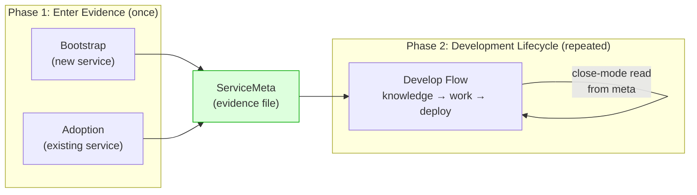
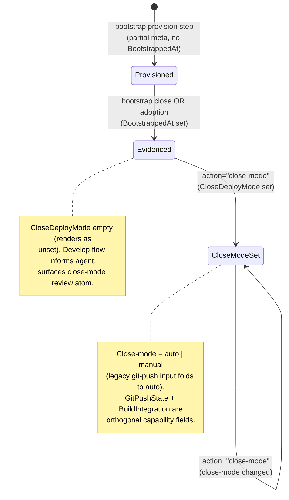
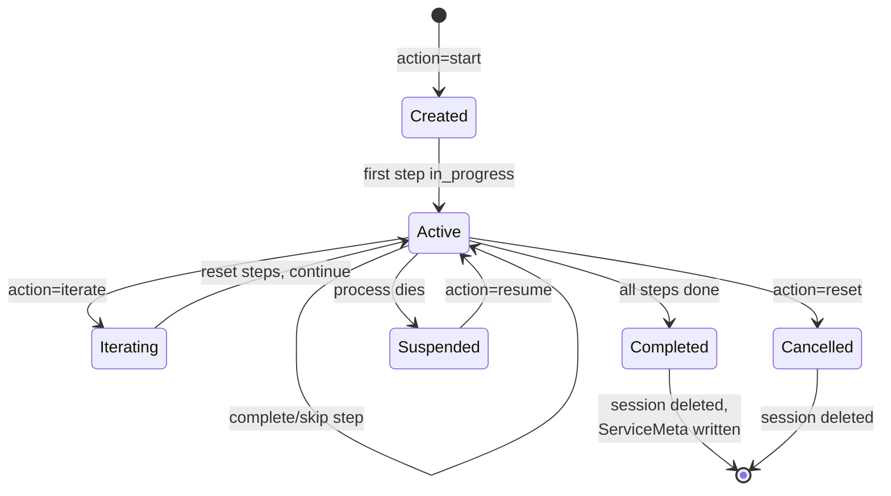
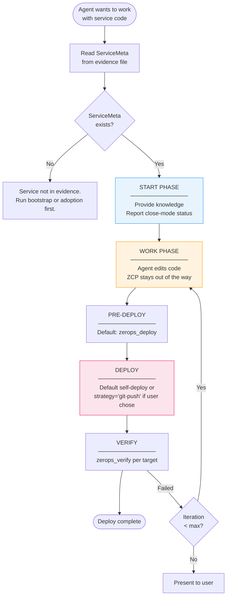

# ZCP Workflow Specification

> **Scope**: Bootstrap, adoption, close-mode + git-push capability + build-integration management (central deploy-config entries — `action="close-mode"`, `action="git-push-setup"`, `action="build-integration"`), develop, recipe, export — both container and local environments, all modes; plus the envelope/plan/atom pipeline that feeds every workflow-aware response.
> **Companion docs**:
> - `docs/spec-scenarios.md` — per-scenario acceptance walkthrough (S1–S13), pinned by `internal/workflow/scenarios_test.go`.
> - `docs/spec-work-session.md` — per-PID Work Session for develop.
> - `docs/spec-knowledge-distribution.md` — atom corpus authoring model (axes, priorities, placeholders).

---

## 1. Lifecycle Overview

### 1.1 Service Lifecycle — Two Phases

Every service on Zerops goes through two phases:



**Phase 1 — Infrastructure** (Option A since v8.100+): Bootstrap creates new services (or adoption registers existing ones) and writes an evidence file (ServiceMeta). Services come up with `startWithoutCode: true` so dev containers reach RUNNING with empty filesystems; managed dependencies reach RUNNING/ACTIVE. **No application code, no `zerops.yaml`, no first deploy.** Phase 1 answers: "are the services provisioned, mounted, and discoverable?"

**Phase 2 — Development**: Develop flow covers ALL code work on the service AND the first deploy — scaffold `zerops.yaml`, write the user's actual application, deploy, verify, iterate. CloseDeployMode + GitPushState + BuildIntegration are always read fresh from ServiceMeta; `develop-strategy-review` prompts the close-mode DECISION as soon as it is `unset` — even before the first deploy (B5), since the decision is deploy-state-independent and gates the whole session's auto-close.

**The boundary is strict**: Bootstrap stops at infrastructure provisioning. The moment any application code, `zerops.yaml`, or `zerops_deploy` is needed, it belongs to develop. If the user says "create me an app for uploading photos in Bun", bootstrap creates the Bun service + dependencies (empty containers); develop scaffolds `zerops.yaml`, implements the photo upload app, runs the first deploy, and stamps `FirstDeployedAt`.

### 1.2 Phase Enum — The Single State Variable

The lifecycle above is collapsed into a single typed `Phase` field carried in every `StateEnvelope` (see §1.6). Every tool response resolves to exactly one phase (the `Phase` Go enum in `internal/workflow/envelope.go`):

| Phase | Meaning | Set by |
|---|---|---|
| `idle` | No active workflow session for this PID. | Default; or after session closes. |
| `bootstrap-active` | A bootstrap session is in progress. | `zerops_workflow action=start workflow=bootstrap`. |
| `develop-active` | A per-PID Work Session is open. | `zerops_workflow action=start workflow=develop`. |
| `develop-closed-auto` | **Derived, not stamped**: every DECLARED scope service has a succeeded deploy + a passed verify that does not predate it (the auto-close gate passes; a redeploy re-opens verify). Transitional phase — awaits explicit close + next. | Computed by `DeriveCloseState`/`EvaluateAutoClose` at read time; never persisted to `ClosedAt`, so the gate cannot desync from what's displayed. |
| `strategy-setup` | Stateless synthesis phase (no session) emitted by `action="git-push-setup"` and `action="build-integration"` — delivers the env-scoped + capability-scoped setup atoms (`setup-git-push-{container,local}`, `setup-build-integration-{webhook,actions}`). | `zerops_workflow action="git-push-setup" service="..."` or `action="build-integration" service="..." integration="..."`. |
| `export-active` | Stateless immediate workflow returning export guidance. | `zerops_workflow action=start workflow=export`. |
| `launch-production-active` | Stateless multi-call narrowing for launch-production; the handler emits its own per-status guidance and `BuildPlan` returns an empty Plan (like `export-active`). | `zerops_workflow action=start workflow=launch-production`. |
| `pool-migrate-active` | Stateless multi-call narrowing that walks a part's dev service onto a dev pool (§13); the handler emits its own per-step guidance and `BuildPlan` returns an empty Plan. | `zerops_workflow workflow=pool-migrate service=<dev>`. |

Invariant: at most one non-idle **stateful** phase per PID at a time. `strategy-setup`/`export-active`/`launch-production-active`/`pool-migrate-active` are stateless — they synthesize guidance and return without touching session state, so they never conflict with an active bootstrap/develop session. (`recipe-active` is an atom phases-axis value, not a `Phase` constant — bootstrap's recipe route runs under `bootstrap-active`.)

`strategy-setup` replaces the retired `cicd-active` phase. Deploy configuration is now three orthogonal operations:
- `zerops_workflow action="close-mode" closeMode={hostname:auto|manual}` — declares the develop session's done-ness ownership; delivery is derived from `GitPushState` (§4.3). Drives auto-close gating + selects which `develop-close-mode-*` atoms fire. Legacy `git-push` input is accepted but folds to `auto`.
- `zerops_workflow action="git-push-setup" service="..." remoteUrl="..." gitToken="..."` (container) or `... remoteUrl="..."` (local) — **probe-first verifier**. The handler probes the supplied (remoteUrl, gitToken) pair against the remote BEFORE writing any PROJECT state — no remote ref, no secret, no origin sync, no meta write (inline session-env credential helper — the ephemeral-.netrc era is over, nothing touches disk). Container mode first self-heals the push source's LOCAL repo if needed (init-if-missing + set-if-absent identity + a HEAD guarantee — never a user-visible commit; git-contract fix §Git Lifecycle GLC-2/3) so the probe below is the real write-proof rather than its weaker read-only fallback; that local repair is best-effort and unconditional — it can happen even when the probe subsequently fails. On success: writes GIT_TOKEN as a SERVICE-scope var with the platform's `sensitive:true` flag on the push source (the 2026-08 userData model requires `sensitive` on every write — `spec-zerops-env-lifecycle.md` §1/§7), syncs `origin` + a url-scoped credential helper in the working tree's git config (the helper reads the live `$GIT_TOKEN` per invocation — fresh SSH sessions see a rotated value within seconds, NO restart involved), verifies a fresh session end-to-end, then stamps `meta.GitPushState=configured` + `meta.RemoteURL`. A re-call with the SAME canonical remote + a NEW gitToken is ROTATION intent (full probe → re-write → re-verify) — a vanished `/var/www/.git` on that path still triggers the non-destructive RECONSTRUCTION from the recorded remote, never the local self-heal, so the recorded history is never masked by a bare marker commit; token-less re-calls short-circuit after verifying the wiring exists (same reconstruction fallback). On probe failure: structured `GIT_TOKEN_INVALID`, no PROJECT state mutation (the local repo may already have been self-heal-repaired, independent of the failure). Local mode skips the token (uses local credential helper, no local self-heal); container mode requires HTTPS only (PAT auth; SCP-form SSH rejected). Pinned by `TestGitPushSetupContainer_*` (incl. `_SameRemoteNewToken_Rotates`, `_SessionAuthFails_NoStamp`, `_ReconstructsMissingGit`, `_EnsuresRepoHeadBeforeProbe`, `_RotationWithToken_MissingGitStillReconstructs`) + `TestGitPushSetupLocal_*`; the credential helper is owned by `internal/ops/git_credential.go`.
- `zerops_workflow action="build-integration" service="..." integration="webhook|actions"` — chooses the ZCP-managed CI shape (requires `GitPushState=configured`). Records the choice and emits the handoff (workflow YAML body + `gh secret set` commands for actions, dashboard URL for webhook); ZCP does NOT verify that the agent committed the workflow / set secrets / completed OAuth — `BuildIntegration=actions/webhook` means "this integration shape was wired", not "the build trigger is confirmed live".

The `Phase` enum is defined in `internal/workflow/envelope.go`.

### Why Infrastructure-First — The Foundational Principle

The two-phase separation (bootstrap infra → develop application + first deploy) is the foundational architectural decision of the workflow system. It applies to **ALL modes** — standard, dev, and simple — without exception.

**Fault isolation.** When bootstrap and application are separate, failures have unambiguous origin. If bootstrap fails, the problem is infrastructure — service config, import YAML shape, env-var discovery, managed-service initialization. If develop fails (during scaffolding, first deploy, or iteration), infrastructure is already proven (services reached RUNNING + env catalogue is complete). Without this separation, every failure requires diagnosing both layers simultaneously, which is exponentially harder for an AI agent.

**Universal deploy flow.** Develop's deploy → verify → iterate cadence is identical regardless of mode (standard dev/stage pairs, single dev container, simple single service). This universality makes the deployment flow stable and eliminates mode-specific edge cases.

**Reduced blast radius.** Bootstrap creates services with `startWithoutCode: true` so dev containers reach RUNNING with empty filesystems and managed services initialize cleanly. Bugs at this layer are config-only (wrong type, hostname collision, missing env). Once infra is proven, develop adds application complexity on a stable foundation.

**Faster iteration in develop.** Once bootstrap completes, develop knows that services exist, env vars resolve, managed services connect. Develop iterations focus purely on application logic + `zerops.yaml` shape — no re-verification of infrastructure plumbing.

This principle must never be bypassed. An agent that writes `zerops.yaml` or application code during bootstrap (even for simple mode) violates B7/B10 and loses all four benefits above.

### ServiceMeta — The Evidence File

ServiceMeta (`.zcp/state/services/{hostname}.json`) is the persistent evidence that a service is under ZCP management.

```
ServiceMeta {
  Hostname                 string           // service identifier
  Mode                     Mode             // standard | dev | simple | local-stage | local-only
  Stages                   []StageRef       // the pair's only stage list, each {hostname, setupName}: one per part of the app (standard / local-stage only; named explicitly on the plan target — no hostname-suffix derivation). A meta without stages (written before them, or by an older zcp that dropped them) reads its stageHostname/stageSetupName as Stages[0] with the same values; every write mirrors Stages[0] into those keys for an older zcp, and nothing else reads them (spec-mate §2.8a.4).
  CloseDeployMode          CloseDeployMode  // unset | auto | manual (legacy git-push folds to auto)
  CloseDeployModeConfirmed bool             // true after user explicitly confirms/sets close-mode
  GitPushState             GitPushState     // unconfigured | configured | broken (git-push capability, orthogonal to close-mode)
  RemoteURL                string           // configured git remote (set when GitPushState=configured)
  BuildIntegration         BuildIntegration // none | webhook | actions (ZCP-managed CI shape, requires GitPushState=configured)
  BootstrapSession         string           // session ID that created this; EMPTY for adoption
  BootstrappedAt           string           // date — empty = incomplete (bootstrap in progress)
  FirstDeployedAt          string           // stamped on first real deploy (session, or local adoption of a stage with deployed code)
}
```

The three axis-bearing fields (`Mode`, `CloseDeployMode`,
`GitPushState`/`BuildIntegration`) are typed Go enums living in
`internal/topology/`. They're orthogonal as RECORDS, but `CloseDeployMode` owns done-ness
ownership while `GitPushState` owns the delivery mechanism: once
`GitPushState=configured`, push is the terminal act of development for
every close-mode except `manual` (the legacy `git-push` close-mode value
folds to `auto` at parse — see §4.3). `Environment` is not persisted: environment is a property of
the currently running ZCP process (runtime-detected), not of a service.

**`BootstrapSession == ""` convention.** Empty (JSON-wise: empty string, not
null) is the adoption marker. Fresh bootstraps set this to the 16-hex
session ID; adoption path writes it as empty. `IsAdopted()` disambiguates
adopted metas from orphan incomplete metas (which also carry an empty
session ID) by requiring `BootstrappedAt` to be set: an adopted meta is
always complete, an orphan never is.



`IsComplete()` returns true when `BootstrappedAt` is set.
`IsAdopted()` returns true when `BootstrapSession` is empty AND the meta
`IsComplete()`. CloseDeployMode + GitPushState + BuildIntegration are
always read from meta at the moment they're needed — never copied into
session state.

### Principles

- **Workflow is NOT a gate.** An agent does not need to start a workflow to call `zerops_scale`, `zerops_manage`, or any other direct tool. Workflows add structure for multi-step operations.
- **Strategy never blocks work.** Agent can always start editing code. Strategy is resolved before deploying, not before working.
- **Tools work independently.** `zerops_discover`, `zerops_verify`, `zerops_knowledge` work without any active workflow.

### 1.3 Delivery Pipeline — Envelope → Plan → Atoms

Every workflow-aware tool response is produced by the same three-stage pipeline, not by ad-hoc guidance assembly.

```
          ┌───────────────┐      ┌────────────┐      ┌──────────────┐
          │ ComputeEnvelope│──▶──▶│ BuildPlan  │      │  Synthesize  │
          │ (state + live  │      │ (Primary,  │  ┌──▶│  (atom filter│
          │  API + session)│      │  Secondary,│  │   │  + compose)  │
          └───────────────┘      │  Alts)     │  │   └──────────────┘
                 │               └────────────┘  │         ▲
                 │                    │          │         │
                 │                    └────────┬─┘         │
                 ▼                             ▼           │
          StateEnvelope  ──────▶──────▶──────▶─┴─── LoadAtomCorpus
                                                     (//go:embed atoms/*.md)
                                 │
                                 ▼
                         ┌────────────────┐
                         │  RenderStatus  │
                         │  (markdown UI) │
                         └────────────────┘
```

**Stage 1 — `ComputeEnvelope`** (`internal/workflow/compute_envelope.go`): the single entry point for state gathering. Reads services from the platform API, service metas from `.zcp/state/services/`, bootstrap session state, the current Work Session, and runtime detection — merging them into a `StateEnvelope`. Called by every workflow-aware tool handler. I/O is parallelised so a tool response pays one round-trip for the envelope regardless of how many state sources are involved.

**Stage 2 — `BuildPlan`** (`internal/workflow/build_plan.go`): a pure function `Plan = BuildPlan(env)`. Deterministic — no I/O, no randomness — so the plan can be reproduced verbatim after LLM context compaction from the same envelope. Branching is a fixed nine-case switch driven by `env.Phase` plus envelope shape (see §1.4).

**Stage 3 — `Synthesize`** (`internal/workflow/synthesize.go`): pure function `guidance = Synthesize(env, corpus)`. Loads the atom corpus once (`LoadAtomCorpus`), filters by axis-match against the envelope, sorts by priority + id, substitutes placeholders from the envelope, and returns the composed bodies. Same compaction-safety invariant: byte-identical output for byte-equal envelopes.

**Stage 4 — `RenderStatus`** (`internal/workflow/render.go`): consumes a `Response{Envelope, Guidance, Plan}` and emits the markdown status block shown to the LLM. The Next section renders the typed `Plan` with priority markers — no free-form Next string, no ad-hoc branching in the renderer.

### 1.4 Plan — Typed Next Action

The Plan is the single source of truth for "what should the agent do next". Every workflow-aware response carries one.

```go
type Plan struct {
    Primary      NextAction            // never zero — if we don't know, we error out upstream
    PerService   map[string]NextAction // one action per still-pending develop-active scope service; rendered only when len > 1
    Secondary    *NextAction           // set only when a second action is commonly done in tandem
    Alternatives []NextAction          // genuinely alternative paths
}
```

Dispatch (strict order, first match wins — see `build_plan.go` for the code):

1. `PhaseDevelopClosed` → Primary=close-session, Secondary=start-next.
2. `PhaseDevelopActive`, some service without a successful deploy (including last-attempt-failed) → Primary=deploy.
3. `PhaseDevelopActive`, deploy done but verify missing (including last-verify-failed) → Primary=verify.
4. `PhaseDevelopActive`, everything green but session still open → Primary=close.
5. `PhaseBootstrapActive` → Primary=continue-bootstrap (route-specific; the recipe route runs here too — there is no separate recipe phase).
6. `PhaseIdle` with no services → Primary=start-bootstrap; with Swarm pools as its only runtimes → Primary=`zerops_lease action="acquire"` of them + alternative add-more-services (§8 DP-29).
7. `PhaseIdle` with bootstrapped services → Primary=start-develop + alternatives (adopt if any unmanaged, add-more-services always).
8. `PhaseIdle` with only unmanaged runtimes → Primary=adopt-via-develop.

`PhaseStrategySetup` / `PhaseExportActive` / `PhaseLaunchProductionActive` fall through to an empty Plan — those handlers emit their own guidance directly.

Failed-last-attempt cases fold into branches 2 and 3 — `needsDeploy` / `needsVerify` both key off `!attempts[last].Success`, so a failed service surfaces as a deploy or verify target. Iteration-tier guidance (diagnose / systematic-check / STOP) rides along via atoms, not a distinct Plan branch.

Gate semantics in the Plan are informational, not structural: e.g. `CloseDeployMode=unset` does not block the Plan from naming a deploy action. The first deploy always uses the default self-deploy mechanism regardless of close-mode; the `develop-strategy-review` atom (`phases: [develop-active]`, `closeDeployModes: [unset]`) prompts the agent to set a close-mode whenever it is unset — including before the first deploy (B5: the prior `deployStates: [deployed]` axis locked the DECISION out of exactly the moment the briefing asks for it). The head also surfaces a `DECISION required: close-mode unset` line so the gate's third input is reachable, not buried. This keeps `BuildPlan` a pure dispatch over envelope shape.

### 1.5 Atom Corpus — Orthogonal Knowledge Matrix

Runtime-dependent guidance lives as ~113 atoms under `internal/content/atoms/*.md`, embedded via `//go:embed`. Each atom has YAML frontmatter declaring its `AxisVector` and a markdown body.

```yaml
---
id: develop-dynamic-runtime-start-container
priority: 3
phases: [develop-active]
runtimes: [dynamic]
environments: [container]
modes: [dev, standard]
title: "Dynamic runtime — start dev server via zerops_dev_server (container)"
---

After a dev-mode dynamic-runtime deploy the container runs `zsc noop`. Start
the dev server via the canonical primitive:
    zerops_dev_server action=start hostname={hostname} command="{start-command}" port={port} healthPath="{path}"
```

Atom bodies are authored elsewhere — this spec references them as
authoritative, not as content copied inline. See
`internal/content/atoms/develop-dynamic-runtime-start-container.md` for
the full prescription.

**Axes** (the knowledge-variation dimensions):

| Axis | Values | Emptiness semantic |
|---|---|---|
| `phases` | `idle`, `bootstrap-active`, `develop-active`, `develop-closed-auto`, `recipe-active`, `strategy-setup`, `export-active`, `launch-production-active`, `pool-migrate-active` | MUST be non-empty. |
| `modes` | `dev`, `stage`, `simple`, `standard`, `local-stage`, `local-only` | Empty = any mode. |
| `environments` | `container`, `local` | Empty = either. |
| `closeDeployModes` | `unset`, `auto`, `manual` | Empty = any close-mode. |
| `gitPushStates` | `unconfigured`, `configured`, `broken` | Empty = any git-push capability state. |
| `buildIntegrations` | `none`, `webhook`, `actions` | Empty = any build integration. |
| `runtimes` | `dynamic`, `static`, `implicit-webserver`, `managed`, `unknown` | Empty = any runtime. |
| `routes` | `recipe`, `classic`, `adopt`, `resume` | Bootstrap-only. Empty = any route. |
| `steps` | bootstrap step names | Bootstrap-only. Empty = any step. |

**Synthesizer contract**:

1. Filter: an atom matches iff every non-empty axis permits the envelope. Service-scoped axes (`modes`/`closeDeployModes`/`gitPushStates`/`buildIntegrations`/`runtimes`) match if *any* service in `env.Services` matches.
2. Sort: priority ascending (1 first), then id lexicographically.
3. Substitute: `{hostname}`, `{stage-hostname}`, `{project-name}` are replaced from the envelope; a whitelist of agent-filled placeholders (`{start-command}`, `{port}`, …) survives untouched. Any unknown `{word}` token is a build-time error.
4. Return: ordered list of rendered bodies.

**Compaction-safety invariant**: for byte-equal envelopes, `Synthesize` MUST return byte-identical output. No map iteration, no timestamps, no randomness leaks into the body.

### 1.6 StateEnvelope — Live Data Contract

`StateEnvelope` is the single typed data structure passed between stages. It is attached verbatim to every workflow-aware tool response, so the LLM can reconstruct state post-compaction.

| Field | Purpose |
|---|---|
| `Phase` | The phase enum from §1.2. Drives atom filtering and plan dispatch. |
| `Environment` | `container` or `local`. Driven by `runtime.Info.InContainer`. |
| `IdleScenario` | Discriminates the `PhaseIdle` sub-cases (`empty` / `bootstrapped` / `adopt` / `incomplete` / `dev-pool` / `orphan`) so atoms filter on the `idleScenarios` axis; `dev-pool` is a project whose only runtimes are Swarm pools (§8 DP-29). |
| `ExportStatus` | Discriminates the `PhaseExportActive` sub-states (`topology.ExportStatus`) so atoms filter on the `exportStatus` axis. |
| `SelfService` | Hostname of the ZCP control-plane container (container env only). |
| `Project` | `{ID, Name}` — project identity. |
| `Services[]` | Sorted snapshots: hostname, type+version, runtime class, status, bootstrapped flag, mode, closeDeployMode, gitPushState, buildIntegration, stage pair. |
| `WorkSession` | Open develop session summary: intent, scope, deploy/verify attempts, close state. `nil` outside develop. |
| `Bootstrap` | Bootstrap session summary: route, step, iteration. `nil` outside bootstrap-active. |
| `Generated` | Timestamp for the envelope (diagnostics only — not part of synthesis input). |

Slices sort by hostname; attempt lists sort by time; maps use key-sorted encoding. The JSON form is deterministic, which is what makes §1.3's compaction-safety invariant provable.

Full field-level Go definitions live in `internal/workflow/envelope.go`.

---

## 2. Bootstrap Flow

Bootstrap creates a new service on Zerops and writes the evidence file. That is its only job — it does NOT set close-mode or any deploy-config fields.

```mermaid
flowchart TD
    Start([Agent triggers bootstrap]) --> Discovery["Discovery call<br/>action=start workflow=bootstrap<br/>(no route yet)"]
    Discovery --> Options{routeOptions[]}
    Options -->|resume| Commit
    Options -->|adopt| Commit
    Options -->|recipe + slug| Commit
    Options -->|classic| Commit
    Commit["Commit call<br/>action=start workflow=bootstrap route=<chosen><br/>(engine writes session)"] --> CreateSession
    CreateSession["Create session<br/>Generate 16-hex ID<br/>Register in registry"] --> Discover

    subgraph Bootstrap ["Bootstrap Flow (3 steps — Option A: infra only)"]
        direction TB
        Discover["1. DISCOVER<br/>─────────────<br/>Classify services<br/>Identify stack<br/>Choose mode<br/>Submit plan"]

        Provision["2. PROVISION<br/>─────────────<br/>Generate import.yaml<br/>Create services<br/>Mount dev filesystems<br/>Discover env vars"]

        Close["3. CLOSE<br/>─────────────<br/>Verify services RUNNING<br/>Write ServiceMeta<br/>Append reflog<br/>Hand off to develop"]
    end

    Discover -->|"plan submitted"| Provision
    Provision -->|"services created"| Close

    Provision -->|"failed"| HardStop["HARD STOP<br/>(bootstrap never iterates;<br/>escalate to user)"]

    Close --> Complete

    Complete([Bootstrap Complete<br/>ServiceMeta BootstrappedAt set<br/>FirstDeployedAt empty — develop owns first deploy])

    style Discover fill:#e8f4fd,stroke:#2196F3
    style Provision fill:#e8f4fd,stroke:#2196F3
    style Close fill:#e8f4fd,stroke:#2196F3
    style HardStop fill:#fce4ec,stroke:#E91E63
```

**Option A (since v8.100+)** — bootstrap is infrastructure only. No
application code, no deploy. Develop owns the entire code-and-deploy
continuum including the first deploy (see `develop-first-deploy-*` atoms
and the `deployStates: [never-deployed]` branch). Bootstrap never
iterates; retry on provision failure hard-stops and escalates to the
user because re-running infra provisioning without human judgment
almost never recovers (stuck metas, conflicting imports).

### 2.0 Route Discovery (first-call split)

Starting a bootstrap is a two-call flow. The first call omits `route`
and returns a ranked `routeOptions[]` list without committing a
session; the second call supplies `route=...` (and `recipeSlug=...`
when `route=recipe`) to commit the session.

```
# 1. Discovery — no session committed
zerops_workflow action="start" workflow="bootstrap" intent="<one sentence>"
→ BootstrapDiscoveryResponse { routeOptions: [...], message: "..." }

# 2. Commit — engine locks in the chosen route
zerops_workflow action="start" workflow="bootstrap" route="recipe" recipeSlug="laravel-minimal"
→ BootstrapResponse { sessionId, progress, current, ... }
```

**Ranking**: `resume` > `adopt` > `recipe` (top `MaxRecipeOptions` above
`MinRecipeConfidence`) > `classic`. `classic` is always present as the
last option — it's the explicit override for "none of the above".

**Route semantics at commit**:

| Route     | When it's offered                                                                | Commit requires             |
|-----------|----------------------------------------------------------------------------------|-----------------------------|
| `resume`  | An incomplete `ServiceMeta` is tagged to a prior session                         | `sessionId` from discovery  |
| `adopt`   | Runtime services exist without complete `ServiceMeta` (and no resumable session) | —                           |
| `recipe`  | Intent scores ≥ `MinRecipeConfidence` against a recipe corpus match              | `recipeSlug`                |
| `classic` | Always                                                                            | —                           |

**Collision annotation**: `recipe` options carry a `collisions[]` list
of hostnames that the recipe's import YAML would clash with in the
current project. Advisory only — provision still catches the conflict
— but the LLM uses it as a pre-flight gate.

**Forcing a route**: A caller that has already decided (e.g. from a
prior discovery round, from a direct user instruction, or from an
internal auto-adoption helper) skips discovery by passing `route=`
on the first call. The engine commits the session immediately.

See `internal/workflow/route.go` for the discriminator implementation
(`BuildBootstrapRouteOptions`) and `internal/workflow/engine.go` for
the commit path (`BootstrapDiscover`, `BootstrapStartWithRoute`,
`BootstrapStart` as the classic-default wrapper).

### 2.1 Session Lifecycle



**Create**: `zerops_workflow action="start" workflow="bootstrap" intent="..."`
- Generates 16-hex session ID, registers in registry with PID.
- Sets step 0 (discover) to `in_progress`.
- Returns available stack catalog from live API.

**Progress**: `action="complete" step="{name}" attestation="..."` (min 10 chars).
- Optional checker validates before allowing completion. Failure → step stays, agent gets details.

**Skip**: `action="skip" step="{name}" reason="..."`.
- `discover` and `provision`: NEVER skippable.
- `close`: skippable only when the plan has no runtime targets
  (managed-only) OR every runtime target has `IsExisting=true`
  (pure-adoption). See §2.6.

**Iterate**: Bootstrap never iterates under Option A. Provision failure
is a hard stop — retrying the same infra-create call without user
intervention almost never recovers (stuck metas, conflicting imports).
`action="iterate"` on an active bootstrap session surfaces the hard-stop
message and closes the work session with `CloseReason=iteration-cap` so
the LLM stops retrying and reports to the user. Only recipe/develop flows
iterate (the `develop` 3-tier deploy ladder caps at 5 attempts).

**Resume**: `action="resume" sessionId="..."` takes over dead session
(PID check). Continues from current step. Also surfaced as
`route="resume"` in the discovery response when an incomplete
`ServiceMeta` is tagged to a prior session.

### 2.2 Exclusivity

Per-service, not global. Multiple bootstraps coexist for different services. Same-hostname lock: incomplete ServiceMeta from alive session blocks new bootstrap for that hostname. Dead PID → auto-unlock.

### 2.3 Step 1: Discover

**Purpose**: Classify services, identify stack, choose mode, submit plan.

**Procedure**:
1. `zerops_discover` — see existing services.
2. Identify runtime + dependencies from user intent.
3. Validate types against `availableStacks`.
4. Choose mode — `bootstrapMode` is required on every runtime target; there is
   no silent default (`validate.go` rejects an empty mode). Recommended:
   - **Standard** (recommended default): `{name}dev` + `{name}stage` + managed.
   - **Simple**: `{name}` + managed — only when the user asks for one service.
   - **Dev**: `{name}dev` + managed — only for an explicit scratch space with no
     durable end state.
5. Present plan to user, get confirmation.
6. Submit: `action="complete" step="discover" plan=[...]`

**Plan structure**:
```
ServicePlan {
  Targets: [{
    Runtime: {
      DevHostname    string  // a-z0-9, max 25 chars
      Type           string  // validated against live catalog
      IsExisting     bool    // true = adoption path (see §3)
      BootstrapMode  string  // "standard" | "dev" | "simple" (required; no default)
      PublicAccess   string  // "auto" | "subdomain" | "none" (empty → auto; §8 O3 PA-6)
      ExplicitStage  string  // optional stage hostname override
    },
    Dependencies: [{
      Hostname    string
      Type        string  // managed HA is a TYPE VARIANT (e.g. postgresql:ha@16 / postgresql:single@16)
      Mode        string  // legacy backward-compat only: a bare type (postgresql@16) with no variant defaults to NON_HA; dropped when the type carries a variant (resolveManagedDepMode — "variant authoritative")
      Resolution  string  // "CREATE" | "EXISTS" | "SHARED"
    }]
  }]
}
```

**Local Storage dependency contract.** A Local Storage dependency uses the
exact catalog type `local-storage:single@1`. It is managed infrastructure and
single-only: no `:ha` promotion, legacy `mode:`, database profile, horizontal
container policy, or generated `${host_*}` connection environment is inferred.
Application access is declared in the consumer runtime's `zerops.yaml` through
`run.volume.hostname: <local-storage-hostname>` (with the schema-defined mount
path/read-only fields). That volume hostname is a real managed dependency
reference for reachability and export/launch analysis.

**Validation**: Hostnames `[a-z0-9]` max 25 chars. Standard mode: explicit stages required on the plan target — `stageHostname` (+ `stageSetupName`) for a one-stage pair, or `stages: [{hostname, setupName}]` for a pair with several, never both; no hostname-suffix derivation (since Release B.4). Stage hostnames are unique within the pair and distinct from its dev half; a runtime hostname planned twice is refused. A recipe plan pairs every stage-role runtime of the dev half's repository into that one pair. A stage's recorded setup must exist in zerops.yaml: a deploy whose recorded setup the yaml lacks returns `requiresSetupInput` naming it. Types against live catalog. Resolution: CREATE = must not exist, EXISTS = must exist, SHARED = another target creates it. Hostname lock check. Errors accumulated (all reported at once).

### 2.4 Step 2: Provision

**Purpose**: Create infrastructure, mount filesystems, discover env vars.

**Procedure**:
1. Generate import.yaml → `zerops_import` (blocks until all processes complete).
2. `zerops_discover` — verify services exist.
3. Mount: container = `zerops_mount` per dev runtime at `/var/www/{hostname}/`. Local = none.
4. `zerops_discover includeEnvs=true` — discover env var NAMES only.

**Env var security model**:
- `includeEnvs=true` returns keys and annotations only — SAFE by default.
- `includeEnvValues=true` opt-in exposes actual values — for troubleshooting only. A value the platform holds `sensitive:true` is never shown (masked, key annotated `isSensitive`).
- Session stores NAMES ONLY — never values.
- Agent uses `${hostname_varName}` references — resolved at container level.

**import.yaml by mode**:

| Property | Dev service | Stage service | Simple service |
|----------|-----------|---------------|----------------|
| `startWithoutCode` | `true` | omit | `true` |
| `maxContainers` | `1` | omit | omit |
| `enableSubdomainAccess` | `true` | `true` | `true` |

**Expected states**: dev → RUNNING, stage → READY_TO_DEPLOY, managed → RUNNING/ACTIVE.

**On completion (container env)** — `action="complete" step="provision"` triggers `autoMountTargets` (`internal/tools/workflow_bootstrap.go`) which runs per runtime target in `plan.Targets`:

1. `ops.MountService` — SSHFS mount base from ZCP host at `/var/www/{hostname}/`.
2. `ops.InitServiceGit` — SSH-exec `git init` + set-if-absent identity + HEAD guarantee inside the target container at `/var/www/.git/` (GLC-1). This is the canonical `.git/` creation: runs once per service, owned by `zerops:zerops`, identity defaults to `agent@zerops.io` / `Zerops Agent` when none is already set. Errors are logged but do not mark the mount FAILED — the deploy path's safety-net (GLC-2) re-heals on demand if this step hiccups.

Mount + InitServiceGit are skipped entirely in local env (`mounter == nil`, `sshDeployer == nil`) — local working dirs are the user's own git territory (GLC-6).

**On completion (both envs)**: Writes partial ServiceMeta (no BootstrappedAt) — signals bootstrap in-progress, provides hostname lock.

**Checker**: All services exist, types match, and statuses are correct.
Connection-oriented managed dependencies must expose their environment
variables; object/shared/Local Storage do not. Local Storage readiness never
waits for database-style connection envs. The type check compares families,
not concrete versions: the platform sets the service type from the repo's
`zerops.yaml` `run.base` at the first build, so a same-family/different-version
live type passes with a resolution note; a different family fails.

### 2.5 Step 3: Close

**Purpose**: Write final evidence file. Bootstrap is done.

**On completion** (Active→false):
1. Write final ServiceMeta per runtime target:
   - `BootstrappedAt` = today's date
   - `CloseDeployMode` = **empty** (NEVER set during bootstrap; renders as `unset`)
   - `GitPushState` = **empty** (renders as `unconfigured`)
   - `BuildIntegration` = **empty** (renders as `none`)
   - Container: hostname = devHostname
   - Local + standard: hostname = stageHostname (inverted)
2. Append reflog to AGENTS.md (cross-tool canonical; Claude pulls it
   via the @AGENTS.md include in CLAUDE.md; Codex / Cursor / Gemini /
   Antigravity read AGENTS.md natively).
3. Delete session, unregister.
4. Return completion message: service list with modes. NO close-mode prompt.

**Bootstrap is done. Services are provisioned (managed = RUNNING,
runtimes = bootstrapped but not-yet-deployed), ServiceMeta written with
BootstrappedAt. No application code written, nothing deployed.**

**Natural transition**: Under Option A the next step is always
`workflow="develop"`. Develop owns all code + the first deploy. Runtimes
entering develop with empty `FirstDeployedAt` trigger the first-deploy
branch (`deployStates: [never-deployed]` atoms) — scaffold
`zerops.yaml`, write code, deploy, verify, stamp `FirstDeployedAt`.

### 2.6 Fast Paths — Managed-Only and Pure-Adoption

`validateSkip` allows `close` to be skipped in either of two shapes:

1. **Managed-only** — the plan has no runtime targets (`len(Targets)==0`).
   No runtime ServiceMeta to write (managed services are API-authoritative).
2. **Pure-adoption** — every runtime target in the plan has
   `IsExisting=true` (`plan.IsAllExisting()`). ServiceMeta for adopted
   services is written inline from the provision step (see §3.2).

In both shapes the bootstrap walks discover → provision → SKIP close.
Mixed plans (some new runtime targets + some adopted) walk the full
flow and write close normally.

### 2.7 Mode Behavior Matrix

| Aspect | Standard | Dev | Simple |
|--------|----------|-----|--------|
| Services | `{name}dev` + `{name}stage` + managed | `{name}dev` + managed | `{name}` + managed |
| Mounts (container) | dev only | dev only | service |
| zerops.yaml start (dev) | `zsc noop --silent` | `zsc noop --silent` | real command |
| zerops.yaml start (stage) | real command | N/A | N/A |
| healthCheck | none (dev) / required (stage) | none | required |
| deployFiles | `[.]` (dev) / build output (stage) | `[.]` | `[.]` |
| Server start (container) | SSH manual (dev) / auto (stage) | SSH manual | auto |
| Deploy sequence | dev → verify → stage → verify | dev → verify | deploy → verify |
| Subdomain enable | auto (deploy handler, first deploy) | auto | auto |
| PHP runtimes | omit `start:` entirely | omit `start:` | omit `start:` |

---

## 3. Adoption Flow

Adoption registers an existing unmanaged service into ZCP management. The outcome is the same as bootstrap: a ServiceMeta with mode and BootstrappedAt.

### 3.1 When Adoption Applies

- Project has runtime services with `managedByZCP=false` (no complete ServiceMeta).
- Init instructions label these as "needs ZCP adoption."
- `zerops_workflow action="route"` offers adoption.

### 3.2 What Happens

Adoption is a simplified process:

1. **Discover**: the agent names the services to adopt in `scope`, and zcp derives the plan from live services (`BootstrapCompleteAdoptPlan`): every scoped runtime an independent `dev` target, every managed service a shared `EXISTS` dependency. zcp never guesses a dev/stage pairing from hostnames or types: a dev/stage pair is the agent's classification, submitted as an explicit plan (`bootstrapMode: standard` with `stageHostname`/`stages`), so a stage is never recorded as a dev service of its own outside its pair (§8 E8). When any two scoped runtimes left for that derivation share a runtime base — compared in canonical bare form, so `ubuntu/<rt>` + `alpine/<rt>` match and different versions do not — the call is refused with `ErrAdoptPairingChoice` (subcode `AMBIGUOUS_SCOPE`), whatever the count, carrying a pairs and an independent-devs plan template covering every scoped runtime, and nothing is committed. A variant-B pair (docs/spec-mate.md §2.8a.4a) is derived with its stages before that question, since no plan records one; a refusal beside it names the scope that adopts it alone. The discover warning steers adoptables sharing a stack to the plan by the same comparison, naming the code-volume exception when the project holds a local-storage service (`TestBootstrapCompleteAdoptPlan_TwoSameType_RefusesWithTemplates`, `TestBootstrapCompleteAdoptPlan_SeveralRuntimesSharingABase_RefusesWithTemplates`, `TestBootstrapCompleteAdoptPlan_VariantBBesideAPairingQuestion_NamesThePairScopeOnly`, `TestEnrichWithMetaStatus_SameStackBesideALocalStorageService_NamesTheCodeVolumeException`).
2. **Verify**: Confirm the service is running and healthy (`zerops_verify`).
3. **Write evidence**: Create ServiceMeta with:
   - Hostname, Mode, Stages (if standard)
   - `BootstrapSession` = empty (not created by bootstrap — the
     adoption marker; combined with `IsComplete()` this makes
     `IsAdopted()` return true, see §1.1 and invariant E7)
   - `BootstrappedAt` = today's date
   - `CloseDeployMode` = empty (renders as `unset`)

No import, no code generation, no deploy. The service already exists and runs.

### 3.3 Mixed Adoption + New

When the user wants to adopt existing services AND create new ones, this goes through bootstrap (§2) with `isExisting: true` on adopted targets. Each target follows its path:
- New targets: full 3-step bootstrap (discover, provision, close)
- Existing targets: ServiceMeta written inline by the provision step

**Pure-adoption fast path**: When *every* runtime target in the plan has
`IsExisting=true`, bootstrap routes through the fast path in §2.6 — the
`close` step is skipped because adoption writes ServiceMeta from
provision directly. Mixed plans (any new runtime target) walk the full
three-step flow and complete close normally.

### 3.4 Outcome

ServiceMeta identical in structure to bootstrap output. The service is now "managed by ZCP" and can enter develop flow.

### 3.5 Live activity awareness — direct reads, the full live-op set, and the wait primitive

A service's resting status cannot distinguish "idle" from "a build/deploy is
running right now": a first `buildFromGit` deploy reads `READY_TO_DEPLOY` (or
`NEW`) the entire time it builds (live-verified). So discover surfaces a
per-service `activity` LIST + a project-level "look + wait" steer, adopt
hard-gates on it, and `zerops_process action="wait"` blocks until the work drains.

- **Sourced from the DIRECT (non-ES) reads, not the search.** Discover's service
  list — and the lifecycle envelope's, and the route action's — comes from
  `ListServicesDirect` (GET `/project/{id}/service-stack`), the only list whose
  active app version names its source, so a runtime imported `startWithoutCode`
  (ACTIVE, holding a source-`NONE` placeholder) reads `deployed: false` there; and
  `ops.ProjectActivity`'s processes from `GetProjectProcessesDirect` (GET
  `/project/{id}/process`). The Elasticsearch searches (`ListServices`,
  `SearchProcesses`, `SearchAppVersions`) trail the DB after an import (seconds,
  load-dependent), so an agent arriving mid-import would otherwise see an "empty
  project". The direct reads reflect creation-time state immediately
  (live-verified: service + its in-flight process visible at ~creation). The ES
  searches stay for the history/timeline (`ops.Events`) and resolve/poll callers.
- **"Busy" = a live process referencing the service** — status `PENDING`,
  `RUNNING`, `ROLLBACKING`, or `CANCELING` (`ops.IsProcessLive`, the SDK's
  non-terminal set). The process is the SOLE busy-truth; it always carries a
  cancelable `processId`. The embedded `process.appVersion` phase
  (`BUILDING`/`DEPLOYING`) only refines the build/deploy LABEL of an already-busy
  build process — it never makes a service busy on its own (a stuck `BUILDING`
  whose build container died has no process to cancel; gating on it would
  deadlock the gate).
- **The full live-op SET, not a single representative** (`ops.ProjectActivity`
  returns `map[string][]LiveOp`; `ServiceInfo.Activity []LiveOp`). A service
  genuinely runs several ops at once — a buildFromGit import enqueues
  `stack.build` AND `stack.enableSubdomainAccess` together, the subdomain toggle
  sitting `PENDING` queued behind the build for its whole duration (live-verified
  eval 2026-06-30). Collapsing them to one by timestamp hid the substantive build
  behind the co-triggered toggle (the empty-project / mid-build mis-steer). The
  list reports ALL live ops, so no operation-type heuristic decides what to
  surface — an unknown future op is reported identically. Ordered newest-first
  (presentation only; lossless). `ops.ProjectActivity` is the single owner, read
  by the discover steer, the adopt gate, AND the wait primitive.
- **The wait primitive** (`zerops_process action="wait"`, `ops.WaitServiceSettled`
  / `ops.WaitProcesses`) — the agent reasons from the statuses and BLOCKS rather
  than re-polling itself. It waits a FIXED set of processes (resolved once), not a
  drain-loop: because the direct read surfaces every concurrent op at-creation
  (build + the subdomain-enable queued behind it + create), the set is already
  complete — there is nothing to "catch later", and not re-polling for new ops
  keeps the wait deterministic and immune to unrelated churn (an autoscale, a
  crash-restart loop) that a drain-to-empty would hang on.
  - `service=<hostname>` resolves the service's currently-live process set once
    (freshly, server-side) and waits exactly that — hostname-grain sugar so the
    agent need not thread process IDs. The "wait until ready" form.
  - `processId` / `processIds` wait the given process(es) to terminal.
  - Reuses `PollProcess` (the documented progress/response race-avoidance holds);
    progress is wired via `buildProgressCallback` to keep the MCP connection alive
    across the long poll. Bounded by a 15-min total budget — a timeout returns a
    soft `WaitResult{TimedOut:true}` (NOT an error; re-call or re-discover), and a
    FAILED op settles with the failure flagged in the message (so "done waiting"
    is never misread as "succeeded"; a service whose newest process already FAILED
    before the wait is flagged too).
- **Discover (read-only):** `ServiceInfo.Activity` (the list) is attached to every
  busy service. When ANY service is busy, discover prepends ONE project-level
  live-activity note naming each busy service's full op list (action/status/
  processId per op) — "the project is mid-change: don't treat these as idle/done,
  don't adopt or deploy onto one mid-operation; block until done with
  `zerops_process action=\"wait\" service=<host>`, then re-run discover; cancel a
  stuck one with `zerops_process`". Idle adoptables still get the "adopt now"
  warning. Discover stays `ReadOnly`/`Idempotent`; it never polls.
- **Adopt gate:** `handleBootstrapComplete` refuses route=adopt when any resolved
  target (scope ∪ plan dev+stage hostnames) has a live op, returning
  `ADOPT_TARGET_BUSY` naming each still-live op + the wait/cancel escape. Each op
  is freshened via `GetProcess` (by-id, direct) before refusing — a host drops out
  of busy once ALL its ops freshen terminal, so a stale row cannot deadlock the
  gate; an activity-fetch error fails open. No meta is written on refusal.
- **Never busy ⇒ never gated:** terminal/failed/queued states (`FAILED`,
  `BUILD_FAILED`, `ACTIVE`, and the <1s fast-fail's `FAILED` process + frozen
  `WAITING_TO_BUILD`) are not busy, so adoption + corrective deploy after a
  failure are never gated.

Pinned by `TestProjectActivity`, `TestProjectActivity_MultipleConcurrentOps`,
`TestWaitServiceSettled_*` / `TestWaitProcesses_*`, `TestProcessTool_Wait*`,
`TestAdoptGate_*`, e2e `TestInFlightActivity_*` + `TestInFlightWait_DrainsServiceToSettled`.

---

## 4. Develop Flow

Develop flow is the **development lifecycle** for any service under ZCP management. It is the MANDATORY wrapper for any code work on runtime services — implementing features, fixing bugs, changing config. No code change should happen outside of this flow.



### 4.1 When Develop Flow Starts

Develop flow MUST start for ANY work on runtime service code:

- **After bootstrap**: Service is RUNNING with an empty filesystem — develop flow scaffolds `zerops.yaml`, writes the user's application, and runs the first deploy
- **Implementing features**: User said "add photo upload" → develop flow
- **Bug fixes**: "Login doesn't work" → develop flow
- **Config changes**: "Change the port" → develop flow
- **Any code modification**: If it touches a runtime service's files → develop flow

Develop flow discovers what code (if any) exists on the service via `zerops_discover` + SSH inspection and acts accordingly. Bootstrap created infrastructure; develop flow owns code, the first deploy, iteration, and close-mode setup.

**Agent MUST NOT** edit runtime service code outside of develop flow. The flow ensures the agent has platform knowledge, knows the close-mode, and deploys + verifies at the end.

### 4.2 Start Phase — Close-Mode from Meta

At the start of develop flow, the system reads ServiceMeta and informs the agent about close-mode status. This is **informational, not blocking**.

**Key principle**: Close-mode is never a gate — for work-session creation or for the first deploy. The first deploy always uses the default self-deploy mechanism (`zerops_deploy targetService=X` with no strategy argument), because `git-push` and `manual` require state (committed code, `GIT_TOKEN`, configured remote, or user presence) that doesn't exist before the first deploy lands. Close-mode surfaces through atoms post-first-deploy:

- `deployStates: [never-deployed]` → first-deploy-branch atoms own the scaffold/code/deploy guidance.
- `closeDeployModes: [unset]` (any deploy state) → `develop-strategy-review` fires and prompts the close-mode DECISION; it no longer carries a `deployStates` axis, so it fires on a never-deployed first start too (B5) alongside the first-deploy-branch atoms.
- Confirmed close-mode → close-mode-specific atoms take over (`develop-close-mode-auto`, `develop-close-mode-manual` and their environment-scoped siblings). Delivery is the separate derived dimension: `gitPushStates=configured` swaps the direct-deploy walkthrough atoms for `develop-git-push-delivery` (push is the delivery), `broken` fires `develop-git-push-broken` (repair first).

Close-mode is always read fresh from `ServiceMeta.CloseDeployMode` — no caching. Agent can change it at any time via `zerops_workflow action="close-mode"`.

### 4.3 Close-Mode Options (Three Orthogonal Dimensions)

Close-mode declares the develop session's **done-ness ownership** (whether ZCP may auto-close, or the user owns the loop) and gates whether auto-close fires; the delivery MECHANISM is derived from git-push capability, not from close-mode (see below). The `develop-close-mode-*` atoms fire on its value. It does NOT make the close handler dispatch anything: `zerops_workflow action="close"` is always a session-teardown call (`internal/tools/workflow.go::handleWorkSessionClose`) that deletes the WorkSession file, unregisters from the registry, and returns `Work session closed.` regardless of `CloseDeployMode`. The mode shapes the agent's pre-close ritual; the close call itself is pure teardown.

After the first deploy lands, three recorded dimensions describe the develop session. Close-mode owns **done-ness ownership**; the delivery MECHANISM is DERIVED from git-push capability, not chosen by close-mode:

| Dimension | Field | Values | Meaning |
|---|---|---|---|
| Close-mode | `CloseDeployMode` | unset / auto / manual | Done-ness ownership + auto-close gating (legacy `git-push` folds to `auto` at parse) |
| Git-push capability | `GitPushState` + `RemoteURL` | unconfigured / configured / broken | Whether `strategy="git-push"` works |
| Build integration | `BuildIntegration` | none / webhook / actions | Which ZCP-managed CI shape consumes pushes |

**Delivery is derived, not chosen by close-mode** (`workflow.resolveDelivery` / `DeployIntent`; ladder rung `topology.DeriveDeliveryState`): `CloseDeployMode=manual` yields the loop; otherwise the first deploy is always a direct self-deploy (D2a), and after that `GitPushState=configured` ⇒ **commit + push is the terminal act of development** (`zerops_deploy strategy="git-push"`) while `unconfigured` ⇒ direct self-deploy. A direct `zerops_deploy` on a configured service redirects to the push call ONLY where a ZCP-managed integration consumes the pushes (`BuildIntegration=webhook|actions`) — `internal/tools/deploy_repo_delivery.go::repoDeliveryRedirect`; `breakGlass=true` performs the self-deploy anyway and flags container-ahead-of-repo. On `BuildIntegration=none` (or the bootstrap's empty default) the redirect does NOT fire: no build rebuilds the target from the repo, so the direct deploy IS the delivery and proceeds with the container-ahead-of-repo warning attached. Redirecting there was a non-terminating loop — the recommended push answered "nothing rebuilds <target>, re-run the deploy with breakGlass=true", i.e. the refused call, making an outage escape the only route through a routine dev→stage promotion. A user's own CI outside ZCP's knowledge also reads as `none`; the warning covers it, since ZCP cannot prove the push delivered. `zerops_deploy_batch` applies the same gate (`batchRepoDeliveryRedirect`): the first refusing entry aborts the batch and routes the escape through the single deploy, batch targets carrying no `breakGlass` field. Capability (`GitPushState`) and done-ness ownership (`CloseDeployMode`) stay orthogonal as RECORDS — but the retired "configured push coexists with `auto` self-deploy at close" cell is superseded: it minted never-pushed `deploy` commits so the repo trailed the container (Karel-confirmed 2026-06-10). Pinned by `TestResolve_ConfiguredDrivesGitPushDelivery` + `TestParseMeta_FoldsLegacyGitPushCloseMode` + `TestRepoDeliveryRedirect_*`.

#### auto
- **Done-ness ownership**: ZCP derives done and may auto-close when every in-scope service is green (succeeded deploy + passed verify).
- **Delivery (derived)**: direct self-deploy via zcli while `GitPushState=unconfigured`; once `configured`, the terminal act is commit + push (`strategy="git-push"`) and the push source receives no further ZCP self-deploys. For async builds (webhook / actions) the agent records the build with `action="record-deploy"` once `zerops_events` confirms `Status: ACTIVE`, so auto-close becomes eligible. A push with no resolver — nothing transmitted, a Mate's HQ remote (container path only), or no `BuildIntegration` wired — records no in-flight `DeployAttempt` at all, on either the container or the local push path (GF-13): recording one there would never heal. The `strategy="git-push"` deploy pre-flight (committed-code requirement) is canonical in §8 D2b.
- **First deploy**: always a direct self-deploy — `auto` is the implicit default for any service not yet deployed.
- **Good for**: the default for nearly all projects.

#### manual
- **Delivery pattern**: ZCP yields. The agent doesn't initiate deploys — the user owns deploy/verify/close decisions via slash commands, hooks, or external automation.
- **Auto-close**: disabled. ZCP still records every `zerops_deploy`/`zerops_verify` you call, but the auto-close gate stays open until you call `action="close"` explicitly.
- **Good for**: experienced users, external CI/CD systems.

> **Legacy `git-push` close-mode value** — retired: delivery is now derived from `GitPushState` (above), so the old `git-push` close-mode value is redundant and folds one-way to `auto` at meta-parse (`foldLegacyCloseMode`). `action="close-mode"` still accepts it for one release window with a deprecation note. Git-push **setup** (`action="git-push-setup"`) is unaffected — that capability is what turns delivery into push.

### 4.4 Setting and Changing Close-Mode + Capabilities

```
zerops_workflow action="close-mode"     closeMode={"appdev": "auto"}
zerops_workflow action="git-push-setup" service="appdev" remoteUrl="git@github.com:org/repo.git"
zerops_workflow action="build-integration" service="appdev" integration="webhook"
```

- `action="close-mode"` validates to one of `auto`, `git-push`, or `manual` and writes `ServiceMeta.CloseDeployMode` + `CloseDeployModeConfirmed=true`.
- `action="git-push-setup"` writes `GitPushState=configured` + `RemoteURL`.
- `action="build-integration"` writes `BuildIntegration` (only valid when `GitPushState=configured`).
- All three actions can be called at ANY time — before, during, or between develop flows.
- Subsequent develop flow reads the updated values from meta.
- Returns guidance for the chosen close-mode + capability state.

**Close-mode + capabilities are always read from meta, never cached in deploy session.** This means:
- User changes close-mode between deploys → next close uses the new mode automatically.
- User flips `BuildIntegration` mid-flow → next push picks up the new integration.
- No "session strategy" concept — meta is the single source of truth.

**A rejected push is a user decision, never zcp's (GF-11).** When a `strategy="git-push"` push (container or local) is rejected by the remote as non-fast-forward — the tracked ref carries commits the local push lacks (a fresh repo pre-seeded with a README, a second agent/human pushing concurrently) — zcp returns `GIT_PUSH_NON_FAST_FORWARD` (`internal/platform/errors.go`) instead of the generic `SSH_DEPLOY_FAILED`/`DEPLOY_FAILED`. The payload carries the canonical remote URL, the tracked ref, `remoteAhead`/`localAhead` commit counts and an `unrelated` flag (computed by fetching the ref and comparing against local HEAD — `ops.ProbeGitDivergence`), and a `next` block naming exactly three options: `rebase` (`git pull --rebase origin <ref>`), `merge` (`git pull --no-rebase origin <ref>`), and `replace-remote` (`git push --force-with-lease origin <ref>` — discards the remote's ahead commits, requires the user's explicit say-so). zcp classifies; it never executes any of the three itself. `git-push-setup`'s confirm-mode success result carries the same classification proactively as a `remote: {ref, state}` block (`empty|in-sync|ahead|behind|diverged|unrelated`, `ops.ClassifyRemoteRefState`) — `ahead`/`diverged`/`unrelated` states surface the same three named options up front (`remoteStateWarning`), before the first push is even attempted.

### 4.5 Pre-Deploy Phase

Before actual deployment, the system:
1. Reads `CloseDeployMode` + `GitPushState` + `BuildIntegration` from ServiceMeta (fresh read, not cached) and resolves `workflow.DeployIntent` (`resolveDelivery`).
2. The first deploy always uses the default self-deploy mechanism regardless of close-mode (D2a).
3. After the first deploy, delivery is DERIVED: `CloseDeployMode=manual` yields; `GitPushState=configured` ⇒ commit + push (`strategy="git-push"`); otherwise direct self-deploy. A direct `zerops_deploy` on a configured service redirects to the push call (`repoDeliveryRedirect`; `breakGlass=true` escapes).

**Deploy pre-flight** (`deployPreFlight` in `internal/tools/deploy_preflight.go`, with `internal/ops/deploy_validate.go`):
- zerops.yaml exists and parses.
- Setup entries match targets (tries role name: "dev"/"stage"/"prod", then hostname).
- DM-2 enforcement: self-deploy's `deployFiles` must be `.`/`./` (blocking; narrower patterns destroy target's working tree — see §8 Deploy Modes).
- Env var references (`${hostname_varName}`) re-discovered from API and validated.

**Not validated client-side**: post-build filesystem existence of `deployFiles` paths. Platform builder owns that check (DM-3/DM-4).

### 4.6 Mode-Specific Deploy Behavior

Deploy modes (self-deploy vs cross-deploy) are orthogonal to workflow modes and carry distinct `deployFiles` contracts. See §8 Deploy Modes (DM-1…DM-5) for the invariants.

**Standard mode** (container):
1. Deploy dev → manual start → verify dev (**self-deploy** — `deployFiles: [.]`)
2. Write stage entry (real start, healthCheck, `deployFiles`=build output path)
3. Deploy stage (from dev) → auto-starts → verify stage (**cross-deploy** — source≠target, `deployFiles` selects build output)

**Standard mode** (local):
1. `zcli push` per target → verify

**Dev mode**: Dev deploy + start + verify only.

**Simple mode**: Deploy → auto-starts → verify.

**Deploy status classification** (`classifyDeployStatus` in `internal/tools/deploy_ssh.go` + `ClassifyDeployFailure` in `internal/ops/deploy_failure.go`):
- `RUNNING`/`ACTIVE` → pass
- `READY_TO_DEPLOY` → fail: "container didn't start — check start command, ports, env vars"
- Other status → fail: "check zerops_logs severity=error"
- Subdomain access check for services with ports

### 4.7 Iteration on Failure

When deploy fails, the agent can iterate. The escalating guidance tiers are delivered via atoms (e.g. `develop-standard-unset-iterate` and the deploy-iteration atoms), not a Go data table:

| Iteration | Tier | Guidance |
|---|---|---|
| 1-2 | DIAGNOSE | `zerops_logs severity=error since=5m`, fix the specific error, redeploy + verify. |
| 3-4 | SYSTEMATIC | "PREVIOUS FIXES FAILED" — walk the env-vars / bind-address / deployFiles / ports / start checklist. |
| 5 | STOP | Present to user: what was tried, current error, "should I continue or will you debug manually?" — do NOT attempt another fix. |

`defaultMaxIterations = 5` (`internal/workflow/session.go`) caps the session, so the STOP tier fires exactly once and then the session closes with `CloseReason=iteration-cap`. Continuing requires a fresh `zerops_workflow action=start`, making continuation an explicit user decision.

### 4.8 Operational Details

- `zerops_deploy` blocks until build completes. Returns DEPLOYED or BUILD_FAILED. For dev/stage/simple/standard/local-stage modes whose runtime carries `publicAccess: auto` (default) or `subdomain`, the handler switches the L7 subdomain on ONCE — the first time the platform can accept it — and waits for HTTP readiness before returning; the response carries `publicAccess {intent, subdomain, url, domains}` reflecting the outcome (§8 O3 PA-1/PA-5). A `publicAccess: none` runtime is never touched. The switch-on predicate is mode-allowlist + `IsSystem()` defensive guard, `not already stamped`, and `no live custom domain`; the platform's `serviceStackIsNotHttp` response on a non-HTTP-shaped stack (worker, deferred dev-server start) is treated as a benign signal and silently skipped. Agents normally never call `zerops_subdomain action=enable` directly; the tool stays available for recovery, production opt-in, and disable operations — and `ops.Subdomain.Enable` continues to surface `serviceStackIsNotHttp` as a real diagnostic to those explicit-recovery callers (the benign-skip downgrade is contextual to the one-time switch-on, not structural).
- Dev server start needed after every deploy for dev-mode dynamic runtimes. Container env uses `zerops_dev_server action=start`; local env uses the harness background task primitive. NOT needed for implicit-webserver (`php-nginx`, `php-apache`) / `nginx` / `static` runtimes or for simple/stage modes (those auto-start via `healthCheck`).
- Stage entry written AFTER dev verified (standard mode).
- `zerops_deploy sourceService={dev} targetService={stage}` for cross-deploy — applies to `GitPushState=unconfigured` direct delivery only. Under `GitPushState=configured` WITH `BuildIntegration=webhook|actions`, stage rebuilds remotely from the configured remote; no local cross-deploy from dev is issued. With `BuildIntegration=none` no remote build exists, so the cross-deploy stays the promotion path. Deploy command resolution flows through `workflow.DeployIntent` (`internal/workflow/deploy_intent.go`), which centralizes the (delivery, pushSource, buildTarget, pushSetup, buildSetup, eventsService, recordDeployTarget, verifyTarget) projection. `workflow.Resolve` is consumed by `internal/workflow/build_plan.go`, `internal/workflow/deploy_intent_targets.go` (which `work_session.go::EvaluateAutoClose` reaches through `ResolvedDeployTargets`), `internal/tools/resolve_build_target.go`, and `internal/tools/workflow_build_integration.go`.
- Storage attach after first stage deploy: a `local-storage` volume is declared in zerops.yaml `run.volume` and needs no post-deploy step; a `seaweedfs` service is mounted by the runtime itself from `run.startCommands`. `zerops_manage action="connect-storage"` drives the platform-managed mount retired with Shared Storage and is recovery-only, not part of the standard flow.
- `zerops_deploy targetService=<h> appVersion=latest` (DM-6, R2) re-deploys a never-activated buildFromGit service's already-built appVersion in place — no source, no rebuild, no re-import; skips the adoption gate and source resolution entirely.

### 4.9 Deploy from a Commit and the Ledger

`zerops_deploy` accepts an optional `sha`. It is rejected on a SELF-deploy
(source and target are the same service, including the auto-inferred
case where `sourceService` is omitted) — `ops.DeploySSH` returns
`ErrInvalidParameter` BEFORE any SSH round trip, `ops.DeployLocal` has no
self case at all. A self-deploy from a commit would extract the commit's
tree and push it `--no-git`, shipping no `.git` and losing the
container's own repository that the normal (no-`sha`) path keeps via
`-g` (GLC-2). Recovery: deploy the working tree instead (omit
`sha`), or cross-deploy the commit to another service. On a cross-deploy,
`sha` is resolved via `git rev-parse --verify <sha>^{commit}` in the
source repo (the local working dir for local-mode deploys, the source
container's working dir over SSH for container-mode deploys — never the
SSHFS mount, per `spec-mate.md` §"git").

**Validation reads whichever tree will actually be pushed, never a stale
stand-in.** For container-mode deploys, `zerops.yaml` is read straight
off the resolved commit — `git show <sha>:zerops.yaml` over SSH,
`ops/git.ReadFileAtCommit` — and validated via
`ops.ValidateZeropsYmlContent` + `ops.ValidatePreDeployContent` (the
content-taking cores `ops.ValidateZeropsYml` /
`ops.RunPreDeployValidation` themselves delegate to, so the no-`sha`
path — which still reads the SSHFS mount — is byte-identical to before).
The SSHFS mount may be missing entirely or simply stale relative to an
older/newer commit than whatever happens to be checked out there right
now, so it is never consulted for a deploy-from-commit. A commit with no
`zerops.yaml` at all (`git show` fails) is a hard `ErrInvalidParameter`
("commit `<sha7>` has no zerops.yaml") raised BEFORE any extraction
work — no temp dir, no archive. For local-mode deploys `zerops.yaml` is
already read from the post-extraction temp dir (extraction happens
before validation there), so no separate content-reading step is needed.

The resolved commit's tree is extracted with
`git archive --format=tar <sha> | tar -x` into a fresh temp directory
OUTSIDE the repo (`os.MkdirTemp` locally, `mktemp -d` in the container),
and the push runs from that extracted tree with `--no-git` and
`--version-name <sha>` — never zcli's own `--workspace-state` archiver,
which trips when the repo's `.git` is a `gitdir:` pointer file. The temp
directory is removed after the push. Omitting `sha` ships the source working tree.

Deploy responses carry `SHA`, `AppVersionID` and `Dirty`; Work Session deploy
attempts retain these fields when a session is present. `AppVersionID` names the
build the poll followed whatever it ended with — deployed, failed, or given up on
while the build runs (`timedOut`, status still `BUILD_TRIGGERED`) — so a reader
follows exactly that build. No automatic Git tag is
created, read, moved or synchronized for a deploy. Tags belong to the user's
release workflow.

`DeployResult.SHA` is the resolved commit for an explicit-sha deploy. For an
ordinary working-tree deploy, `ops/git.HeadStatus` reads the source HEAD and
uncommitted state before pushing, without changing the checkout. `Dirty` is true
when that working tree has uncommitted changes; it is false for an explicit-sha
archive. Without a reachable source HEAD, SHA stays empty and the deploy can
still succeed. A dirty result means “HEAD plus uncommitted changes”, never that
SHA alone reproduces the shipped files. A working-tree deploy that ships a dirty
source to a CROSS target says so where the agent reads it: one `Warnings` entry
naming the shipped HEAD and pointing at `sha=` as the reproducible alternative
(`ops.dirtyCrossDeployWarning`; `TestDeploySSH_CrossDeployDirty_WarnsNotReproducible`,
`TestDeployLocal_Dirty_WarnsNotReproducible`) — never on a self-deploy (the dev
loop is dirty by design; DM-7 reports `repoState`) and never on the explicit-sha
path (always clean).

**The platform is the sole authority for the ACTIVE appVersion.** A response or
recorded attempt describes a ZCP operation, not a live pointer to what runs now.
Session history is bounded and local, not a shared deployment database. Missing
source evidence means source unknown, not no previous deployment. In particular,
the current polling path still selects the newest service event rather than a
process correlated to the push: SHA/appVersionID output is not yet a proven
commit-to-artifact mapping under search lag or concurrent deploys. Removing tags
does not fix that correlation limitation.

A rollback is `zerops_deploy targetService=<h> appVersion=<id>`: it re-activates
an existing BACKUP appVersion belonging to the target, without a build (§8 R2 /
§12.6 GF-8). Obtain candidates from `zerops_events serviceHostname=<h>`'s
`appVersions` section or the status envelope's `rollback` block — never by
probing `zerops_deploy` with a fake id — and validate their current
eligibility on the platform. Git tags are
not involved. Deploying an earlier SHA is a NEW build, offered as a fallback
when no suitable BACKUP artifact remains and named as such in the response.

---

## 5. Environment Differences

Both environments follow the same flows but with different mechanisms.

### 5.1 Container Mode

```
┌─────────────────────────────────────┐
│  zcp container (ZCP service)        │
│                                     │
│  SSHFS mounts:                      │
│    /var/www/appdev/  ──────────┐    │
│    /var/www/apidev/  ──────┐   │    │
│                            │   │    │
│  Agent edits code here     │   │    │
│  Changes appear instantly  │   │    │
│  on target containers      │   │    │
└────────────────────────────┼───┼────┘
                             │   │
                    ┌────────┘   └────────┐
                    ▼                     ▼
           ┌──────────────┐     ┌──────────────┐
           │  apidev      │     │  appdev      │
           │  container   │     │  container   │
           │  /var/www/   │     │  /var/www/   │
           └──────────────┘     └──────────────┘
```

- **Detection**: `serviceId` env var present.
- **Code access**: SSHFS mounts at `/var/www/{hostname}/`.
- **Deploy (default, `GitPushState=unconfigured`)**: SSH into service, git init + zcli push from inside.
- **Deploy (`GitPushState=configured`)**: SSH into service, push the already-committed HEAD (`strategy="git-push"` refuses a dirty tree or missing commit — it never commits for you).
- **Server start**: `zerops_dev_server action=start` for dev (`zsc noop`) in container env. Auto for stage/simple via `healthCheck`.
- **Commands**: `ssh {hostname} "cd /var/www && {command}"`.
- **Mount tool**: Available.
- **ServiceMeta hostname**: devHostname (standard), hostname (dev/simple).

### 5.2 Local Mode

```
┌─────────────────────────────────────┐
│  Developer's machine                │
│                                     │
│  Code in working directory          │
│  zerops.yaml at repository root     │
│  Deploy pushes code via zcli push   │
└─────────────────────────────────────┘
           │
           │ zcli push
           ▼
    ┌──────────────┐
    │  Zerops      │
    │  service     │
    │  container   │
    └──────────────┘
```

- **Detection**: `serviceId` env var absent.
- **Code access**: Working directory.
- **Deploy (default, `GitPushState=unconfigured`)**: `zcli push` from local machine.
- **Deploy (`GitPushState=configured`)**: push the already-committed HEAD from local (`strategy="git-push"` refuses a dirty tree — it never commits for you).
- **Server start**: Real start command in zerops.yaml. healthCheck always.
- **Mount tool**: Not available.
- **ServiceMeta hostname**: stageHostname for standard (inverted), hostname for dev/simple.

### 5.3 Guidance Adaptation

Environment-specific guidance is handled at the atom level, not in conductor code: atoms tagged `environments: [local]` cover local-only guidance (e.g. `bootstrap-generate-local`, `bootstrap-deploy-local`, `develop-local-workflow`), atoms tagged `environments: [container]` cover container-only guidance, and atoms with an empty `environments` axis apply to both. The synthesizer picks the right combination per turn — no hand-coded addendum/replacement logic in Go. See `docs/spec-knowledge-distribution.md` for the authoring model.

---

## 6. Workflow Routing

`zerops_workflow action="route"` returns prioritized offerings based on project state.

**Priority ordering**:
1. (P1) Incomplete bootstrap → resume/start hint
2. (P1) Unmanaged runtimes → adoption offering
3. (P1-P2) Managed services → deploy offering (`develop`); ladder-aware hint when any pair has `GitPushState=configured` (push is the terminal act)
4. (P2) Managed services → close-mode entry (`close-mode`), chaining to `git-push-setup` (capability) + `build-integration` (CI)
5. (P3) Add new services → bootstrap hint
6. (P5) Utility → scale

Deploy (`develop`) is always offered regardless of close-mode — close-mode is informational, resolved within the flow, never a routing gate.

Route returns **facts, not recommendations**.

---

## 7. Session Management

ZCP has **two independent session kinds**, owned by different layers and
governed by different lifetimes. Full philosophical treatment in
`spec-work-session.md`.

### 7.1 Infrastructure Sessions (Bootstrap / Recipe)

Stored at `.zcp/state/sessions/{id}.json`:
```
WorkflowState {
  Version    "1"
  SessionID  16-hex random
  PID        process owner
  ProjectID  Zerops project
  Workflow   "bootstrap" | "recipe"
  Iteration  counter
  Intent     user's goal
  CreatedAt  RFC3339
  UpdatedAt  RFC3339
  Bootstrap  *BootstrapState
  Recipe     *RecipeState
}
```

Lifetime = workflow duration. Survives process restart via registry
claim-on-boot (dead-PID auto-recovery).

### 7.2 Work Sessions (Develop)

Stored at `.zcp/state/work/{pid}.json`, one per process:
```
WorkSession {
  Version         "1"
  PID             int
  StartTime       RFC3339         // (pid,startTime) recycled-PID identity guard
  ProjectID       string
  Environment     "container" | "local"
  Intent          string
  Services        []hostname
  Roles           map[hostname]string  // RC-B session roles; absent → required
  CreatedAt       RFC3339
  LastActivityAt  RFC3339
  Deploys         map[hostname][]DeployAttempt  // capped at 10
  Verifies        map[hostname][]VerifyAttempt  // capped at 10
  ClosedAt        RFC3339 (empty = open)
  CloseReason     "explicit" | "auto-complete" | "abandoned" | "iteration-cap"
}
```

Lifetime = one LLM task per process. Does **not** survive restart — code
work survives in git and on disk. Dead-PID work sessions are pruned on
engine boot, never claimed.

### 7.3 Registry

`.zcp/state/registry.json` — tracks both infrastructure sessions
(`SessionID` = 16-hex) and work sessions (`SessionID` = `work-{pid}`),
with file lock via `.registry.lock`. Auto-prunes dead PIDs and sessions
>24h old on new-session creation. This is the single source of session
ownership; no other state files track active sessions.

### 7.4 Actions

| Action | Applies to | Effect |
|--------|-----------|--------|
| `start workflow=bootstrap\|recipe` | infra | Creates infra session |
| `start workflow=develop` | work | Creates Work Session for current PID |
| `complete step=...` | infra | Advances infra step |
| `iterate` | infra | Resets generate+deploy (bootstrap) |
| `status` | both | Returns Work Session if present, else infra |
| `close workflow=develop` | work | Closes Work Session, deletes file |
| `reset` | both | Deletes active session(s) |
| `resume sessionId=...` | infra | Claims dead-PID infra session |

Develop has **no** `iterate` or `complete step` — it is stateless by
design; deploy/verify attempts accumulate in the Work Session for
visibility.

---

## 8. Invariants

### Evidence

| ID | Invariant |
|----|-----------|
| E1 | Every managed runtime service has a ServiceMeta with Mode and BootstrappedAt |
| E2 | Bootstrap creates ServiceMeta with empty CloseDeployMode + GitPushState + BuildIntegration |
| E3 | Adoption creates ServiceMeta with empty BootstrapSession (marker for the adoption path) |
| E4 | IsComplete() = BootstrappedAt is non-empty |
| E5 | Partial meta (no BootstrappedAt) signals bootstrap in-progress |
| E6 | Only runtime services get ServiceMeta — managed services are API-authoritative |
| E7 | IsAdopted() = BootstrapSession is empty AND IsComplete() — disambiguates adopted metas from orphan incomplete metas |
| E9 | `ServiceMeta.PublicAccess` (`auto` default · `subdomain` · `domain` · `none`) and `SubdomainEnabledByZcpAt` (RFC3339, written once) are the only persisted public-access facts; everything else about public access is read live (O3). Pair-keyed like every other lifecycle stamp (E8): the stamp applies per hostname, so a standard pair carries one intent and one stamp per half (`PublicAccessFor(hostname)`). |
| E8 | Runtime meta is pair-keyed, not hostname-keyed. Every managed runtime service is represented by exactly one ServiceMeta file keyed by m.Hostname. In container+standard and local+standard modes that single file represents the dev hostname in m.Hostname and every stage in m.Stages (one per part of the app). In dev/simple/local-only modes m.Stages is empty. A develop scope naming the dev half includes every stage; a stage's deploy takes its setup from its Stages entry (`TestValidateDevelopScope_DevHalfOfThreeStagePair_IncludesEveryStage`, `TestDeployPreFlight_StageOfThreeStagePair_TakesItsSetupFromStages`). Consequences: (a) any code that maps hostnames → metas MUST iterate m.Hostnames() or use workflow.ManagedRuntimeIndex, never keying on m.Hostname alone; (b) lifecycle stamps (FirstDeployedAt, CloseDeployMode, GitPushState, BuildIntegration) written to either half apply to the pair as a whole; (c) the envelope pipeline deliberately splits the pair into two ServiceSnapshots for atom filtering — that split is a render concern, not a storage concern; (d) the dev half may be a dev pool — a pair keyed by its pool and marked (`ServiceMeta.DevPool`, `DevIsPool()`; `ServiceSnapshot.DevIsPool` for pure readers), written only by the pool migration's re-key (§13 PM-10) — and no reader does container work (ssh, mount, deploy from, probe) on a meta's Hostname without asking `DevIsPool` (`TestNoContainerWorkOnPoolDevHalf`, §13 PM-10). Enforced by TestNoInlineManagedRuntimeIndex. |

### Deploy Modes

| ID | Invariant |
|----|-----------|
| DM-1 | Every `zerops_deploy` invocation resolves to exactly one of two **deploy classes** at tool entry: **self-deploy** when `sourceService == targetService` (after auto-infer from omitted source), **cross-deploy** otherwise — including `strategy=git-push`. The class is a carried parameter through `DeploySSH` / `DeployLocal` / `handleGitPush` and into `ValidateZeropsYml`. No layer infers the class heuristically later. `ClassifyDeploy(source, target) DeployClass` in `internal/ops/deploy_common.go` is the canonical computation. |
| DM-2 | Self-deploy's `deployFiles` for the resolved setup block MUST be `.` or `./`. Narrower patterns destroy the target's working tree on artifact extraction: the artifact contains only the cherry-picked subset, the runtime's `/var/www/` is overwritten with that subset, and the source is permanently lost on the target (and on subsequent self-deploys, since the target no longer has source to re-upload). Client-side pre-flight rejects DM-2 violations with `ErrInvalidZeropsYml` before any build triggers. |
| DM-3 | Cross-deploy's `deployFiles` is defined over the **build container's post-`buildCommands` filesystem**. The source tree is INPUT (uploaded by `zcli push`), the build output is OUTPUT (produced by `buildCommands`), and `deployFiles` selects from OUTPUT. A cross-deploy `deployFiles` path that doesn't exist in the source tree (e.g. `./out`, `./dist`, `./target`, `./bin`) is normal, not an error. ZCP client-side pre-flight MUST NOT stat-check source-tree existence for cross-deploy `deployFiles`. |
| DM-4 | Validation is layered with disjoint authority. ZCP client-side pre-flight validates only source-tree-knowable facts: YAML syntax, schema shape, role↔setup coherence, DM-2. Zerops API pre-flight (`ValidateZeropsYaml`) validates field values against the live service-type catalog. Zerops builder validates the post-build filesystem at build time (deployFiles paths existing in build container, emitted via tag-scoped `FetchBuildWarnings`). Runtime validates initCommands, readiness checks, start command. **No layer duplicates another's authority.** |
| DM-5 | At runtime start, CWD is `/var/www`. Content-root expectations of foreground processes (ASP.NET's `ContentRootPath = Directory.GetCurrentDirectory()` → `wwwroot/` lookup at `/var/www/wwwroot`; Python's `__file__`-relative resolution; Java's classpath) are **runtime concerns**. Recipes MUST document content-root implications when their default `deployFiles` pattern interacts with a well-known runtime gotcha. Agents pick `deployFiles` preserve-vs-extract (`./out` vs `./out/~`) to match the runtime's content-root expectation — tilde extraction strips the prefix segment, preserve retains it. |
| DM-6 | `zerops_deploy appVersion=latest` is a THIRD source class alongside self/cross-deploy: no `sourceService`, no `deployFiles`/DM-2 stat-check, no adoption gate — it re-deploys an already-built appVersion in place via `PUT /app-version/{id}/deploy` (R2), carrying the resolved zerops.yaml text + setup name the platform requires (it does not reuse the stored yaml). |
| DM-7 | A self-deploy runs one combined pre-flight read before the push (`ops.DeploySSH` → `git.ReadSelfDeployPreflight`, one SSH round trip): `notCarried {count, bytes, sample}` names the git-ignored paths that won't exist in the replacement container, `envFiles` lists `.env`/`.env.*` paths found regardless of ignore state, and `repoState` classifies the source as `clean`\|`dirty`\|`merging`\|`rebasing`\|`detached`. Facts, never a gate — every field is omitted from the result when empty, and a transport hiccup or a source with no repo yet reads as a zero-value preflight rather than failing the deploy (GF-12). Cross-deploy never runs this preflight; the target's own repo shape isn't what a distinct source ships. Every read-only `git status` zcp runs on a dev service — the envelope's repo state, a working-tree deploy's head status, this pre-flight, the uncommitted-files warning, the crew copies' dirty check, a git-push deploy's dirty-tree check, launch's push proof in a container and git-push-setup's porcelain summary — runs with `GIT_OPTIONAL_LOCKS=0`: a plain status refreshes and rewrites the checkout's `.git/index` and can collide with the user's own git, and these reads run on every status call (live 2026-10-24) (`TestStatusProbes_NeverRewriteTheIndex`, `TestReadOnlyStatusProbes_RunWithOptionalLocksOff`), `TestToolStatusProbes_RunWithOptionalLocksOff`. |
| DM-8 | A self-deploy hard-refuses BEFORE any push when the SAME preflight read (DM-7) finds `.git` as a regular file — a linked-worktree or submodule gitdir pointer (`GIT_WORKTREE_UNSUPPORTED`) — or a `.gitmodules` file present (`GIT_SUBMODULES_UNSUPPORTED`). Both are unrecoverable-in-place shapes for the zcli self-deploy archiver (see the zcli archiver facts below), not preferences: a worktree pointer ships as just the pointer file (broken repo in the replacement container), and `git archive` ships submodule directories empty (code silently missing at runtime). Recovery is named in the error, not attempted automatically — convert to a real repository / vendor the submodule content, or cross-deploy a resolved commit to a different target instead. |

**zcli self-deploy archiver facts** (verified against `zcli@v1.1.0-13-g9827852`, `src/archiveClient`; cited because DM-7/DM-8 and GF-12 both depend on them): the git path (`zcli push` without `--no-git`) builds the archive via a temp index (`GIT_INDEX_FILE`) + `git add -A` + `git stash create` + `git archive` — ignored files (`.gitignore`, `.git/info/exclude`) NEVER ship, and no flag changes that. `--workspace-state all` (zcp's own self-deploy flag) ships tracked + untracked-unignored and mutates neither the working tree nor `.git/index`. `-g` copies the whole `.git/` directory byte-for-byte via `filepath.Walk` (`handler_archiveGitFiles.go:183-197`), so refs/stash/reflog/config travel — but a `.git` FILE (worktree/submodule pointer, DM-8) only tars the pointer, producing a broken repo in the new container. `git archive` runs without `--recurse-submodules`, so submodule directories arrive EMPTY (DM-8). `build.deployFiles` is server-side only — zero occurrences in zcli. `zcli deploy -g` never reads the flag, so `deploy` must never be used for self-deploy. `--no-git` (the deploy-from-commit / cross-deploy path) walks everything including `.git` and dotfiles, filtered only by `.deployignore`.

### Bootstrap (Option A — infrastructure only)

| ID | Invariant |
|----|-----------|
| B1 | 3 steps in strict order: discover → provision → close |
| B2 | discover/provision always mandatory; close skippable only for managed-only or pure-adoption plans (§2.6) |
| B3 | Starting bootstrap is a two-call flow: first call without `route` returns `routeOptions[]` (no session); second call with `route=<chosen>` commits. Empty-route commits are rejected except the classic-default convenience wrapper `BootstrapStart(pid, intent)` used by internal callers |
| B4 | Attestation ≥ 10 chars on completion |
| B5 | Checker failure blocks step advancement; bootstrap **hard-stops** on retry — iterate is disabled and escalates to the user |
| B6 | Per-service exclusivity via hostname lock |
| B7 | Bootstrap does NOT write application code, does NOT deploy, does NOT set deploy strategy. Develop owns all three |
| B8 | Non-discover steps require plan from discover step (defense-in-depth) |
| B9 | `route="recipe"` requires a valid `recipeSlug`; unknown slugs error BEFORE session creation (no orphan session leak) |
| B10 | After bootstrap close, develop owns everything code-related: scaffolding zerops.yaml, writing the application, running the first deploy, stamping `FirstDeployedAt` |

### Develop Flow / Work Session

| ID | Invariant |
|----|-----------|
| D1 | Develop flow requires ServiceMeta with BootstrappedAt — except a start whose scope names only Swarm pools, or one in a project whose only runtimes are pools, which opens no session and answers with the lease loop (§8 DP-29) |
| D0 | ALL code changes to runtime services MUST go through develop flow |
| D2 | Close-mode is NEVER a gate for Work Session creation — briefing always proceeds |
| D2a | First deploy always uses the default self-deploy mechanism regardless of meta.CloseDeployMode; `git-push` / `manual` take effect only after `FirstDeployedAt` is stamped |
| D2b | `handleGitPush` (`internal/tools/deploy_git_push.go`) refuses with `ErrPrerequisiteMissing` (`PREREQUISITE_MISSING`) when there is no committed code at the working directory. The earlier `meta.IsDeployed()` / `FirstDeployedAt` gate was replaced because it false-positived on adopted services the platform had deployed before ZCP ever wrote the meta. Pinned by `TestDeployTool_GitPush_NoCommittedCode_Refuses` + `TestDeployTool_GitPush_AdoptedNeverDeployed_Proceeds`. |
| D2c | `RecordDeployAttempt` stamps `FirstDeployedAt` (via `stampFirstDeployedAt`), resolving the meta by Hostname OR stage hostname match. Deploying/verifying either half of a container+standard pair stamps the same dev-keyed meta, so the first-deploy branch exits regardless of which half the agent acted on first. Pinned by `TestRecordDeployAttempt_StampsViaStageHostname`. |
| D2d | Standard-mode first-deploy fires `develop-first-deploy-promote-stage` atom (`modes: [standard]`, `deployStates: [never-deployed]`, `stageScope: [in-scope]`) to cover dev→stage cross-deploy. Auto-close requires both halves to be deployed+verified — unless the session left the stage half out of scope (RC-B, `outOfScope`): then no atom promotes to or delivers through that stage (the `stageScope` axis, spec-knowledge-distribution §3.15 — promote-stage, the standard close cadence, `develop-standard-unset-*`, `develop-git-push-delivery`), `develop-stage-out-of-scope` says the work ends at dev and the person can ask for the stage next, the typed plan never points at it, the never-deployed stage no longer holds the session in the first-deploy branch once the dev half deployed, and the session closes on the dev half alone. Pinned by `TestScenario_S14_StageLeftOutOfScope`, `TestBuildPlan_DevelopActive_OutOfScopeStageHalf`. |
| D2f | **A Mate's stand-up stops at dev.** In a Mate (`runtime.Info.MateEnabled`, from `ZCP_MATE_ENABLED`), develop start leaves out of scope (`RoleOutOfScope`) the stage half of every standard pair in scope that the Mate adopted (`ServiceMeta.IsAdopted`) and whose dev half was never deployed (`workflow.DeriveDeployed` against the direct service list, the one read that sees an import's placeholder version) — whether zcp auto-included the stage or the agent named it. Every new Mate is born from the recipe with its services imported without code, so its stand-up ("Stand up development of the project.") deploys, starts and verifies the dev halves and ends there; the stage stays a visible reminder and `develop-stage-out-of-scope` names it as the next step the person can ask for (D2d). A stage deploy delivers nothing since 2026-10-21 (spec-mate §10.10, *A Mate's git*); the stage stays out as the person's next step. A pair the Mate created for a task (a classic bootstrap: "build a todo app" deploys its stage), one whose dev half runs deployed code, and every project outside a Mate keep the stage required. Pinned by `TestHandleDevelopBriefing_MateStandUp_LeavesTheStageOut` and the goldens `develop/standup-stage-out-of-scope`, `develop/standup-dev-deployed-wired`. |
| D2e | Local-mode close guidance lives in `develop-close-mode-auto-local` atom (`modes: [dev, stage]`, `environments: [local]`). Covers local+dev and local+standard (where the envelope surfaces the stage half as `Mode=stage`). |
| D3 | CloseDeployMode + GitPushState + BuildIntegration are read from meta at deploy time, never cached in Work Session |
| D4 | Close-mode review surfaces via `develop-strategy-review` atom (deployStates=[deployed], closeDeployModes=[unset]) — the atom layer owns the prompt, not the briefing |
| D5 | CloseDeployMode can be changed at any time via action="close-mode"; GitPushState via "git-push-setup"; BuildIntegration via "build-integration" |
| D6 | git-push capability setup is a separate explicit action; build-integration is a third orthogonal action |
| D7 | manual close-mode: agent informs, user executes |
| D8 | Deploy checkers validate platform integration, not application correctness |
| D9 | Checker failure blocks step advancement — agent receives CheckResult with details |
| D10 | Mixed `strategy=` values across targets in a single deploy session are rejected |
| W1 | Work Session is per-PID, stored at `.zcp/state/work/{pid}.json` |
| W2 | Work Session stores only intent + scope + deploy/verify history — never close-mode, mode, or service status (those are read fresh) |
| W3 | Work Session does NOT survive process restart; dead-PID files are pruned, never claimed |
| W4 | Deploy and verify tools append to Work Session as side-effects, capped at 10 entries per hostname |
| W5 | Work Session auto-closes when every service in scope has a succeeded deploy AND a passed verify |
| W6 | Work Session is advisory (Lifecycle Status in system prompt); it does not gate tool calls |

### Close-mode + capabilities

| ID | Invariant |
|----|-----------|
| S1 | CloseDeployMode values: unset, auto, manual (the legacy `git-push` value folds one-way to `auto` at meta-parse — `foldLegacyCloseMode`; `action="close-mode"` still accepts it for one release window) |
| S2 | Never auto-assigned — bootstrap leaves it `unset`; user opts in via `action="close-mode"` |
| S3 | Set via explicit action="close-mode" / "git-push-setup" / "build-integration", writes to ServiceMeta |
| S4 | Develop flow always reads CloseDeployMode + GitPushState + BuildIntegration fresh from meta |
| S5 | Delivery MECHANISM is derived from `GitPushState`, not chosen by close-mode: `GitPushState=configured` ⇒ commit + push is the terminal act of development for every close-mode except `manual` (`resolveDelivery`); a direct deploy on a configured service redirects to push where a ZCP-managed integration consumes the pushes (`repoDeliveryRedirect`, `breakGlass` escapes); on `BuildIntegration=none` nothing rebuilds from the repo, so the direct deploy proceeds as the delivery — redirecting there looped back to the refused call. `zerops_deploy_batch` applies the same gate. Pinned by `TestRepoDeliveryRedirect_NoIntegrationProceeds` + `TestBatchRepoDeliveryRedirect`. A successful direct deploy of such a pair (break-glass, or this one) carries the container-ahead-of-repo warning (`repoDeliveryDivergenceWarning`) only when what it shipped is not a clean commit on the pair's tracked branch (GF-7) of origin as the source's checkout last saw it — `git.CommitOnRemoteBranch` reads that checkout's remote-tracking ref on the source, never fetching; uncommitted changes on top, a commit off it, a branch the checkout never saw, or a checkout zcp cannot read keep the warning. Pinned by `TestRepoDeliveryDivergenceWarning_OnlyWhenTheShippedCommitIsNotOnTheTrackedBranch` + `TestCommitOnRemoteBranch_ReadsTheCheckoutsOwnRemoteTrackingRef`. `GitPushState` (capability) and `CloseDeployMode` (done-ness ownership) stay orthogonal as RECORDS, but the superseded cell "configured push coexists with `auto` self-deploy at close" no longer holds. Pinned by `TestResolve_ConfiguredDrivesGitPushDelivery` |

### Operational

| ID | Invariant |
|----|-----------|
| O1 | zerops_deploy blocks until build completes |
| O2 | zerops_import blocks until all processes complete |
| O3 | **Public access = user intent + live observed state; never guessed from DTO fields.** Observed state is read per call: `subdomain` on/off/enabling (`GetService.SubdomainAccess`, REST-authoritative, plus an in-flight `stack.enableSubdomainAccess` in `ops.ProjectActivity`); `domains` (the project routing list `ListPublicHTTPRoutings` filtered by `locations[].serviceStackId` — the service DTO carries no domain field, live-verified); `listener` (`topology.IsDeferredStart`: a dev-mode dynamic runtime idling on `zsc noop` has none until `zerops_dev_server start`). Intent lives in `ServiceMeta.PublicAccess` (E9): `auto` (default) · `subdomain` · `domain` · `none`, with `SubdomainEnabledByZcpAt` stamped once. **PA-1** auto-enable runs only for `auto ∧ not stamped ∧ domains = ∅ ∧ modeAllowsSubdomain`, at two hooks — after a DEPLOYED result and after a successful `zerops_dev_server start` — and stamps on success. `serviceStackIsNotHttp` is a benign skip that does not stamp: the platform refuses the enable until a listener exists, and the import flag `enableSubdomainAccess` on a `startWithoutCode` runtime is dropped by the platform without a process (live-verified). **PA-2** once stamped zcp never enables on its own again; observed `off` after the stamp means the user switched it off ⇒ intent `none`; only an explicit `zerops_subdomain enable` returns to `subdomain`, `disable` sets `none`. **PA-3** `domains ≠ ∅` ⇒ intent `domain`: no auto-enable, verify probes the domain. **PA-4** verify splits `http_root` into `http_internal` (every HTTP-class runtime, from the project network; deferred-start without a listener ⇒ `skip` "start the dev server first") and `http_public` by intent: `subdomain on` ⇒ probe the subdomain URL; `enabling` ⇒ `pending`; `domain` ⇒ probe `https://<domain>/` and report DNS/TLS/HTTP as the domain's state; `none` ⇒ `skip` "internal-only by intent"; `auto` without a listener ⇒ `skip` "enabled automatically once the dev server runs"; `auto` with a listener and nothing on ⇒ `fail` + `Recovery{zerops_subdomain enable}` — the only case that emits that recovery. A runtime a dev server serves (dev mode, dynamic, whatever the server's live state) gives a page its first compile: a probe that got no answer is asked again, each wait twice the last, up to 90 s (`TestProbe_ADevServerGetsItsFirstCompile`); an answer of any status ends it. An `http_internal` 4xx beside an `http_public` 2xx/3xx for the same path is `info`, not `fail` — reached and serving, the internal hostname refused as the Host by a dev server's host check (Vite's `allowedHosts` 403) — the answer kept as it came; a 5xx, or a 4xx with no public answer, stays `fail` (`TestVerify_AnInternalAnswerTheHostCheckRefuses`). **PA-5** every URL-bearing surface (deploy, dev-server, status/close RCO-7, discover) renders `publicAccess {intent, subdomain, url, domains[]}`. **PA-6** plan runtime entries accept `publicAccess: auto \| subdomain \| none` (`none` drops `enableSubdomainAccess` from the import yaml); adopt derives intent from observed state (on ⇒ `subdomain`, domains ⇒ `domain`, else `auto`). `ops.Subdomain` stays check-before-mutate: a redundant enable is accepted with HTTP 200 and yields a FAILED `noSubdomainPorts` process (live-verified; the code lives in the process DTO `error.code`, mapped into `Process.FailReason`). Enable/disable propagate flag, process and routing within ~1 s, so no surface waits on them. Production is untouched: P-PROD-2 strips the subdomain from the launch bundle and prod intent is never `auto`. |
| O4 | Dev-server lifecycle in develop workflow is owned by `zerops_dev_server` (container env) or the harness background-task primitive (local env — e.g. `Bash run_in_background=true` in Claude Code). Platform auto-starts the process only for `simple`/`stage` modes and `implicit-webserver`/`static` runtimes. In container env one mechanism runs dev servers: the dev service's supervisor `zcp-devsup`, the dev setup's `run.start` (docs/spec-mate.md §2.8a). `zerops_dev_server` drives it by server name over SSH (`zcp-devsup ctl`): the first `start` of a server declares it in the repo's `.zcp/dev-servers.json` (command, port, working directory; the file changes only when the set of servers does), later starts need only the name, `stop` ends that server's process group and leaves its siblings running, `status`/`logs` read the supervisor's state and the server's own log. The supervisor starts every declared server after a container restart or redeploy (an `autostart: false` one stays stopped) and leaves a crashed one down until it is started again. A dev service whose dev setup does not run the supervisor yet is moved onto it by its first `start` (§2.8a.2): two lines in the dev setup, the server declared, one redeploy from inside, one sentence saying so. Nothing finds processes by name or command pattern and zcp keeps no record of its own; an upgraded zcp removes the units of the deleted keeper, and a deploy of a host its record names carries the kept server onto the supervisor before the record entry goes (docs/spec-mate.md §2.8a.4). `zerops_dev_server` returns structured `{running, healthStatus, startMillis, reason, logTail}` from a single call so diagnosis needs no follow-up. Agents never hand-roll SSH backgrounding (`ssh {host} "cmd &"`) for dev-server lifecycle in container env — the SSH channel holds open until the 120 s bash timeout because the child still owns stdio. Runtime-class guidance for agents lives in the atom corpus (develop-dynamic-runtime-start-container, develop-dev-server-triage, develop-platform-rules-container); post-deploy messages in `zerops_deploy` are honest about completion state without branching on runtime class. A deploy of a dev service with one declared server reports it as `devServer`, and the supervisor's word — a declared server with a port that runs — is the deploy's and verify's listener fact for PA-1/PA-4, never `zsc noop`. `TestDevServer_StopOneNamed_SiblingsKeepRunning`, `TestDevServer_UndeclaredStart_DeclaredOnce`, `TestDevServer_NoProcessPatternMatching`, `TestDevServer_FirstStartWithoutSupervisor_MigratesIt`, `TestDeployListener_SupervisorReportsListener`, `TestRetireDevServerKeeper`. |
| O5 | Stage entry written AFTER dev verified (standard mode) |
| O6 | Stage deployFiles = build output, NOT [.] |

### Recovery classification

| ID | Invariant |
|----|-----------|
| R1 | One classification, many readers. `ops.RecoveryState(hostname)` yields `shape ∈ {healthy, fresh-misconfigured, failed-build, failed-init, stuck-building}` plus evidence, from `LatestFailedAppVersionContext` + `HasPriorDeployAttempt` + `ProjectActivity`. `fresh-misconfigured` = `READY_TO_DEPLOY` with no deploy attempt ever (imported without `startWithoutCode` and without `buildFromGit`). Every recovery reader — verify/provision `Recovery` pointers, the `zerops_import override` gate payload, atom selection — consumes it; none re-derives a recovery branch from `service.status` alone. |
| R2 | The gate's `next` is always the read-only diagnosis (`zerops_events`). What follows (`then`) depends on the shape AND on what exists to recover: `failed-init` with a built artifact and no container (a never-activated buildFromGit service — `DEPLOY_FAILED` appVersion, `READY_TO_DEPLOY`, `activeAppVersion=null`) ⇒ `zerops_deploy targetService=<h> appVersion=latest`, which re-deploys the built artifact through `PUT /app-version/{id}/deploy` (live-verified: same appVersion goes ACTIVE in ~25 s; the call must carry the zerops.yaml text + setup name, the platform does not reuse the stored yaml); any `failed-*` shape with a container ⇒ `zerops_deploy targetService=<h>` (never gated; the prior appVersion keeps serving). The ready-made `zerops_import override=true` retry is emitted only where nothing deployed can be lost and no in-place path exists: `fresh-misconfigured`, and `failed-build`/`stuck-building` on a git-provisioned service with no activated version (the platform has no public-git rebuild route — `build-and-deploy` only builds a freshly uploaded appVersion). Rollback (`appVersion=<id>`, GF-8 §12.6) generalises this to any RECORDED appVersion id, not just the newest: live-verified 2026-09-14, the previously-active version flips to `BACKUP` once a newer one activates, `PUT /app-version/{id}/deploy` against a `BACKUP` id re-activates it (`stack.deploy.backup`, no build, the request body is ignored when its fields are JSON null — empty strings are rejected with `invalidUserInput`, so `platform.RedeployAppVersion` sends null for an empty argument; `TestRedeployAppVersion_EmptyFields_SendNull`) in ~50-70s, and the same call against the CURRENTLY ACTIVE id 400s `appVersionInvalidStatus`. The candidate ids/statuses come from two sources — `zerops_events serviceHostname=<h>`'s `appVersions` section or the status envelope's per-service `rollback: {active, backup}` block (`ops.AppVersionCandidates`, the same reader the "does not belong" refusal renders from) — never from probing `zerops_deploy` with a fake id to harvest the list from an error message. |
| R3 | Atom selection carries a `deployHistory` axis (`none` · `failed` · `ok`, from R1). An atom whose body names `override=true` must declare `deployHistory: [none]` (`TestAtomAuthoringLint`), so override-first advice can never render on a service with deploy history. |

### Git Lifecycle (container env)

Managed runtime services carry a `/var/www/.git/` that direct `zerops_deploy` treats as an ARTIFACT-transport substrate, never a place it mints user-visible commits. These invariants pin where it's created, who owns it, how the deploy path self-heals its absence on migrated services, and the identity/HEAD guarantees zcli's own archiver needs.

**Execution flow — when `.git/` is created**:

- **Bootstrap/adopt time (canonical path, GLC-1)** — When `zerops_workflow action="complete" step="provision"` succeeds, `autoMountTargets` iterates `plan.Targets` and for each runtime target runs `ops.MountService` followed by `ops.InitServiceGit`. The init runs SSH-exec (not SFTP) so `.git/` lands owned by `zerops:zerops`. Identity is filled SET-IF-ABSENT (default `agent@zerops.io` / `Zerops Agent`; a value already present — including one the user set — is never overwritten), `.git/info/exclude` is seeded by runtime class, and a HEAD guarantee ensures a reachable commit exists (`ops.GitEnsureRepoHeadCommand`). This happens **once per service** (the exclude seed and HEAD guarantee still re-run — idempotently — on every later deploy, GLC-2).

- **Deploy time — happy path (GLC-2)** — Every `zerops_deploy` in container mode runs `buildSSHCommand`'s safety-net, composed from the SAME `ops.GitEnsureRepoHeadCommand` bootstrap uses: init-if-missing, identity set-if-absent, HEAD guarantee. On a service where bootstrap has already run, every guard no-ops — the deploy goes straight to `zcli push`. No `git add` / `git commit` runs here: the (possibly dirty) working tree ships via zcli's own `--workspace-state=all` ephemeral stash-archive, never a ZCP-minted commit.

- **Deploy time — migration / recovery (GLC-2 cold path)** — If `.git/` is missing (service provisioned before this feature shipped, or someone ran `sudo rm -rf /var/www/.git` for recovery), the init guard fires, identity gets filled, and the HEAD guarantee mints a single empty `zcp init` marker commit (per-invocation `-c` robot identity — never persisted config) so zcli's archiver has a HEAD to diff against. `zcli push` then succeeds without needing a separate pre-step.

- **Never** — ZCP-host container's own `/var/www` (GLC-4: it's the SSHFS mount base, not a code directory); user's local working directory (GLC-6: that's the user's own git territory); any path that went through the SSHFS mount from the ZCP host (GLC-5: mount-side `git init` would produce root-owned dirs due to a zembed SFTP MKDIR regression).

**Single source of identity + HEAD guarantee (GLC-3)**: `ops.DeployGitIdentity` backs two single-owner shell-fragment builders (`gitIdentityEnsureFragment`, `gitHeadEnsureFragment`, composed into `ops.GitEnsureRepoHeadCommand`), consumed by every self-heal site — `InitServiceGit`, `buildSSHCommand`'s safety-net, `BuildGitOriginSyncCommand`, `BuildGitReconstructCommand`, and git-push-setup's pre-probe ensure. Write policy: repo-local identity is SET-IF-ABSENT (never stomps a user-set value); the ZCP-internal HEAD-guarantee marker commit always uses per-invocation `git -c`, never persistent config — it's ZCP's commit, not the user's. zcp seeds no `.git/info/exclude` and authors no `.gitignore` anywhere in this chain — the agent owns the repo's ignore rules, guided (§12.6, GF-2).

| ID | Invariant |
|----|-----------|
| GLC-1 | Every runtime service added to the project via bootstrap or adopt has `/var/www/.git/` initialized **container-side** (via `ops.SSHDeployer.ExecSSH`, never SFTP MKDIR), owned by `zerops:zerops`, with identity filled set-if-absent (default `user.email = agent@zerops.io`, `user.name = Zerops Agent`) and a reachable HEAD. Enforced by `autoMountTargets` post-mount hook: after `ops.MountService` succeeds it calls `ops.InitServiceGit`. The SSH-exec path matters because zembed's SFTP MKDIR regression creates root-owned directories, which would corrupt `.git/objects/` and break subsequent git operations. Errors are logged but do not mark the mount FAILED — GLC-2 is the safety net. zcp never seeds `.git/info/exclude` and never writes a `.gitignore` — the agent owns the repo's ignore rules, guided (§12.6, GF-2). |
| GLC-2 | `deploy_ssh.go::buildSSHCommand` must tolerate a missing `.git/` as the migration/recovery fallback. The init guard stays inside the OR branch (`test -d .git || git init -q -b main`); identity is set-if-absent OUTSIDE it (never stomping a user-set value — the B13 fix's actual requirement was "identity exists", not "identity is ZCP's"); a HEAD guarantee follows so zcli's archiver always has a commit to diff against. Direct deploy mints NO other commit — the dirty tree ships via zcli's ephemeral stash-archive. Same identity-ensure shape in `BuildGitOriginSyncCommand` (GAP4-1). Pinned by `ops/deploy_git_test.go` + `ops/git_identity_test.go`. |
| GLC-3 | `ops.DeployGitIdentity` is the single source of the default identity value, consumed only through the single-owner fragment builders in `ops/git_identity.go`. No code path writes identity unconditionally or persists the HEAD-guarantee marker commit's identity into repo config. **Human attribution (F3)**: at git-push-setup, `ops.DeriveGitHubIdentity` derives name/email from the PAT for github.com remotes only (`ops.IsGitHubRemote` — fail-closed exact-host gate — decides); the result seeds repo-local config IFF the current value is absent or EXACTLY equals the robot identity (`ops.BuildGitIdentitySeedCommand`) — a genuinely custom value is preserved and reported, never overwritten. This migration fires ONCE per value: a later PAT rotation to a different GitHub account does NOT re-seed, because the now-human identity no longer exactly-matches the robot default (identity is user-owned once set). A buildFromGit clone carrying a recipe-baked non-robot identity is likewise never auto-migrated (neither absent nor exactly-robot) — same preserved/reported treatment. Reconstruction (`BuildGitReconstructCommand`) takes the derived identity directly when available, landing a rebuilt repo human-attributed from its first init rather than robot-then-migrate; the tokenless recall path has no PAT to derive from, so it only detects a still-exactly-robot identity and prompts a one-time re-run with `gitToken` — it never fabricates one. Release tags, export commits, and flatten commits carry no inline identity of their own (`git tag -a` / plain `git commit`) — they read ambient repo config, so they inherit the seeded human identity automatically once F3 has run. |
| GLC-4 | The ZCP-host container has no git state. `/var/www` there is the SSHFS mount base, not a code directory; no `.git/` is ever initialized on it, and no `git config --global` is written. `zcp init` in container mode (`init_container.go::containerSteps`) performs only Claude config + optional VS Code setup. Developer-side git workflows (e.g. `zcp sync recipe push-app`) run on developer laptops with the developer's own `~/.gitconfig` and are never expected to pass through a Zerops-deployed ZCP service. |
| GLC-5 | Mount-side `git init` (from the ZCP-host into a managed service's SSHFS-mounted `/var/www/{hostname}/`) is forbidden agent behavior, covered by `develop-first-deploy-write-app.md` guidance. zembed's SFTP MKDIR would produce root-owned `.git/objects/` which poisons every subsequent deploy. Recovery: `ssh {host} "sudo rm -rf /var/www/.git"` and let GLC-2's safety net re-init. |
| GLC-6 | Local-env `strategy=git-push` requires a user-owned git repo with ≥1 commit (verified against `zcli@v1.0.61` `handler_archiveGitFiles.go:67-75`). ZCP does **not** auto-init git in the user's working directory — identity, default branch and `.gitignore` conventions are personal. `develop-platform-rules-local.md` instructs the agent to ask the user to run `git init && git add -A && git commit -m '<msg>'` themselves; `handleLocalGitPush` pre-flight catches the case as a hard fallback. The default `zerops_deploy` strategy uses `zcli --no-git` and needs no git state. The container-mode default path (GLC-2) depends on the same zcli floor for its `--workspace-state=all` archiver — no runtime probe, containers ship platform-maintained zcli. |
| GLC-7 | Adopt establishes repository history through `ops/git.AdoptBaseline` over SSH via `ops.AdoptRepoBaseline`, without creating or reading Git tags. The decision is based on CONTENT: a reachable HEAD tree different from the empty tree takes the **existing** case, preserving HEAD and history untouched — no commit, no init. No repo, an unborn HEAD or an empty marker tree takes the **initialized** case: the same commit-ready state bootstrap leaves a fresh service in (init-if-missing, identity set-if-absent, an empty marker HEAD if none was reachable) — WITHOUT staging or committing the files adopt found. The working tree stays exactly as adopt found it, uncommitted; zcp never commits user files. Neither `RepoProvenanceInitialized` nor `RepoProvenanceExisting` proves those files built the running appVersion. `ServiceMeta.Repo` (`SetRepoBaseline`) stores `{BaselineAppVersion, Provenance}`; the adoption-time active appVersion ID comes from `ListServicesDirect`. Container lifecycle status exposes `repo: {present, head, baseline, provenance}`: present/head are read live through `ops.ReadRepoStatus` (one SSH round trip per runtime service, fanned out concurrently with bounded parallelism so a status call costs one round trip of wall time, not N — `TestAttachRepoStatus_ManyServices_ReadsRunConcurrently`; the `rollback` block's per-service `ops.AppVersionCandidates` reads fan out the same way), while baseline/provenance come from ServiceMeta as adoption metadata, independent of the current HEAD. Adopt's provision-complete response (`complete step="provision"`, the route's last step since close is auto-skipped) carries this same per-service `repo:` block via `bootstrapResultWithRepoStatus`, so the baseline-commit guidance in that response points at data in that response — every other bootstrap response stays terse (`TestHandleBootstrapComplete_AdoptProvisionComplete_CarriesRepoBlock`). Local mode uses the bootstrap-time read-only repo check (GLC-6). |

**Explicit behavior change (git-contract fix, 2026-07-12)**: since direct deploy no longer auto-commits (GLC-2), a dev container's working tree stays dirty across iterations until something actually commits it — the launch `dev-tree-dirty` gate (§10, P-LP-11) is now the explicit sign-off-commit enforcement that the old invisible auto-commit used to fake. This is intended, not a regression.

### Recipe Collision Override (F6)

The recipe route DERIVES its plan from the recipe (the single owner) —
the agent authors nothing in the happy path. When the agent does submit
a plan, it carries only collision recoveries (hostname renames + flipping
a managed dep to `EXISTS`); ZCP reconciles those into a
`RecipeShapeOverrides` and rewrites the recipe's canonical import YAML to
match. These invariants pin the derive + rewrite contract so
managed-service runtime references (`${hostname_*}` in the recipe's app
repo `zerops.yaml`) stay resolvable.

**Execution flow — derive + rewrite**:

- **Plan-submit derive (RCO-1)** — `BootstrapCompletePlan` REJECTS a
  recipe-route session outright (`engine.go`: "recipe route derives its
  plan from the recipe"); the tool dispatch routes recipe to
  `BootstrapCompleteRecipePlan`. That handler parses the recipe shape,
  reconciles any submitted plan into a `RecipeShapeOverrides`
  (`reconcileRecipeOverrides`), and builds the bootstrap plan from the
  recipe verbatim (`DeriveRecipePlan`) — every runtime (workers,
  cross-type stages, secondary-repo pairs) earns a target. Any error
  (managed rename, runtime type mismatch, parse failure) rejects the
  plan BEFORE persistence.

- **Provision-step guidance (RCO-2)** — the `buildGuide` provision
  step-branch (a method on `BootstrapState`) calls
  `RewriteRecipeImportYAMLFromShape(importYAML, overrides)` (overrides
  from `b.RecipeOverrides`, reconciled at discover) and injects the
  rewritten YAML into the atom surface. The agent copies that block into
  `zerops_import` — hostnames match the plan, `zeropsSetup`/`type`/
  `buildFromGit`/`priority`/`mode` are recipe-verbatim.

- **Discover-step guidance (RCO-3)** — plan is not yet submitted, so
  the recipe YAML is injected verbatim. The agent uses that shape to
  confirm or rename (it does NOT author the plan).

- **Provision YAML is services-only (RCO-6)** — the provision step-branch
  renders the rewritten YAML WITHOUT any `project:` key: the instruction
  ("call `zerops_import` with the `services:` section ONLY") and the YAML
  beneath it must agree. The recipe's `project.vault` (or the deprecated
  `project.envVariables`) is not dropped silently — they render as EXECUTABLE pre-steps (key AND value,
  e.g. `zerops_env action="set" scope="project" ...`), with generator
  expressions (`<@generateRandomString(...)>`) flagged for expansion via
  `zerops_preprocess` first, so generated secrets (Laravel `APP_KEY`) are
  never lost; a vault item's own `sensitive` flag rides along. Note the
  importer contract precisely: `ops.Import` accepts `project.vault` (and
  `project.envVariables`) and rejects every OTHER `project.*` key — content
  describing the importer must not overstate the rejection.

- **Structured runtime URLs (RCO-7)** — after a recipe provision, the
  bootstrap response carries a structured runtime-URL collection — per
  subdomain-enabled service: hostname, role (dev|stage|other), composed
  https URL, and a handoff flag (stage = handoff) — present on the
  successful post-provision/close response, on `action="status"` while
  close remains active, and on the terminal close response. URLs are
  COMPOSED from the project-level `zeropsSubdomainHost` (service-level
  subdomain fields are null even when enabled; discover reports only
  `subdomainEnabled`) — resolution happens at the L4 tools layer via
  `ops.ResolveSubdomainURL` (workflow must not import ops). Close/status
  Markdown guidance derives from this data; it never hand-composes URLs.
  Resolution failure is best-effort: the entry is omitted and the guidance
  says so — never a fabricated URL, never a close-blocking error. The dev
  service of a standard recipe pair idles by design (`zsc noop`, answers
  502) and is never presented as the app URL.

| ID | Invariant |
|----|-----------|
| RCO-1 | Recipe-route plans are DERIVED, not probe-validated. `BootstrapCompletePlan` refuses a recipe session; `BootstrapCompleteRecipePlan` reconciles any submitted plan into a `RecipeShapeOverrides` (`reconcileRecipeOverrides`) and derives the plan from the recipe shape (`DeriveRecipePlan`) — keeping every runtime verbatim. Any error (managed rename, runtime type mismatch, YAML parse failure) rejects BEFORE persistence, so invalid plans never reach provision. |
| RCO-2 | Runtime-service hostname rename is the ONLY per-service field the rewrite mutates. `type`, `zeropsSetup`, `buildFromGit`, `priority`, `mode`, `enableSubdomainAccess`, `verticalAutoscaling`, `vault` (and the deprecated `envVariables`, `envSecrets`) — all pass through byte-verbatim. Changing any of these requires `route="classic"`. |
| RCO-3 | Managed-service hostnames are IMMUTABLE across the rewrite. A plan `Dependency` whose `Hostname` differs from the recipe's corresponding managed service triggers a rejection at RCO-1. Rationale: the recipe's app repo `zerops.yaml` holds `${hostname_*}` env-var references; a mutable hostname would leave those dangling. Rename is architecturally out of scope for F6. |
| RCO-4 | `Dependency.Resolution == EXISTS` on a managed dep drops the corresponding service entry from the rewritten YAML entirely. `zerops_import` must not attempt to create a service with an EXISTING hostname (the platform would reject with `serviceStackNameUnavailable`); runtime `${hostname_*}` refs resolve to the pre-existing service automatically. |
| RCO-5 | Discover step injects the recipe YAML VERBATIM; provision step injects the REWRITTEN YAML (via `RewriteRecipeImportYAMLFromShape(importYAML, overrides)`). Discover is called before the plan exists — the agent uses the canonical shape to confirm or rename. Provision is called after plan submission — the agent executes with plan-driven hostnames. Enforced by the `(b *BootstrapState) buildGuide` discover|provision step-branch (`bootstrap_guide_assembly.go`). |
| RCO-6 | The provision-step rendered YAML is SERVICES-ONLY — no `project:` key in any fenced block; `project.vault` (or `project.envVariables`) values surface as executable key+value pre-steps carrying each item's own sensitive flag (with a `zerops_preprocess` note for generator expressions). The importer accepts `project.vault` and `project.envVariables` and rejects other `project.*` keys; guidance/atoms must state that contract exactly. |
| RCO-7 | Post-provision, `action="status"` during close, and terminal close responses carry the structured runtime-URL collection (hostname, role, url, handoff; stage = handoff). URLs are composed from project-level `zeropsSubdomainHost`, resolved at L4 (tools) via `ops.ResolveSubdomainURL`; guidance derives from the collection; resolution failure omits the entry best-effort and never blocks close; the idle dev service (`zsc noop`, 502) is never the handoff URL. |

### Pipeline

| ID | Invariant |
|----|-----------|
| P1 | `ComputeEnvelope` is the single entry point for state gathering — no tool handler reads `.zcp/state/` or the platform API directly for envelope fields. |
| P2 | `BuildPlan(env)` is pure: no I/O, no time, no randomness. Same envelope JSON → same Plan. |
| P3 | `Synthesize(env, corpus)` is pure under the same contract as P2. Same envelope JSON → byte-identical composed guidance. |
| P4 | `zerops_workflow action="status"` returns the canonical lifecycle envelope (envelope + plan + guidance) and is the supported recovery primitive after context compaction. Mutation responses (start, complete, strategy, close, deploy, verify, manage, scale, env, mount, dev_server, subdomain) MAY be terse — their lifecycle context is recovered via `status`. Free-form `next` strings remain rejected everywhere; tools that point at a next action return a typed `Plan`. Error responses MUST remain leaf payloads (`convertError` does not attach an envelope) — the same recovery contract: `status` is the single entry point. |
| P5 | `Plan.Primary` is never zero. If dispatch finds no branch, an empty Plan is returned and treated as a construction bug — callers MUST error, not silently continue. |
| P6 | Each atom declares a non-empty `phases` axis. Atoms with empty phases are rejected at corpus load (`LoadAtomCorpus`). |
| P7 | Unknown `{placeholder}` tokens in atom bodies are build-time errors — none leak to the LLM as literal braces. |
| P8 | `strategy-setup` is a stateless phase: it synthesizes guidance from the atom corpus and returns without touching session state. The `export-active` phase still has stateless atom rendering (six topic-scoped atoms compose the agent-facing guide), BUT the underlying handler does multi-call narrowing through the `WorkflowInput.{TargetService, Variant, EnvClassifications}` per-request inputs — see §9 Export-for-buildFromGit Flow. |
| P9 | Recipe authoring is the maintainer-only `zerops_recipe` v3 engine (`internal/authoring/recipe/`, ZCP_AUTHORING-gated) with its own embedded brief substrate, NOT the atom synthesizer. The pipelines are intentionally independent — see `docs/spec-authoring-boundary.md`. |

### Pools and sandboxes (PS)

A Zerops Swarm pool (`swarm@1`, `swarm-vm@1`) runs the user's deployed code but is not an app
runtime: it holds up to ten containers that its orchestrator (`http://orch.<pool>.zerops`, bearer
`${<pool>_API_TOKEN}`) hands out by lease, and a deploy reaches only the containers created after it.
A Zerops Box (`ubuntu/zbox@1`, beta) is a single Ubuntu VM, not a container, whose orchestrator runs
sandboxes as microVMs and serves the workspace API on port 8080 and the sandbox ingress on 8081
(zerops-docs `zbox/workspace-service.mdx`, `zbox/isolation.mdx`). It starts with no base and no
sandbox domain until zcp sets it up (PS-11). An import may write the bare
`zbox@1`; it is stored as `ubuntu/zbox@1` (live-verified 2026-10-24). The platform's category does not
tell them apart — pools report `USER` like any runtime, Box reports `STANDARD` like a database
(live-verified 2026-10-23) — so ZCP classifies them by type string.

| ID | Invariant |
|----|-----------|
| PS-1 | `topology.IsPoolType` / `topology.IsSandboxType` classify by the type string (a known OS prefix stripped, any case); `IsRuntimeType` is false for both; `RuntimeClassFor` returns `pool` / `sandbox`, never `dynamic`, so no deferred-start, dev-server or `zsc noop` guidance applies to them. `TestIsPoolType_TypeStrings`, `TestIsSandboxType_TypeStrings`, `TestRuntimeClassFor_PoolAndSandbox`. |
| PS-2 | Adopt — the engine, the tool route and adopt-local — never makes a pool or Box a dev, stage or local-stage target, never lists it as a managed dependency, and never counts it toward the dev/stage pair question; discover reports adoption state `pool` / `sandbox` with a one-line reason. A pool keys a pair only through the pool migration's re-key (§13 PM-10), never through adopt. Plan validation reads each half a target names — the dev half, every stage, a code volume's further dev services — by its LIVE type in the project's listing, never the type the plan writes for it: a pool or Box written down as a runtime (`stageHostname=<pool>`, `type=nodejs@22`, `isExisting=true`) is refused as infrastructure an app uses. `TestInferServicePairing_PoolAndSandbox_NotTargets`, `TestClassifyAdoptionState_PoolAndSandbox`, `TestValidateBootstrapTargets_ExistingPoolOrBoxByLiveType_Refused`. |
| PS-3 | Export and launch-production refuse a pool or Box as the app's runtime or source before any read of its files (a read by service hostname reaches a random pool container); launch names a pool or Box the project holds but the bundle does not carry, rather than dropping it silently. Verify never HTTP-probes a pool by service hostname as one container. In a container it asks the pool's orchestrator instead, with the bearer DP-3 finds: pass names the containers and how many are leased, fail names why (`TestPoolOrchestratorCheck`, `TestVerify_Pool_OrchestratorCheck_InContainer`). `TestExport_PoolAsRuntime_Refused`, `TestBuildLaunchBundle_PoolInProject_NamedNotCarried`, `TestVerify_Pool_NotProbedAsSingleRuntime`. A deploy never runs from a pool's own hostname — a self-deploy naming only the pool, or the pool named as the source, is refused before any read or ssh call and points at a lease alias (`TestDeployTool_PoolAsSource_Refused`, `TestDeploySSH_PoolAsSource_Refused`). The pool checks cost no search of their own (each listing is ES-backed, §3.5): `zerops_deploy` and `zerops_deploy_batch` read service types from the call's one listing of the project's services — the deploy resolves its source and target from that same listing — and `zerops_manage` stop/restart reads a Box from the service it resolved, so a call in a project without a pool lists no more than before pools (`TestDeployTool_NoPoolProject_ListsAsBeforePools`, `TestDeployBatchTool_NoPoolProject_ListsAsBeforePools`, `TestManageTool_StopRestart_ListsTheServicesOnce`). |
| PS-4 | Scale applies each type's own import-schema bounds: a pool's container counts may be 0, and a `maxContainers` above 10 is refused before anything is sent (the platform itself would silently cap it at 10, live 2026-10-23) — the pool notice says it is refused, never capped; a Box takes no container counts (a single VM) and refuses them by name. `TestScale_Pool_ZeroMinContainers_Accepted`, `TestScale_Box_ContainerCounts_Refused`, `TestScale_PoolNotice_SaysWhatScaleDoesWithAHigherMax`. |
| PS-5 | A bootstrap plan naming a pool or Box as a runtime target is refused with guidance (it is infrastructure an app uses, not the app); `ubuntu/zbox@1` passes the type check whenever the live schema lists it ACTIVE, and the embedded seed schema knows it. `TestValidateBootstrapTargets_PoolAsRuntime_Refused`, `TestCatalogTypeErrors_ZboxActive_Accepted`. |
| PS-6 | A pool's `API_TOKEN` and `ADMIN_TOKEN` (both generated with the pool) and a Box's `ZBOX_` variables (`ZBOX_WORKSPACE_API_KEY`, the whole authority over the workspace; `ZBOX_WORKSPACE_VOLUME_KEY`) are credentials of that service whatever flag the platform reports. Every presentation site masks their value — discover `includeEnvValues` shows `<redacted: pool or Box credential>`, and the generate-dotenv preview diff masks a value a ref resolves out of one — and `zerops_env set` on that service writes them `sensitive:true` even when told plain. The class keys on the OWNING service (`IsPoolType` / `IsSandboxType`), so a runtime's own `API_TOKEN` stays the agent's value. Apps wire them by reference in `run.envVariables` (`${<pool>_API_TOKEN}`, `${<box>_ZBOX_WORKSPACE_API_KEY}`); export and launch never read a pool's or Box's env (PS-3). `TestDiscover_IncludeEnvValues_PoolAndBoxCredentialsMasked`, `TestEnvSet_PoolAndBoxCredentials_AlwaysSensitive`, `TestGenerateDotenv_PreviewDiff_PoolAndBoxCredentialsMasked`. |
| PS-7 | Lowering a pool's `maxContainers` below the containers it holds deletes the highest-numbered ones within ~30 s, leased ones included, with their `/var/www`, and their leases then answer `container-not-found`; a pool holds at most 10 (a higher maximum is accepted and capped at 10) — live-verified 2026-10-23. So scale reads before it mutates (O3): a raise reads nothing; a lowering lists the pool's containers through its orchestrator (bearer as DP-3). A container under a reservation is leased — `reserved`, or `stopping`/`starting` while its holder parks or unparks it (DP-28), which keeps its `/var/www` — and it counts toward the lowest safe maximum. One over free containers only proceeds and its result names them; one that would delete a leased container is refused `DIAGNOSIS_REQUIRED` with a `wouldDestroy` (operation `pool-shrink`, targets the lease aliases, `diagnoses` saying whose each lease is, `wouldDestroy.containers` every container that goes, `retryCall` the same call acknowledged) until the call carries a matching `confirmDestructive` — the import-override ack shape, no second style. A zcp that cannot ask the orchestrator says so and gates every lowering the same way, the pool hostname as the target. The pool notice says at most 10 per pool and that lowering deletes containers. `TestScale_PoolLowering_ReadsTheOrchestratorFirst`, `TestScaleTool_PoolLoweringOverALease_NeedsConfirmDestructive`, `TestScaleTool_PoolLoweringOverFreeContainers_ProceedsAndNamesThem`, `TestScaleTool_PoolLoweringUnchecked_NeedsConfirmDestructive`, `TestScaleTool_Pool_ResultCarriesTheContainerCountNotice`, `TestScale_Integration_PoolLoweringOverALease_AsksFirst`, `TestScale_PoolLowering_ContainerBeingParkedIsLeased`. |
| PS-8 | A Box's restart, its stop and every resize — CPU and RAM as well as disk — stop its VM, and its running sandboxes come back `PARKED` without their memory (parked ones keep theirs); a reload restarts only the orchestrator and keeps them running. Its own and project variables apply at once, with no reload; `ZBOX_WORKSPACE_API_KEY` is read only when the orchestrator starts, so an edit rotates it on the next reload, and until then only the old key works. Disk only grows. (zerops-docs `zbox/workspace-service.mdx` — Service lifecycle, Resizing, Environment variables; `zbox/access.mdx` — Rotate the API key; `zbox/secrets.mdx`.) So `zerops_env` never restarts a Box: not as a reader, not in the fallback when the project's env cannot be read, not as a service whose rows cannot be read (`isAutoRestartEligible`). A change to a Box's own variables replaces "reference it and deploy" with what applies it — at once for an ordinary variable, `zerops_manage action=reload serviceHostname=<box>` for the API key, the old key working until then; services that read the key by reference (`${<box>_ZBOX_WORKSPACE_API_KEY}`) restart as any reader does. `zerops_manage` restart and stop of a Box put in front of their next action that its running sandboxes came back `PARKED` without their memory, to park the ones to keep and to reload when the VM need not stop; its description says a Box inverts the restart-not-reload rule. A Box scale's notice says every resize stops the VM and the disk only grows. No other zcp path restarts a Box: it has no zerops.yml, so no deploy, dev server or public-access hook reaches it (PS-3, PS-5), and a launch bundle never carries one. `TestEnvChange_Box_NeverRestarted`, `TestManageTool_Box_RestartStop_WarnSandboxesLoseMemory`, `TestScale_Box_ResizeNotice`, `TestAnnotations_DescriptionKeywords`, `TestIntegration_Box_KeyRotationLifecycleAndVerify`. |
| PS-9 | Verify of a Box adds an `orchestrator` check: the workspace API's `GET /api/rest/ping`, the one route that answers without the key (zerops-docs `zbox/access.mdx` — HTTP API), asked at `http://<box>:8080`, which other services of the project reach (`zbox/workspace-service.mdx` — Project network). It is asked only when zcp runs in the project's container and service_running passed (a stopped Box's API does not answer, `zbox/workspace-service.mdx` — Service lifecycle); no key is read or sent. An answer passes and names the orchestrator's version; a non-200 or no answer fails naming it and the Box's log. Outside the project the check is skipped and says the API answers only inside it; a Box that is not running skips it too. By hostname and in the all-services scan alike. `TestBoxOrchestratorCheck`, `TestVerify_Box_OrchestratorCheck`, `TestVerify_Pool_NotProbedAsSingleRuntime`. |
| PS-10 | A Box can be created only in a project in region prg1 (owner-stated platform fact, 2026-10-24). In another region its `stack.create` fails with the platform's `containerAction` "Sorry, there is currently not enough hardware capacity to run your container." and the platform removes the service (live: ny1, 5 of 5 imports on 2026-10-24, and on 2026-10-23). zcp passes that message through as the process's fail reason, and `zerops_import` adds a warning naming the region rule for each Box of the import that failed that way — read from the import YAML and the polled processes alone: it is the backstop behind the region pre-check (PS-16), which reads the project's location before the import (`auth.Info.Region` is the API's region, defaulting to prg1, never the project's). A Box created by import or in the GUI starts empty — no base and no domain for sandbox ports (zerops-docs `zbox/getting-started.mdx` — In the Zerops GUI or with import YAML; `zbox/workspace-settings.mdx` — Domains); `zerops_import` sets up each Box it creates (PS-11), and outside zcp `zbox setup` does. The pools-and-box theme's Box section states what an agent needs from the merged Box docs: one VM and its lifecycle (PS-8); ports 8080/8081, that sandbox port URLs need subdomain access and the 8081 domain, and project-side reach at `http://<box>.zerops:8081` with the port's `Host` (`zbox/workspace-service.mdx` — Subdomain access; `zbox/networking.mdx` — Port hostnames, Reach a sandbox from the project); the API's `/api/rest/` routes, keyless ping, `Idempotency-Key`, operations long-polled with `waitSeconds`, error shape and OpenAPI document (`zbox/access.mdx`), and `networkMode` required on create (`zbox/workspace-settings.mdx`); the public URL's 60 s and 50 MiB caps and exec's 60 s default, 10 min maximum and 4 MiB per stream (`zbox/commands.mdx`); key rotation on reload and the unchangeable volume key (`zbox/workspace-service.mdx`, `zbox/access.mdx`); that the default `PROJECT_INTERNET` reaches every project service, the database included, so untrusted code takes `INTERNET` or `AIRGAPPED` and the credentials proxy, and base builds run with the project network (`zbox/networking.mdx` — Egress, `zbox/isolation.mdx`, `zbox/secrets.mdx`, `zbox/images.mdx`); no Docker in sandboxes, `linux/amd64` images, and `<host>.zerops` names inside them (`zbox/docker.mdx`, `zbox/images.mdx`, `zbox/networking.mdx` — Project services). `TestThemes_PoolsAndBox_PoolSection_FactsPresent`, `TestImportTool_BoxCapacityFailure_NamesTheRegionRule`, `TestGetProcess_ErrorCodeFoldsIntoFailReason`. |
| PS-11 | A Box starts with no base and no sandbox domain (live-verified 2026-10-24), so `zerops_import` finishes the setup of every Box of its YAML (`ubuntu/zbox@1`, or the bare `zbox@1` the platform stores as it) whose `stack.create` FINISHED before it returns — side by side, once the processes are polled, before the envelope is computed: it waits for the workspace API to answer (ping through zproxy, at most 120 s; ui-access answers `serviceStackNoActiveContainer` for a moment after a create), makes sure a READY base exists (PS-13) and, when the Box's subdomain access is on, makes its 8081 Zerops subdomain — the `-8081.` host of the service env `zeropsSubdomain`, else its line 2 — a `DASH` sandbox domain. The result carries one `boxSetup` block per Box: `status` (`READY`: a READY base; `PULLING`: a pull still running, with its operation; `FAILED`), `orchestrator`, `base` (name, status, digest, operation, `pulled` when this call started the pull), `domain` (domain, form, state `added`/`present`/`none`, reason, recovery calls), `problems` (each a problem and its fix) and `next` (how sandboxes are created through the workspace API, or the recovery call). Every failure is named with its fix — a stopped Box (never asked: `zerops_manage action=start`), an orchestrator that does not answer (`zerops_logs`), a 401 even after a fresh mint (a changed `ZBOX_WORKSPACE_API_KEY` takes effect on a reload, which keeps running sandboxes), a token below BasicUser, a Box that is gone, `409 workspaceFull` (free room, or `zerops_scale`, which restarts the Box), a failed pull — and a failed setup never fails the import; a create rolled back for capacity gets no block, its FAILED reason stays as it was. `zerops_box` re-runs the setup (`action=setup`: the same steps; it finishes a pull still running) or reads it (`action=status`: orchestrator, bases, a running pull, domains, subdomain state and the calls that finish what is missing; it never mutates) by `serviceHostname`, refuses a service that is no Box by its type, and dispatches one table entry per action. Live (prg1, 2026-10-24): the import of a Box returned `READY` after 60 s, the create and the pull about 30 s each. `TestBoxSetup_FreshWorkspace_PullsBaseThenAddsDomain`, `TestBoxSetup_PullStillRunning_ReportsPullingWithRecovery`, `TestBoxSetup_Failures`, `TestBoxSetup_OrchestratorLate_WaitsForIt`, `TestBoxSetup_NotABox_Refused`, `TestBoxSetupImported_OnlyABox`, `TestBoxStatus_ReadsWithoutChangingAnything`, `TestBoxStatus_StoppedBox_NotAsked`, `TestImportedBoxServices_BothSpellings`, `TestImportTool_BoxSetup_OnlyForFinishedBoxes`, `TestImportTool_BoxSetupFailure_ImportStillSucceeds`, `TestImportTool_NoBox_NoSetupBlock`, `TestBoxTool_Setup_FinishesAFreshWorkspace`, `TestBoxTool_Status_ReadsOnly`, `TestBoxTool_Refusals`, `TestBox_Integration_ImportFinishesSetup_ThenSetupChangesNothing`, `TestE2E_Import_Box_FinishesSetup`. |
| PS-12 | Box setup and status — `zerops_box` and the setup `zerops_import` finishes (PS-11, PS-13) — reach a Box's workspace API through zproxy only (verify's `orchestrator` check is PS-9's own: the keyless `GET /api/rest/ping` at `http://<box>:8080` inside the project, the one route that answers without the key, sending no credential): `POST /service-stack/{id}/ui-access` with zcp's own Zerops token (`platform.MintBoxAccess`, posted by hand — the route is not in the SDK; minting needs BasicUser or above on the project, which a Mate's project-scoped token has — live-verified 2026-10-24) answers an access token, its expiration, `urlApi` and `urlUi`, and every call then goes to `<urlApi>/api/rest/...` with the access token as its bearer — even ping needs it there. zcp never reads `ZBOX_WORKSPACE_API_KEY` or `ZBOX_WORKSPACE_VOLUME_KEY` (a Mate's token reads them `REDACTED` outside sudo mode anyway) and never keeps or uses `urlUi`, which carries the token in its path: an answer without `urlApi` is refused, never completed from `urlUi`. A client mints once and again once on a 401, never more. `TestMintBoxAccess_PostsUIAccessAndDropsURLUI`, `TestMintBoxAccess_Refusals_KeepTheAPICode`, `TestMintBoxAccess_UnusableAnswer_NeverEchoesIt`, `TestBoxClient_RemintsOnceOn401`, `TestBoxClient_DecodesLiveShapes`. |
| PS-13 | Box setup reads before it writes (O3), so a re-run on a Box already set up makes no mutation. Base — the default image only (`https://storage.cdn.zerops.app/4ga3k-boxstorage/zbox/zbox-base.tar.gz`, named `default`; the owner's decision): any READY base in `base-list` ends the step; else a PULL_BASE operation PENDING or RUNNING in `operation-list` is polled — `base-list` lists a pulled base only once it is READY (live-verified 2026-10-24: none of the 29 reads that saw a pull running listed any base), so a running pull is found there, not in `base-list`; a base PULLING or FLATTENING with no operation to follow is left alone; only then `POST /base` with an `Idempotency-Key`, sent once more with the same key after a lost answer (network, 5xx — and a 2xx whose body the connection cut short, a NETWORK_ERROR naming only the API's base URL and the cause). The pull's operation is always long-polled (`GET /operation/{id}?waitSeconds=30`, at most 180 s), because a replayed key answers the first answer verbatim with its stale status (live-verified 2026-10-24). Domain — `GET /workspace` first; `PUT /workspace/domains`, which replaces the whole list (live-verified), is sent only when the ingress host is missing, every domain already there kept and the new one appended. Setup never turns subdomain access on: with the service's `subdomainAccess` off — read from the service, never from the presence of `zeropsSubdomain`, which the platform writes while the service is still CREATING — it registers no domain and names `zerops_subdomain action=enable serviceHostname=<box>`, then `zerops_box action=setup serviceHostname=<box>`; `zerops_subdomain action=enable` works on a Box, whose ports read `httpSupport:null` (live-verified 2026-10-24: `stack.enableSubdomainAccess` FINISHED in 0.4 s). `TestBoxSetup_AlreadySetUp_NoMutations`, `TestBoxSetup_ExistingDomains_Merged`, `TestBoxSetup_PullInProgress_PollsItInsteadOfPullingAgain`, `TestBoxSetup_PullingBaseWithoutAnOperation_NeverPullsAgain`, `TestBoxSetup_PullTransportFailure_RetriesWithTheSameKey`, `TestBoxSetup_SubdomainOff_ReportsRecovery`, `TestBoxIngressHost_FromZeropsSubdomain`, `TestE2E_Import_Box_FinishesSetup`, `TestBoxClient_AnswerCutShort_IsTheNetworks`. |
| PS-14 | A zproxy access token is a bearer to the whole workspace for an hour after its last use, so it gets the workspace key's rule: it travels only in the `Authorization` header of a Box API request — never in a URL (a transport error prints the URL), a request body, an error, a log line, a tool result, the envelope, an audit record or telemetry. `platform.BoxAccessToken` formats and marshals as `[box-access]`; `platform.BoxClient` scrubs it from every refusal the API echoes back and names only `urlApi` and the transport cause when the API does not answer; the mint refuses an answer it cannot use without quoting its body. `TestBoxClient_BearerOnlyInHeader`, `TestBoxClient_SecretNeverInErrorText`, `TestBoxAccessToken_FormatsRedacted`, `TestImportTool_BoxSetup_ResultNeverCarriesToken` (a sentinel token, echoed back by the fake API, grepped across the `zerops_import` and `zerops_box` results and everything zcp prints), `TestE2E_Import_Box_FinishesSetup` (the live result carries no access token, `accessToken` or `/service-ui/`). |
| PS-15 | Code the app's users send — a playground's snippets, a grader's submissions, notebook cells, an agent's tool calls, plugins — runs in a Zerops Box sandbox beside the app, never in the app's runtime container, whose namespaces, chroot or subprocesses still share its kernel, files and project network; a sandbox is its own microVM with no project value unless named, never a `ZBOX_` one, and `AIRGAPPED` or `INTERNET` keep it off the project's services (zerops-docs `zbox/isolation.mdx`, `zbox/networking.mdx` — Egress). Live on 2026-10-24 an agent asked for a snippet runner built a namespace sandbox in the app's own container and never considered Box: no bootstrap or develop guidance named it. So the rule is said where services are planned. `bootstrap-user-code-box` renders at the discover step of the classic and recipe routes — never adopt, which plans nothing new, nor past discover: the Box (`ubuntu/zbox@1`) is infrastructure, a dependency of the runtime with `resolution: CREATE` or its own `zerops_import`, never a runtime target (PS-5), prg1 only (PS-16), and the pools-and-box theme has the calls — pools and the Box are a theme of their own (`zerops://themes/pools-and-box`, one section per subject), never sections of the services theme every managed-service fetch reads (`TestThemes_PoolsAndBox_OwnTheme`). The stack catalog that step shows names a Box as microVM sandboxes that run code the app's users send (prg1 only). `bootstrap-provision-rules` gives the Box's import entry (its hostname and type; no runtime property, `mode` or container count; subdomain access only for sandbox ports), its ACTIVE state and how the app reaches it. In develop the rule is one bullet of `develop-knowledge-pointers` — a feature that runs code the app's users send, the Box, the pools-and-box theme's section — never an atom of its own: develop guidance sits over the composer's 24 KB budget, where an atom of its own (~700 B) demoted other atoms to one-line heads in a scope mixing deployed and never-deployed pairs, and the bullet keeps that atom within its old bytes, so the first-deploy branch stays under the MCP output cap (`TestScenario_UserSuppliedCode_PlanningPointsAtABox`, `TestCorpusCoverage_OutputUnderMCPCap`). The route menu carries no planning prose — it lists routes, and a Box joins the services of any route. A classic plan accepts a Box dependency (type-checked like any service, no `mode` added), and provision passes it once ACTIVE — its status after import, live-verified 2026-10-24 — without reading its env (PS-6, PS-12). The pools-and-box theme's "Running code the app's users send" states what an app calls, verified against the workspace's OpenAPI document and live (2026-10-24, an app in the project calling `http://<box>:8080`): the API and key wired by reference in `run.envVariables`; the `default` base's digest read from `base-list` (the name in its place answers `404 baseNotFound`); create with `{baseDigest, networkMode, integrations, waitSeconds}` and an `Idempotency-Key` (either missing answers `400`; the same key and body replay the first answer, another body answers `409 idempotencyKeyConflict`), `AIRGAPPED` for strangers' code; exec's argv with no shell and no stdin and its answer (`exitCode` null when `timedOut`, `127` for a missing program, 4 MiB per stream with its truncated flag, working directory `/` by default); terminate and its operation, in a `finally` since TTLs are not enforced yet; one sandbox per run — a create about 250 ms, an exec tens of milliseconds, a terminate about 10 ms, about 0.3 s a run; six default sandboxes to a Box as imported, then `409 workspaceFull`; the edge's 60 s cap only on the public API URL (a 70 s exec answered inside the project). Eval cell A12 expects a Box (docs/spec-scenarios.md §9.3). `TestScenario_UserSuppliedCode_PlanningPointsAtABox`, `TestCatalogView_PoolsAndSandboxes_OwnGroup`, `TestThemes_PoolsAndBox_BoxFromTheApp_FactsPresent`, `TestThemes_PoolsAndBox_PoolSection_FactsPresent`, `TestCatalogTypeErrors_ZboxActive_Accepted`, `TestBootstrapPlan_BoxDependency_AcceptedWhereItCanExist`, `TestCheckProvision_BoxDependency_ActivePassesWithoutAnEnvRead`, `TestScenario_ClassicCodeRunnerSandbox_ExpectsABoxSandbox`. |
| PS-16 | Region pre-check. A Box can be created only in a project in region prg1 (PS-10), which the project record reports as `primaryInstanceLocation` `{id: "eu-central", name: "EU Central (prg1)"}` (live-verified 2026-10-24; a ny1 project reads `us-east-1`, "US East (ny1)"); `platform.Project` carries both (`LocationID`, `LocationName`). `topology.BoxLocationAllowed` keeps the locations a Box can be created in as one table keyed by location id, so another region is one entry. `ops.BoxRegionRefusal` reads the project once (`GetProject`), and only when there are Boxes to create; outside those locations it answers `PREREQUISITE_MISSING` naming each Box, the rule and the project's location as the platform names it, pointing at a project in prg1. A read that fails, or a record that names no location, refuses nothing: the platform's capacity failure and PS-10's warning say it after the fact. `zerops_import` asks it for every Box of its YAML (`ubuntu/zbox@1` or `zbox@1`) after the Mate gates and before the override gate and any create — an import without a Box reads no region. A classic or adopt plan asks it for every Box dependency it would create (`resolution: CREATE`, any case) before the plan is taken; a Box it names as `EXISTS` or `SHARED` exists already and is never checked. The farm's run projects are created through the prg1 API with no location, so they are in prg1 (docs/spec-eval-farm.md §2.1 FM-10). `TestBoxLocationAllowed`, `TestBoxRegions`, `TestGetProject_CarriesTheLocationIDAndName`, `TestBoxRegionRefusal`, `TestImportTool_BoxOutsidePrg1_RefusedBeforeImport`, `TestImportTool_BoxRegion_ReadOnlyWithABoxAndPassesInPrg1`, `TestBootstrapPlan_BoxDependencyOutsidePrg1_RefusedBeforePlanning`, `TestBootstrapPlan_BoxDependency_AcceptedWhereItCanExist`, `TestImportTool_BoxCapacityFailure_NamesTheRegionRule`. |
| PS-17 | A part's dev pool opens one preview port per container — a lease answers on `previewPortBase` + its container's stable number, 1 … `maxContainers` (DP-19, §13 PM-11) — and the ports are the `run.ports` of the pool's deployed setup, which zcp never writes. So a raise of the maximum of a pool zcp holds a lease record of (zcp leases no pool an app uses as infrastructure) is checked before it is sent (O3), against the direct read: the preview block is the longest run of consecutive ports the service reports with scheme `http`/`https` (set at deploy from `httpSupport`; the routing flag follows the subdomain and is never read). A raise past it is refused `PREREQUISITE_MISSING`, naming the containers past the block and their ports (the block's first port − 1 + the container's stable number), that their previews would answer 502, that a raise is an infrastructure change to ask the person about first, and the step: declare the ports in the pool setup's `run.ports` with `httpSupport: true`, commit, deploy the pool from that commit, raise again — or release a lease. A lowering, the same maximum again, a pool zcp holds no lease record of, a pool with no HTTP port, and ports with two longest runs of one length (no single block) proceed unchecked. Kara's run, 2026-10-25: a helper raised hqpool from 3 to 4 unasked; the service reported ports 3001-3003 and `maxContainerCount` 4 (live read), and container 4's preview on 3004 answered 502. `TestScale_PoolRaise_PastThePreviewPorts_Refused`, `TestScaleTool_PoolRaisePastThePreviewPorts_RefusedWithTheStep`, `TestScale_Integration_PoolRaisePastThePreviewPorts_Refused`. |

### Dev pools (DP)

A part's dev environment may be a pool: each branch an agent works on gets one container of it,
leased through `zerops_lease`. The agent takes and returns the container itself (the owner's decision,
2026-10-23); Mate learns of it from the envelope. Platform facts behind these rules were live-verified
on 2026-10-23: a pool container answers SSH on its own hostname `node-id-<n>.runtime.<pool>.zerops`
(`<n>` never reused) when the pool's `sshIsolation` service variable admits the caller; a reset
brings a container back as its image — what `run.prepareCommands` wrote survives, `/var/www`
included, and everything written or started since is gone; a clean acquire resets only a container
marked dirty, which writes over ssh never mark, so an expiring lease (or a release without reset)
hands the next holder the previous one's files; a deploy never updates a leased container; the pool's own service env reaches its containers and their ssh sessions;
`ZEROPS_StableNumber` starts at 1 and is a slot the platform reuses after deletions, so it can differ from the container number in a lease's alias (live 2026-10-24: container #3 had stable number 1) — the preview port follows the stable number, read inside the container; a Mate's own API token reads the pool's `API_TOKEN` masked, while
the zcp container's live env (`/etc/zerops-zembed/env.json`, rewritten as services change) carries it as
`<pool>_API_TOKEN` in a project with envIsolation none. A lease's dev servers and every command run in it over ssh
share its container's RAM: a command the memory limit kills ends its ssh call with exit 255 and no output while
the dev server runs on (live 2026-10-24: a dev server of 1.3–3.0 GB RSS plus a parallel typecheck in a 4 GB pool
container, killed twice, passing single-threaded), so the pool's `minRam` is sized for the dev server plus the
heaviest check (pools-and-box theme, `TestThemes_PoolsAndBox_DevPool_Memory_FactsPresent`). A pool container also bounds its
tasks (processes and threads; live 2026-10-25): its cgroup `pids.max` is 2000, and every systemd unit in it is capped at
300 — systemd's default `TasksMax`, 15 % of 2000 — so the SSH sessions and everything they start share the 300 of
`zerops-zembed.service`. A build that forks a worker per core or many children exhausts it: `ssh` to the lease fails with
`fork/exec /bin/bash: resource temporarily unavailable` while memory is fine (Kara's run: a full production build in a
lease, after which the container neither released nor restarted cleanly). An Alpine stage container reads 2000 with no
per-unit cap. The dev-pool atom names the limit and the remedy — cap the build's parallelism, or build through a deploy
to the stage (golden `develop/dev-pool-dev-service`).

| ID | Invariant |
|----|-----------|
| DP-1 | A lease is addressed by the alias `<pool>-<number>` (the orchestrator's container `number`) — dot-free, so it never equals a platform hostname and passes Mate's mount parser. zcp writes it as a `Host`/`HostName` stanza in `/etc/ssh/ssh_config.d/zcp-leases.conf` through an argv `sudo` call (never a shell), after the alias matches `^[a-z][a-z0-9]{0,39}-[0-9]+$` and the hostname `^node-id-[0-9]+\.runtime\.[a-z0-9]+\.zerops$`; it mounts `<alias>:/var/www` at `/var/www/<alias>`. The file is installed to `zcp-leases.conf.new` beside it — a name ssh's `ssh_config.d/*.conf` include does not match — and renamed over it with `sudo -n mv -f`, because `install` creates its target before it sets the mode and an ssh started in between could not open the file (live 2026-10-24: "Can't open user config file …/zcp-leases.conf: Permission denied"); a rename within one directory is atomic, so a reader sees the old file or the new one, and a failed rename leaves the file as it was, says so and removes the staging file. The mount is the unit `zsc unit create sshfs-<alias>` makes (`zerops@sshfs-<alias>.service`), which runs sshfs in the foreground and restarts it when it exits, so a `fusermount` alone is undone within seconds (live-verified 2026-10-24): an unmount removes the unit first and runs `fusermount` only while the mount is still there, a unit it cannot remove fails the unmount before any `fusermount` — a forced unmount of a stale mount too, which ignores a failed removal only once no unit is left, as an orphan mount may have none — every unit removal clears the instance's failed state with `reset-failed` (live 2026-10-24: `zsc unit remove` leaves `zerops@sshfs-<alias>.service` listed failed), a failed instance left after the unit file is gone counts as a unit left by that removal — only there: `zerops_mount action=status` and an unmount of an unmounted service ask for the unit file alone, so a failed instance an older zcp left on every unmount is never "pending" or `UNIT_CLEANED` — and a failed unmount's advice names `sudo zsc unit remove sshfs-<alias>` before `fusermount -uz`. `TestValidateLeaseAlias`, `TestLeaseAliasStanza_Rejects*`, `TestLeaseAliasInstall_StagesThenRenamesIntoPlace`, `TestLeaseAliasInstall_RenameFails_SaysSoAndRemovesStaging`, `TestUnmount_GoneOnceTheUnitStops_NoFusermount`, `TestUnmount_UnitRemoveFails_NoFusermountThatTheUnitWouldUndo`, `TestHasUnit_AFailedInstanceIsNoUnit`, `TestCleanupUnit_RemoveFailsButNothingIsLeft_Succeeds`, `TestDetachMount_FailedUnmount_NamesTheUnitNotFusermountAlone`, `TestForceUnmount_UnitRemoveFails_FailsWhileTheUnitStays`. |
| DP-2 | The orchestrator is the truth for a lease; zcp's record `.zcp/state/leases/<alias>.json` (mode 0600) only carries the lease string and what zcp needs to find its own leases — never a ServiceMeta, and no reservation time. **Whose a container is** is asked of the orchestrator with the record's own lease, and nothing else decides it: `POST /container/{id}/renew`, the lease only in `X-Swarm-Lease` (DP-3). 200 with `lockState` `reserved` (or `stopping`/`starting`) is the lease's own — running or stopped, however its `lockSince` moved; 200 `deleting`, 400 `unknown-lease`, and 400 `container-not-found` — also the reasonless `containerAction` "Container not found" the orchestrator passes on as a 400 right after a delete, which the client maps to `container-not-found` (only that 400: the same words with any other status stay unverified) — are `lost`; any other answer (none within the read budget, a 5xx, a 401/403, a pool zcp cannot reach) is `unverified`. A lease refused `unknown-lease` is told apart by a read of its container by id: reserved is another holder's, otherwise free. A lease of a pool that is gone, re-created or being deleted is `lost` without a renew (DP-20). zcp asks again right before every call that changes a container or reaches it — a release, delete, stop or start, the guard's ssh, a sync's or a rewire's ssh, and every tool that reaches a lease's container over ssh or sshfs: `zerops_dev_server` (every action), `zerops_verify`, `zerops_deploy` and `zerops_deploy_batch` from a lease, `zerops_mount action=mount`, and `zcp init`'s lease restore before it remounts a lease at boot (`ops.LeaseTargetChecked`: one renew per call, the parked refusal of DP-28 after it; `zcp init` asks every lease whose record is not parked at once, within 15 s, through a check the command layer builds over the API client serve mode builds — only when there is a lease to mount — and a lost lease's line names the release that drops its record, an unverified one's — no answer, no orchestrator, no API client — names why and `zerops_mount action=mount serviceHostname=<alias>`, which asks again; the aliases are rendered as before) — and acts only on the lease's own: a `lost` lease is never read or written over ssh and its container never reset, deleted, stopped or started; an `unverified` one — or any lease, for a zcp that has no orchestrator to ask — is read from and sent nothing, and every refusal of it names `zerops_lease action=status`, which asks again; a lost one's refusal names the release that drops its record. The plan never names an `unverified` lease as a stage's source (live recheck 2026-10-24: `zerops_dev_server` on a lease another holder had taken ssh'd into its container and started `zcp-devsup` there, and `zerops_verify` called it healthy). The orchestrator's `held-by-other` answer to a release carrying the lease is final; to a delete, stop or start it drops the record only once a renew of the lease agrees the lease ended; while the renew still gives the container to the lease the call is refused as any other orchestrator failure, and while the renew does not answer the container may be another holder's — nothing more is sent to it, mounted or written, and the refusal names the status that asks again. A drop takes the record as `lost` with its alias stanza and mount and is written — inside a refused branch release (DP-23) and a re-park (DP-28) too — never "may succeed in a moment" (live 4g: a lease another holder took read `held`, its release kept refusing over ssh, its record could not be dropped). **A record is dropped only while it is still the lease's own**: zcp reads `<alias>.json` again and removes it, unmounts `/var/www/<alias>` and re-renders the aliases only when it still holds the dropped lease and container — checked before any unmount, a release's or a park's, so another lease's mount is never taken down. The read and the removal hold the alias's record lock (`<stateDir>/locks/record-<alias>.lock`, a flock waited for at most 10 s), which every write of a record holds too, so another process's write never lands between them; and a record is written again — by a park, an unpark, a re-park, an acquire after its checkout — only while it still names the lease and its container, checked and written under the same lock: one that names another lease by then, or is gone or unreadable, is left alone, the orchestrator is asked again and the lease dropped as `lost`, or the call refused. Another zcp sharing the state directory may have released the container and taken it again under the same alias meanwhile — a released container stays as the pool's warm one (DP-27), so the next acquire takes it within seconds — and that lease's record, mount and stanza are left alone, the view saying the alias names another lease now; a release then hands the branch's other leases no overlay without the alias, which may still name a lease of the branch (DP-26). A record zcp cannot read is kept as well, the view saying why and how to clear it. Two limits stay by design: a renew and the call it vouches for are two requests — the orchestrator offers no call conditional on a lease — so a lease that ends between them is acted on once more; and a zcp older than the record and group locks, sharing the state directory, takes neither. Live-verified 2026-10-24: a renew with the holder's own lease answers 200 in ~36 ms and changes nothing (`lockSince`, `dirty`, status, processes, files), never starts a stopped container, and is accepted after the holder's own stop and start; with a wrong lease, or any lease on a free container, it answers 400 `unknown-lease`, not retryable; a lease taken with TTL 0 — every lease zcp takes — never expires, so it ends only by a release, a reset or a delete; after a delete it answers 200 `deleting` for ~10–24 s, then 400 "Container not found" with `metadata: null`, then — once a `GET /container` has run — 400 `container-not-found`; `lockSince` restarts at every stop and start (an acquire's, stop's and start's answer carries it; a delete answers an empty body, a reset release none), so no recorded time tells the lease's own reservation from another's; a release of a free container checks no lease and resets it, answering `released` (live 4f); a release with a wrong lease on a reserved container answers 400 `containerAction`, reason `held-by-other`, retryable `true` (live 4g), while a renew of the same answers `unknown-lease` — the reason vocabulary is per endpoint. On a delete, stop or start `held-by-other` is not live-verified, nor what the orchestrator answers its own holder while it stops or starts the container — hence the confirming renew. Status renews every record at once (each within the read budget) and reconciles: a record whose lease is lost is `lost`, its note saying why (gone, free, another holder's, being deleted, the pool re-created); a reserved container with no record — or one its holder is stopping or starting under its reservation — is `unknown-holder`; a record without its alias or mount is `unmounted`; a record whose renew answers its container stopped and reserved is `parked`, checked before the mount (DP-28); a record whose renew is not answered keeps the listing's state, `unverified`, with why (DP-11); a pool whose orchestrator does not list its containers still loses what zcp knows without it — every record of a pool being deleted by its search row or, after an orchestrator that could not be reached, gone or being deleted by its read by id, and a record taken before the pool was re-created — reported `lost` with why, never `unverified`, in a status of that pool or of every pool — in `action=status` and in the envelope's `leases[]` alike, whose reader checks the same host side (inside a container the system mounter and the alias file; `docs/spec-mate.md` §2.8a.3) — and `zcp init` — the boot step a zcp@1 container runs — re-renders the aliases from the records after a zcp redeploy and remounts each lease its orchestrator vouches for, as a step that never fails the boot. Whether a name is a lease is decided by zcp's record of it, never by its shape: `zerops_mount action=mount` mounts a name zcp holds a lease record of as that lease (`ops.MountLease`, no service lookup) and looks any other name up as a service — one shaped like an alias included — refusing it `SERVICE_NOT_FOUND` before sshfs runs when no service has it (`TestMountTool_AliasShapedName_MountedOnlyWithALeaseRecord`, `TestMountService_AliasShapedName_LookedUpLikeAnyName`). `zerops_mount action=status` reports a lease's mount — mounted, stale or pending — without writing a probe file through it: its sshfs reconnects to the container's hostname, which the pool hands to its next holder once the lease ended, and a status asks no orchestrator. `TestLeaseList_*`, `TestInitSSHFS_RemountsLeases`, `TestRun_Container_RestoresLeases`, `TestRun_Container_LeaseRestoreFailure_DegradesNotFatal`, `TestLeaseTool_UnmountedLease_EnvelopeSaysWhatStatusSays`, `TestEnvelopeLeaseHost_ChecksTheHostSideInsideAContainerOnly`, `TestLease_Integration_UnmountedLease_EnvelopeSaysWhatStatusSays`, `TestSwarmClient_Renew_ReadsTheLiveAnswers`, `TestSwarmClient_HeldByOther_EveryLeaseCallReadsTheLiveRefusal`, `TestLeaseOwnership_Status_RenewDecides`, `TestLeaseOwnership_StopStartOutsideZcp_StaysOurs`, `TestLeaseOwnership_LostAnswerThenRefusal_StaysOurs`, `TestLeaseOwnership_ConcurrentParkDuringRelease_NeverDropsALiveLease`, `TestLeaseOwnership_HeldByOther_DropsTheRecord`, `TestLeaseOwnership_HeldByOtherForItsOwnLease_KeptUnlessTheRenewAgrees`, `TestLeaseOwnership_AliasReused_AnotherLeasesRecordLeftAlone`, `TestLeaseOwnership_UnreadableRecordAtTheAlias_KeptAndSaid`, `TestLeaseOwnership_StopHeldByOther_RenewUnanswered_NothingMountedOrWritten`, `TestLeaseTool_Ownership_LeaseAnotherHolderTook_LostThenDropped`, `TestLeaseTool_Ownership_StoppedOutsideZcp_StaysParked`, `TestLeaseTool_Ownership_RenewFails_UnverifiedNeverRead`, `TestLease_Integration_LeaseReleasedOutsideAndRetaken_DroppedAsLost`, `TestLease_Integration_LeaseStoppedOutsideZcp_StaysOurs`, `TestLeaseTargetChecked_TheOrchestratorVouchesOnce`, `TestInitSSHFS_LeaseRestore_AsksItsOrchestratorFirst`, `TestInitSSHFS_NoLeaseCheck_NothingMountedNotFatal`, `TestInitSSHFS_LeaseChecks_AskedAtOnce`, `TestInitSSHFS_LeaseCheckHangs_Bounded`, `TestRun_Container_LeaseRestoreAsksFirst`, `TestInitLeaseCheck_NoAPIClient_UnverifiedSaysWhy`, `TestInitLeaseCheck_BuildsTheClientOnlyWhenAsked`, `TestInitLeaseCheck_AsksThroughLeaseTargetChecked`, `TestLease_Integration_LeaseNotOurs_ToolsNeverReachIt`, `TestMountTool_LeaseNoOneVouchesFor_NeverMounted`, `TestDeployBatch_LeaseSourceNoOrchestratorVouchesFor_Refused`, `TestDeployIntent_StageOfPoolDevPair_SourceIsLease`, `TestDevelopBriefing_PoolPairStage_LeaseNoOrchestratorVouchesFor_NeverTheSource`, `TestDropLeaseRecord_WaitsForAWriterOfTheAlias`, `TestLeaseOwnership_ParkUnpark_RecordTakenMeanwhile_NeverWrittenOver`, `TestLeaseStatus_ListingFails_KnownLossesAreLost`, `TestLeaseStatus_ListingFails_RecreatedLeaseLostBesideUnread`, `TestMountStatus_LeaseMount_NeverWriteProbed`, `TestLeaseStatus_UnknownHolderParkingItsContainer_Named`. |
| DP-3 | Every acquire is `{start:true, clean:true, leaseTtlSeconds:0}`, run to its own deadline whatever its caller does (an acquire has no idempotency key, so one cut short would leave a container reserved for good). The orchestrator's bearer is the pool's `API_TOKEN`, read from the container's live env as `<pool>_API_TOKEN`, then as `<pool>_LEASE_TOKEN`, then through the env API. A value that is still the text of a reference (`${...}`) is never a bearer: a service variable named like the reference it holds (`<pool>_API_TOKEN=${<pool>_API_TOKEN}`) stays literal under every envIsolation, and while it exists turns every other reference to that name on the service literal too, while a different-name one resolves into the live env within ~15 s (live-verified 2026-10-23). With no bearer the refusal names any unresolved value, says to delete a same-name variable, and to add `<pool>_LEASE_TOKEN=${<pool>_API_TOKEN}` on the zcp service — never the same name (`TestLeaseAcquire_PoolBearer_LiveEnvSources`, `TestLeaseAcquire_NoUsableBearer_SaysAddADifferentNameReference`). The lease string travels only in the `X-Swarm-Lease` header — never in a URL (a transport error prints the URL), a log, a tool result, the envelope or telemetry. An orchestrator refusal reaches the agent with everything it says in words, scrubbed of the bearer and the lease: its message — left out when it is the platform's placeholder `See metadata`, which points at `meta[]` — the platform's cause (`meta[].metadata.message`), and the rest of `meta[]`: each item's code and error and every other metadata key, whatever its JSON type (live, 2026-10-25: a release of a container that could start no process answered `See metadata` alone, and the agent learned nothing of why; `TestSwarmClient_ErrorEnvelope_SaysWhatItsMetadataSays`, `TestLeaseRelease_OrchestratorRefusal_SaysWhatItsMetadataSays`). `TestSwarmClient_LeaseOnlyInHeader`, `TestLeaseTool_ResultNeverCarriesLease`, `TestLeaseAcquire_MaskedToken_UsesTheContainersLiveEnv`, `TestLeaseAcquire_CallerGoneMidAcquire_NoLeak`. |
| DP-4 | Release refuses while the container holds commits on no remote branch or uncommitted/untracked files, naming them; `force=true` skips that refusal. A reset takes every commit in `/var/www`, so the commits on no remote branch are counted over every local branch and HEAD — a branch HEAD is not on and a detached HEAD included; an unborn HEAD (no commit yet, an orphan branch) names no revision while the branches still count, so a checkout with no commit counts 0 — never HEAD's alone (`TestLeaseReleaseGuard_CommitsOnAnyLocalBranch_Refused`, `TestLeaseReleaseGuard_NoCommitYet_Passes`). A zcp with no ssh to the container (local mode) cannot check it, so an unforced release — a lease's or a branch's — is refused `PREREQUISITE_MISSING`, naming `force=true`, and releases nothing (`TestLeaseRelease_NoSSH_RefusedUnlessForced`, `TestLeaseReleaseGroup_NoSSH_RefusedUnlessForced`). Every release resets the container (`reset=true`), or removes it with its own lease when the pool already has its warm container or the container is outdated (DP-27): either way its processes end, so a dev server left on a preview port stops answering, and the next acquire starts clean; a container that cannot be reset is deleted instead (DP-15). Before any of that a release asks whose the container is (DP-2): one that is no longer the lease's — gone, free, another holder's, being deleted — is dropped as `lost` with its alias stanza and mount, its note saying why, with or without `force`: the guard never runs over ssh (it would read whoever holds the container now, or a reset image: live 4d, "not a git repository"), and the orchestrator's release and delete are never called (live 4f: a forced release reset the pool's free container under a racing acquire and answered `released`); the branch's other leases are rewired without it first, as before any release (DP-26). One the orchestrator does not answer about (`unverified`) is refused, `force` or not — nothing read, nothing changed — naming the status that asks again. The reset release asks again right before it is sent: a `lost` answer then, or a `held-by-other` answer to the release, drops the record unreleased. A container ssh cannot reach is asked about again: no longer the lease's, it is dropped unchecked as `lost` and nothing is released. An orchestrator that does not answer while its pool is still there refuses the release, `force` or not (DP-20). zcp never commits on the agent's behalf (GF-2). The check only reads: every git call it makes runs with `GIT_OPTIONAL_LOCKS=0`, since a plain `git status` refreshes the checkout's `.git/index` and writes it back — a new inode and mtime, same bytes (live-verified 2026-10-23). `TestLeaseOwnership_Release_NotOurs_DropsTheRecordAndTouchesNothing`, `TestLeaseOwnership_Release_Unverified_Refused`, `TestLeaseOwnership_ConcurrentParkDuringRelease_NeverDropsALiveLease`, `TestLeaseTool_Ownership_ForcedReleaseOfAFreeContainer_NeverResetsIt`, `TestLeaseRelease_Unreachable_Lost`, `TestLeaseRelease_UnreachableOrchestratorSilent_Refused`, `TestLeaseRelease_Unpushed_Refused`, `TestLeaseRelease_Force_Resets`, `TestLeaseRelease_ResetPassedAndRecordRemoved`, `TestLeaseReleaseGuard_ReadsTheCheckoutWithoutRewritingItsIndex`. |
| DP-5 | `zerops_lease` — registered in a container only, since its orchestrators answer only inside the project (DP-3); a local zcp's tool list carries no `zerops_lease` (`TestServer_LeaseToolGating`): `action=acquire` (`pool` — or `pools`, several, one lease each, DP-17; never both — `repo` — the https clone URL, cloned as given and remembered per pool as given after the first acquire (DP-18) or seeded with a migrating dev's origin by pool-migrate's env step (§13 PM-4) — optional `branch`, and optional `from`, the branch a new one is cut from, DP-6), `action=status` (optional `pool`), `action=release` (`lease` = the alias, or `branch` — every lease of it, DP-23 — with optional `repo`; never both; optional `force`), `action=rollout` (`pool`, DP-7), `action=sync` (`lease` alone, DP-24), `action=park` and `action=unpark` (`lease` alone, DP-28); `pools` on any other action is refused. Results name the alias, the pool, the container hostname, the branch, the state and `acquiredAt` (every view of a lease zcp has a record of: acquire, status, release); status also carries each held lease's `activity` and `unsaved` (DP-21), `idle` on a lease nothing has happened in for 24 h, and `nextActions` naming the idle ones (DP-25), and each pool's `warm` (DP-27); an acquire that returned the lease zcp already held for the repository, branch and pool carries `reused: true` (DP-17), and each lease an acquire took carries `devServers` and `siblingEnv` (DP-30); an acquire or release that changed a branch's group carries `rewired`, and a status view of a lease wired to a container no lease of its group holds `wiring: "stale"` (DP-26). When the orchestrator does not answer (outside the project), the result says it answers only inside the project. `TestLeaseTool_*`, `TestLeaseViews_CarryAcquiredAt`. |
| DP-6 | Acquire puts the branch in the container's `/var/www` — empty, or holding the clone zcp started while the container was warm (DP-32), which the checkout settles first — by running git inside the container with the pool's own service env (its `GIT_TOKEN` wired the way a dev service's is); a credential never appears in a clone URL, `.git/config` or a process argument. For an https origin the repository keeps a credential helper scoped to the origin's host — and its port when that is not 443, since git matches a scope's port exactly (live, git 2.50.1: a helper under `https://host` is never asked for `https://host:8443`) — that answers from the session's `GIT_TOKEN` (pool service env reaches ssh sessions in its containers — live-verified) and answers nothing without it, so the agent's own push over the alias authenticates with nothing stored. Only https origins are taken. A branch that does not exist yet on origin is cut from `main` without tracking it: from its group's base commit when a lease of the same repository and branch was cut before (DP-17), else from the current `origin/main` — or, with `from=<branch>` (one lease or a group), from the current `origin/<from>`, every new member of the group from the one commit the first was cut from. A `from` origin does not have fails the checkout naming it, whatever the branch, and the container goes back (`INVALID_PARAMETER`): nothing is cut from another commit instead. `from` never rewrites a branch: one origin has is tracked as it is there, one its group cut before starts from the group's base, and one a lease already holds is returned as it is — each lease saying `from` was not applied. `from` names a branch a lease takes, never the branch itself, never with `main` (no acquire cuts it), and only on an acquire, each refused before a container is taken (live, 2026-10-25: an agent made two branches off an open change's branch by a raw `git push origin origin/pool-previews:refs/heads/<new>` over ssh, since an acquire would have cut them from main; `TestLeaseTool_Acquire_From_CutsTheNewBranchFromTheBase`, `TestLeaseTool_Acquire_From_BaseNotOnOrigin_Refused`, `TestLeaseTool_Acquire_From_ExistingBranch_NeverRewritten`, `TestLeaseTool_Acquire_From_BadInput_Refused`). The checkout answers the commit it cut from, and the record keeps it as `base` (a branch tracked from origin keeps none, and so does an older record — its group's next lease is cut from the current `origin/main`). The checkout also answers, on a line of its own, the container's stable number (`ZEROPS_StableNumber` of its ssh session), which the record keeps as `stableNumber` — written before the acquire lets its keys go and before any rewire — for its siblings' preview URLs (DP-31); a session without one answers none and the record keeps none (`TestLeaseCheckout_AnswersTheContainersStableNumber`). A base origin no longer has (main rewritten since) fails the checkout naming it, never cutting the branch from another commit. `TestLeaseCheckout_*`, `TestLeaseCheckout_NewBranch_CutFromTheGroupsBase`, `TestLeaseCheckout_BaseNotOnOrigin_FailsNamingIt`, `TestLeaseCheckoutCommand_PersistsHostScopedHelper`, `TestLeaseCredentialHelper_AnswersFromSessionEnvOnly`, `TestLeaseCredentialHelper_OriginOnItsOwnPort_AnswersThere` (a dev service's checkout scopes by the same rule: `TestPersistedCredentialHelper_ByShellAndHost`). A `zerops_deploy strategy=git-push` from a lease is refused: it would push the target's tracked branch, while a lease pushes its own (`TestDeployTool_LeaseSource_GitPushRefused`). The checkout leaves the repository commit-ready: a fresh pool container carries no git identity (live 2026-10-24: the agent's first commit failed "Author identity unknown"), so zcp fills the robot identity set-if-absent after the checkout, the one fragment every commit-ready site uses (`TestLeaseCheckoutCommand_SetsACommitIdentityOnlyWhenAbsent`). |
| DP-7 | A deploy whose target is a pool changes only containers the pool creates after it, whatever its source (a lease, a dev service, a local checkout): existing containers, leased or free, keep their version (`current:false`). Its result says so (`reachesNewContainersOnly`), runs no verify or public-access step against the pool, and points at `zerops_lease action=rollout`. `action=rollout pool=<pool>` calls the orchestrator's `POST /container/rollout` without `force`: free outdated containers are replaced within the pool's minimum and maximum; reserved ones (every lease, zcp's included) are skipped as `held-by-other` and keep their version until released — a release removes an outdated container with its own lease (DP-27), and the orchestrator does not replace a held outdated container its holder deleted (live-verified 2026-10-23), so the old version leaves the pool at release and the pool's top-up creates a current one — zcp never forces a rollout (force needs the admin token, and would take a lease from its holder); outdated containers with work in progress retire by themselves. The result counts replaced, created, retiring and skipped containers with each skip's reason; a pool whose minimum equals its maximum is refused (`pool-fixed-size`) and the result says a rollout needs room between them. `TestSwarmClient_Rollout*`, `TestLeaseRollout_*`, `TestDeployTool_ToPool_SaysOnlyNewContainers`. |
| DP-8 | A deploy from a lease — single or batch — reads it only once its orchestrator vouches for it (DP-2). A stage tracks main (the owner's decision, 2026-10-23): a branch is reviewed on its lease's preview URL, never on a stage, and zcp steers a deploy from a lease to a stage towards main rather than refusing it. From a lease, the part's stage is any app-runtime target — anything but a pool, a Box or a managed service — whatever mode adopt recorded it in: a pool never pairs with a stage (PS-2) and adopt records a lone runtime beside it as `dev`, so the target's mode cannot tell. Such a deploy first fetches the remote's `main` into the lease's `origin/main` (`git fetch origin +refs/heads/main:refs/remotes/origin/main`, inside the source's git lock, bounded, through the credential helper the lease's repository keeps — DP-6), so `sha="origin/main"` ships main as the remote has it now; a fetch that fails is no failure. After resolving what it ships it asks `git merge-base --is-ancestor <commit> origin/main`. It is never refused for that commit: a commit not on `origin/main`, or uncommitted changes, deploys like any other — a corrective deploy is never gated, a failed stage must take a fix before that fix is merged, and merging is not the agent's call. Its result then carries one `warnings` entry: stage tracks main, what the deploy ships (never what the stage runs — the build may fail, GF-5) and that it is not on `origin/main`, with main's short sha — or, for uncommitted changes on top of a commit that is on `origin/main`, that the commit is on it and only the uncommitted changes are not; a failed fetch, so the compare used the copy the lease fetched last; the lease's preview URL as the place to review a branch, through `zerops_dev_server action=status hostname=<alias>` (a lease deploy runs no supervisor command in the leased container, so the URL is not read here); and the call that puts main back, `zerops_deploy sourceService=<alias> targetService=<stage> sha="origin/main"`. Where zcp cannot tell — no `origin/main`, no commit, a check that gave no answer — the entry says so and why. A commit on `origin/main` (clean) adds nothing. Every other deploy — a lease to a pool (DP-7), any deploy from a service — fetches nothing and says nothing more. The git-push refusal from a lease (DP-6) points at the preview URL and at putting main on the stage, never at sending the branch there. `TestDeploySSH_StageTracksMain`, `TestDeploySSH_StageTracksMain_ChecksTheShippedCommit`, `TestDeployTool_LeaseToStage_StageTracksMain`, `TestDeployTool_LeaseGitPushRefusal_SteersStageToMain`, `TestLease_Integration_DeployToStage_SaysStageTracksMain`. |
| DP-9 | A full pool refuses an acquire at once (`all-reserved`, retryable) and queues nothing — an acquire succeeds only after a release (live-verified 2026-10-23). The orchestrator passes the platform's cause on (`meta[].metadata.message`), kept as `SwarmError.Cause`. The refusal reads the pool's limits and containers (both answer at once) and says how many of at most how many are leased (a container `reserved`, or `stopping`/`starting` under its holder's park or unpark, PS-7), which leases are zcp's own (aliases; each reserved container zcp has a record of is renewed with its lease, DP-2: one another holder now reserves is theirs, never named or read, and one the orchestrator does not answer about is named zcp's, `unverified`, never read) and how many other holders hold, and what frees a container: release a lease, or raise `maxContainers` while it is below 10 (`zerops_scale` refuses a higher value, PS-4), an offer that says a raise is an infrastructure change to ask the person about first and that each container it adds needs its preview port declared in the pool's `run.ports` first (PS-17, `TestLeaseAcquire_FullPool_RaiseOfferIsThePersonsCallAndNeedsPreviewPorts`) — at 10, that raising will not help. A cause other than the service maximum is quoted, and raising is not offered. `all-reserved` never reads "may succeed in a moment". With ssh and the pool's listing the refusal reads each of zcp's leases the renew confirms as status does (DP-21: all at once, each within its budget, changing nothing; with no listing zcp's records are named and never read, since a container whose lease ended may be another holder's) and lists them oldest activity first — those last active longest ago (marked `idle` past 24 h, DP-25), then the more recent, then those in use now (a preview connection open), then those whose activity was not read — each with what a release would lose (its uncommitted or untracked files and commits on no remote branch, counted). The release it names is the oldest of them that holds nothing unsaved and is not in use (the first otherwise), after asking the person when this conversation did not take it; it never names `force`. A listed container no lease holds that no acquire takes still takes a place of the pool — one the orchestrator is removing (`lockState` `deleting`), or one in any state but `ACTIVE` or `STOPPED` (a platform action on it failed, `ACTION_FAILED`) — and the refusal names each by alias with its state: one being removed frees its place within about half a minute (acquire again then); a failed one zcp cannot remove — the orchestrator removes only a container its holder leases, its `force` takes the pool's `ADMIN_TOKEN` (PS-6), the platform's API has no container delete, and the holder's own delete left one standing (live, 2026-10-25: webpool #5 went `ACTION_FAILED` after a restart its exhausted process table could not run, zcp's release removed it with its lease, and five minutes later it was still listed and every acquire refused "full: 2 of at most 3 containers are leased") — so the refusal names `zerops_events` for what failed and, below the ceiling, raising `maxContainers` by one as the person's call; zcp never acts on it (`TestLeaseAcquire_FullPool_NamesTheFailedContainerItCounts`). `TestSwarmClient_ErrorEnvelope_KeepsThePlatformCause`, `TestLeaseAcquire_FullPool_SaysHowFullAndWhatFreesOne`, `TestLeaseAcquire_FullPool_ListsYourLeasesOldestActivityFirst`, `TestLeaseTool_Acquire_FullPool_SaysHowFull`, `TestLeaseTool_Acquire_FullPool_ListsYourLeasesOldestActivityFirst`, `TestLeaseOwnership_FullPool_NamesNoLeaseAnotherHolderTook`, `TestLease_Integration_FullAndStoppedPools`, `TestLease_Integration_IdleStatusAndFullPoolByActivity`, `TestLeaseAcquire_FullPool_ContainerBeingParkedIsLeased`. |
| DP-10 | A stopped pool's orchestrator does not answer (the address resolves, nothing listens); a restart or a stop and start keeps every container's id, number, hostname and lease, its `/var/www` and `/home/zerops`, and loses processes and `/tmp` (live-verified 2026-10-23). When the orchestrator does not answer, zcp reads the pool's status by id (the search lags): a pool that is not running is reported as such — stopped, with `zerops_manage action=start` and what a stop keeps and loses; starting, with "retry once ACTIVE" — never as zcp running outside the project, which stays the answer for a running pool (DP-5). `TestLeaseOps_PoolNotRunning_SaysStartIt`, `TestLeaseTool_StoppedPool_SaysStartIt`. |
| DP-11 | `action=status` without a pool never fails over one pool that cannot be read (stopped, unreachable, no bearer): that pool's leases are zcp's records, state `held` and `unverified` with why (`unverified` also marks a lease whose renew got no answer while its pool's listing did, DP-2: its state is then the listing's — `held`, `parked`, `unmounted` — never `lost`, and nothing is read from it), the pool is named under `unreadPools`, every other pool is reconciled as usual, and the envelope's `leases[]` marks only that pool's leases `unverified` (`docs/spec-mate.md` §2.8a.3). A named pool that cannot be read stays an error. Status — and the envelope's lease reader, which runs after every tool result in a project with a pool — lists the project's services once (an ES-backed search, §3.5) and resolves every pool and the warm counts (DP-27) from that one list, never a search per pool (`TestLeaseStatus_ListsTheServicesOnce`). `TestLeaseList_NoPool_OneStoppedPool_OthersStillVerified`, `TestLeaseTool_Status_OneStoppedPool_OthersStillListed`, `TestLeaseTool_Ownership_RenewFails_UnverifiedNeverRead`, `TestLease_Integration_FullAndStoppedPools`. |
| DP-12 | A lease of a repository on this Mate's HQ — `ops.IsHQRemote` against the address of the HQ its enrollment names, read at each acquire — authenticates as HQ's git user `mate`: the checkout's fetch and the helper the repository keeps answer `username=mate` with the session's `ZCP_HQ_GIT_TOKEN` — the pool's HQ credential (DP-16), never its `GIT_TOKEN` — and nothing without it. The helper is stored under HQ's scope, its port included when it is not 443, by the rule a dev service's checkout follows. Unlike a dev service's HQ helper it never asks `zcp hq git-credential`: zcp is not installed in a pool container. Any other repository keeps DP-6's helper. The lease record keeps the canonical repository, never a credential, so for a lease on HQ the release guard (DP-4) and the git-push refusal from a lease (DP-6) name HQ's branch rule: a branch of the agent's own (`git checkout -b <branch>` first when on `main`), never `main`, never forced. Inside a Mate an acquire puts the Mate credential on the pool's `GIT_TOKEN` first (DP-16). A lease of an HQ repository whose session still finds the pool's `ZCP_HQ_GIT_TOKEN` unset or another token — zcp outside a Mate, or a secret changed or revoked since zcp wrote it — fails at checkout, hands the container back, and says what is missing and that an acquire inside a Mate writes it afresh, as `PREREQUISITE_MISSING` — never as `GIT_TOKEN_*`, whose contract asks the user for a token of their own. `TestLeaseCheckoutCommand_HQRepo_AuthenticatesAsMate`, `TestLeaseHQCredentialHelper_AnswersAsMateFromSessionEnvOnly`, `TestLeaseAcquire_HQRepo_ChecksOutAsMate`, `TestLeaseCheckout_HQCredentialFailure_NamesTheMateCredential`, `TestLeaseRelease_HQRepo_HintNamesHQsBranchRule`, `TestLeaseTool_HQRepo_ChecksOutAsMate`, `TestLeaseTool_HQCheckoutFailure_SaysWhatIsMissing`, `TestDeployTool_LeaseGitPushRefusal_HQRepo_NamesHQsBranchRule`, `TestLease_Integration_HQRepo_ChecksOutAsMateAndPushesByHQsRule`. |
| DP-13 | A lease always has its supervisor. A pool container released with `reset=true` comes back as its image — `$HOME`, `/var/www`, writes under `/opt`, `/tmp` and every process gone — and the platform never runs its `run.start` again, not after a stop and start of the container nor a restart of the pool (live-verified 2026-10-23); since every release resets (DP-4), a reused container would run no `zcp-devsup`. Live: 22 of 22 reused leases ran none, and starting it over ssh brought their dev servers back on the right preview port. So zcp starts it: an acquire, after its checkout and the repository's prepare (DP-14), an unpark (DP-28), and a `zerops_dev_server` call on a lease whose read finds `zcp-devsup` installed but nothing answering its control socket (a reused container restarted since, a supervisor that died) — once per call, then it reads again. After a checkout a supervisor that already answers — `run.start`'s, in a container the platform just created, which booted on an empty `/var/www` — is reloaded, by a call of its own after the servers' overlay (DP-22), so the declared servers start as in a reused container; a refused reload is a note. The start itself carries neither the overlay nor the reload. A dev-server call never reloads (a checkout missing the declaration would stop every server). The start is `run.start` by hand: `zcp-devsup run` in `/var/www` as the ssh session's user, with the session's env (the pool's service env and `ZEROPS_StableNumber`, DP-6), in its own session (`setsid`; `nohup` where there is none) with stdin from `/dev/null` and its output appended to `$HOME/.zcp/devsup/supervisor.log`, so it outlives the ssh call; it waits up to 10 s for the control socket to answer. It starts one only when `zcp-devsup ctl status` exits `2` (no supervisor) — one that answers, or holds the socket without answering, never gets a second beside it — and, where `flock` exists, under a lock in `$HOME/.zcp/devsup`, so concurrent calls start one. A pool whose image carries no `zcp-devsup` (a pool used as a sandbox for running code) gets nothing started: the acquire's note says the pool is not a dev pool — it serves no dev servers or previews — and `zerops_dev_server` refuses its leases. A supervisor that does not come up never fails the acquire: the lease stays held and its note carries the supervisor's output; a dev-server call answers with it. `zerops_verify` and `zerops_dev_server` on a lease reach it only once its orchestrator vouches for it (DP-2), so a supervisor is never started in another holder's container. `zerops_verify` on a lease only reads: a supervisor that does not answer is named as one `zerops_dev_server` starts, never blamed on the pool's `run.start`. A dev service is never started this way: its supervisor is its dev setup's `run.start` and a missing one moves the dev setup onto it (docs/spec-mate.md §2.8a.2). `TestEnsureLeaseSupervisor_StartsOneOnlyWhenNoneAnswers`, `TestEnsureLeaseSupervisor_StartsItAsRunStartWouldAndDetached`, `TestEnsureLeaseSupervisor_ConcurrentCallsStartOne`, `TestEnsureLeaseSupervisor_CommandQuotesItsWorkDir`, `TestEnsureLeaseSupervisor_LeavesARunningOneAlone`, `TestLeaseAcquire_ReloadsASupervisorThatAlreadyRuns`, `TestLeaseAcquire_EnsuresTheSupervisorAfterTheCheckout`, `TestDevServer_SupervisorStartedByZcpOnlyInALease`, `TestDevServer_LeaseSupervisorMissingOrNotComingUp_SaysWhy`, `TestLeaseDevServerChecks_NoSupervisor_SaysWhatALeaseNeeds`, `TestLeaseTool_Acquire_EnsuresTheSupervisor`, `TestDevServerTool_LeaseWhoseSupervisorIsGone_StartsIt`, `TestLease_Integration_ReusedContainerGetsItsSupervisor`, `TestLease_Integration_PoolWithoutZcpDevsup_SaysNotADevPool`. |
| DP-14 | A pool image bakes the part's dependencies into `/var/www` through `run.prepareCommands` (they survive a reset, and the checkout's `git clean -fd` keeps them: they are ignored); a branch whose lockfile differs needs an incremental install on top (live: `npm install --prefer-offline` took 1.0–1.6 s and left the tree clean). The repository declares it as `prepare`, an optional top-level string in `.zcp/dev-servers.json` (docs/spec-mate.md §2.8a.1). After a successful checkout an acquire reads the checked-out declaration and, when it declares one, runs it in `/var/www` as an ssh call of its own — `/bin/sh -c`, the session's env, stdin from `/dev/null`, bounded at 5 min — before the supervisor step (DP-13), which starts the declared servers. Its failure never hands the container back and is never classified as a checkout failure (`classifyCheckoutFailure`, DP-6): the lease stays held, and the result's `prepare` carries the command, `ok`, the exit code and its output's tail, with a note saying how to run it again. A declaration that cannot be read runs nothing and the note says why. zcp keeps `prepare` when it rewrites the declaration and never writes one; the supervisor ignores it. A workspace monorepo's install reads every member's manifest, the workspace definition, the lockfile and any patch directory, and `run.prepareCommands` see only what `build.addToRunPrepare` copies (zerops-docs build pipeline: the prepare runtime container holds no application code), so the pool's setup lists them all there and installs the whole workspace: a package manager that checks the installed tree before a script reads a filtered install as stale — pnpm 11 with a closure-keeping `--filter`, live 2026-10-24 — and its next `run` or `exec` in a lease starts a full install; a part's checks can import sources beyond its own package closure, whose dependencies the image then needs too (pools-and-box theme, `TestThemes_PoolsAndBox_DevPool_WorkspaceDependencies_FactsPresent`). `TestDeclaration_Prepare_ParsesAndRoundTrips`, `TestDeclareDevServer_KeepsTheRepositorysPrepare`, `TestLeaseAcquire_RunsTheRepositorysPrepareAfterTheCheckout`, `TestLeasePrepare_FailureIsNeverACheckoutFailure`, `TestLeaseTool_Acquire_ReportsTheRepositorysPrepare`, `TestLease_Integration_ReusedContainerGetsItsSupervisor`. |
| DP-15 | A container the platform created for the pool's `minContainers` has no primary snapshot: `release?reset=true` answers 400 `containerAction`, reason `no-primary-snapshot`, not retryable, and the reservation stays (live-verified 2026-10-23). zcp never releases it unreset — a clean acquire resets only a container marked dirty, which writes over ssh never mark, so the next holder would get this one's `/var/www`, `$HOME`, `/tmp` and `/opt`. Once the release guard passed (DP-4) or with `force`, it deletes the container through the orchestrator (`DELETE /container/{id}`, the lease only in the `X-Swarm-Lease` header, DP-3; 202, gone in about 7 s), drops the record and says so: the container could not be reset, so it was deleted; set the pool's `minContainers` to 0, since zcp keeps the pool's warm container itself (DP-27), one the orchestrator creates and can reset — never that the agent pre-warm containers by hand. The pool creates fresh containers, with a snapshot, on later acquires. A refused delete keeps the reservation and the record and names both refusals; a lease the orchestrator no longer knows is dropped as lost, and so is one whose delete is refused `held-by-other` once a renew agrees the lease ended (DP-2). A failed checkout's hand-back (DP-6) takes the same path, and its refusal says where the container went in its message and its suggestion alike — released with a reset, deleted because it could not be reset, gone already, or still reserved with the release to run first — never "released" beside "stays reserved". `TestLeaseRelease_Unresettable_DeletesTheContainer`, `TestLeaseRelease_UnresettableAndTheDeleteFails_KeepsTheLease`, `TestLeaseCheckout_FailureOnAnUnresettableContainer_DeletesIt`, `TestAbandonLease_MessageAndSuggestionSayWhereTheContainerWent`, `TestLeaseTool_Release_Unresettable_DeletesWithTheLease`, `TestLease_Integration_UnresettableContainerIsDeletedNotReleasedUnreset`. |
| DP-16 | Inside a Mate (`runtime.Info.MateEnabled`) an acquire of a repository on its HQ (DP-12) makes the pool's `ZCP_HQ_GIT_TOKEN` (`ops.PoolHQCredentialEnvKey`) the Mate credential its HQ enrollment holds now, before it takes a container — as git-push-setup gives it to a wired pair's dev service (`spec-mate.md` §10.10, *The credential*): the hand-rolled userData write, `sensitive:true`. It is a variable of its own, never the pool's `GIT_TOKEN`: every container of a pool reads the pool's whole service env, and a lease of a repository outside HQ answers its host's 401 with `GIT_TOKEN` — so with the Mate credential there it reached github.com at the checkout's fetch, in a warm clone and on every push, and an HQ acquire wrote over a `GIT_TOKEN` the user had set, under the leases still holding it. Only the HQ lease helper reads `ZCP_HQ_GIT_TOKEN` — inline for an HQ repository's fetch and warm clone, persisted under HQ's scope alone — so the credential reaches no other host, the user's `GIT_TOKEN` is never written, and both kinds of repository work on one pool at once (`TestLeaseAcquire_HQThenOutsideHQ_TheMateCredentialReachesOnlyHQ`, `TestLeaseAcquire_HQRepo_TheUsersGitTokenStays`). Like `GIT_TOKEN` it is masked at every echo site, kept out of a generated `.env`, of export and launch bundles and of Mate's vault (`TestPoolHQCredentialVariable_IsACredentialEverywhere`). The Mate's API key writes a sensitive value but reads every one back `REDACTED` (live-verified 2026-10-23), so zcp compares by its own record, never by reading: `.zcp/state/leases/credentials/<pool>.json` (mode 0600) keeps the pool service id and the `hq.CredentialFingerprint` of what zcp wrote — never the credential. It writes when that record is absent, names another pool service (re-created under the hostname) or another fingerprint (the Mate enrolled again), and skips the write when it matches — or, for a pool that keys a pair, when the record the repository pass took over onto the pair (below) names the pool service and the credential: a write deletes the variable and creates it anew, and between the two every fresh session of every container of the pool reads none, so git in the pool's other leases fails "could not read Username" (live, 2026-10-25: a sync's push from one lease failed 2 s after another conversation's acquire rewrote the credential its pool, keying a pair, already held, while a push just before and a sync 12 s after went through; `TestLeaseTool_HQRepo_PoolKeyingAPair_NoWriteOfTheCredentialItHolds`). A pool's service env reaches its containers' fresh ssh sessions within seconds, no restart (live-verified 2026-10-23), so an acquire that wrote reads `sha256sum` of `$ZCP_HQ_GIT_TOKEN` in fresh sessions of the leased container — the hash, never the value — until it is the credential's, at most 8 reads 3 s apart (a session that cannot say ends the wait), and then checks out. An enrollment holding no credential zcp can read refuses before any container is taken (`PREREQUISITE_MISSING`), and so does a write that fails (with the write's own code). A checkout HQ refuses drops the record, so the next acquire writes afresh. The repository pass — bootstrap, adopt, every develop start — renews every pool whose record names another fingerprint than the enrollment's, in a Mate with pairs or without: a lease is held until released, so the next acquire may be far off while the pool's leases need the new credential from their next fresh session. It reads the pool by id, drops the record of a pool that is gone (a 404 or a 400 `serviceStackNotFound`, `TestRenewPoolHQCredentials_PoolGoneBy400_RecordDropped`), and reports one it could not write, retried on the next pass. The credential never appears in a result, error, log, envelope, session command or state file. A repository outside HQ, or zcp outside a Mate, writes no credential on the pool, and nothing zcp does ever writes the pool's `GIT_TOKEN`: it stays the user's (DP-6). A pool that keys a pair (§13 PM-10) is renewed with its pair, from the pair's HQ credential fingerprint, into the same `ZCP_HQ_GIT_TOKEN` — a dev service keeps its Mate credential as `GIT_TOKEN`, a pool never (`TestHQPass_PoolDevHalf_RenewalLeavesThePoolsGitTokenTheUsers`): the pass takes the per-pool record over when it names the pool service the pair records, and removes it. `TestLeaseAcquire_HQRepoInAMate_PutsTheMateCredentialOnThePool`, `TestLeaseAcquire_PoolTokenStaysTheUsers`, `TestLeaseAcquire_HQRepo_WaitsUntilASessionSeesTheWrittenCredential`, `TestLeaseAcquire_HQRepo_NoCredentialOnThePool_TakesNoContainer`, `TestLeaseAcquire_HQRepo_RefusedCheckout_WritesAfreshNextTime`, `TestRenewPoolHQCredentials_RewritesEveryPoolWhoseFingerprintDiffers`, `TestCredentialFingerprint_IsTheClientsFingerprint`, `TestLeaseTool_HQRepoInAMate_PutsTheMateCredentialOnThePool`, `TestReconcileHQRepositories_RenewsThePoolsCredentialAfterTheMateEnrollsAgain`, `TestLease_Integration_HQRepoInAMate_PutsTheMateCredentialOnThePool`, `TestHQPass_PoolDevHalf_TakesOverThePoolsCredentialRecord`. |
| DP-17 | A branch that spans several app parts holds one lease per part's pool: a **group**, derived, never stored — the leases zcp holds (by its records) of one repository and branch; a record older than keeping `repo` is of its pool's default repository, an empty branch is `main`. zcp holds **one lease per repository, branch and pool** (`main` included): an acquire of a key it already holds returns that lease as status reports it (`held`, or `unmounted` with what it lacks), `reused: true`, and reserves, checks out and starts nothing — so a second conversation's acquire of a held branch shares its container, and `reused` — a field, since a client acts on fields — tells it to bind nothing. A record of the key whose lease ended (`lost`), with none held beside it, refuses the acquire naming the release that drops it (DP-2: a release drops a lost record without asking the orchestrator, DP-4) — one whose container another holder now reserves is such a record (live 4g, where status had called it `held` and the acquire kept refusing a branch no release could free). A record of the key the orchestrator does not answer about (`unverified`, DP-2) refuses the acquire too, naming `zerops_lease action=status pool=<pool>`, which asks again — never returned `reused`, since its container may be another holder's. The held-lease check, the reservation, the record and the checkout run under a lock per key (`<stateDir>/locks/lease-<hash>.lock`, flock, waited for until the call ends), so two acquires of one key reserve one container and the one that waited returns it reused, while acquires of other keys run at once; a state directory that cannot be written refuses before any container is taken. `action=acquire pools=[…]` (`pool` is one pool of it) first checks every pool (one service listing: a pool named twice, an unknown service, a service that is no pool, a pool with no bearer — DP-3), the branch and one repository — `repo`, else the default every pool that has one agrees on (pools defaulting to different repositories are refused naming each, with "pass repo"; a pool with no default takes the group's) — and, for every member it will lease, the HQ credential (DP-16), all before reserving any container; then reserves the missing members at once (each DP-3's own deadline: an acquire takes 14–29 s, so one after another would add them up); then checks out the first new member alone, cut — when the branch is new to origin — from the group's recorded base, else from what its own fetch found on `origin/main`, and the other new members at once from the commit the first was cut from (DP-6), so every member starts from one main commit; then each runs the repository's prepare and the supervisor step (DP-13, DP-14) once the keys are let go. A member waits for every reservation and the first checkout — minutes on a pool still preparing a container — so each is asked about (DP-2) right before its checkout, and again before its record is written after it: one whose lease ended meanwhile, its container maybe taken again under the same alias, is never checked out or written over, its record dropped while it is still its own and its container never handed back; one the orchestrator does not answer about is not checked out; either fails the acquire as any failing member does. Every member goes through the one lease's steps — never a second copy of them. If any member fails (refused reservation, record write, checkout), every container this call reserved goes back as a failed checkout's does (DP-15: unmount, release with reset, or delete when it cannot be reset) while the leases held before the call stay, and the refusal is the first failing member's own (in the pools' order), carrying every other member's failure, where each other container went, and which held leases stay; one that could not be handed back stays reserved and recorded, and the suggestion names `zerops_lease action=release lease=<alias> force=true`. The result lists the members in the pools' order — the order Mate binds the first of — and never a lease string (DP-3). Every view of a lease built from zcp's record — acquire, status, release, park — and its envelope snapshot name the group's repository as `repo` beside `branch`: the record's identity, canonical and credential-free (`topology.RepoIdentity`: no userinfo, query or fragment), absent for a lease zcp holds no record of or an older record naming none — so a client keys a group as zcp does, never by branch alone (docs/spec-mate.md §6.3; `TestLeaseViews_CarryTheRepository`, `TestComputeEnvelope_LeaseRecords_CarryTheRepository`). `ops.LeaseGroup(alias)` answers a lease's group from the records, one per pool. `TestLeaseAcquireGroup_AllPoolsCheckedBeforeAnyReservation`, `TestLeaseAcquireGroup_PoolsWithDifferentDefaultRepos_Refused`, `TestLeaseAcquireGroup_OneDefaultRepo_IsTheGroups`, `TestLeaseAcquireGroup_MembersInPoolsOrder`, `TestLeaseAcquireGroup_ReservesInParallel`, `TestLeaseAcquireGroup_OneMemberFails_HandsBackThisCallsMembers`, `TestLeaseAcquireGroup_NewBranch_EveryMemberCutFromOneBase`, `TestLeaseAcquireGroup_BranchOnOrigin_RecordsNoBase`, `TestLeaseAcquire_HeldBranchOnPool_ReturnsHeldLeaseReused`, `TestLeaseAcquire_LostLeaseOfTheBranch_RefusedNamingTheRelease`, `TestLeaseOwnership_Acquire_ReuseCheck`, `TestLeaseAcquire_ConcurrentSameKey_ReservesOnce`, `TestLeaseAcquire_ConcurrentDifferentKeys_RunTogether`, `TestLeaseAcquire_StateDirUnwritable_TakesNoContainer`, `TestLeaseGroup_HeldLeasesOfOneRepositoryAndBranch`, `TestLeaseTool_GroupAcquire_MembersInPoolsOrder`, `TestLeaseTool_GroupAcquire_BadInput_TypedRefusal`, `TestLease_Integration_GroupAcquire_OneLeasePerPoolInPoolsOrder`, `TestLeaseAcquireGroup_MemberEndsWhileAnotherWaits_NeverCheckedOutOrWrittenOver`, `TestLeaseAcquire_RecordTakenDuringTheCheckout_NeverWrittenOver`. |
| DP-18 | A lease clones its repository at the URL exactly as it was given — trimmed of surrounding space, still https without userinfo (DP-6) — and so does an acquire that takes the pool's default, which zcp records as given: a plain git server answers `…/repo.git` and refuses `…/repo` ("repository not found", live Mate run 2026-10-23), so a clone never goes through `topology.CanonicalRepoURL`. The canonical form is identity only: the lease record's `repo` (`ops.LeaseTargetInfo.Repo`) and any compare of two repository URLs (`topology.SameRepoURL`); HQ recognition reads only the host and port (`ops.IsHQRemote`, DP-12). A failed checkout names the URL it cloned. `TestLeaseAcquire_RepoAsGiven_ClonedVerbatim`, `TestLeaseAcquire_StoresPoolDefaultRepo`, `TestLease_Integration_RepoAsGiven_ClonedVerbatim`. |
| DP-19 | A dev-server call on a lease — every action — first asks the pool's orchestrator whether the container is still the lease's (DP-2). A dev-server start or restart on a lease reports and probes for readiness the lease's own address: its preview port (`previewPortBase` + its `ZEROPS_StableNumber`, `docs/spec-mate.md` §2.8a.1) at the pool's subdomain — the `previewUrl` the result names — whether the start enabled the pool's subdomain or found it on; never the pool's first declared HTTP port, which forwards to another container (live: a start on an 8002 lease warned that 8001 answered 502). A lease with no preview port has no public address, so nothing is probed. The hook is PA-1's second (O3): on a dev service it reports and probes the started server's own port's subdomain likewise (`ops.DevServerSubdomainURL`). `TestDevServer_LeaseStart_ProbesItsOwnPreviewPort`, `TestLease_Integration_DevServerStart_ProbesTheLeasesOwnPreview`. |
| DP-20 | A pool service that is gone or being deleted holds nothing of a lease, and its orchestrator does not answer. Read by id (the search lags), a pool the read no longer finds — a 404, or the HTTP 400 `serviceStackNotFound` the platform answers for a deleted service (live-verified; `ops.IsServiceGone`) — or finds `DELETING`/`DELETED` (`SERVICE_DELETING`/`SERVICE_DELETED`), makes a release — with or without `force` — drop the record as `lost` and say why ("the pool service is being deleted (status DELETING), so there was nothing to release; the record is dropped"); a search row already in a deletion status does the same without calling the orchestrator, a pool the search misses is read by id before it counts as gone (§3.5) — a read by id that fails otherwise leaves the lease `unverified`, refused with that read's own failure, never the search's "no such service" — and an orchestrator that cannot be reached is followed by that read. The release's own pool read and status read a search miss the same way: found by id, the release goes to the orchestrator and status reconciles the pool; a read by id that fails otherwise is an unread pool (DP-11) — a lease is never `lost`, nor its record dropped, on the search's word alone. The release reads this before its guard (DP-2, DP-4), so such a lease is dropped with or without force and nothing is read over ssh (live: the release of a lease of a deleted pool was refused "the orchestrator did not answer" until `force=true`). A pool that is still there but whose orchestrator does not answer stays refused — `force` too, since zcp cannot tell whose the container is (`unverified`, DP-2). `TestLeaseRelease_PoolGoneOrBeingDeleted_DroppedAsLost`, `TestLeaseOwnership_LaggingSearch_ByIDReadFails_RefusalCarriesItsError`, `TestLeaseOwnership_LaggingSearch_TheReadByIDDecides`, `TestLeaseRelease_Unreachable_PoolGoneByID_Lost`, `TestLeaseRelease_UnreachableOrchestratorSilent_Refused`. |
| DP-21 | `action=status` reports, for each lease zcp holds that it reads — `held` or `unmounted`, confirmed as its own by the renew of its lease (DP-2), its ssh alias installed — `activity` and `unsaved`, from **one** ssh invocation per lease, every lease at once, each bounded by 5 s (`leaseActivityReadTimeout`). `activity.lastChangeAt` is the checkout's last change: the newest of `.git/logs/HEAD`'s mtime and the newest mtime of any modified or untracked file git does not ignore (`git ls-files -z -m -o --exclude-standard`); `activity.acquiredAt` is the record's, `activity.readAt` zcp's clock at the read; DP-25 draws a lease's idleness from these facts. `previewLastConnAt`/`previewOpenConns` come from the lease's supervisor in the same invocation, after the guard's reads and whatever they did: `ctl version` and `ctl status`, verbs every `zcp-devsup` knows, the status bounded at 2 s where the container has `timeout`; the read still exits with the checkout part's status. zcp takes the preview server's two fields (`docs/spec-mate.md` §2.8a.2) only from a supervisor whose `ctl version` lists `activity`; an older one, none, or one that does not answer leaves both absent, and `activity.note` says the preview was not observed and why. One that lists `activity` and runs no dev server on a preview port has no preview forward, so no preview connection can be open: it reads `previewOpenConns: 0` with no `previewLastConnAt` and no note, so a client drawing idleness from the envelope reads the preview as observed, as DP-25 does (`TestLeaseActivity_NoPreviewServer_ZeroOpen`). `previewOpenConns` 0 is an observed zero; `previewLastConnAt` is absent while no connection came since the supervisor started. `unsaved` is the release guard's own two reads (DP-4), built and parsed by the same code the guard runs, so status and release agree: the first 20 `git status --porcelain` lines as `files`, all of them counted in `fileCount`, and `unpushedCommits`; a clean checkout reads `{"fileCount":0,"unpushedCommits":0}`. The read changes nothing: the activity part runs first and never reads `.git/index` (the guard's `git status` after it may refresh it), every git call in it runs with `GIT_OPTIONAL_LOCKS=0`, nothing in it writes, and status restores no alias and calls no orchestrator mutation (its listing and renews change nothing, DP-2); it leaves the index's bytes, inode and mtime as they were and works while another git holds `.git/index.lock`. With nothing modified the activity line's second field is empty (`"<epoch> "`). Live-verified 2026-10-23: 62/65 ms median/p95 over zcp's ssh options (5 ms inside the container), 118/156 ms on a 10,000-file checkout with 150 changes; a deleted tracked file and a rename (`mv` keeps the mtime) do not move `lastChangeAt`, `git stash -u` does (it writes `logs/HEAD`). A fact that was not read is absent, never zero: an unreachable container, a read cut at its budget, a failed `git status` or count (in git's own words), a lease its orchestrator did not answer about (`unverified`, DP-2, DP-11) or one missing its alias leaves `lastChangeAt` and `unsaved` absent and says why in `activity.note`, keeping what an earlier part read; a read never fails status. A lease whose container did not answer the read is marked `notAnswering` with why — its process limit (its ssh server could not start the shell: fork answered EAGAIN, "resource temporarily unavailable", the call exiting 127) or ssh not reaching it (exit 255) — and `nextActions` names it and says to tell the person rather than wait on it or retry in a loop: a container at its process limit does not recover while what fills it runs, and a restart of its pool restarts every container of it, the other leases' dev servers too (live, 2026-10-25: a full production build filled webpool-5's process table while its dev server still served; a helper looped `until ssh webpool-5 …` for 20 minutes, its orchestrator waited on it, and the dev-server call said only `exit status 127`). Every call that runs in a lease says the same instead of a bare ssh exit: a dev-server call (DP-19), a sync's source and each member (DP-24), and the release guard (DP-4), which releases a lease at its process limit only with `force`, after the person agreed (`TestLeaseTool_ProcessLimit_SaysTheLeaseIsNotAnswering`, `TestDevServerTool_Lease_ProcessLimit_SaysNotAnswering`). Only a call with ssh reads it, so the envelope's lease reader never does. `TestLeaseActivity_CommandIsReadOnly`, `TestLeaseActivity_ParsesNewestChange`, `TestLeaseActivity_ReadFails_SaysWhatFailedAndKeepsWhatItRead`, `TestLeaseActivity_RealCheckout_ReadsWithoutWritingAndAgreesWithTheGuard`, `TestLeaseActivity_RealCheckout_NotACheckout_SaysGitStatusFailed`, `TestLeaseActivity_JSON_AbsentFactIsNeverZero`, `TestLeaseStatus_ReportsActivityAndUnsavedPerHeldLease`, `TestLeaseStatus_ActivityUnreadable_SaysWhy`, `TestLeaseStatus_ActivityReadsInParallelWithinBudget`, `TestLeaseStatus_ActivityNotRead_SaysWhyOrStaysAbsent`, `TestLeaseActivity_PreviewFromSupervisorWhenCapable`, `TestLeaseActivity_OlderSupervisor_PreviewNotObserved`, `TestLeaseActivity_RealShell_SupervisorAnswersAfterGitFails_KeepsGitsFailure`, `TestLeaseTool_Status_CarriesActivity`, `TestLease_Integration_StatusReportsActivityAndUnsaved`. |
| DP-22 | A part's dev servers reach the same branch's sibling workspaces by container hostname: over the project network `http://<container hostname>:<port>` answers from a container of another pool, on a port in that pool's `run.ports` and on one not in it alike (live-verified 2026-10-23). The repository's `.zcp/dev-servers.json` names, in `siblingEnv`, the variable a part's servers read and the pool it reaches (`docs/spec-mate.md` §2.8a.1). A dev server is `zcp-devsup`'s child, never zcp's, so zcp hands the value to the supervisor as its env overlay (`zcp-devsup ctl env`, §2.8a.2), which puts it into the exec env of every server it starts. A lease's overlay is, for each `siblingEnv` variable, the container hostname of the lease zcp holds of its group (DP-17) on the named pool — its own container for its own pool — read from zcp's records, never the orchestrator; a pool the group holds no lease on is left out, so the variable keeps the container's own value (the part's stage). zcp sends the full overlay — `--set` per variable, `--clear` when it is empty, which also drops whatever a previous holder left — before it starts or reloads a lease's servers: on every `zerops_dev_server` start or restart of a lease, before the declaration's write, the reload and the start; and in an acquire's supervisor step (DP-13) — a `ctl env` of its own once the supervisor is ensured, under the group's lock (DP-26) — before the reload of a supervisor that answers, or right after the start of one zcp started, which then restarts the servers it booted (a reset takes `$HOME`, and the supervisor's state with it, live-verified 2026-10-23); in a sync's take of a declaration its fast-forward changed (DP-24); and to every other lease of a group whose membership zcp changes (DP-26). `ctl env` is a capability: zcp sends it only when `ctl version` lists `env`. On a supervisor without it a dev-server start whose overlay is not empty is refused, naming the supervisor's version, the variables and the way to a newer one (point the pool's `zcp-devsup` line at a release that lists `env`, deploy the pool, release the lease, `rollout`, acquire); an acquire notes the same and never fails on it; an empty overlay starts as before. The supervisor answers `ctl env` before it restarts the servers started under another overlay, so after a changed overlay zcp reads `ctl status` until every server live before it has been restarted (its restart count grew) or no longer runs, within the start budget, and only then reloads or starts — a restart the change already did is not done again, and a server still unrestarted when the budget ends is named in the result. A start result on a lease whose declaration names `siblingEnv` or `siblingPreviewEnv` (DP-31) carries `siblingEnv` (`set`: variable → container hostname, or preview URL; `leftToContainerEnv`) and says it in its message; a supervisor's refusal of the overlay at acquire is a note. A dev service never gets an overlay, whatever its declaration says. An entry a lease's start adds to the declaration names the lease's pool as its `service`, so in a repository of several parts each lease's supervisor runs only its own part's servers (a pool container's `hostname` env is the pool's); a declared entry keeps its `service`, or its lack of one; zcp reads a lease's servers as the entries naming its pool or none — start, status, verify and the envelope alike. `TestDevServer_LeaseSiblingEnv_SendsFullOverlayBeforeStart`, `TestDevServer_LeaseSiblingEnv_PoolNotHeld_LeftToContainerEnv`, `TestDevServer_LeaseEmptyOverlay_StillSentToReplaceAPreviousHolders`, `TestDevServer_SupervisorWithoutEnvCapability_NotSentEnv`, `TestDevServer_SupervisorWithoutEnvCapability_NonEmptyOverlay_RefusedWithRecovery`, `TestDevServer_LeaseSiblingEnv_ChangedOverlay_ReadsStatusBeforeStart`, `TestAwaitOverlayRestarts_WaitsForEachServerTheChangeRestarts`, `TestDevServer_DevServiceNotALease_NoEnvCall`, `TestLeaseAcquire_SiblingEnv_SentWithTheSupervisorStep`, `TestLeaseAcquire_SiblingEnv_SupervisorWithoutEnvCapability_NotedNotSent`, `TestDevServer_LeaseDeclaresItsPoolAsService`, `TestDevServer_LeaseLeavesADeclaredEntryWithoutServiceAsIs`, `TestDevServer_LeaseReadsItsPoolsEntries`, `TestVerifyLease_ReadsItsPoolsEntries`, `TestDevServerTool_LeaseSiblingEnv_ResultNamesSetAndLeftVariables`, `TestLease_Integration_DevServerStart_SendsTheSiblingOverlay`. |
| DP-23 | `action=release branch=<branch>` (optional `repo` and `force`; never with `lease`) releases the branch's group (DP-17) — every lease zcp holds, by its records, of the branch of one repository — whole or not at all. `repo` empty is the one repository zcp leases the branch for; a branch it leases for several is refused naming each with its leases ("pass repo"), and a branch it holds no lease of is refused, both before any container is read. Unless `force`, it first reads every lease's unsaved work with DP-4's read-only guard, all at once and changing nothing; any lease holding work a release would lose, or one that cannot be checked (a container ssh cannot reach and the orchestrator still holds included), refuses the whole branch — nothing is released and no record dropped — naming every lease's own state: its files (the first 20) and its commits on no remote branch, why it could not be checked with what git answered, or that it holds none; the suggestion says how to save the work and names `zerops_lease action=release branch=<branch> force=true`. A branch of one lease is refused as that lease's own release is. Then — at once with `force` — every lease goes through the one lease's release step, never a second copy of it: unmount, release with a reset or delete the container when it cannot be reset (DP-15), drop a lease of a pool that is gone or being deleted as lost (DP-20). A lease the orchestrator will not release stays reserved and recorded while the others go: the result lists every lease, earliest acquired first, the failed one `held` (`unmounted` when its mount is gone, since a release unmounts first) with an `error` and a note naming the call that releases what is left, which `nextActions` names too; the same call again finishes the branch, since a released lease has no record left. No result carries a lease string (DP-3). Before anything else every lease is asked about (DP-2), all at once: a lease no longer zcp's — gone, free, another holder's, its start refused `held-by-other` with a renew agreeing, or found ended by the renew right before its guard (DP-28) — is dropped as `lost`, never read and never released, and holds nothing back (a refusal of the rest names it as going with the branch's release, unread; one its start or that last renew found ended is dropped even then, the drop written, naming the branch's leases that may still run wired to it, DP-26); one the orchestrator does not answer about refuses the branch unless `force`, and is not released even then — it stays recorded, its note naming the status that asks again. `release lease=<alias>` stays one lease's release. `TestLeaseOwnership_ReleaseBranch`, `TestLeaseOwnership_HeldByOther_DropsTheRecord`, `TestLeaseOwnership_ParkedWake_LeaseEndsDuringTheSSHWait_GuardNeverReads`, `TestLeaseOwnership_DroppedOutsideARelease_NamesTheSiblingsStillWired`, `TestLeaseReleaseGroup_OneMemberUnsaved_ReleasesNone`, `TestLeaseReleaseGroup_OneMember_RefusedAsItsOwnRelease`, `TestLeaseReleaseGroup_ReadsEveryMemberBeforeReleasingAny`, `TestLeaseReleaseGroup_Force_ReleasesEvery`, `TestLeaseReleaseGroup_OrchestratorFailsOne_PerMemberResult`, `TestLeaseReleaseGroup_Again_FinishesTheGroup`, `TestLeaseReleaseGroup_EachMemberTakesTheOneLeasesPath`, `TestLeaseReleaseGroup_SeveralRepositories_RefusedWithoutRepo`, `TestLeaseReleaseGroup_NothingToRelease_Refused`, `TestLeaseTool_ReleaseBranch_ReleasesEveryLeaseOfTheBranch`, `TestLeaseTool_ReleaseBranch_OneUnsaved_RefusesAll`, `TestLeaseTool_ReleaseBranch_OrchestratorFailsOne_PerMemberResult`, `TestLeaseTool_ReleaseBranch_BadInput_TypedRefusal`, `TestLease_Integration_ReleaseBranch_OneDirtyLeaseRefusesThenForceReleasesEvery`. |
| DP-24 | `action=sync lease=<alias>` moves the commits the agent made in one lease to every other lease of its branch's group (DP-17), through origin — where review reads the branch and the release guard counts unpushed work (DP-4) — never lease to lease: the agent commits over `ssh <alias>` (zcp stages and commits nothing, GF-2) and the sync pushes and fast-forwards. It takes `lease` alone: `pool`, `branch`, `repo` and `force=true` are refused (the branch and its leases are the lease's own; a sync never forces). It refuses, changing nothing anywhere, a lease of `main` (an empty branch is `main`; main changes only through review), a zcp without ssh into its leases, a source whose container is no longer its lease's (named with the release that drops its record) or that the orchestrator does not answer about (DP-2), a source checkout holding uncommitted or untracked files — named as the release guard's own read names them (DP-4), with the commit to make — or whose HEAD is not on the lease's branch, and a push that fails: origin moved on (`GIT_PUSH_NON_FAST_FORWARD`: the agent integrates `origin/<branch>` there and syncs again), origin's rules refused the ref (`PERMISSION_DENIED`, nothing wrong with the credential; for a repository on HQ, HQ's branch rule, DP-12), a missing or refused credential (DP-6's classification, `GIT_TOKEN_*` outside HQ), or a source ssh cannot reach. The push is `git push --porcelain [-u] origin refs/heads/<branch>:refs/heads/<branch>` — `-u` while the branch does not track `origin/<branch>` — never a force flag or a `+` refspec, authenticating through the helper the lease's checkout persisted (DP-6); its outcome is git's own flag: `pushed`, `new-branch` or `up-to-date`. Then every other lease of the group (`ops.LeaseGroup`: one per pool, earliest acquired first), all at once, on its branch: `git fetch origin refs/heads/<branch>`, then — HEAD at origin's commit: `up-to-date`; HEAD with commits origin's lacks: `has-own-commits` with their count (`ownCommits`), never rebased or merged; otherwise `git merge --ff-only` to origin's commit: `fast-forwarded` (`from`, `to`), or, when git refuses because the merge would overwrite a local change, `local-changes-in-the-way`, its files named by the release guard's read. Each lease is asked about first (DP-2): one no longer its lease's is `lost`, naming the release that drops its record, and one the orchestrator does not answer about `unverified`, naming the sync again once it answers — neither fetched nor fast-forwarded, nothing sent to it over ssh. The group is read before the push, so a lease's alias must still name a lease of the sync's repository and branch when it is asked about: one released since and taken again under the alias for another repository or branch is `lost` as well, whatever the orchestrator answers the lease it names now. A checkout on another branch is `on-another-branch`, a container ssh cannot reach `unreachable`, any other failure `failed` with git's words and the checkout classification's `code`; each of these is left exactly as it was and carries a note saying what to do. Up to date or fast-forwarded, a branch that tracks nothing is set to track `origin/<branch>`. A lease's outcome never fails the sync: the push already happened. Every read-only git call runs with `GIT_OPTIONAL_LOCKS=0` (DP-4); only the push, the fetch, the fast-forward and the upstream write. A fast-forwarded lease names in `unwatchedServers` only the running servers nothing zcp knows of reloads — its runtime entries (`ctl run`), which no declaration covers — each with its `zerops_dev_server action=restart`, since they keep serving the code they started with. A declared server reloads by itself, by the declaration's own contract (docs/spec-mate.md §2.8a.1 `servers[].watch`): with a `watch` the supervisor restarts it on a change under its paths, and without one its command's own watcher (`--watch`, vite) does, so a sync never names one nor suggests restarting it (measured 2026-10-24: a sync named a Vite server that had already served the fast-forwarded file, and obeying would have cost a 25–74 s restart of the heaviest server). A fast-forward that changes `.zcp/dev-servers.json` (the step answers it, from `git diff --quiet` of the two commits) is zcp's own change to the lease's checkout, as an acquire's checkout is (DP-13), so the lease's supervisor takes it in the same call: the sibling overlay first when it changed (DP-22: computed and sent under the group's lock, DP-26; only to a supervisor that lists `env`, the restarts it sets off awaited), then `ctl reload` — an added server starts, a removed one stops, a changed one restarts — and the lease carries `reloaded: true` with a note naming what started, restarted and stopped; a declaration that cannot be read is never reloaded, and a supervisor that does not take it is a note naming the call that starts it on the new one. The servers that started or restarted since the fast-forward run the new code and are not named in `unwatchedServers`; restarting the others stays the agent's call. The result is `sync: {branch, source, commit, push: {outcome, setUpstream, ms}, members: [{alias, pool, outcome, from, to, ownCommits, unwatchedServers, reloaded, code, note, ms}], checkMs, ms}` — every step's duration in milliseconds — with `nextActions` naming each restart, each lease left as it was and, for a missing or refused credential, the user-owned credential contract; it never carries a lease string (DP-3). `TestLeaseSync_PushesThenFastForwardsEveryOtherLease`, `TestLeaseOwnership_Sync_LeasesNoLongerOursAreNeverReached`, `TestLeaseSync_SourceUncommitted_RefusedNamingFiles`, `TestLeaseSync_BranchMain_Refused`, `TestLeaseSync_NeverForcePushes`, `TestLeaseSync_ReadOnlyGitCallsTakeNoOptionalLocks`, `TestLeaseSync_MemberWithOwnCommits_LeftUntouched`, `TestLeaseSync_LocalChangesInTheWay_LeftUntouched`, `TestLeaseSync_MemberFastForwardFailsOtherwise_NamedWithGitsWords`, `TestLeaseSync_MemberNotFastForwarded_NamedNotFailed`, `TestLeaseSync_PushRefused_NothingFastForwarded`, `TestLeaseSync_SourceNotOnItsBranch_Refused`, `TestLeaseSync_NoSSHOrNoRecord_Refused`, `TestLeaseSync_FastForwardedMember_NamesOnlyServersNothingReloads`, `TestLeaseSync_ReportsEachStepsMilliseconds`, `TestLeaseSync_FastForwardChangedDeclaration_SendsOverlayThenReloads`, `TestLeaseSyncScript_RealGit_DeclarationChange_Marked`, `TestLeaseSyncScript_RealGit_FastForwardsTwoClones`, `TestLeaseSyncScript_RealGit_MemberWithOwnCommits_LeftUntouched`, `TestLeaseSyncScript_RealGit_LocalChangesInTheWay_LeftUntouched`, `TestLeaseSyncScript_RealGit_DirtySource_NothingPushed`, `TestLeaseSyncScript_RealGit_OriginMovedOn_RefusedNothingForced`, `TestLeaseSyncScript_RealGit_GroupOfOne_PushesOnly`, `TestLeaseTool_Sync_PushesAndFastForwardsTheBranchsOtherLeases`, `TestLeaseTool_Sync_MemberLeftAsItWas_NamedInNextActions`, `TestLeaseTool_Sync_Refused_TypedError`, `TestLeaseTool_Sync_BadInput_TypedRefusal`, `TestLease_Integration_Sync_PushesThenFastForwardsTheBranchsOtherLeases`, `TestLeaseSync_MemberAliasRetakenForAnotherRepository_NotFastForwarded`, `TestLeaseSync_SiblingReleasedDuringTheTake_NeverWiredToIt`. |
| DP-25 | Idleness is a label, never an act (`docs/spec-mate.md` §0 rule 4): nothing in zcp releases, stops or deletes a lease because it is idle. `action=status` marks a lease it read (DP-21) `idle` — `{since, next}`, on the result only, never on the envelope's `leases[]` — when nothing has happened in it for 24 h (`leaseIdleAfter`, the owner's answer): its last activity, the newest of `activity.lastChangeAt`, `previewLastConnAt` and `acquiredAt` (an acquire is activity), is 24 h or more before zcp's clock; no preview connection is open — `previewOpenConns` above 0 is in use now, however long ago that connection opened (a dev server's websocket stays open while its tab does); and every fact was read: the checkout's last change, the unsaved work, and the preview, from a supervisor that lists `activity` (one that runs no dev server on a preview port reads 0 open connections, DP-21). A fact not read — an older supervisor, one that does not answer or does not run, an unreachable container, a lease its orchestrator did not confirm — leaves the lease unmarked, never idle. The preview forward records no close, so once a long connection closes, idleness dates from when it opened: a person using a preview opens new connections (page loads, requests past keep-alive, the dev server's reconnect after any drop), so a connection open a day with no other beside it is a tab left open; the label can come early that way, never late while a connection is open, and every release still runs its guard. `since` is that last activity. `next` names, when the guard's reads find nothing a release would lose, `zerops_lease action=release lease=<alias>` and that files git ignores and stashes go with any release; with unsaved work, what it holds (the guard's own description: the first 20 files, all counted, and the commits on no remote branch) and how to keep it (commit and push it, HQ's branch rule on an HQ repository, or park it: `zerops_lease action=park lease=<alias>`, DP-28) — never a release and never `force`. The leases of a group (DP-17) are idle together or not at all: only when the call read every lease of the group (a status of one pool reads none of its leases on other pools) and each held one is idle — all marked since the newest activity of any, `next` naming the branch's release (DP-23, with `repo` when zcp leases the branch for several repositories) or what each lease holds. `nextActions` names the idle leases, that nothing releases a lease by itself, and to ask the person before releasing one this conversation did not take. Marking changes nothing: status calls no orchestrator mutation (a renew changes nothing, DP-2), writes no record or alias, runs no host command, and runs only the read-only checkout read (DP-21). `TestLeaseStatus_IdleNothingUnsaved_NamesTheRelease`, `TestLeaseStatus_ActiveOrUnread_NeverIdle`, `TestLeaseStatus_IdleWithUnsaved_NamesWhatAndNeverForce`, `TestLeaseStatus_GroupIdle_NamesTheBranchRelease`, `TestLeaseStatus_NeverMutates`, `TestLeaseTool_Status_IdleLease_NamesWhatFreesIt`, `TestLease_Integration_IdleStatusAndFullPoolByActivity`. |
| DP-26 | A released container goes to its pool's next acquirer under the same hostname (DP-1), so a sibling still wired to it would reach someone else's workspace. Every change zcp makes to a group's membership (DP-17) therefore first hands every other lease of the group the sibling overlay (DP-22) recomputed from zcp's records. An acquire that takes a lease of a branch zcp already leases — single or group — hands every lease of the group it did not take (held before it, returned `reused`, or not named) the overlay with the new ones in, after the checkout and beside the new leases' own supervisor step, which sends theirs; an acquire that takes none rewires nothing. `release lease=<alias>`, once its guard passed (DP-4) and before the orchestrator is asked, hands every other lease of the alias's group the overlay without it — unless the alias names another lease's record by then (DP-2), which may be a lease of the same branch; a release that then fails while the renew still answers the container the lease's own (DP-2) hands every lease the rewire changed the overlay back with the lease in, and the refusal says so — a container the orchestrator let go (the release went, the record could not be dropped), or one it does not answer about, is never handed back, and the refusal names the call that wires the siblings again. `release branch=<branch>` takes every lease of the group, so nothing is rewired before it; a lease the orchestrator would not release is handed the overlay without the leases that went. Every change of a group's membership holds the group's lock (`<stateDir>/locks/group-<hash>.lock` of the canonical repository and the branch, a flock): a release from its rewire through the drop of its record, a lost lease's release and a branch release likewise through their drops and the rewire of what stays held, and an acquire's rewire from reading zcp's records through its sends — so a rewire computed while a lease is still recorded is never sent after its release dropped it, and two releases of one group never leave a sibling wired to either. Every other overlay zcp sends a lease — a dev-server start's, an acquire's own supervisor step's, an unpark's, a sync's take of a changed declaration — is computed from the records and sent under the same lock, which is held for that read and the one `ctl env` exchange (bounded by `zcp-devsup ctl`'s 75 s), never for a supervisor's start or the wait for the restarts a changed overlay sets off: a group acquire's members still run their supervisor steps at once, and only their overlays' sends queue behind a release or a rewire of the group. A rewire runs per lease, all at once: read its dev servers, compute its overlay from its own declaration — one that cannot be read keeps only the variables still naming a container of the group, or the preview URL of a pool the group holds (DP-31) — and send it when it differs from the supervisor's, only to a supervisor whose `ctl version` lists `env` (one that does not is a note naming what it cannot set and the way to a newer one), then read `ctl status` until each server live before has been restarted under it, within the start budget. A lease whose image carries no zcp-devsup is left out. A parked lease (DP-28) is sent nothing — nothing answers on it — and is a note naming its unpark, which sends it the overlay its group then has. Each lease is asked about first (DP-2): one no longer its lease's is sent nothing and is a note naming the release that drops its record — its container may be another holder's — and one the orchestrator does not answer about is sent nothing, a note naming the call that sends the overlay once it answers. A lease ssh cannot reach, whose supervisor does not answer or refuses the overlay is a note naming it and the call that sends the overlay again (`zerops_dev_server action=restart hostname=<alias> name=<server>`), never a refusal: another lease's health never strands a container. The result carries, beside `leases`, `rewired: [{alias, siblingEnv, restarted, pending, note, ms}]` — `restarted` read back by those status reads — and `nextActions` repeats each note; no result carries a lease string (DP-3). A lease zcp drops as `lost` where no release rewires its branch — a park or an unpark whose stop or start found it ended, a re-park, a refused branch release — names the branch's leases that may still run wired to its container and the status that names the restart; nothing is sent to them. A lease that ends outside zcp is not chased (`docs/spec-mate.md` §0 rule 4): `zerops_lease action=status` marks a held lease `wiring: "stale"` when a server runs under an overlay — read from the `ctl status` its checkout read already runs (DP-21), from a supervisor that lists `env` — naming a container that is no lease of its group by that status's word (a group record its orchestrator gives as lost, or no record of the group) — or the preview URL of a pool on which the group holds no lease by that word (DP-31) — its note naming each such variable, the container, whose it was and the call that sends the overlay again; a status of one pool takes the other pools' records as they stand. `zerops_dev_server action=status` on a lease says the same (`wiring: "stale"`, its message) by zcp's records alone. Neither sends anything. `TestLeaseAcquire_JoiningGroupRewiresMembers`, `TestLeaseAcquire_NewGroup_RewiresNothing`, `TestLeaseAcquire_JoiningGroup_SupervisorWithoutEnv_NotedNotSent`, `TestLeaseRelease_RewiresSiblingsBeforeRelease`, `TestLeaseRelease_RewireFails_NoteNotBlock`, `TestLeaseRelease_FailsAfterRewire_ResendsWithMemberBackIn`, `TestLeaseRelease_ReleasedButRecordKept_NoHandBack`, `TestLeaseRelease_SiblingDeclarationUnreadable_DropsOnlyTheLeavingContainer`, `TestLeaseReleaseGroup_OrchestratorFailsOne_RewiresTheLeaseLeftHeld`, `TestLeaseReleaseGroup_EveryLeaseGoes_RewiresNothing`, `TestLeaseOwnership_Rewire_SiblingNoLongerOursIsNeverReached`, `TestLeaseOwnership_DroppedOutsideARelease_NamesTheSiblingsStillWired`, `TestLeaseOwnership_AliasReusedByTheSameBranch_NoRewireWithoutIt`, `TestLeaseStatus_StaleWiring_NamedNotFixed`, `TestDevServerStatus_StaleWiring_Named`, `TestLeaseTool_Release_RewiresTheBranchsOtherLeases`, `TestLeaseTool_Acquire_JoiningGroup_NamesTheRewire`, `TestLeaseTool_Release_RewireFailed_NextActionsNameTheCall`, `TestLeaseTool_Status_StaleWiring_Named`, `TestLease_Integration_Rewire_ReleaseFirstRewiresStatusNamesStale`, `TestLeaseRelease_TwoSiblingsAtOnce_NoOverlayNamesEither`, `TestDevServerStart_SiblingReleasedMeanwhile_NeverWiredToIt`, `TestLeaseAcquire_SiblingReleasedDuringTheSupervisorStep_NeverWiredToIt`, `TestLeaseUnpark_SiblingReleasedMeanwhile_NeverWiredToIt`, `TestLeaseSync_SiblingReleasedDuringTheTake_NeverWiredToIt`. |
| DP-27 | Each pool keeps one warm container (`ops.LeaseWarmTarget`, the owner's answer) — one an acquire takes at once, where a create takes ~16 s on a container pool and minutes on a VM pool. Warm is free, `ACTIVE`, `current`, reachable, `dirty:false` and `snapshots ≥ 1` read by id (`GET /container/{id}`: a list omits `snapshots` and a create answers it null, live-verified 2026-10-23); platform-made `minContainers` containers have no snapshot and never count, and containers in every lock state, `deleting` included, count toward the pool's total. **Release**: after its guard (DP-4), under the warm lock, the release asks whose the container is (DP-2): one no longer the lease's is neither reset nor deleted — the orchestrator checks no lease on a free container, so a reset would take the pool's warm container from under another acquire — and its record is dropped as `lost`; one the orchestrator does not answer about is refused, the record kept; a delete refused `held-by-other` drops the record as `lost` once a renew agrees the lease ended, and otherwise falls back to the reset release like any refused delete. Otherwise it keeps its container — the reset release — only when the container is current, `ACTIVE` and the pool has fewer warm containers besides it than the target (a reset leaves a stopped container stopped, so a parked lease released by force, DP-28, is never kept warm: `TestLeaseRelease_ParkedForce_StoppedContainerNeverKeptWarm`); otherwise it deletes the container with its own lease (`DELETE /container/{id}`, the lease only in `X-Swarm-Lease`, DP-3; never force, never a batch, never by lowering `maxContainers`; the only other container zcp removes is the free warm one an unpark replaces to route its lease's preview again, DP-28) and drops the record: the result says the container was removed and why (the pool already has its warm container, the container ran an outdated version, it is stopped, or the pool is full). **Full pool** (the owner's decision, 2026-10-25): a container the release would keep is removed instead when the pool serves an HTTP port (`ops.poolServesHTTP`, read by id) and holds its maximum — every listed container counted as the top-up counts them, the released one, a stuck one and one being removed included (DP-9) — so no container can be created after this release: a reset takes the container off the pool's routes and only a change of the pool's containers puts it back (DP-28 **Preview route**), so kept warm, the acquire that takes it next would get a preview answering 502 with nothing created to re-render the routes (live-verified 2026-10-25 10:29 UTC). The pool's next acquire creates a container — a cold start, whose create re-renders the routes — and the pool has no warm container while it is full: the release skips its top-up (the container being removed still counts toward the maximum, so it would create nothing) and records the outcome `full` with a note saying so, which status reports as `warm.last`; a failed checkout's hand-back (DP-15) names the full pool. A pool with room keeps the reset-keep (the next acquire's top-up create re-renders the routes), and so do a pool with no HTTP port (no route to lose, as the unpark leaves it alone), a pool whose limits cannot be read, and a release that cannot take the warm lock or read the pool. A branch's release (DP-23) decides each member under its own pool's lock from its own read, forced or not: one member removed from a full pool, another kept warm in a pool with room. `TestLeaseRelease_FullPublicPool_RemovesRatherThanKeepsWarm`, `TestLeaseRelease_FullPoolCountsStuckContainers_Removes`, `TestLeaseRelease_WarmKeptWhereTheRouteNeedsNoRemoval`, `TestLeaseReleaseGroup_FullPublicPoolMemberRemoved_OtherKeptWarm`, `TestAbandonLease_FullPublicPool_HandBackSaysRemovedFull`. A container without a primary snapshot goes the DP-15 way first. A delete refused for any reason but a lease the orchestrator no longer knows falls back to the reset release and names the refusal — the platform refuses a second concurrent removal and one below the pool's minimum alike, 400 with `metadata: null`, only the message telling them apart (live-verified 2026-10-23). **Top-up**: after an acquire or a release, zcp creates `min(target − warm, maximum − total)` through the orchestrator's `POST /container {"count":n}` (bearer only), in the background (`context.WithoutCancel`, bounded by `LeaseCallTimeout`), never through `minContainers`. An acquire can take a container a create makes before the create answers (live-verified 2026-10-23), so zcp never treats one as its own. Each warm container — created, kept or found — then gets the pool's repository cloned into it (DP-32). **Lock**: the keep-or-remove decision and the top-up take one flock per pool (`<stateDir>/locks/warm-<pool>.lock`) and read the pool inside it; a create holds it until the orchestrator answers; a release that cannot take it within 20 s keeps its container with the reset release — which asks whose the container is right before it is sent (DP-4) — and says so; an acquire that finds it held tops up in the background once it is free. Deciders outside the lock (another container's zcp, another consumer of the pool) can overshoot the target by one, and a later release removes the extra container. **Visible**: each top-up's outcome (`creating`, `created`, `ready`, `full` — a `pool-capacity-exceeded` refusal included — `failed`, `unread`) is kept per pool (`<stateDir>/warm/<pool>.json`), and `action=status` reports each pool's `warm`: `target`, `ready` (counted by id; absent, with a note, when it could not be counted — never a guessed 0: a warm candidate whose read by id fails leaves the count unknown while it falls short, so status reports `ready` absent, a top-up records `unread` and creates nothing, and a release keeps its container with the reset release), `preparing` (a create zcp started, while within its own deadline), `last` and `clone` (DP-32), so a create that failed in the background is never invisible; a `creating` past its deadline (its zcp ended first) is reported as never answered. Status only reads. **Preparing**: while a create runs, an acquire that finds no other free container is refused `containers-preparing` — retryable, at once, reserving nothing (live-verified 2026-10-23) — so zcp retries it every 2 s for up to 60 s on a container pool, to the acquire's own deadline on a VM pool (§0 rule 4 allows retrying a step that changed nothing); the lease's note names the wait, and a refusal past it names the warm create. Results say "kept as the pool's warm container", "removed" (with why — a full pool's removal names its maximum and the cold start) or "a warm container is being prepared"; a failed checkout's hand-back (DP-15) says the same. A zcp without the policy (`LeaseDeps.Warm` nil: the envelope's lease reader, the scale gate, the verify check) resets every release and creates nothing. **minContainers**: a pool stays at `minContainers: 0` — the pool's import stanza in the guidance says so — since the containers the platform creates for a minimum never count as warm and a release deletes them (DP-15); a `zerops_scale` that sets a pool's `minContainers` above 0 says so in its notice, with the warm container from the orchestrator's create as the way to have one ready. `TestSwarmClient_Create_SendsCountAndBearerOnly`, `TestSwarmClient_Container_ReadsSnapshotsByID`, `TestLeaseRelease_WarmBelowTarget_ResetsAndKeeps`, `TestLeaseRelease_WarmAtTarget_DeletesWithItsOwnLease`, `TestLeaseRelease_Outdated_Deletes`, `TestLeaseRelease_DeleteRefused_FallsBackToReset`, `TestLeaseRelease_Unresettable_DeletedAsDP15BeforeTheWarmDecision`, `TestLeaseOwnership_WarmDecision_NeverResetsOrDeletesNotOurs`, `TestLeaseOwnership_WarmLockBusy_NeverResetsAContainerFreedMeanwhile`, `TestLeaseOwnership_HeldByOtherForItsOwnLease_KeptUnlessTheRenewAgrees`, `TestLeaseWarm_DeletesOnlyTheReleasedContainer`, `TestLeaseWarm_KeepThenRemoveThenPrepare`, `TestEnsureWarm_*`, `TestLeaseAcquire_ContainersPreparing_RetriesWithinDeadline`, `TestLeaseStatus_ReportsEachPoolsWarm`, `TestLeaseStatus_CreateThatNeverAnswered_SaysSo`, `TestHandBackOutcome_WarmKeptOrRemoved`, `TestLeaseTool_Release_WarmPool_KeepsThenRemoves`, `TestLeaseTool_Acquire_TakesTheWarmOne_PreparesAnother`, `TestLease_Integration_WarmPool_KeepsOneRemovesTheOther`, `TestScale_PoolMinContainersAboveZero_NoticeSaysUnresettable`, `TestLeaseStatus_WarmCandidateUnread_ReadyAbsent`, `TestEnsureWarm_CandidateUnread_CreatesNothing`. |
| DP-28 | A held lease can be **parked**: `zerops_lease action=park lease=<alias>` stops its container through the orchestrator with the lease (`POST /container/{id}/stop`, the lease only in `X-Swarm-Lease`, DP-3; never force) and `action=unpark lease=<alias>` starts it again (`POST /container/{id}/start`). Live-verified 2026-10-23: a stop with the lease leaves the container `STOPPED` and still reserved (`lockSince` restarts, snapshots kept) in 9.2–9.6 s on a container never reset (its `run.start` running) and 4.6–4.7 s on a reset one; a start takes 3.3–4.4 s and ssh answers ~65 ms after it returns; `/var/www` and `$HOME` survive and every process ends; `/tmp` survived on the 2026-10-23 probe's `nodejs@22` pool (a zfs root, not a tmpfs), while an Ubuntu base empties it at every start (systemd-tmpfiles' `D /tmp`, live-verified 2026-10-24), so a park's result and the guidance promise `/var/www` and `$HOME` only; while stopped, ssh fails (255, no route to host, after ~6 s), the orchestrator's exec answers `container-not-running`, another client's acquire never gets the container (it creates one), and zcp's sshfs mount blocks the first access for ~42 s, then errors, and reconnects by itself after the start; `run.start` runs again on the start of a container never reset, not of a reset one; a reset release of a stopped reserved container returns it free, clean and still stopped in ~1 s. **Park** asks whose the container is (DP-2; check before mutate, O3) and refuses — nothing changed — a lease that is no longer its own (named with the release that drops its record), one the orchestrator does not answer about, and one it is stopping or starting right now; it unmounts the lease **first** — a mount that will not unmount refuses the park (`UNMOUNT_FAILED`, naming `fusermount -uz`), since a stopped container's mount hangs whatever reads it — then asks again right before the stop (a lease that ended during the unmount is dropped as `lost`, not parked; one not answered about is refused with its mount back), then stops the container (none when it is stopped already; a stop refused `held-by-other` drops the record as `lost` once a renew agrees, and one the renew does not answer is refused without the mount back, the record as it was, DP-2; a park whose alias names another lease's record by then unmounts nothing) and records the lease `parked` with `parkedAt` (RFC 3339, UTC) in its record — only while the alias's record still names the lease (DP-2): one another zcp process took again meanwhile, after the stop or while the unmount of a container stopped outside zcp ran, is left alone and the lease dropped as `lost` once a renew agrees, an unpark's record likewise: `LeaseTarget` and `zcp init` read only records, so `LeaseTargetInfo` carries `Parked`. A stop the orchestrator refuses leaves the lease held, running and mounted again. **Unpark** asks the same and starts only the lease's own container (none when it runs already) — one no longer the lease's, or not answered about, is refused with nothing sent and nothing reached over ssh, and a start refused `held-by-other` drops the record as `lost` once a renew agrees — records it running, waits for its ssh (every 1 s, up to 60 s), mounts it, and makes sure its supervisor runs (DP-13) — started only when `zcp-devsup ctl status` exits 2, so a container never reset, whose `run.start` started one, gets no second — handing it the branch's sibling overlay computed from the checkout's declaration and zcp's records as an acquire's checkout does (DP-22, DP-26), the group may have changed while it was parked; a declaration zcp cannot read sends none, and the supervisor keeps the overlay it kept in its state. Once the container runs nothing fails the unpark: an ssh that does not answer, a mount or a supervisor that fails is a note, and the same call again does what is left. **Preview route**: the platform's L7 balancer drops a pool container from the pool's public routes when the orchestrator stops it and does not put it back when the orchestrator starts it again; it rebuilds the pool's routes only when the pool's containers change — a create or a removal, each re-render taking the containers ACTIVE at that moment — and re-applying or toggling subdomain access changes nothing (live-verified 2026-10-25: after an unpark the per-port subdomain answered 502 for 12 min 46 s while the dev server answered on the same address over the project network, until the removal of the pool's warm container brought it back ~7 s after it began; a create brought it back ~1 s after it began; a reset release loses the reset container's own route likewise, since its re-render runs while the container restores; a service reload rebuilds the routes too but re-runs `run.start` in never-reset containers, restarting other leases' supervisors and dev servers, so zcp never uses it). So once the unpark's container runs again — zcp started it, or it started outside zcp after zcp parked it — the unpark changes the pool's containers under the warm lock (DP-27): it removes the pool's free warm container (no lease, no force) and creates its replacement once it has left the pool (within 2 min; otherwise the outcome is recorded `failed` and the next acquire or release tops the pool up), or creates the warm container when the pool has none; a refused removal is followed by a create when there is room. A pool with no HTTP port is left alone; a full pool whose other containers are all held changes nothing, and the note says the preview may answer 502 until an acquire that creates a container or a release that removes one. So a **park** in such a pool — serving an HTTP port, holding its maximum, with no free warm container an unpark could replace — parks all the same and says so up front: its note says that once unparked the preview answers 502 until the pool's containers change, and suggests releasing the lease instead once its work is pushed (in a full pool the release removes its container and the branch's next acquire creates a routed one) or, below the 10-container ceiling, a raise of `maxContainers`, the person's call (rehearsal 2026-10-25: an unpark in a full pool left the preview at 502 for over 2 min, until a release removed another container); a pool with room, with a warm container, or with no HTTP port says nothing of it. Live with the fix (2026-10-25): the route came back 7.8 s after the unpark returned, twice, and the pool had its warm container again ~20 s later; a re-render may time out one request to the pool's subdomain. A reset-kept warm container (DP-27) gets its route back only through the next set change — an acquire's top-up create when the pool has room; in a full pool the acquire that took it got a 502 preview (live-verified 2026-10-25 10:29 UTC: lvupool-1 kept warm with a reset at max 2, taken by the next acquire, public 8001 502 while the project network answered 200), so a release in a full pool serving previews removes its container rather than keep it warm and the next acquire creates a routed one (DP-27 **Full pool**). **Status** reports a recorded lease whose renew (DP-2) answers its container `STOPPED` and reserved — or `stopping`/`starting` under its reservation — as `parked`, before any check of its mount, with `parkedAt` when zcp parked it and a note naming the unpark (one stopped outside zcp says so, and stays the lease's own: live-verified 2026-10-24, the renew still answers after the holder's stop and start); one zcp parked whose container runs again is `held`/`unmounted` with a note naming the unpark; a pool that cannot be read lists a parked record `parked`, unverified (DP-11), and a renew that is not answered gives the listing's state, unverified; the envelope's `leases[]` carries the state verbatim (`docs/spec-mate.md` §2.8a.3). Nothing is read from a parked lease's checkout (DP-21). **Refusals** — each after the orchestrator vouched for the lease (DP-2), a lease whose container it answers stopped counting as parked: `zerops_dev_server`, `zerops_deploy` and `zerops_deploy_batch` from a parked lease are refused before anything is sent or pre-flight reads its checkout, naming the unpark; `zerops_mount action=mount` of a parked lease is refused before sshfs runs (a mount of a stopped container blocks about 42 s, then fails), naming the unpark; `zerops_verify` reports it unhealthy with the unpark, without probing; `action=sync` from a parked lease is refused, and a parked member is not tried — outcome `parked`, naming the unpark and the sync again. An acquire of a repository, branch and pool zcp holds a parked lease of returns it, `reused` and `parked` (DP-17). `zcp init` keeps a parked lease's ssh alias and does not mount it — a record parked without asking, a container its orchestrator answers stopped once asked (DP-2) — and never fails because of one. **Release**: without `force`, a parked lease is started first and its ssh waited for, so the guard (DP-4) reads it — and, once its ssh answers, the orchestrator is asked again right before the guard reads: a lease that ended during the wait is dropped as `lost`, its container never read or stopped; a release refused after that — the guard, an ssh that never answered, the orchestrator — asks whose the container is again and stops it again with the lease, so the lease stays parked, and says so; one no longer the lease's, or whose stop is refused `held-by-other` with a renew agreeing, is dropped as `lost` with its alias and mount, the drop written, and the refusal says so, naming the branch's leases that may still run wired to it (DP-26); one whose `held-by-other` the renew does not answer is left, with its record, as it was; a container zcp cannot stop again runs on, its record says so and the refusal names the park. Only the lease's own parked container is started for the guard (DP-2); a start the orchestrator refuses refuses the release, naming the unpark and the forced release, and one refused `held-by-other` with a renew agreeing drops the record as `lost`. With `force` nothing is started: the reset release returns the container to the pool stopped, and the next acquire starts it; under the warm policy a stopped container is never the pool's warm one — it is removed with its own lease and the pool topped up with one that runs (DP-27). **Wiring**: a parked lease is still held, so its container keeps its hostname and no pool hands it out: park and unpark change no group's membership and rewire nothing (DP-26); the branch's other leases stay wired to it — the park's note names them — and their dev servers reach nothing on it until it is unparked. Nothing parks a lease on its own: idleness only offers it (DP-25). `TestSwarmClient_StopStart_LeaseOnlyInHeader`, `TestSwarmClient_StopStart_RefusalNeverCarriesTheLease`, `TestLeasePark_UnmountsThenStopsWithItsLease`, `TestLeasePark_UnmountFails_NothingStopped`, `TestLeasePark_StopRefused_StaysHeldAndMounted`, `TestLeasePark_LeaseNotHeld_Refused`, `TestLeaseOwnership_Park_OnlyWhenOurs`, `TestLeaseOwnership_Park_NotOurs_RefusedNothingChanged`, `TestLeaseOwnership_Park_LeaseEndsDuringTheUnmount_NeverStopped`, `TestLeaseOwnership_Unpark_OnlyWhenOurs`, `TestLeaseOwnership_ParkedWake_LeaseEndsDuringTheSSHWait_GuardNeverReads`, `TestLeaseOwnership_ParkedWake_RenewUnanswered_RefusalSaysItStartedIt`, `TestLeaseOwnership_StopHeldByOther_RenewUnanswered_NothingMountedOrWritten`, `TestLeaseTool_Ownership_ParkHeldByOther_ResultSaysLost`, `TestLeaseTool_Ownership_ParkFindsTheContainerFreed_NextSaysWhatHappened`, `TestLeasePark_AlreadyStopped_RecordsWithoutAStop`, `TestLeaseUnpark_StartsWaitsForSSHMountsAndSupervises`, `TestLeaseUnpark_SSHAnswersLate_WaitsForIt`, `TestLeaseUnpark_SSHNeverAnswers_RunsUnmountedWithNote`, `TestLeaseUnpark_StartRefused_StaysParked`, `TestLeaseUnpark_RunningLease_StartsNothingRestoresTheRest`, `TestLeaseStatus_StoppedReservedIsParked`, `TestLeaseStatus_UnreadPool_ParkedRecordStaysParked`, `TestLeaseRelease_Parked_StartsThenGuards`, `TestLeaseRelease_Parked_RefusedThenStoppedAgain`, `TestLeaseRelease_Parked_StartRefused_NothingReleased`, `TestLeaseRelease_ParkedForce_ReleasedStoppedWithoutAStart`, `TestLeaseReleaseGroup_ParkedMember_StartedAndStoppedAgainOnRefusal`, `TestLeaseAcquire_ParkedLeaseOfTheKey_ReusedNotASecond`, `TestLeaseRelease_ParkedSibling_NotRewiredNamed`, `TestLeaseSync_ParkedLease_RefusedOrNamedParked`, `TestLeaseStatus_IdleWithUnsaved_OffersPark`, `TestLeaseTarget_ParkedRecord_SaysParked`, `TestDevServer_ParkedLease_RefusedWithUnpark`, `TestDeploySSH_ParkedLeaseSource_Refused`, `TestInitSSHFS_ParkedLease_SkippedNotFatal`, `TestLeaseTool_ParkThenUnpark_StateRidesResultAndEnvelope`, `TestLeaseTool_ParkUnpark_BadInput_TypedRefusal`, `TestDeployTool_ParkedLeaseSource_RefusedBeforeAnyRead`, `TestVerify_ParkedLease_NoProbeNamesUnpark`, `TestLease_Integration_ParkStatusUnparkRelease`, `TestThemes_PoolsAndBox_DevPool_Park_FactsPresent`, `TestMountTool_ParkedLease_RefusedWithUnpark`, `TestLeaseOwnership_ParkUnpark_RecordTakenMeanwhile_NeverWrittenOver`, `TestLeaseUnpark_SiblingReleasedMeanwhile_NeverWiredToIt`, `TestLeaseUnpark_PublicPool_ReplacesTheWarmContainer`, `TestLeaseUnpark_PublicPool_NoWarmContainer_CreatesIt`, `TestLeaseUnpark_PublicPool_FullNoneFree_SaysItIsNotRouted`, `TestLeasePark_PublicPool_FullNoneFree_SaysItsPreviewWillNotAnswer`, `TestLeaseUnpark_PoolWithoutHTTPPort_ChangesNoContainer`, `TestLeaseUnpark_RunningUnparkedLease_ChangesNoContainer`. |
| DP-29 | A project's Swarm pools are worked on through a lease — never bootstrap, adopt or a develop session (measured live 2026-10-24: a develop start scoped to two dev pools answered `ADOPT_REQUIRED` "No bootstrapped services found", and no idle status named `zerops_lease`). A develop start whose scope names only pools no pair is keyed by — or, with no scope, one in a project that holds no ServiceMeta and whose only runtimes are pools — opens no work session (nothing deploys or verifies a pool, so W5 could never close it) and answers with the envelope as status reads it, the `develop-dev-pool` atom headed by why no session opened, and a plan whose primary is `zerops_lease action="acquire"` of those pools: `pool` for one, `pools` for several (`workflow.ListArg`, rendered unquoted as `pools=["a","b"]`). Pools named beside other hosts are refused `INVALID_PARAMETER` naming the lease once zcp holds a meta; before that, an unadopted runtime in the project keeps `ADOPT_REQUIRED` (D1); in a project of pools only, a scope naming any other host is refused naming the pools. A pool keying a pair keeps its §13 PM-10 refusal. Idle: a project whose only runtimes are pools (managed services and Boxes aside) is `idleScenario: dev-pool` — priority incomplete > bootstrapped > adopt > dev-pool > empty — and its plan's primary is the same acquire, adding services the alternative; a pool beside an app runtime adds no plan step, as it may be infrastructure that app uses (PS). Whenever an idle project holds a pool, the container idle guidance names `zerops_lease action=status` and `action=acquire`, and tells a part's dev pool (its setup starts `zcp-devsup run`, or the repository's `.zcp/dev-servers.json` names it as a `service`) from an app's pool (the app calls it with `${<pool>_API_TOKEN}`), which is left to the app. `TestHandleDevelopBriefing_DevPoolScope_AnswersTheLeaseLoop`, `TestHandleDevelopBriefing_DevPools_UnadoptedRuntime_StillAdoptRequired`, `TestHandleDevelopBriefing_DevPools_ScopeBesideOtherHosts_RefusedNamingTheLease`, `TestHandleLifecycleStatus_DevPools_NameTheLease`, `TestComputeEnvelope_IdleScenario_Pools`, `TestBuildPlan_IdleDevPool_LeasesAContainer`, `TestRenderStatus_ListArgRendersAsAList`, `TestScenario_IdleDevPool_NamesTheLease`. |
| DP-30 | An acquire names, for each lease it took — in a group (DP-17), alone, or joining a branch mid-way — the dev servers zcp left there, so no `zerops_dev_server action=status` per lease is needed to learn them (measured 2026-10-24: after a group acquire the agent made one status call per lease for health and preview URL). Once the leases' supervisor steps (DP-13) and the rewire of the branch's other leases (DP-26) are done, one read of each lease's supervisor (`ctl status`, nothing waited for and nothing probed) gives `devServers`, each server as the envelope's `devServers[]` carries it (docs/spec-mate.md §2.8a.3): `name`, `port`, `status` verbatim — `running`, or `starting` while its port does not answer yet (a server still compiling its first answer: a valid state, whose follow-up is the status call `nextActions` names, `zerops_dev_server action=status hostname=<alias> name=<server>`; a `crashed` one is named with its logs) — and, on the preview server, `url`, its preview URL as `zerops_dev_server action=status` reports it (DP-19: the pool's subdomain on the lease's own preview port, absent while the subdomain is off). Beside them `siblingEnv` (`set`, `leftToContainerEnv`) is the overlay the lease's supervisor took in that step (DP-22, DP-31): container hostnames and preview URLs, never a secret, and never a lease string (DP-3). A lease returned `reused` was not touched and carries neither; a pool without zcp-devsup, a supervisor that did not come up and a read that failed carry no `devServers` (the lease's note says what is wrong with the supervisor). `TestLeaseAcquire_ResultCarriesEachDevServerAsTheAcquireLeftIt`, `TestLeaseAcquire_DevServerNotAnsweringYet_NamedForTheStatusCall`, `TestLeaseTool_Acquire_CarriesEachLeasesDevServers`, `TestLease_Integration_Acquire_CarriesEachLeasesDevServers`. |
| DP-31 | A part its siblings reach from a browser is reached at its preview URL, never its container hostname, which only server-side code resolves (measured 2026-10-24: a web part reached HQ from the page, so `siblingEnv` had no reader there and still restarted its Vite at every leave and join of the HQ part). The declaration's `siblingPreviewEnv` (docs/spec-mate.md §2.8a.1) names, as `siblingEnv` does, a variable a part's servers read and the pool whose lease of the same branch it reaches; the lease's overlay sets it to that lease's preview URL — `https://`, the pool's subdomain on `previewPortBase` (of the declaration the overlay is computed from) + that lease's container's stable number, the address `zerops_dev_server action=status` reports as its `previewUrl` (DP-19), whether or not the pool's subdomain is on yet (the address does not change when it goes on) — and a variable naming the lease's own pool its own. The preview port follows the container, never the pool: live 2026-10-24 a part that left its branch and joined again on the pool's warm container moved its preview from `-8001` to `-8002` (stable number 2). So the URL is resolved, never hand-copied: from zcp's records (the stable number the checkout read, DP-6) at every point the container hostname is (a dev-server start or restart, an acquire's supervisor step, every rewire of DP-26, a sync's take of a changed declaration, an unpark), and a join or leave that changes it restarts the servers that read it, as DP-22 restarts them. A variable whose URL zcp cannot build keeps the container's own value and is listed in `leftToContainerEnv`, a dev-server start's message saying why: the branch holds no lease on its pool, the declaration names no `previewPortBase`, the sibling's record predates keeping its stable number, or the pool's `run.ports` carry no port with HTTP there. One variable is never in both maps; `siblingEnv`'s form and values are unchanged; a supervisor that predates the key ignores it (an unknown top-level key) and takes the URL through `ctl env` like any value, so no new `ctl version` capability is involved. Status marks a lease `wiring: "stale"` (DP-26) when a server runs under the preview URL of a pool no lease of its group holds by that status's word, and a rewire of a lease whose declaration cannot be read keeps the preview URLs of pools the group still holds. `TestParseDeclaration_SiblingPreviewEnv_Shapes`, `TestDeclareDevServer_KeepsTheSiblingPreviewEnv`, `TestLeaseCheckout_AnswersTheContainersStableNumber`, `TestDevServer_LeaseSiblingPreviewEnv_HandsTheSiblingsPreviewURL`, `TestLeaseAcquire_SiblingPreviewEnv_FollowsTheSiblingsContainer`, `TestLeaseRelease_SiblingDeclarationUnreadable_KeepsThePreviewURLsOfTheGroup`, `TestLeaseStatus_StaleWiring_NamedNotFixed`, `TestLease_Integration_SiblingPreviewEnv_FollowsTheSiblingsContainer`. |
| DP-32 | A pool's warm container already holds the pool's repository, so an acquire — a part joining a branch mid-way included — fetches and checks out only what its branch changes (measured 2026-10-24: a warm acquire still paid the whole clone, 10.8 s on z3's 86 MB / 24 k-file tree against 2.7–3.8 s for a 3-file repo). Right after zcp creates a pool's warm container (once the create answers), keeps one at a release (once its reset release is done) or finds one at an acquire or a release (DP-27), it reads the container by id and, only while it is free, `ACTIVE` and reachable, starts over ssh to the container's hostname a clone, detached in its own session (`setsid`), of the repository the pool's last lease checked out — `<stateDir>/warm/<pool>.repo.json`, the URL as given (DP-18), else the pool's default — at `origin/main` into the empty `/var/www` (detached HEAD), a second later refreshing the index so no file is in its second (git compares whole seconds: the first checkout after a clone re-read such files, 2.3 s on z3 for a one-file change), its state in `.git/zcp-warm`: the repository's identity, its process group, the commit, and `done` once it finished. A free container answers ssh on its hostname like a leased one, and an ssh write into it keeps it `dirty:false`, so the next clean acquire takes it unreset (live-verified 2026-10-24). Nothing is cloned for a pool zcp never leased a repository from, into a `/var/www` that holds a repository, or where the image lacks git, flock or setsid. The clone authenticates exactly as a checkout does — DP-6's inline helper answering from the session's `GIT_TOKEN`, as HQ's user `mate` from the pool's `ZCP_HQ_GIT_TOKEN` for a repository on the Mate's HQ (DP-12) — and persists no helper, identity or credential; a repository on HQ is cloned only once zcp's record says the pool's `ZCP_HQ_GIT_TOKEN` holds the credential the enrollment holds now (DP-16): never outside a Mate, never before an acquire wrote it, never after the Mate enrolled again, and the clone never writes it. Clone and checkout meet under a flock on `/var/www` itself: the clone takes it without waiting and only on a `/var/www` holding no repository; every checkout holds it for its whole run and settles first — it takes a finished clone of its own repository (by identity), waits up to 3 min for one still running, stops the process group of one of another repository or one that outlasts the wait, and removes any clone that is not a finished one of its own — every file of the commit it checked out, then its `.git`, the image's baked dependencies kept — before it checks out as on an empty `/var/www`, never on top of it; a clone that will not stop or cannot be read fails the checkout, which hands the container back with a reset (DP-15). A reset takes the clone away with `/var/www`, which leaves the empty `/var/www` a checkout has always taken. A launch ssh could not run is tried again, up to four tries of 10 s a second apart: ssh itself failing (exit 255) — it once refused to start while a release reinstalled the alias file beside the clone (live 2026-10-24: "Can't open user config file …/zcp-leases.conf: Permission denied"), which the alias file's rename into place (DP-1) now rules out — or a try that ran out of time before ssh got in, as the first connection to a container its create had just answered did (dropped until the container admitted zcp a second later). Status reports each pool's last clone as `warm.clone` — `started`, `skipped` or `failed`, the container and why — and a checkout that removed a clone says so in the lease's note. Measured 2026-10-24: a part joining a branch of a z3 snapshot (83 MB, 23.9 k files, over https) took 9.1–9.7 s on a reset warm container before (its checkout 8.4–8.5 s) and 3.3–5.0 s on the cloned one (checkout 2.1–4.2 s); one that came while the clone still ran waited for it and took it (10.3 s); on zeropsio/zcp (55 MB, 4.4 k files, from GitHub) a warm acquire of a new branch took 6.4 s before and 2.25 s after. `TestLeaseWarmClone_ThenCheckout_TakesTheClone`, `TestLeaseWarmClone_LeavesNoEntryRacilyClean`, `TestLeaseWarmClone_CheckoutOfAnotherRepository_RemovesItFirst`, `TestLeaseWarmClone_Unfinished_RemovedBeforeTheCheckout`, `TestLeaseWarmClone_Running_CheckoutWaitsForIt`, `TestLeaseWarmClone_RunningForAnotherRepository_CheckoutStopsIt`, `TestLeaseWarmClone_TreeAlreadyARepository_LeftAlone`, `TestLeaseWarmClone_ImageWithoutTheTools_StartsNothing`, `TestLeaseWarmClone_ContainerTheTopUpCreated_GetsThePoolsRepository`, `TestLeaseWarmClone_ContainerAReleaseKeeps_GetsItAfterTheReset`, `TestLeaseWarmClone_FoundWarmContainer_GetsIt`, `TestLeaseWarmClone_PoolNeverLeasedARepository_ClonesNothing`, `TestLeaseWarmClone_ContainerTakenMeanwhile_Untouched`, `TestLeaseWarmClone_LaunchAnswers_RecordedAsTheyAre`, `TestLeaseWarmClone_SSHFailingAsTheAliasFileIsRewritten_TriedAgain`, `TestLeaseWarmClone_HQRepository_OnlyWithTheMateCredentialOnThePool`, `TestLeaseWarmClone_WithoutTheWarmPolicy_ClonesNothing`, `TestLeaseCheckout_RemovedWarmClone_SaysSo`, `TestClassifyCheckoutFailure_WarmCloneThatWouldNotStop`, `TestLeaseWarmCloneCommand_CredentialNeverInIt`, `TestLeaseWarmRepoKey_IsTheRepositorysIdentity`, `TestLeaseTool_Acquire_NewWarmContainerGetsTheRepository`, `TestLease_Integration_WarmContainerGetsTheRepository`. |
| DP-33 | A branch group is one change: the change of a repository's branch in a Mate's HQ is the group's (DP-17), opened and described from any lease of it — `zerops_workflow action="open-change" service=<alias>` takes the repository and branch from the lease's record, which must be on the Mate's HQ and never `main` — and kept by zcp per change, never on a pair or a lease. Pushing the branch from any lease moves the change. A merged change's note names the group's leases with the branch release that frees them, never releasing one (DP-25), and status and `zerops_lease action=status` name each group's change, or that its branch has none yet, from zcp's records alone (`docs/spec-mate.md` §10.10). zcp `TestResolveChange_LeaseAliasNamesRepoAndBranch`, `TestOpenChange_FromLeaseAlias`, `TestHQPass_MergedChangeNamesItsLeasesAndStages`, `TestLeaseGroupChanges_NamesEachGroupsChange`, `TestStatus_OneBlockPerRepository`, `TestDevelopDevPoolAtom_OpensTheBranchsChangeFromALease`. |

---

## 9. Export-for-buildFromGit Flow

The export workflow turns a deployed runtime service into a re-importable single-repo bundle (`zerops-project-import.yaml` + `zerops.yaml` + source code) so the same infrastructure can be reproduced in a fresh project via `zcli project project-import`. Conceptually it is the inverse of `buildFromGit:` import — a snapshot+reify pass that captures live state into a self-referential repo whose `buildFromGit:` URL points at itself.

Pinned by `internal/tools/workflow_export_test.go::TestHandleExport_*` + `internal/ops/export_bundle_test.go::TestBuildBundle_*`.

### 9.1 Multi-call narrowing

Stateless three-call narrowing uses the per-request `WorkflowInput.{TargetService, Variant, EnvClassifications}` inputs threaded across calls. The handler returns one of seven structured response shapes:

| Status | When | Contents |
|---|---|---|
| `scope-prompt` | `TargetService` empty | List of project runtimes; agent picks one. The chosen hostname alone determines the half packaged (`appdev` → dev, `appstage` → stage) — there is no separate dev/stage `variant` choice. |
| `scaffold-required` | `/var/www/zerops.yaml` missing or empty | Chain to `scaffold-zerops-yaml` atom; do NOT silent-emit. |
| `git-push-setup-required` | Live `git remote get-url origin` empty (no remote — nowhere to push) | Chain to `setup-git-push-{container,local}`; no bundle on this path (the remote must exist first). |
| `classify-prompt` | Project has envs + `EnvClassifications` incomplete | Per-env review table (`key` + `currentBucket` + server-computed `suggestedBucket` + `rationale`; values redacted, agent fetches via `zerops_discover service=… includeEnvs=true includeEnvValues=true`). `suggestedBucket` derives from the env key NAME via `envclass.ClassifyProjectEnv` bias + `topology.IsClassifyInfrastructure` override; the value never enters the computation, preserving the no-leak invariant. |
| `validation-failed` | `BuildBundle` schema validation surfaced blocking errors | `bundle.errors` carries JSON-pointer paths + messages. Validation outranks `git-push-setup-required` (a schema-invalid bundle would fail at re-import even after setup). |
| `publish-ready` | All gates passed incl. probe-proven push capability | `bundle.importYaml` + `bundle.zeropsYaml` + `nextSteps` (write yamls, commit, push via `zerops_deploy strategy="git-push"`). |
| `compose-ready` | Bundle composed clean, live remote EXISTS, but no probe-proven push capability (`meta.GitPushState != configured`) | `bundle.importYaml` + `bundle.zeropsYaml` handed over for the USER to commit+push with their own credentials — the standalone recipe-repo terminal. Atom `export-compose-ready`. |

### 9.2 Bundle shape

`zerops-project-import.yaml` carries:

- `project: { name, envVariables: {...} }` — name copied from source; envVariables filtered + classified per §3.4 of the export plan.
- ONE runtime service entry with: `hostname`, `type`, `buildFromGit: <live-remote-url>`, `zeropsSetup: <matched-setup-name>`, `enableSubdomainAccess` (when source had it). No `mode:` — runtimes are always HA on the platform (a mode/variant on a runtime is ignored), and the dev/simple/local-only topology distinction is established by ZCP's bootstrap on import, not embedded in the bundle.
- N managed service entries — included so connection refs (`${db_*}` / `${redis_*}`) and Local Storage volume refs (`run.volume.hostname`) remain resolvable at re-import. Each entry carries `hostname` + exact LIVE composite `type` + `priority: 10`; PostgreSQL/Valkey additionally carry the live profile tier. Local Storage preserves `local-storage:single@1` and never gains a sibling `mode:`, profile, object-storage fields, or fabricated `:ha`; recipe authoring emits its schema-valid vertical-autoscaling baseline separately. A sibling `mode: HA|NON_HA` is emitted ONLY as a backward-compat fallback for a mode-capable bare legacy source type. Single owner: `internal/ops/bundle/rules.go::managedEntryWithRules`.

`zerops.yaml` is the verbatim live `/var/www/zerops.yaml` body from the chosen runtime container. Pre-flight verifies the named `setup:` block exists.

### 9.3 Four-category secret classification

Per-env classification protocol (LLM-driven, no hardcoded heuristics in Go) — see `internal/content/atoms/export-classify-envs.md` for the full agent-facing protocol with worked examples. Buckets:

| Bucket | Detection | Emit shape |
|---|---|---|
| `infrastructure` | Value resolves to a managed-service-emitted reference (`${db_*}`, `${redis_*}`, plus per-service variants). Includes compound URLs assembled from `${...}` components. | DROP from the project vault; `${...}` reference in zerops.yaml resolves at re-import against the (re-imported) managed service. |
| `auto-secret` | Source/framework convention uses var as local encryption/signing key. | `{value: <@generateRandomString(<32>)>, sensitive: true}` — re-import gets a fresh secret. |
| `external-secret` | Third-party SDK call (Stripe, OpenAI, Mailgun, GitHub, …). | `{value: REPLACE_ME, sensitive: true}` placeholder; new project owner sets the real key. |
| `plain-config` | Literal runtime config (LOG_LEVEL, NODE_ENV, FEATURE_FLAGS). | Verbatim (sensitive when the name reads as a secret). |

The handler emits the per-env review table on `classify-prompt`; the agent fetches values separately via `zerops_discover`, classifies, and re-calls with the populated map. Phase 3 redaction: classify-prompt rows carry `key` + `currentBucket` + server-computed `suggestedBucket` + `rationale` — no raw value field. `suggestedBucket` is name-pattern-derived (`envclass.ClassifyProjectEnv.Bias` plus the exact-key `topology.IsClassifyInfrastructure` allowlist for `ZCP_API_KEY` / `ZCP_AGENT_TYPE` / `ZCP_AGENT_TYPES` / `ZCP_AGENTS` / `GIT_TOKEN` / `ZCP_LAUNCH_TOKEN` — the last is the staged single-token launch secret whose bundle-drop is part of P-LP-14); the value never enters the computation.

### 9.4 Invariants

| ID | Invariant |
|----|-----------|
| E1 | Export bundle includes EXACTLY ONE buildFromGit-bearing runtime service. Managed services from the source project are included as plain entries (no `buildFromGit`) for `${...}` reference resolution at re-import. Pinned by `TestHandleExport_PublishReady` + `integration/export_test.go::TestExportFlow_MultiCallThroughServer`. |
| E2 | Generated `import.yaml` and `zerops.yaml` MUST schema-validate against the published JSON schemas (`import-project-yml-json-schema.json` / `zerops-yml-json-schema.json`) BEFORE publish. Validation failures populate `ExportBundle.Errors`; the handler returns `status="validation-failed"` instead of `publish-ready`. Pinned by `TestHandleExport_ValidationFailed` + `TestValidateImportYAML_*` + `TestValidateZeropsYAML_*`. |
| E3 | `meta.GitPushState=configured` is a Phase C (publish) prereq only — Phase A (probe) and Phase B (generate) run with no git-push capability and surface preview/classification + chain pointer when configured. Pinned by `TestHandleExport_GitPushUnconfigured_DeliversComposeReady` + `TestHandleExport_MissingGitRemote_ChainsToGitPushSetup`. |
| E4 | HA-ness lives in the managed `services[].type` VARIANT (`postgresql:single@18` / `:ha`), NOT a `mode:` field. The runtime service entry emits NO `mode` (runtimes are always HA; a mode/variant on a runtime is ignored). A sibling `mode: HA`/`NON_HA` survives only as a backward-compat fallback on a managed entry whose type carries no variant. Pinned by `TestComposeImportYAML_MinimalRuntimeOnly` (runtime omits mode) + `TestManagedEntryWithRules`. |
| E5 | Live `git remote get-url origin` is the source of truth for the `buildFromGit:` URL; `ServiceMeta.RemoteURL` is a cache that gets refreshed on every export pass via `refreshRemoteURLCache`. Drift surfaces as a non-fatal warning in `bundle.warnings`; cache-write failures also surface as warnings (non-fatal — bundle uses live remote regardless). Pinned by `TestHandleExport_RemoteURLDrift_SurfacesWarning` + `TestRefreshRemoteURLCache`. |
| E6 | Each PostgreSQL/Valkey managed dep carries its LIVE `profile` scaling tier (identity snapshot — code label `R7`), read via `ops.FetchServiceProfile` (`GetService`, since the Discover list omits `autoscalingProfileId`) so a re-imported DB keeps its tier instead of reverting to platform defaults. The structure validator strips the type-dependent profile conditionals (`stripImportEnums`) so a platform-valid profile is not false-rejected. Pinned by `TestManagedEntryWithRules` + `TestValidateImportYAMLStructure_*`. |
| E7 | Local Storage is wired by `run.volume.hostname`, not `${host_*}`. A mounted dependency is referenced; an unmounted one receives volume-mount guidance and never a `${host_connectionString}` recommendation. Export preserves `local-storage:single@1` without mode/profile/object-storage fields. Pinned by `TestBuildLaunch_LocalStorage*` + `TestManagedEntryWithRules_LocalStorageSingle_PreservesTypeWithoutModeOrProfile`. |

### 9.5 Why this is not a recipe

Recipes (`zerops_recipe`) are a multi-repo, registry-published product with separation between an app-repo (source code) and a recipe-repo (zerops.yml + import.yaml templates). Export-for-buildFromGit is a SINGLE-repo self-referential snapshot: source code + `zerops.yaml` + `zerops-project-import.yaml` all live in ONE repo, and the import.yaml's `buildFromGit:` URL points at THAT same repo. The shared primitives (buildFromGit, zerops.yaml at root) make some code reuse possible but the user-facing intent differs — recipes are templated for many users; export is a single-project snapshot. The export workflow does NOT route to recipe-publish.

---

## 10. Launch Production Flow

`zerops_workflow workflow="launch-production"` is a stateless multi-call narrowing that takes a working dev/stage source project to a launched production project in a SEPARATE Zerops project, under a strict trust boundary: ZCP never holds standing prod access. Pipeline-first: the production import carries NO `buildFromGit` — runtimes start ACTIVE-empty via `startWithoutCode: true` and the FIRST production build arrives as the first release tag through the production pipeline, the same mechanism every later release uses. Single-token lifecycle (P-LP-14): ONE integration token covers create-project, the bring-up window, and GitHub Actions, staged as the `ZCP_LAUNCH_TOKEN` service secret during the window; the window closes physically at `action="confirm-production"`. Acquisition is delegated-first (P-LP-15): on a fresh availability read, ZCP mints the token itself from a one-time platform delegation on the user's explicit `confirmLaunch=true` — the value never crosses the conversation. An explicit `launchKey` from the user takes precedence when supplied, and is also the fallback when no delegation is available.

### 10.1 State machine

The new-project happy path is eight states; the existing-project path adds a
ninth, `existing-project-conflict-prompt` (hostname collisions awaiting a
per-host merge decision — §10.3 P-LP-12), branching off after `classify-prompt`.

```
scope-prompt → source-control-required → classify-prompt → ready-to-launch → launching →
                                                                                  │
                                                                         ┌────────┴────────┐
                                                                         │                 │
                                                                 configuring-pipeline    failed
                                                                         │
                                                                      launched
```

Status semantics — read-side narrowing (no mutation, no launch key needed):
- `scope-prompt` — `productionProjectName`, `region`, `keepNonHA` missing. (Custom domains are operator-owned dashboard work post-launch — not a launch input.)
- `source-control-required` — scope complete but the source-control gate (P-LP-10) refuses one or more promoted runtimes. Per-runtime blockers identify which check failed (`git-push-unconfigured`, `remote-mismatch`, `build-integration-recommended`) with Recovery hints chaining `git-push-setup` / `zerops_deploy strategy=git-push` / `build-integration`. Stateless — no state file written; gate re-runs on every poll. Read-side does NOT audit (would spam every poll); publish-side does. Atom `launch-source-control-required` carries the per-blocker-id user-facing guidance.
- `classify-prompt` — source-project envs present, classifications incomplete.
- `ready-to-launch` — bundle composed, source-control changes pushed (`setup: prod` block in source `zerops.yaml`), schema clean, blockers cleared. `delegatedLaunch.available` reports whether a platform delegation can mint the token on `confirmLaunch=true` (P-LP-15); the manual `launchKey` walkthrough is the fallback.

Mutation pipeline (token acquisition required from this point on — the delegated `confirmLaunch=true` mint (P-LP-15), or the manual `launchKey` fallback):
- `launching` — the launch token is staged as the `ZCP_LAUNCH_TOKEN` service secret on the source push service (stage failure aborts BEFORE the create — P-LP-14), then `ProjectAdminClient.CreateAndImportProject` invoked — the production project's id is persisted the moment Zerops returns it, before any other call — A.10 `GrantSelfRole` applied, per-service import processes polled. No build runs at import time — runtimes reach ACTIVE with empty containers (startWithoutCode). Every call that reads a launch's state and may mutate it holds the launch's lock (`.zcp/state/launch-production-locks/<launchID>.lock`, flock / LockFileEx) for its whole duration: a second call — in this zcp process or another — is refused while one runs, however long it takes; never an age. The lock goes with its call or its process, so a `launching` state with no production project recorded, met while the lock is free, is one whose call ended before it recorded what Zerops did — or whose create Zerops did not answer: a network failure, a timeout, a cancelled call or Zerops' own 5xx leave the state `launching` (only a 4xx refusal, or a failure before any request, fails it). The next publish reads its handle first: the production project, with the staged launch token, by its name AND the launch's own marker — the launch creates the project with the description `bundle.LaunchMarker(launchID)` — never by name alone (a launch key may read every project of its org, and Zerops allows duplicate names). One such project is recorded as the launch's orphan (`failed`, reset cleans it up). The state records `createSent` before the create goes out (a write that fails creates nothing); when none of the launch's own projects is found and its create was sent, the publish is refused — "a launch may have created a project; check Zerops and reset" — naming any project of the name it cannot tell, adopting and deleting none: the project search is ES-backed and may miss a project created seconds earlier. With the create never sent (or no token staged — staging precedes the create) the launch runs again.
- `configuring-pipeline` — transient; for each promoted runtime in the bundle, the handler reads `GetServiceStackIntegrationStatus` (the ZCP-level method; the underlying SDK call is `GetServiceStackExternalRepositoryIntegrationStatus`) and records the result in `state.PipelineConfigurations`. Path B: ZCP **never PUTs** integration config (P-LP-7). Per Phase A spike (`docs/spec-launch-production-platform-spike.md §B.3`), the launch-window machine token lacks the per-clientUser GitHub OAuth grant PUT requires.
- `launched` — terminal success for the INFRASTRUCTURE; the application arrives with the first release. Response carries the structured `firstRelease` block (truth + deliveryFamily + per-family steps + watch pointer), the mandatory `launch-delete-key` atom (P-LP-4), and — per delivery family — either the `prodCd` actions track (family=actions; the dashboard pipeline atoms + `pipeline-not-configured-*` blockers are SUPPRESSED there, the platform integration-status being expectedly absent for GitHub Actions) or a `launch-pipeline-configured` / `-configure-dashboard` / `-skipped` atom (webhook/none families). Unconfigured webhook/none runtimes surface as `pipeline-not-configured-<hostname>` blockers with `Severity=warn` (P-LP-8 — pipeline issues never block the launched status) carrying a Zerops dashboard deep-link and a recommendation payload (`repositoryFullName`, `eventType=TAG`, `tagRegex` default `^v\d+\.\d+\.\d+$`, `zeropsYamlSetup=prod`). `BuildIntegration=none` → the firstRelease block instructs ASKING the user which family to wire — never a silent default.
- `failed` — any mutation pipeline step failed (auth, import, deploy poll). Structured `blockers[]` describes recovery; agent reads them and either retries (delegated path: `confirmLaunch=true` reuses the token staged by the prior attempt; manual path: a fresh `launchKey`) or abandons via `action="reset"`. Pipeline-config issues NEVER reach this status.

### 10.2 Resume + idempotent re-check

A second call with the same `productionProjectName` + same launchID reads the existing state file. Two sub-cases:

- `state.Status == launched` AND `pendingPipelineConfigurations(state)` AND a launch-window token resolves (the staged `ZCP_LAUNCH_TOKEN` secret first, explicit `launchKey` as fallback — P-LP-14) → handler constructs a fresh `ProjectAdminClient`, re-runs `executeLaunchPipelineCheck`, refreshes `state.PipelineConfigurations`, and returns the launched response with updated blockers. Use this after the user has configured a runtime via the Zerops dashboard.
- Otherwise → handler returns the current launched/failed/in-progress view as-is (`action="status"` semantics).

### 10.2b Window close — `action="confirm-production"`

The launch window stays open through delivery wiring, first releases and recovery; it closes only on the explicit user-acked call: `action="confirm-production" productionProjectName=<name> confirmFunctional=true`. Preconditions: `state.Status == launched`; prod-runtime liveness is read best-effort via the staged token (warn-only — the user's confirmation is the gate). Effect: the staged secret is DELETED first (delete failure leaves the window honestly open), `WindowClosedAt` stamped second, audit entry `confirm-production` appended. The response carries the `tokenLifecycle` block: the token stays valid (GitHub Actions keeps the repo-secret copy), regenerate recommendation + dashboard pointer (token id matched best-effort via `ListIntegrationTokens`), and — for the actions family — the user-run `gh secret set` refresh command. Re-calls echo the original close (idempotent). Post-close, token-less prod-ops/resume/reset refuse with the lifecycle message naming the close time.

### 10.3 Invariants

| ID | Invariant |
|----|-----------|
| P-LP-1 | The launch-window key is NEVER written to state, log, or response. `launchState` struct has no field for it; sentinel-leak tests greps all serialization surfaces. |
| P-LP-2 | `platform.NewProjectAdminClient` / `platform.ProjectAdminClient` symbols are reachable only from four files: `internal/tools/{workflow_launch_production.go, launch_pipeline.go, launch_prod_ops.go (F7 bring-up window), launch_confirm.go (confirm-production close)}`. The factory-var seam (`projectAdminClientFactory` / its org-binding wrapper `newLaunchAdmin` / `existingProdTokenClientFactory`) additionally allows `launch_reset.go` + `launch_existing.go`. Pinned by `TestProjectAdminClientRestrictedImport`. |
| P-LP-3 | Source-immutability guard fires before every mutation: re-hash `SourceSnapshot` and refuse on drift. Pinned by source-state-validation tests. |
| P-LP-4 | The `launched` response ALWAYS surfaces the mandatory window-close atom (`launch-delete-key` id — body carries the confirm-production close + regenerate note). Pinned by `TestHandleLaunchProduction_LaunchedResponseIncludesDeleteKey`. |
| P-LP-5 | External secret values are NEVER read by ZCP. `EnvKey` carries no `Value` field by type definition (compile-time enforcement); the omit-Value invariant is unconditional. |
| P-LP-6 | Audit log entries are append-only (`O_APPEND`, `0o600`). Pinned by audit-log mode tests. |
| P-LP-7 | ZCP does NOT call `PutServiceStackIntegration` in v1 (Path B). The pipeline-check uses `GetServiceStackIntegrationStatus` only. Path A is backlogged. Pinned by `TestExecuteLaunchPipelineCheck_NoPutCallsByZCP`. |
| P-LP-8 | Pipeline-config issues surface as warn-severity blockers on the `launched` response — never failure. Prod project IS created + deployed; pipeline-config is recoverable via dashboard + workflow re-call. Pinned by `TestExecuteLaunchPipelineCheck_NotConfigured_PopulatesBlocker`. |
| P-LP-9 | `GetServiceStackIntegrationStatus` HTTP 400 with code `noExternalRepositoryIntegration` maps to canonical `IntegrationState.NotConfigured` — error is NOT propagated as failure. Pinned by `TestApiCodeNoExternalRepositoryIntegration_Constant` + live `TestProjectAdminClient_GetServiceStackIntegrationStatus_NotConfiguredLive`. |
| P-LP-10 | The repo identity launch uses for production-pipeline wiring (the `ZEROPS_TOKEN_PROD` secret command's `-R owner/repo`, the webhook integration's `repositoryFullName`) comes from `ServiceMeta.RemoteURL` of a meta with `GitPushState == GitPushConfigured` AND matches the live `git remote get-url origin` on the push hostname. NEVER from a live SSH read of `/var/www/.git/config` alone. (The production import.yaml itself carries NO `buildFromGit` — pipeline-first composition: runtimes start via `startWithoutCode: true` and the first prod build arrives through the production pipeline, which also retires the FP-3 repo-visibility gate — nothing clones without a credential anymore.) The gate (`validateLaunchSourceControl`) runs at the read-side transition (`scope-prompt → classify-prompt`) without audit and at the publish-side mutation (`executeLaunchMutation` / `executeExistingProjectMutation`) with audit — drift between the two surfaces in `launch-audit-log.json`. Closes the recipe-template silent-fallback loophole where `git remote get-url origin` returned the public `zerops-recipe-apps/<slug>` template URL on a service the user never wired via `git-push-setup`. Pinned by `TestValidateLaunchSourceControl_*` + `TestHandleLaunchProduction_GitPushUnconfigured_FiresSourceControlRequired` + `TestHandleLaunchProduction_ReadSideGate_DoesNotAudit` + `TestBuildLaunch_PipelineFirst_NoBuildFromGit`. |
| P-LP-11 | The dev container's working tree MUST be clean AND its local HEAD MUST match the remote HEAD on the configured RemoteURL at gate time. `git status --porcelain` on the push hostname returns empty AND `git ls-remote <RemoteURL> HEAD` returns the same SHA as `git rev-parse HEAD`. Either failure surfaces as a hard-block blocker (`dev-tree-dirty-<hostname>` / `head-not-pushed-<hostname>`) chaining the agent into `zerops_deploy strategy="git-push"` to commit + push. Closes the "configured git but never pushed" loophole where `meta.GitPushState=configured` is true but the working tree never reached the remote. Pinned by `TestValidateLaunchSourceControl_DevTreeDirty_Blocks` + `TestValidateLaunchSourceControl_HeadNotPushed_Blocks`. |
| P-LP-13 | The launch-new import yaml ALWAYS carries `project.corePackage` (default `SERIOUS`; explicit `LIGHT` allowed — readiness check `prod-core-package` surfaces a recommendation, never a block) + `project.location` (default `eu-central`; the offered menu derives from the LIVE import schema's `project.location` enum). Read-back verification against `GetProject` (Mode + LocationID) is the only proof the platform honored them — the silent-drop precedent is `project.userRoles[]` (spike A.10). Pinned by `TestBuildLaunch_CorePackageSerious` / `_CorePackageLightOverride` / `_Location` / `_ExistingVariantOmitsProjectBlock` + live `TestProjectAdminClient_CorePackage_ReadBackMatrix`. |
| P-LP-12 | Existing-project launch (ExistingProjectID + ExistingProdToken supplied) refuses to advance past hostname conflicts without a per-conflict `MergeStrategy` ack + `ConfirmDestructive` for replace-flagged entries. Detected collisions surface as `existing-project-conflict-prompt` status with one blocker per colliding hostname. `mergeStrategy={"<host>": "skip"}` drops the entry from the bundle (additive launch); `mergeStrategy={"<host>": "replace"}` keeps it but requires `confirmDestructive={operation: "launch-production-replace", acknowledgedTargets: [<host>, ...]}` matching every replace-flagged hostname. Extends the diagnose-before-destruct invariant. Pinned by `TestDetectExistingProjectConflicts_*` + `TestApplyMergeResolutionsToBundle_DropsSkipsAndOverridesReplaces` + `TestMissingDestructiveAckForReplaces_*`. |
| P-LP-14 | Single-token staged-secret protocol: on the explicit-`launchKey` path the launch token enters the conversation exactly ONCE (the launchKey-bearing mutation call); on the delegated path (P-LP-15) it never crosses the conversation at all — ZCP mints it itself from the platform delegation. Either way the mutation stages the resolved token as the `ZCP_LAUNCH_TOKEN` service-scope var with `sensitive:true` (read back verbatim by the source client — `spec-zerops-env-lifecycle.md` §7) (`ops.LaunchTokenEnvKey`; the platform rejects custom envs with a `ZEROPS_` prefix, so the staged service secret is NOT `ZEROPS_`-prefixed — the independent `ZEROPS_TOKEN_PROD` name is the GitHub repo secret the prod CI reads, P-LP-10) on the source push service strictly BEFORE `CreateAndImportProject` — a staging failure aborts pre-create (no project; the manual path leaves no state, the delegated path persists a retryable failed state carrying the D-7 forensics — P-LP-15). Every launch-window operation (prod-ops, pipeline resume, reset orphan-delete, confirm-production liveness) resolves the token from the staged secret via `launchKeyFromStage` (platform-API read of the source env store, in-request only); explicit `launchKey` is accepted ONLY as fallback. The GitHub repo-secret conveyance is secret-to-secret (`gh secret set` reads the staged env over ssh — no paste placeholder). The window closes at `action="confirm-production"` (explicit `confirmFunctional=true` user ack; best-effort prod-liveness is warn-only): the staged env is DELETED FIRST, then `WindowClosedAt` is stamped — enforcement is the deleted env (nothing left to read), the stamp is honest-status only. Post-close, token-less launch-window calls refuse with the lifecycle message. The token itself stays valid — regeneration, not expiry, is what invalidates it; the close response carries the regenerate recommendation + dashboard pointer (token id best-effort via `ListIntegrationTokens` — integration tokens may read token lists, never mutate them). The staged value never crosses response/state/audit surfaces, is classify-infrastructure (bundle filter), and is dotenv-denylisted. Pinned by `TestExecuteLaunchMutation_StagesTokenBeforeCreate`, `TestExecuteExistingProjectMutation_StagesToken`, `TestLaunchStaging_KeyNeverInState`, `TestProdOps_ReadsStagedToken` / `_StageEmpty_Refuses` / `_AfterClose_LifecycleMessage`, `TestPipelineResume_StagedToken`, `TestLaunchReset_StagedToken`, `TestConfirmProduction_DeletesStageAndStamps` / `_RequiresAck` / `_RefusesBeforeLaunched` / `_AlreadyClosed_Idempotent`, `TestLaunchTokenEnvKey_ClassifiedInfrastructure`, `TestProdCDActionsBlock`. |
| P-LP-15 | Delegated launch-token mint (new-project path only): `ready-to-launch` decorates `delegatedLaunch.available` from a FRESH `ListOwnTokenDelegations` read every time — never a locally persisted flag (D-1). Publishing via this path requires the user's explicit `confirmLaunch=true` (D-4); an explicit `launchKey` always takes precedence and skips the delegation machinery entirely, zero list/mint calls (D-5). The mint runs LATE, exactly once, immediately before `stageLaunchToken` — after every refusal gate (source-control, schema, bundle composition) has already passed (D-3), so a mundane refusal never burns the one-time delegation. No usable delegation (absent, consumed, or a list-read error) falls back to the manual `launchKey` walkthrough, rendered as a `delegation-unavailable` blocker on the normal `ready-to-launch` shape — never an error envelope (D-6); a CONFIRMED empty/unusable list keeps the definitive absent/consumed/revoked diagnosis, while a list-READ failure says "could not verify" instead (the check failed — asserting the definitive claim there is the lie-class). A mint that consumes the delegation but fails before the project is created (empty token, admin-client rejection, staging failure) surfaces the D-7 consumed-delegation narrative: names the minted token, states the delegation is spent, and directs the user to regenerate it in the dashboard and re-call with `launchKey`. A retry first resolves an already-staged token from a prior attempt, at zero delegation calls. Every controlled post-mint abort RETAINS the non-secret forensics in launch state (`TokenAcquisition`, `MintedTokenName`; a staging failure also `TargetServiceHostname`, because the env write may have committed and reset's staged-secret delete keys on it), and `action="status"` surfaces them; a `failed` state with NO target project is directed to retry (`confirmLaunch=true` on the delegated path — staged token reused), never to reset, which is abandonment and deletes the staged token. Reset checkpoints a successful orphan-project delete (clears `TargetProjectID`, persists) BEFORE attempting the staged-secret delete, so a secret-delete failure cannot wedge retries on re-deleting an already-gone project. Pinned by `TestReadyToLaunch_DelegationAvailable_AdvertisesPrimaryPath` / `_NoDelegation_ManualPathUnchanged` / `_ListError_FailsOpenToManualPath` (D-1/D-6), `TestExecuteLaunchMutation_Precedence_LaunchKeyZeroDelegationCalls` (D-5), `TestExecuteLaunchMutation_Ordering_GateRefusalSkipsMint` (D-3), `TestPublishGate_ConfirmLaunchPublishes` / `_NeitherKeyNorConfirm_StaysReadOnly` (D-4), `TestExecuteLaunchMutation_MintOutcome_EmptyToken` / `_AdminFactoryFailure` / `_StagingFailure` + `TestLaunchTokenStageFailedMessage_MintedName_D7Narrative` (D-7), `TestExecuteLaunchMutation_DelegatedRetry_UsesStagedToken_ZeroDelegationCalls`, `TestExecuteLaunchMutation_AbortStateForensics`, `TestExecuteLaunchMutation_ListError_CouldNotCheckWording` / `_ConfirmedEmpty_KeepsDefinitiveWording`, `TestExecuteLaunchMutation_StageReadError_BlocksBeforeMint`, `TestRenderLaunchTerminalRecovery_FailedNoTargetDelegated_PointsAtRetry`, `TestHandleLaunchReset_ProjectDeletedSecretDeleteFails_RetrySkipsProjectDelete`, `TestMintDelegatedLaunchToken_RequestBodyPinsDelegatedShape`. |
| P-LP-16 | Local Storage launch preserves the exact single-only type, counts `run.volume.hostname` as its reachability reference, and is excluded from HA promotion/readiness/family guidance. Consent and warnings never offer `keepNonHA` as a Local Storage choice and never recommend DB connection variables. Pinned by `TestBuildLaunch_LocalStorage*`, `TestLaunchReadiness_LocalStorage*`, and `TestManagedFamiliesByHA_LocalStorage*`. |
| P-LP-17 | A part whose pair is keyed by its dev pool (§13 PM-10) is refused by name before any read of the source: launch reads the pushed code, zerops.yaml and origin in the push source's checkout, and a pool has none — its hostname reaches a random one of its containers (§8 PS-3). `resolveLaunchRuntimes` marks the runtime (`DevIsPool`); the flow answers `source-control-required` with the `pool-dev-pair-<pool>` block blocker right after scope — before the source-control gate, the env read or any ssh — and the gate (read- and publish-side), the build-integration earn, the bundle composer and the production Actions block refuse it alike. Launching a migrated part, read from its origin, is a follow-up. `TestLaunchProduction_PoolDevHalf_RefusedBeforeAnyRead`, `TestLaunchSourceControlGate_PoolDevHalf_RefusedBeforeRead`, `TestBuildIntegrationEarn_PoolDevHalf_ReadsNothing`, `TestProdCDActionsBlock_PoolDevHalf_None`, `TestPoolPair_Integration_LaunchRefusedBeforeAnyRead`. |
| P-LP-18 | A derived production setup never lets Mate's preview pane frame production: `deriveProdSetupBlock` copies the template's `run` block without Mate's frame sources (`bundle.WithoutMateFraming` — a `frame-ancestors` naming `https://mate.zerops.io`, or a bare source list naming it beside `https://*.zerops.app`), keeping the app's own sources and `'none'` where none remain; a setting naming Mate's address alone stays. `launch-write-prod-setup` names the stage that builds Mate's preview variant of a setup (one that `extends` it and changes only the framing, `docs/spec-mate.md` §10.10): `prodSetupNameOverride` names the setup it extends. launch-production never runs in a Mate (`docs/spec-mate.md` §10.11), so this guards a setup written in one. Pinned by `TestDeriveProdSetupBlock_DropsMatesFramingAllowance`. |

---

## 11. Planned Features

### 11.1 Mode Expansion (simple/dev → standard)

**Status**: Partially implemented (ServiceMeta merge + awareness atom); generate/deploy flow for the new stage service is delegated to the agent via the `develop-mode-expansion` atom's guidance.

**Problem**: A service bootstrapped in simple or dev mode needs to expand to standard (dev+stage). This requires creating a new stage service, updating zerops.yaml with a stage entry, deploying to stage, and updating ServiceMeta.

**Mechanism**: Bootstrap in expansion mode — the existing runtime is flagged `isExisting: true` with `bootstrapMode: "standard"` and an explicit `stageHostname`. Plan example:

```json
{
  "runtime": {
    "devHostname": "app",
    "type": "bun@1.3",
    "isExisting": true,
    "bootstrapMode": "standard",
    "stageHostname": "appstage"
  }
}
```

What the engine guarantees:

1. **Meta merge** (`mergeExistingMeta`, via `writeProvisionMetas` / `writeBootstrapOutputs`): when an existing complete `ServiceMeta` is detected for the runtime hostname AND the target carries `IsExisting=true`, the about-to-be-written meta is merged with the existing one. Upgrade fields (`Mode`, the stage hostnames) come from the plan; user-authored fields (`BootstrappedAt`, `CloseDeployMode`, `CloseDeployModeConfirmed`, `GitPushState`, `RemoteURL`, `BuildIntegration`, `FirstDeployedAt`) are preserved, as are `PrimarySetupName` and each stage's setup (migrate-forward: a non-empty existing value wins) and `ProvisionedFromGit` (sticky-once-set OR). The authoritative preserved set lives in `mergeExistingMeta`. Without this, a dev→standard upgrade would silently revert the user's close-mode + capability choices and lose the original bootstrap date.
2. **Awareness atom** (`develop-mode-expansion.md`, `modes: [dev, simple]`, `deployStates: [deployed]`, priority 6): fires during develop flow for deployed single-slot services so the agent is prompted with the expansion command and the required plan shape. Gated on `deployed` because expansion is a post-first-deploy decision — suggesting it before the current single-slot setup has validated would be premature.
3. **Fast-path**: because `plan.IsAllExisting()` returns true for an existing runtime with no new dependencies, bootstrap auto-skips the `close` step after provision — meta write fires from the provision tail via `writeBootstrapOutputs`.

What the agent still owns: generating the import YAML fragment that creates only the new stage service (not the existing dev), appending the `setup: prod` entry to `zerops.yaml`, and running the cross-deploy `zerops_deploy sourceService="{dev}" targetService="{stage}"`. The atom body includes the step-by-step instructions; bootstrap provides the session frame and the meta merge, but does not auto-generate stage code.

**Why bootstrap, not develop**: Creating services is infrastructure work. Bootstrap already handles service creation, ServiceMeta writes, and hostname locks. Develop flow handles code changes, not infrastructure topology changes.

---

## 12. Git Foundation — source, change path, delivery, evidence

This section states ONCE the path a change takes from "where does the code come from" to
"what runs, and how do I put the previous version back". Every git-shaped rule elsewhere in
this spec (§2/§3 entry routes, §4.3 derived delivery, §4.9 deploy-from-commit + evidence,
§8 Git Lifecycle GLC-1..7, §10 launch gates) is an instance of it, and `spec-mate.md §6`
is the same model seen from the mate side. It is provider-agnostic: an origin is any HTTPS
git host reachable with a PAT (GitHub, GitLab, a self-hosted forge, anything else); the
GitHub- and GitLab-specific parts are only the two CI shapes the platform can consume today
(§12.5). Rules are numbered GF-n; a rule marked OPEN is stated so the design is whole, but
is not built — the "Home" column says where it lives once it is.

Owner intent this section serves (Karel, 2026-09-14): git is the base of every code path;
any git host; new, imported and adopted projects alike; production always means an origin
plus CI; Gitea inside Zerops is the optional default origin, not a requirement; mate
collaboration happens over a shared repository. Since 2026-10-02 the default origin inside a
Mate is its HQ, which replaced that Gitea (`spec-mate.md §10.10`, *A Mate's git*); a repository the
person keeps on GitHub is the checkout's origin instead (`spec-mate.md §5.10`).

### 12.1 Vocabulary

| Term | Meaning | Home |
|---|---|---|
| checkout | `/var/www` of ONE dev service: one working tree, one process, one subdomain. The isolation unit is the service, never a directory — worktrees are refused (`spec-mate.md §6.3`). Two agents (or two mates) on one dev service share the same uncommitted files; independent parallel work is a SECOND dev service with its own checkout. | GLC-1, `spec-mate.md §6.1/§6.3` |
| origin | The shared remote of a checkout: `ServiceMeta.RemoteURL` + `GitPushState`, written only by `git-push-setup` (probe-first, PAT as the `GIT_TOKEN` service secret, url-scoped credential helper). Optional for dev; mandatory for production (P-LP-10). | §4.3, §4.4 |
| tracked ref | The ref a target consumes — what stage or prod is built from. Recorded once in `ServiceMeta.TrackedRef` by `git-push-setup`'s confirm step (explicit `trackedRef` input, else the push source's current branch, else the remote's default branch, else `"main"`); read by the `git-push` default branch, the Actions template's `branches:` trigger, and the launch gate's remote-HEAD compare — each falling back to `"main"` independently (`trackedRefOrDefault`) when a pre-existing meta carries none. | GF-7 |
| delivery | Whatever turns a working tree or a commit into an appVersion on a target: the dev self-deploy (working tree, `-g`), deploy-from-commit (cross-deploy, §4.9), CI on push (§12.5), or the user's own CI that zcp cannot see. Which one applies is DERIVED (§4.3), never chosen by close-mode. | §4.3, §8 DM |
| evidence | Deploy result and local Work Session attempt fields (`sha`, `appVersionId`, `dirty`), subject to the correlation limitation in §4.9. Platform state owns the ACTIVE appVersion; absent evidence means source unknown. | §4.9, GF-5 |
| baseline | Adopt's starting point: repository history preserved as-is, or the repo brought to a commit-ready state WITHOUT committing the files found on the container, with the adoption-time appVersion and provenance `initialized` / `existing` stored in ServiceMeta. Neither is a claim that the tree equals the running appVersion. | GLC-7 |

### 12.2 Entry — where the source comes from

| Route | Source of code | Repo state after the route | Origin |
|---|---|---|---|
| bootstrap `recipe` / `classic` (§2) | recipe or agent-written tree in the dev service | GLC-1: repo with a reachable HEAD, identity set-if-absent. zcp seeds no ignore rules and the working tree stays uncommitted — the agent writes `.gitignore` and makes the baseline commit itself, guided (§12.6, GF-2). A buildFromGit build leaves the clone's `.git/` history in `/var/www` (observed live on the farm 2026-09-14, G2 run), so such a service adopts as `existing`; zcp does not depend on it. | none until `git-push-setup` |
| user's existing repository | `git-push-setup remoteUrl=<their host>` on the dev service; reconstruction from the remote when `/var/www/.git` is missing (§4.4) | repo synced to origin, `GitPushState=configured` | the user's, any host |
| `adopt` (§3) | a running service, with or without git | GLC-7: `initialized` (no repo / marker-only HEAD — brought to commit-ready state, working tree left uncommitted) or preserved existing HEAD; adoption appVersion and provenance recorded in metadata | none until `git-push-setup` |
| launch-production (§10) | never a clone: prod starts `startWithoutCode`, the first release is the first CI build | prod services carry no repo | the dev checkout's origin, mandatory |

### 12.3 The change path — one checkout

```
edit ──► dev self-deploy ──► commit ──► push ──► deliver to target ──► verify ──► roll back
 │            │                │          │             │                │            │
 │  mate checkpoints        working    user/agent    origin,      stage: §4.9 or    zerops_   re-activate a
 │  (refs/t3/*, turn        tree, -g,  commit with   tracked      CI-on-push        verify    recorded
 │  history; never          repo       ambient       ref          prod: CI-on-push            appVersion
 │  a delivery)             travels    identity                   only (P-LP-10/11)           (GF-8)
 └──────────────────────────────────────────────────────────────────────────────────────────┘
```

- **edit → dev self-deploy** is the fast loop and stays dirty by design: the working tree
  ships via zcli's stash-archive with `-g`, so the repository travels inside the artifact
  and survives the container replacement (GLC-2, verified live 2026-09-14). The recorded attempt
  for a dirty deploy carries `dirty:true` — it records HEAD plus "uncommitted changes on top",
  never "commit X is what runs". Nothing outside the repository travels with it (GF-12): the
  same self-deploy carries `notCarried`/`envFiles`/`repoState` (DM-7) so what won't survive
  the next container is visible before it's lost, not discovered after.
- **commit** is the user's or the agent's, with ambient identity (GLC-3). zcp does not
  auto-commit routine edits; its own objects (HEAD marker, adopt's commit-ready
  initialization) carry the robot identity inline but never stage or commit found files —
  the `.gitignore` and the baseline commit of what was found are the agent's, guided (GF-2).
- **push** needs an origin (§4.4). The pushed branch is the tracked ref (GF-7).
- **deliver**: a stage receives either a deploy-from-commit (§4.9, cross-deploy) or a CI
  build of the tracked ref; production receives ONLY a CI build of a pushed, clean HEAD
  (P-LP-10/11). A direct deploy on a configured pair redirects to the push only where a
  zcp-managed integration consumes pushes (§4.3).
- **verify** is `zerops_verify` against the target; **roll back** re-activates a recorded
  appVersion (GF-8) — a rebuild of an older commit is a different act and is named as such.

### 12.4 Two checkouts, one origin

`dev1` and `dev2` are two services, each its own repository (GF-1), sharing one origin.
Independent work lives on branches; integration happens at the origin (a pull request on the
host, or a fast-forward of the tracked ref); the stage consumes the tracked ref, so which
checkout produced a change is invisible to delivery. Evidence tags are written in the
checkout that deployed; the other checkout sees them only through the origin (GF-9, OPEN).
Mate checkpoints stay per checkout (`spec-mate.md §6.4`) and are never pushed.

### 12.5 Delivery contract — provider-agnostic

The contract every CI shape fulfils: **take one specific revision, deploy it to one specific
target, and leave an appVersion whose version name is that revision's sha.** Shapes:

| Shape | Status | Evidence the platform keeps |
|---|---|---|
| GitHub Actions running `zcli push` with `ZEROPS_TOKEN_PROD` (§10) / `BuildIntegration=actions` | built | version name: `BuildIntegration=actions`'s setup-aware zcli workflow (`tools/workflow_build_integration.go`) passes `--version-name "${GITHUB_REF_NAME} ${GITHUB_SHA::7}"` in a bash step (GF-10; the compact wrapper-action variant, `zeropsio/actions`, cannot express it). The §10 launch-production tag-triggered template (`tools/workflow_launch_production.go`, `ZEROPS_TOKEN_PROD`) does NOT yet — separate template, GF-10 not extended there. |
| GitLab webhook → platform pulls (`BuildIntegration=webhook`) | built | none — the appVersion DTO carries no sha (verified 2026-09-14); source is unknown to zcp unless the platform adds it |
| A Mate's HQ deploying the application's environments from its own archive of a commit | built for stages, live 2026-10-02 (`spec-mate.md §10.8`); production moves to HQ next. It replaces the Gitea Actions shape verified live 2026-09-14, retired with the Gitea; zcp writes no workflow into a Mate's repositories | version name `main <sha7>` (live: `main 48b289b`) |
| user's own CI outside zcp | supported, opaque | unknown unless it sets the version name |
| zcp-owned webhook relay | **not needed**; removed from the plan | — |

Platform limits that bound this table (verified 2026-09-14, `platform-verifier` memory):
`buildFromGit` accepts only github.com / gitlab.com; webhook receivers exist only for those
two and require the account's OAuth link; no generic authenticated build trigger carrying a
ref; no sha on the appVersion DTO; integration tokens have no TTL. Asks to the platform
team, in order of leverage: a host allowlist (or none) for `buildFromGit`; an authenticated
build trigger taking `{ref|sha, setup}`; the commit sha on the appVersion DTO; a TTL on
integration tokens. Each ask, if granted, deletes a row from the table above rather than
adding code.

### 12.6 Rules

| # | Rule | Home / status |
|---|---|---|
| GF-1 | A checkout is a service. No worktrees, no second checkout inside one service; parallel independent work is a second dev service. | `spec-mate.md §6.3` |
| GF-2 | zcp never auto-commits routine development changes. Its HEAD marker (GLC-2) and adoption initialization (GLC-7) carry inline robot identity, but never stage or commit anything the agent or user wrote. No automatic deploy or baseline tags are written. `.gitignore` and the baseline commit are the agent's, guided; zcp seeds no ignore rules. The guidance that carries this obligation to the agent renders where the obligation arises, not later: `bootstrap-close-baseline-commit` at the recipe close step and `bootstrap-adopt-baseline-commit` at the adopt provision step plus one line in the adopt transition message (adopt auto-skips close, so a close-step atom never reaches it; the repo is initialized when provision completes), `develop-self-deploy-reproducibility` in develop-active for `dev`, `simple` AND `standard` (the dev half of a pair is `Mode = standard`, so an atom scoped to `dev` alone never reaches it), and the three standard-pair stage-promotion atoms (commit the dev half over SSH before the cross-deploy; `sha="<commit>"` ships an exact commit without touching the tree; rollback is `appVersion=<id>`). Proven by the farm oracles, not by the prompt — by CONTENT, never by author, because a dev container's ambient identity is the robot's until git-push-setup derives a human one (GLC-3): G1 requires a non-empty HEAD tree (zcp's marker is the empty tree) and G6 a tracked cargo file (zcp stages nothing), both a tracked `.gitignore` and no `.env`/`node_modules` in HEAD; G3's prompt names no parameter and its `toolArg` row requires `sha~` on the stage deploy (`spec-scenarios.md §9.3`). | GLC-2/3/7, §4.9 |
| GF-3 | Deploy-from-commit is a cross-deploy only. A self-deploy always ships the working tree with `.git` (`-g`); shipping an extracted tree to the source service itself would delete the container's repository. | §4.9; `TestDeploySSH_ShaSelfTarget_Refused` |
| GF-4 | The `zerops.yaml` that is validated is the one that is deployed: the commit's for a sha deploy, the working tree's otherwise. | §4.9 |
| GF-5 | Evidence never overclaims. No source evidence ⇒ "source unknown"; uncommitted working-tree changes ⇒ `dirty:true`; a baseline ⇒ `initialized` or `existing`, never parity with the running appVersion; the platform's active appVersion is the only "what runs". | §4.9, GLC-7 |
| GF-6 | Production is delivered only by CI from an origin, from a clean, pushed HEAD; zcp never self-deploys production. | P-LP-10/11 — unchanged |
| GF-7 | The tracked ref is recorded once per target and read by the push default, the CI template and the launch gate. A meta that carries NO tracked ref (every ServiceMeta written before this rule) is compared by the launch and release push-proof against `HEAD` — the remote's default branch, exactly the pre-GF-7 compare — never against the literal `main` (`tools.launchPushProofRef`; `TestLaunchGate_LegacyMetaWithoutTrackedRef_ComparesHEAD`, `TestHandleRelease_LegacyMetaWithoutTrackedRef_ComparesHEAD`); a recorded ref is never softened. | built — `ServiceMeta.TrackedRef`, `ops/git.CurrentBranch` (`TestCurrentBranch_*`), `tools.resolveContainerTrackedRef`/`localGitBranchDetector` (`TestGitPushSetupContainer_RecordsTrackedRef_*`, `TestGitPushSetupLocal_RecordsTrackedRef_*`), `tools.resolveTrackedBranch`/`trackedRefOrDefault` (`TestGitPush_DefaultBranchFromMeta`), Actions template (`TestBuildIntegration_ActionsTemplateUsesTrackedRef`), launch gate (`TestLaunchGate_ComparesTrackedRef`) |
| GF-8 | Rollback is the re-activation of a recorded appVersion (`PUT /app-version/{id}/deploy`, the R2 path generalised from `latest` to any recorded id) with no build; deploying an older commit is a NEW build and is offered as the fallback, named as such. The candidate ids come from `zerops_events` or the status envelope's `rollback` block (`ops.AppVersionCandidates`), never from a probe deploy call with a fake id. | built — `ops.ReactivateAppVersion` (`TestReactivateAppVersion_*`), `ops.AppVersionCandidates` (`TestAppVersionCandidates_*`), `tools.runAppVersionRollback` (`TestDeploySSH_AppVersionID_*`) |
| GF-9 | Git tags are user-owned release markers, not a deploy ledger. No automatic deploy/baseline tag creation, lookup or synchronization. | §4.9, GLC-7 |
| GF-10 | Every zcp-driven build passes `--version-name`, so `SearchAppVersions.name` is a platform-side breadcrumb independent of local session history, read back by the Mate app and HQ as the commit a service runs. Every name is exactly two tokens, a label for people and the commit's first 7 hex characters, which both readers take for the commit whatever the label says: a working-tree deploy is labelled by its branch — `main 7e2d4c1` — or `HEAD` when HEAD is on no branch (detached; git refuses a branch named HEAD), with `-dirty` on the sha when uncommitted changes ride on top (`main 7e2d4c1-dirty`), which every reader takes for no commit; a deploy-from-commit is labelled by the checked-out branch when the commit is its tip, else `commit` (`commit 7e2d4c1`), never dirty; the Actions template names the pushed branch, `${GITHUB_REF_NAME} ${GITHUB_SHA::7}` in a bash step; no reachable HEAD ⇒ no flag. Never itself proof of what was deployed (GF-5) — correlate with the resulting appVersion. | built for zcp-driven SSH/local deploys and the `BuildIntegration=actions` template — `ops.versionNameFor`, `ops.commitVersionName`, `git.HeadStatus` (the branch in the same round trip), `DeployResult.VersionName` (`TestBuildSSHCommand_VersionNameFromHead`, `TestVersionName`, `TestCommitVersionName`, `TestHeadStatus_Branch`, `TestReadSelfDeployPreflight_Branch`, `TestDeployLocal_VersionNameFromHead`), Actions template's `--version-name "${GITHUB_REF_NAME} ${GITHUB_SHA::7}"` (`TestActionsTemplate_VersionNameSHA`) — OPEN: the §10 launch-production tag-triggered template (§12.5) still doesn't |
| GF-11 | A rejected push is the user's decision: zcp classifies (rebase/merge/replace-remote) and never force-pushes or merges on its own. A non-fast-forward rejection returns `GIT_PUSH_NON_FAST_FORWARD` with the tracked ref's `remoteAhead`/`localAhead`/`unrelated` divergence (`ops.ProbeGitDivergence`) and a `next` block naming exactly the three options; `git-push-setup`'s confirm-mode success result surfaces the same classification proactively as `remote: {ref, state}` (`ahead`/`diverged`/`unrelated` ⇒ `remoteStateWarning`) so the risk is visible before the first push, not only after a rejected one. | built — `ops.IsNonFastForwardRejection`/`ProbeGitDivergence`/`ClassifyRemoteRefState` (`TestProbeGitDivergence_*`, `TestClassifyRemoteRefState`), `tools.classifyGitPushNonFastForward`/`newGitPushNonFastForwardError` in `handleGitPush`/`handleLocalGitPush` (`TestGitPush_NonFastForward_Classified`, `TestGitPush_NonFastForward_NeverForces`, `TestConvertError_NonFastForward`), `tools.probeGitPushRemoteState` in `confirmGitPushSetupContainer`/`confirmGitPushSetupLocal` (`TestGitPushSetup_RemoteState_Empty/InSync/Ahead/Unrelated`) |
| GF-12 | Owner principle (Karel, 2026-09-15): a dev checkout is reproducible from its repository and nothing else on it is persistent — code in git, configuration in service env vars, data in managed services, no `.env` files. The self-deploy boundary is exactly what zcli's git archiver ships (see the zcli self-deploy archiver facts under DM-7/DM-8): a self-deploy's pre-flight read and its two hard refusals are how zcp makes that boundary visible instead of silent. | built — DM-7/DM-8, `git.ReadSelfDeployPreflight` (`TestReadSelfDeployPreflight_*`), `TestDeploySSH_SelfDeploy_PreflightNotCarried`, `TestDeploySSH_GitFile_Refused`, `TestDeploySSH_Submodules_Refused` |
| GF-13 | A `strategy="git-push"` records an in-flight `DeployAttempt` (no `SucceededAt`) under the push source only when something can later resolve it — a wired `BuildIntegration=webhook\|actions` build watch (container path) or its manual `record-deploy` fallback (both paths; the local path has no build watch of its own, so the fallback is its only resolver). Nothing was transmitted (`NOTHING_TO_PUSH`), the destination is this Mate's HQ (container path only — nothing ever builds off a Mate's change branch, `spec-mate.md §10.10`; a local git-push never targets a Mate's HQ, there is no Mate on a developer's own machine), or `BuildIntegration` is `none`/unset: none of these has a resolver, so recording the placeholder there left a permanent, unexplained `Success:false` "failed deploy" on the push source (`deployAttemptsToInfo` renders any empty `SucceededAt` as a failure) — never healed, so `needsDeploy`/auto-close stayed stuck on a service that never actually failed. A push that no build follows is delivery, not a deploy of that service, so those outcomes record nothing. A genuine push failure (pre-flight, transport, non-fast-forward) carries `Error`+`FailureClass`, but is recorded under the SAME trackability gate as a success, never unconditionally: a destination nothing can ever resolve records neither outcome, since a recorded failure there would be exactly as permanent and unexplained as the in-flight placeholder this gate exists to prevent — nothing would ever record a superseding success either. The error itself always still reaches the agent in the `CallToolResult`; only the `DeployAttempt` write is skipped. `NOTHING_TO_PUSH` detection itself was broken on the local path — `git push`'s status line lands on stderr, and the shared `runGitWithEnv` only returns stdout — so a real up-to-date local push always read as `PUSHED`, never exercising this gate's NOTHING_TO_PUSH branch at all; fixed by a push-only `runGitPushCapture` that reads both streams, without widening `runGitWithEnv` for its other callers. | built — container: `tools.gitPushBuildIntegrationConfigured`, `tools.gitPushDestinationTrackable` (success AND failure share it — the `trackable` local at the success gate, and the `recordAttempt` closure at every failure point in `handleGitPush`) (`TestDeployTool_GitPush_NoFutureBuild_NeverRecordsDanglingAttempt`, `TestDeployTool_GitPush_WebhookIntegration_StillRecordsInFlightAttempt`, `TestDeployTool_GitPush_UntrackableDestination_FailureRecordsNoDanglingAttempt`, `TestDeployTool_GitPush_TrackableDestination_FailureStillRecordsAttempt`); local: `tools.localGitPushTrackable` + `tools.runGitPushCapture` in `handleLocalGitPush`, and the same `gitPushBuildIntegrationConfigured` gate on the `record` closure's failure side (`TestHandleLocalGitPush_NoFutureBuild_NeverRecordsDanglingAttempt`, `TestHandleLocalGitPush_NoFutureBuild_FailureRecordsNoDanglingAttemptEither`, `TestLocalGitPushTrackable`, `TestHandleLocalGitPush_NothingToPush_DetectedFromStderr`, `TestHandleLocalGitPush_WebhookIntegration_StillRecordsInFlightAttempt`) |

### 12.7 Open items and owners

- GF-10 platform-side source evidence — the `--version-name` breadcrumb is built for SSH/local deploys and the `BuildIntegration=actions` template; the §10 launch-production tag-triggered template (`tools/workflow_launch_production.go`) still doesn't pass one, and reading the breadcrumb back via `SearchAppVersions` to correlate a push with its resulting appVersion is not built at all — needs a caller that reads it and treats the mapping as evidence, never proof (GF-5).
- Mate commit/push through zcp (`spec-mate.md §6.3`) — the fork's side of GF-2.
- Platform asks (§12.5) — owner sends; each granted ask removes code.

---

## 13. Pool Migration Flow

`zerops_workflow workflow="pool-migrate" service=<dev>` (also accepted with `action="start"`) is a
stateless multi-call narrowing, the §10 pattern, that walks one part whose dev environment is a
plain dev service — a dev-only service, the dev half of a variant-A pair, or the dev services of a
variant-B pair, whose repository lives on a code volume (PM-13) — onto a dev pool (§8 DP); a dev serving several parts moves each part onto a pool of its own, one part per call, and
is retired once every part has moved (PM-12). Each call reads live state, names the part's current step and the next exact
call, and carries the guidance of the `pool-migrate-active` atoms. The flow owns two mutations of
its own, the env copy and the retire; every other step runs through a tool that already carries
its gates (`zerops_import`, `zerops_deploy`, the agent's own git, `zerops_lease`,
`zerops_dev_server`, `zerops_verify`). Its read side writes nothing anywhere.

### 13.1 Steps

| Step | Derived from | Next call |
|---|---|---|
| `provision` | the pool's hostname absent from the direct service list; or the pool listed with a live process of its own that is not a build (§3.5) | `zerops_import` with the rendered stanza in `next.args.content`; while the pool's processes run, `zerops_process action="wait" service=<pool>` |
| `env` | the pool listed and settled, and its service env not yet the dev's (PM-4: a key to write, or the pool's default repository not the dev's origin) | `zerops_workflow workflow="pool-migrate" action="pool-env" service=<dev> pool=<pool>` |
| `image` | the pool settled and its env the dev's, and the pool not yet running an app version of the pool setup in the dev checkout's HEAD commit (PM-11); or a build of the pool running | `zerops_deploy sourceService=<dev> targetService=<pool> setup=<pool> sha=<commit>` once the commit passes every check (PM-11), else none — `nextUnavailable` names what to fix and commit; while a build of the pool runs, `zerops_process action="wait" service=<pool>` |
| `move` | the image step done (PM-11), and zcp holds no lease of the pool on the work's branch while the census names work that holds the retire (PM-6), or no work's branch is named | none — the agent's own git; `nextUnavailable` names what to push, and the lease for once it is moved |
| `lease` | the image step done, nothing left that holds the retire, and zcp's records name no lease of the pool on the work's branch of the dev's origin | `zerops_lease action="acquire" pool=<pool> branch=<work's branch>` |
| `ready-to-retire` | the image step done and zcp's records name a lease of the pool on the work's branch of the dev's origin (`ops.PoolMigrateLeases`) | `zerops_workflow workflow="pool-migrate" action="retire" service=<dev> pool=<pool>` — its first call diagnoses (PM-8), and its `why` names what the retire deletes as the diagnosis does (for a variant-B pair every dev service and, last, the code volume, PM-13); for a dev serving several parts, the retire `service=<dev>` once every part is here, else the flow call walking the first part that is not (PM-12) |
| `retiring` | a retire record in flight (PM-7) — from it alone, before any other read | the same retire call, which resumes it |
| `retired` | a retire record `retired`, its dev hostname not held by a service with another id | none |

The move step's content rides every step's answer from the first call on: `census`, the dev
service's unsaved work (PM-2), and `workBranch`, the branch a lease of the pool checks out. The
agent may move work at any step; the flow commits and pushes nothing (GF-2).

The pool stanza names one service: hostname `<stem>pool` (the dev hostname without its `dev`
suffix; `pool=<hostname>` overrides it, on every call; a hostname the platform would refuse is
`pool-hostname-invalid`, one a non-pool service holds — or a pool another pair holds, PM-9 — is `pool-hostname-taken`), type `swarm@1`,
`minContainers: 0`, `maxContainers: 3`, the dev service's own `verticalAutoscaling` (CPU mode and
the CPU, RAM and disk bounds, read by id), and `vault.sshIsolation: "vpn service@<zcp hostname>"`.
The pool's own env rides `vault`: a service-level `envVariables` block is deprecated in the import
schema (it still creates the service's env, every value plain — `spec-zerops-env-lifecycle.md`
§8b), and `sshIsolation` reaches a pool's containers only as a service env variable (§8 DP). The
stanza never carries a credential — `GIT_TOKEN` reaches the pool in the env step.

A response carries `status` (`step` | `not-a-candidate`; on the retire's own answers also
`retire-refused` | `aborted`), `service` (the pair's dev half when the
call named its stage), `stages`, `pool`, for a dev serving several parts `part` (the stage of the
part the answer walks) and `parts` (`[{stage, setup, pool, step}]`, PM-12), `step`, `steps` (each `done` | `current` | `pending`),
`next` `{tool, args, why}` or `nextUnavailable`, `census` and `workBranch` `{branch, source}` or
`{missing}` on every step, `env` (PM-4) and `envRequests` once the pool is settled, `image`
(PM-11) once the pool holds the dev's env, `retire` (the record's `phase`, `devServiceId`,
`forced`, `bundle` `{path, sha256, bytes, refs, stashes, reflogTips, trees}`, `restore`,
`keptInBundle`, `notKept`, `abortReason`, for a variant-B pair `codeVolume` `{hostname, serviceId,
mountPath, refused, bundle, restore}`, and `gaps` once retired) once a retire started, `action`
(`pool-env` on the env step's own answer, `retire` on the retire's), `refusals[]` `{reason,
message, recovery?}` (on a variant-B retire's `retiring` answer too: what holds the volume's
delete, PM-13), `warnings`, `guidance` (the `pool-migrate-plan` atom, on every step the
`pool-migrate-move` atom, once the pool is settled the `pool-migrate-env` atom, once the pool holds
the dev's env the `pool-migrate-image` atom, and once the image step is done — and on every answer
from a retire record — the `pool-migrate-retire` atom) and `inputs` (what the next call passes
again).

### 13.2 Invariants

| ID | Invariant |
|----|-----------|
| PM-1 | Flow shape. `workflow="pool-migrate"`, with or without `action="start"`, is read-side and writes nothing: no state file, meta, env, ref or crew save. Its SSH calls are the census on the dev service (PM-2; a variant-B pair's on the code volume's checkout through the dev's mount, PM-13) and, once the pool holds the dev's env, the image step's read-only read of the dev checkout's HEAD commit (PM-11); its platform calls are the direct reads `ListServicesDirect` and `GetProjectProcessesDirect`, the dev's by-id `GetService`, and once the pool is settled the service env of the dev, the pool and the stages with each one's by-id `GetService` and active app-version env (PM-4: it reads no secret, and zcp's own records only by reading). The step is derived from those direct reads, never an ES search (§3.5), so a call repeated after compaction lands on the same step (P4). Beside those it reads only local files: zcp's own lease records, for the lease step (PM-6), and the retire's record — a part whose retire started is answered from that record before any other read (PM-7). Its phase is `pool-migrate-active` and `BuildPlan` returns an empty Plan for it; the typed tool output stays nil. `TestPoolMigrate_ReadSideWritesNothing`, `TestPoolMigrate_StepFromLiveState_NoPool_Provision`, `TestPoolMigrate_StepFromLiveState_PoolPresent_Env`, `TestPoolMigrate_StepFromLiveState_PoolImportInFlight_Provision`, `TestPoolMigrate_StepFromLiveState_DecidesOnDirectReads`, `TestPoolMigrate_RepeatCall_SameStep`, `TestPoolMigrate_Dispatch_ReachesTheFlow`, `TestPoolMigrate_Integration_PairNamesProvisionWithAStanza`, `TestPoolMigrate_ReadSide_LeaseAndRetireSteps`. |
| PM-2 | Unsaved-work census. Every candidate step reads `census` in one SSH round trip of read-only git over the dev service's repository at `/var/www` (a variant-B pair's at the code volume's mount, PM-13) — the main checkout and every linked worktree, `.crew/*` included (`ops.ReadPoolMigrateCensus`). Per tree (`trees[]`, the main checkout first): its HEAD and branch, the branch's upstream `{remote, branch}`, a detached HEAD and the commits it alone holds (`detachedCommits`: on no branch and no remote), a registered worktree whose directory is gone (`missing`), what it is in the middle of (`inProgress`: merging, rebasing, cherry-picking, reverting, bisecting), and from `git status --porcelain=v2` its `staged`, `modified`, `conflicted` and `untracked` paths (an untracked directory named once), its `.env`/`.env.*` files git does not carry (`envFiles`: untracked or ignored; one inside a wholly ignored directory rides that directory's entry) and an `ignored` summary (a wholly ignored directory named once). Repository-wide: `branches[]`, each local branch holding commits on no remote branch, with the count; `stashes[]`, every entry `{ref, commit, message}`; `reflogOnly`, the commits only a reflog reaches (reset, amended or rebased away — every reflog, every worktree's HEAD included, minus every stash entry), counted, with the newest ten; `t3Refs`, the refs under `refs/t3/` counted by namespace. Each path list is `{count, paths}`, the first ten named. `clean` is true when it names no unsaved work: no staged, modified, conflicted or untracked path, nothing in progress, no `.env` file, no detached commit, no branch commit on no remote, no stash entry, no reflog-only commit and no submodule — a repository of its own, its objects in `.git/modules` (or its own `.git`), whose work the census cannot count and the bundle does not carry: a commit or a stash inside one leaves the superproject's status clean, so `submodules` names each tree's gitlinks (its index's mode-160000 entries) and a submodule's status entry is named there, never as a staged or modified path; `t3Refs` and `ignored` never make it unclean (Mate's own refs; files a checkout reproduces from its repository, GF-12). The census writes nothing — no ref, object, reflog, lock or index: every git command in it only reads, and `git status` runs under `GIT_OPTIONAL_LOCKS=0`, so it never refreshes and rewrites an index whose entries are stale, as a plain `git status` does. A step that fails, or an answer cut short, is no census, never a clean one: the flow refuses `dev-unreadable` naming the step and git's stderr — and so is a worktree whose path holds a newline, which `git worktree list --porcelain` prints verbatim and a line-by-line read would cut, taking the worktree for one whose directory is gone (the `-z` listing finds it; the refusal says to move that worktree). Crew worktrees (PM-9) are read from it. `workBranch` is the branch a lease checks out: in a Mate the open change's branch (`source: change`), without one the dev checkout's own branch (`current`) unless it is `main` or a `mate/` branch, which HQ takes no push to; elsewhere the dev checkout's branch's upstream when it is on origin (`upstream`); otherwise `missing` says what names one (a detached checkout, no upstream, an upstream on another remote, a branch HQ refuses). `TestPoolMigrateCensus_EveryPlaceWorkHides_Named`, `TestPoolMigrateCensus_CleanRepo_Clean`, `TestPoolMigrateCensus_EachItemMakesItUnclean`, `TestPoolMigrateCensus_WritesNothing`, `TestPoolMigrateCensus_OneRoundTrip`, `TestPoolMigrateCensus_ScriptRunsOnlyReadOnlyGit`, `TestPoolMigrateCensus_NotARepository_Error`, `TestParsePoolMigrateCensus_IncompleteOrFailed_Error`, `TestPoolMigrate_Census_Rendered`, `TestPoolMigrate_Census_CleanDevSaysSo`, `TestPoolMigrate_WorkBranch_FromChangeCurrentOrUpstream`, `TestPoolMigrateCensus_Submodule_NamedNeverClean`, `TestPoolMigrateCensus_WorktreePathWithNewline_NoCensus`. |
| PM-3 | The bundle. Before any delete the retire writes a verified bundle of the dev's repository to `.zcp/state/migrate/<dev>.bundle` (mode 0600; `ops.BuildPoolMigrateBundle`). One SSH round trip builds it on the dev service, in `/tmp/zcp-pool-migrate` — outside the repository (GF-2), removed before and after: a `git clone --mirror --local --no-hardlinks` of `/var/www` — its objects directory copied whole, so the objects no ref names come along, and nothing hard-linked: a repository on a code volume is a filesystem of its own (PM-13), where a hard link from `/tmp` fails and a clone told `--local` dies on it (`Invalid cross-device link`, rc 128; live-verified 2026-10-24) — with a ref under `refs/zcp-migrate/` for every place work hides that no ref names — each stash entry (`stash/<n>`; a plain `--all` bundle carries only `stash@{0}`), each commit a reflog mentions, every worktree's HEAD reflog and every stash entry included (`reflog/<sha>`, `git rev-list --no-walk --reflog`), and per tree in `git worktree list` order its HEAD (`trees/<i>/head`), a WIP commit of its index and tracked files (`trees/<i>/wip`, `git stash create` against a copy of the index — a plain one rewrites the index file) and a commit of its untracked files (`trees/<i>/untracked`, written through an index of the scratch directory's own; never a `.env`/`.env.*` file, an ignored file, or an untracked repository of its own, which `bundle.nested` names; a submodule's repository is never carried either, PM-6) — each created before the clone so the mirror holds its objects; then `fsck` of the mirror, and the fingerprint (PM-5) read before and after, which must agree. `git bundle create - --all` of the mirror streams over SSH stdout alone (`ops.SSHStreamer`, implemented by `platform.SystemSSHDeployer.StreamSSH`: stdout to the file as it arrives, stderr apart, no tty, never `CombinedOutput`) into a `.part` file that is verified on this container — `git bundle verify`, a fetch of every ref into a scratch repository, its refs exactly the mirror's, `fsck` — before it is renamed into place. A step that fails, a dev ssh cannot stream from, a tree mid-merge with a conflict (git makes no WIP commit of it) a worktree whose path holds a newline (the line-by-line read would keep it as gone and none of its edits; the fingerprint refuses it too, PM-5) or a bundle that does not verify leaves no file and stops the retire. The source repository changes in nothing but unreferenced objects: its refs, reflogs, stash list, index files (bytes and mtime) and trees read the same, and `fsck --no-dangling` says the same. The bundle carries no reflog history beyond the tips, no remote URL or other config (the record keeps the origin), no hooks and no `info/exclude`. `retire.restore` (`ops.PoolMigrateRestoreSteps`) puts it back in an empty directory: every ref under `refs/migrated/`; the branches, remote branches, tags and `refs/t3/` where they were; origin; the main checkout on its branch (or its detached HEAD); the stash list in its order (`git stash store`, oldest first); each tree's index and tracked files (`git stash apply --index` of its WIP commit) and untracked files (`git archive \| tar -x`); each linked worktree where it lay beside the main checkout. `TestPoolMigrateBundle_CarriesEveryRefStashWIPAndReflogTip`, `TestPoolMigrateBundle_SourceUntouched`, `TestPoolMigrateBundle_MirrorSharesNoFileWithTheRepository`, `TestPoolMigrateBundle_ScratchOnAnotherFilesystem_Bundles`, `TestPoolMigrateBundle_RestoresEveryItem`, `TestPoolMigrateBundle_ConflictedTree_Refused`, `TestPoolMigrateBundle_StreamCutShort_VerifyFails_NothingKept`, `TestPoolMigrateBundle_NoStreamingSSH_Refused`, `TestParsePoolMigrateBundle_CutShortOrFailed_Error`, `TestSystemSSHDeployer_StreamSSH_StdoutOnly`, `TestPoolMigrateBundle_WorktreePathWithNewline_Refused`. |
| PM-4 | The env step. `action="pool-env"` (`workflow="pool-migrate"` or none; any other workflow is refused) re-runs every check of the read side and, on a settled pool only, gives the pool the dev service's own service env (`ops.ApplyPoolMigrateEnv`); before that it writes nothing and says so. What is copied: the dev's user-set layer — its slim service env minus the keys its active app-version's zerops.yaml owns (`FetchServiceUserEnvs`; those reach the pool with the pool setup in the image step) — never project env, which every service reads already. A plain value is copied as the API reads it, `${...}` references included. A secret — a row the platform holds sensitive, or one it masks from zcp's token — is read in the dev container's environment over SSH, never through the API (OD-10: a Mate's own key reads every sensitive value `REDACTED` on every API path, and can write them — live-verified 2026-10-23): one fresh session, every key a single-quoted word handed to `printenv` with its stderr discarded, the keys riding the positional parameters and never a shell variable — one sharing a key's name (a loop over `k`) would change that exported value and read the script's — the answer NUL-framed between markers so no value is word-split, expanded or echoed into stderr, and the script always exits 0; the SSH error is never wrapped and its output is dropped (`ops.PoolEnvReadError` names host and exit only). zcp writes it with its own key, `sensitive:true`, through the hand-rolled userData writer (`platform.CreateServiceEnvVar`); a plain key keeps the dev's flag. The value stays inside zcp's process — no result, error, warning, log, envelope, state file or session command carries it; a failed write is named by the platform's error codes only, never its message. Check-before-mutate: both sides are read and only a key whose value or flag differs is written — a replace removes the pool's row first, then creates it with the flag (§7 trap: an update without the flag turns a secret plain). Secrets are compared by fingerprint only (SHA-256 over the pool service id, key and value): the pool's value when the API shows it, else zcp's record `.zcp/state/migrate/pool-env/<pool>.json` (mode 0600, keyed by the pool service id) of the fingerprints it wrote, the keys it asked for and the dev hostname keying the pair whose migration wrote them (`dev`: the pool is that migration's, PM-9) — never a value. Never written: the pool's `API_TOKEN` and `ADMIN_TOKEN` (`pool-credential`, a dev key of that name refused by name), its `sshIsolation` (`pool-ssh-isolation`), zcp's and Mate's own keys — `ZCP_API_KEY`, `ZCP_LAUNCH_TOKEN`, `GITEA_TOKEN`, any `ZCP_`/`MATE_`/`GITEA_` key (`zcp-owned`), a key the pool's deployed zerops.yaml owns (`pool-zerops-yaml`) and a platform name (`platform`), each named in `env.neverCopied` and none read on the dev. A secret unset or empty in the dev container is never guessed or written empty: it becomes a `zerops_env action="request"` call for the pool in `envRequests` and is recorded as asked, so it does not hold the step; a read that does not answer fails its secrets (`env.failed`, the step stays) and leaves what the record knew of them, and its asks, as they were — while the record still takes what that run did see, such as a `GIT_TOKEN` read on another service and copied (`TestPoolMigrateEnv_DevReadFails_GitTokenCopiedFromElsewhereIsRecorded`). `GIT_TOKEN` (`env.gitToken.state`) never holds the step: in a Mate it is never read or copied — an acquire puts the Mate's HQ credential on the pool itself, as `ZCP_HQ_GIT_TOKEN` (DP-16), and the pool's `GIT_TOKEN` stays the person's to set for a repository outside HQ; outside a Mate it is read and copied only on a call carrying `copyGitToken=true`, the person's yes (`ask` until then; `on-pool` leaves a pool's own; `copied`, `unchanged`; `dev-has-none` and `unreadable` send the person to set the pool's own — `zerops_env request` refuses the name). The GIT_TOKEN is the pair's: the one on the service the pair pushes from, its dev half, where git-push-setup writes it — a variant-B part whose pool takes the env of a dev service of its own (PM-13) is offered the dev half's (`PoolMigrateEnvInput.GitTokenFrom`), read on the person's yes in a fresh session in the dev half's container; a GIT_TOKEN the part's own dev service holds is neither offered nor copied, and a read of the dev half that does not answer fails the GIT_TOKEN alone (`failed`), the part's other secrets still copied and recorded. Once zcp copied it, the read side — and a later step without the yes — answers `unchanged` and never offers the copy again: the pool holds a GIT_TOKEN as a secret and zcp's record of that pool service keeps the fingerprint of the value it wrote, equal to the pool's value whenever the API shows it (a masked one is taken from the record), and that step keeps the fingerprint in the record; a GIT_TOKEN zcp did not write, or one the person replaced since where the API shows it, is `on-pool`. Nothing restarts: a running process keeps its boot env, a fresh ssh session in a pool container, one already running included, reads the new values within seconds (live-verified 2026-10-23, §8 DP-16; `spec-zerops-env-lifecycle.md` §5, §7); the step waits for its writes' processes, so the next call reads the pool settled. It seeds the pool's default repository (DP-5) with the dev's origin, canonical — in a Mate the pair's HQ repository, elsewhere its git-push remote — writing only when the record names another or none (`env.defaultRepo`). `env.stageDiff` names, per stage, the keys the stage has that the pool lacks and the reverse (the never-copied names and `GIT_TOKEN` aside); the values are the dev's (OD-5's shared dev DB) and nothing aligns them. The read side derives the same block without writing or reading a secret: `env.done` when every key to copy is on the pool — a plain value equal, a secret present (compared only when the step runs) or asked — and the default repository is the dev's origin; then the step is `image`, and a dev key added later makes it `env` again. `TestPoolMigrateEnv_PlainVerbatimSecretFromTheContainer`, `TestPoolMigrateEnv_ReservedAndZcpOwnedKeysNeverWritten`, `TestPoolMigrateEnv_CheckBeforeMutate_WritesOnlyTheDifference`, `TestPoolMigrateEnv_FlagDiffers_SecretRewrittenSensitive`, `TestPoolMigrateEnv_MaskedPoolSecret_ComparedByRecord`, `TestPoolMigrateEnv_MaskedBecomesRequest`, `TestPoolMigrateEnv_ReadFails_NothingGuessedNoValueInError`, `TestPoolMigrateEnv_GitTokenRule`, `TestPoolMigrateEnv_GitTokenZcpCopied_NotOfferedAgain`, `TestPoolMigrateEnv_GitTokenFromThePairsPushSource`, `TestPoolMigrateEnv_StageKeyDiff`, `TestPoolMigrateEnv_NoRestart`, `TestPoolMigrateEnv_SecretNeverInResult`, `TestPoolMigrateEnv_WriteFailure_NamedByCodeOnly`, `TestPoolMigrateEnv_PoolZeropsYamlKey_NeverWritten`, `TestPoolMigrateEnv_DevZeropsYamlKey_NotCopied`, `TestReadPoolMigrateEnv_ReadsNoSecretWritesNothing`, `TestPoolMigrateEnvRead_RealShell_ValuesExact`, `TestParsePoolEnvRead_CutShortOrMalformed_NoValue`, `TestSeedPoolDefaultRepo_CheckBeforeWrite`, `TestPoolMigrate_StepFromLiveState_PoolPresent_Env`, `TestPoolMigrate_StepFromLiveState_EnvDone_Image`, `TestPoolMigrateEnv_ActionCopiesThenTheFlowNamesImage`, `TestPoolMigrateEnv_GitToken_AskedThenCopiedOnYes`, `TestPoolMigrateEnv_InAMate_GitTokenNeverCopied_DefaultRepoIsHQ`, `TestPoolMigrateEnv_BeforeThePoolIsReady_WritesNothing`, `TestPoolMigrateEnv_NotACandidate_WritesNothing`, `TestPoolMigrateEnv_OtherWorkflow_Refused`, `TestPoolMigrateEnv_Dispatch_ReachesTheStep`, `TestPoolMigrateEnv_SecretNeverInAnyToolOutput`, `TestWorkflowInputSchema_PoolEnvNamed`, `TestPoolMigrateEnvRead_RealShell_NoKeyShadowedByTheScript`. |
| PM-5 | Fence, locks, fingerprint. From the fence through the delete the retire holds both pair locks — the dev's and the pool's (`workflow.LockPair`, in a fixed order) — so no HQ pass, stand-up or describe of zcp runs git on the pair; it takes the dev's mount on this container down first (`fenced`), and a mount it cannot take down stops the retire. The fingerprint (`ops.ReadPoolMigrateFingerprint`, one SSH round trip writing nothing but unreferenced objects) reduces the repository to digests: every ref, every commit a reflog mentions, and per tree its HEAD, the blob ids of its `git status --porcelain=v2` and `git ls-files -s` — never the index file's bytes or mtime — the trees of its working files and index as `git stash create` sees them, and the tree of its untracked files. It is taken with the bundle and read again right before the delete, the dev fenced again first; anything that moved aborts the retire (`fingerprint-changed`, naming the refs, the reflogs or each checkout that changed, or a worktree added or removed), and so does a fingerprint that cannot be read (`fingerprint-unreadable`). zcp cannot command the Mate app's own writers; the window left is the one delete call. `TestPoolMigrateRetire_FenceBeforeBundle`, `TestPoolMigrateRetire_FingerprintChanged_Aborts`, `TestPoolMigrateRetire_UnmountFails_AbortsAndRestores`, `TestPoolMigrateFingerprint_UnchangedEqual_EachChangeNamed`. |
| PM-6 | The retire. `action="retire"` (`workflow="pool-migrate"` or none; any other workflow is refused) re-runs every check of the read side, then the retire's guards — each a direct read — naming every one that fails (`status: "retire-refused"`, nothing written): the step reached (`move` with a work's branch, `lease` or `ready-to-retire`, else `not-ready`); the dev read by id — the id the delete uses — and not DELETING (`dev-deleting`) or gone (`dev-not-live`); no live process referencing it (`dev-busy`, §3.5); no active launch-production whose target names the dev, a stage, or no runtime (`launch-active`); no project or service env variable but the dev's own holding `${<dev>_` (`env-reference`; values zcp's token reads masked are named in a warning, a pool's or Box's own credential never); no custom-domain intent and no public routing to the dev's id (`domain`); and a lease zcp holds of the pool on the work's branch of the dev's origin — its record (`ops.PoolMigrateLeases`), the pool's orchestrator listing it held (`ops.LeaseList`, which renews it, DP-2; no orchestrator wired, or one that does not answer whether the lease is still zcp's (`unverified`), is `lease-unreadable` — the lease never reached over ssh — and one no longer held `no-lease`) — passing verify as `zerops_verify` verifies a lease (`lease-unverified`), with no waiver. Every part the dev serves has its pool: for a dev serving several parts every part's step and lease are guards of their own (PM-12). Then the acknowledgment (PM-8), then the unsaved work: every census item (PM-2) but the commits only a reflog reaches holds the retire (`unsaved-work`) unless the acknowledged call carries `force=true` — a submodule among them, the refusal saying to push each one's commits, branches and stashes to its own remote, and a forced retire naming it in `notKept`, never in `keptInBundle`, since the bundle carries no submodule's repository — the bundle carries every reflog tip as a ref, so an amend, a reset or a rebase never needs force, and those commits are named in `keptInBundle`. Under both pair locks — the record re-read under them, so a retire another call started meanwhile answers from its record and is never started twice — the record `.zcp/state/migrate/<dev>.json` (mode 0600) is written: the dev's id from the by-id read, the pool's id, the pool setup, the stages, the origin, `forced`. The phases run, each saved before the work it names: `started`; `fenced` (PM-5); `bundled` — the final census (crew worktrees, or unsaved work that appeared since on an unforced retire, abort), the bundle (PM-3), `keptInBundle` and `notKept`; `rewritten` — `workflow.MigratePairToPool` (PM-10); `deleting` — re-fence, the fingerprint re-checked equal, then `ops.DeleteByID` with the recorded id, never a hostname resolved through the lagging search, and its process polled, then the dev read by id while it reads DELETING (it lingers a few seconds after the process; a deleted service's by-id read answers HTTP 400 `serviceStackNotFound`, not only a 404 — `ops.IsServiceGone`); `retired` once the dev reads gone by id — its HQ backoff record dropped, any stale mount cleared. A dev still DELETING, or still live after its delete, keeps the record at `deleting`, and the answer (`retiring`) says call again. The answer names the bundle, `restore`, what was kept and not kept, and `gaps`: a Mate made from the group recipe gets a dev service for the part again, and launch and export refuse a migrated part. `TestPoolMigrateRetire_GuardFails_Refused`, `TestPoolMigrateRetire_LeaseUnverified_RefusedNeverReached`, `TestPoolMigrateRetire_DeletesByRecordedID`, `TestPoolMigrateRetire_ReflogOnlyCommits_NeverHoldTheRetire`, `TestPoolMigrateRetire_DeleteNotTaken_CallAgain`, `TestPoolMigrateRetire_RekeyRefused_AbortsCleanly`, `TestPoolMigrateRetire_StartedElsewhereMeanwhile_NoSecondStart`, `TestPoolMigrateRetire_Dispatch_ReachesTheRetire`, `TestDelete_ByID_NeverResolvesTheName`, `TestPoolMigrateEnvReferences_NamesEveryReferenceButTheDevsOwn`, `TestPoolMigrateDevDomains_RoutedToTheDevByID`, `TestPoolMigrateLeases_PoolRepoAndBranchFromRecords`, `TestPoolMigrate_Integration_RetireDiagnoseConfirmDeletesByRecordedID`, `TestPoolMigrate_Integration_RetireWithoutOrchestratorRefused`, `TestPoolMigrateRetire_Submodule_NotKept_NeedsForce`. |
| PM-7 | Resume and abort. Every later retire call acts on the record and the recorded id, never a fresh name lookup, deciding from the dev's state by id: DELETING keeps the record (`retiring`: call again); gone finishes whatever the phase — the pair re-keyed onto the pool now when the dev went outside zcp before the re-key, so the stage never stays under a dead key — and marks it `retired`; live resumes from the phase on the acknowledged call, under both pair locks with the record re-read under them (a record another call moved answers as it is now): from `started`, `fenced` or `bundled` the guards run again — a refusal now aborts — and the dev is re-fenced and the phase done again (a new bundle: `bundled` is saved before its bundle and the bundle recorded only once written and verified, so a record cut there holds none); from `rewritten` whose re-key never began — the phase is saved before its work, so a cut there leaves the pair keyed by the dev and no pair of a recorded pool moved from it — the guards run again as from `bundled`, still before the split (PM-12), a refusal now aborting; from `rewritten` past that the re-key is finished (a no-op once done) and the retire goes on to `deleting`; from `deleting` it re-fences, re-checks the fingerprint and deletes by the recorded id again. A resume past `bundled` whose record holds no verified bundle on this container — none recorded, or its file gone or not the size it was verified at — takes one again before anything else, so nothing is deleted that no bundle holds. A service that later takes the old hostname has another id and is never touched; a retire of that service starts a record of its own — under the pair locks too, the retired record of the old id answers nothing for it — and the old record and its bundle, the only copy of the old dev's work, are kept apart as `.zcp/state/migrate/<dev>.<old id>.json` and `.bundle` — and a variant-B retire's second bundle as `.volume.bundle`, the newer and only copy of the late writes (PM-13) — each restore list naming its bundle there, never written over. Absence from a search is never taken as gone. `aborted` is the end of a refusal or a failure after `started` while the dev reads live: the re-key reversed by `workflow.RevertPoolPair` (applied to what the pair's file holds now; nothing to reverse when the pair is still keyed by the dev), the mount put back, the record marked `aborted` with its reason, the bundle kept; a new retire starts a new record. The read side — and the env step — answers a record in flight as `retiring` and a retired one as `retired`, named by the dev or by a stage, before any other read; an aborted record, or a retired one whose dev hostname a service with another id holds now, is ignored. `zerops_delete` refuses a service holding a retire record in flight (`INVALID_USAGE`, pointing at the retire); an aborted or retired record changes nothing there, and a service with no record deletes as it always did. `TestPoolMigrateRetire_ResumeTable`, `TestPoolMigrateRetire_CutWhileBundling_ResumeBundlesAgain`, `TestPoolMigrateRetire_ResumeWithoutAVerifiedBundle_BundlesAgain`, `TestPoolMigrateRetire_NameRetaken_RetiresTheNewService`, `TestPoolMigrate_ReadSide_LeaseAndRetireSteps`, `TestDeleteTool_RetireRecord_PointsAtRetire`, `TestPoolMigrateRetire_CutBeforeTheRekey_ResumeReadsTheGuards`, `TestPoolMigrateRetire_NameRetaken_KeepsTheVolumeBundleApart`. |
| PM-8 | Diagnose before destruct. The retire uses the `zerops_import override` gate (`DiagnosedDestruction`, `confirmDestructive`): a call without the acknowledgment — the first, or any resume of a live dev — changes nothing and answers `DIAGNOSIS_REQUIRED` with `wouldDestroy` `{operation: "pool-retire", targets: [<dev>], wouldDestroy: {serviceStacks, serviceIds (the id it is deleted by), uncommittedCode, unsavedWork (each census item but the reflog-only commits), notKept (the dev's own URLs, its `.env` files, ignored files, an unfinished operation, its submodules' repositories, reflog history beyond the tips, git config and hooks, files of the dev's container outside the path the bundle reads — `/var/www`, or a variant-B pair's code volume mount, PM-13)}, diagnoses: [{hostname, cause}], retryCall}`, with a suggestion that the person agree by name first. It goes ahead only on a call carrying `confirmDestructive={operation: "pool-retire", acknowledgedTargets: [<dev>]}`, sent once the person agreed to deleting the dev by name, plus `force=true` while `unsavedWork` names anything — only once the person agreed to leaving that work; the retry's `patchHints` say so and it never carries force — and the verified bundle is written before the delete either way. The guards are read again on the acknowledged call: an acknowledgment never carries a retire past one. `TestPoolMigrateRetire_DiagnoseThenConfirm`, `TestPoolMigrateRetire_UnsavedWork_NeedsForceAfterTheBundle`, `TestPoolMigrateRetire_Resume_NeedsTheAcknowledgment`, `TestWorkflowInputSchema_RetireNamed`. |
| PM-9 | Not a candidate. The flow refuses, naming every reason it finds and no step or next call: a call from outside a container (`not-in-container`); a pool or Box, or the stage of a pair already keyed by its dev pool (`pool-or-box`); a service zcp does not track, or whose bootstrap has not finished (`not-adopted`); simple and local modes (`simple-mode`, `local-mode`); for a dev serving several parts, a `pool` naming none of its parts' pools (`pool-not-a-part`, the parts' pools named); a dev whose work has no origin to move through (`no-origin` — in a Mate a pair not wired to HQ, elsewhere `GitPushState` not configured or an origin that is not plain https, since a lease clones only https); a dev absent from the direct service list (`dev-not-live`); an invalid or taken pool hostname — a part's pool that is another pair's is taken (`pool-hostname-taken`, before any write or secret read): a pair other than the dev's is keyed by it or names it, or zcp's env record of it names another dev's migration (PM-4) — two dev services land on one pool by default (`app` and `appdev` both name `apppool`), and the env step would write the dev's secrets, `GIT_TOKEN` and default repository over a pool serving another app; the retire's re-key still refuses a pool that becomes another pair's while its guards read; a dev it cannot read over SSH (`dev-unreadable`); and a dev holding crew worktrees — any linked worktree registered under `/var/www/.crew/`, a missing (prunable) one included — while crewmates cannot work on leases (`crew-worktrees`: crew lanes stay on plain-dev parts). A refusal the meta decides never reaches the dev over SSH. `TestPoolMigrate_NotACandidate_Refused`, `TestPoolMigrate_StageOfPoolDevPair_RefusedWithoutSSH`, `TestPoolMigrate_NotACandidate_SimpleModeSkipsSSH`, `TestPoolMigrate_Integration_SimpleServiceRefusedByName`, `TestPoolMigrate_Integration_CrewWorktreesRefused`, `TestPoolMigrateEnv_PoolAnotherPairHolds_RefusedBeforeAnyWrite`, `TestPoolMigrateRetire_RekeyRefused_AbortsCleanly`. |
| PM-10 | The pool-keyed pair. After a retire the pair's one meta (§8 E8) is keyed by the pool and marked `devPool` (`ServiceMeta.DevIsPool()`; `ServiceSnapshot.DevIsPool` for pure readers, off the wire). `workflow.MigratePairToPool` re-keys inside one `.services.lock` — the pool-keyed file is written, then the dev-keyed one removed, so a cut leaves both and the next call finishes the move; a move already done is a no-op. It carries the stages, every lifecycle stamp, the HQ record and the stage's own records, moves the dev's public-access intent under the pool's key with its stamp cleared, takes the pool's setup as `primarySetupName`, and sets the dev container's own facts — its setup, adopt-time baseline, serves-HTTP and public-access records and the fingerprint of the credential it held — aside under `devPool.migratedFrom`, which nothing reads as the pool's (the next HQ pass renews the pool's credential, taking over what DP-16's per-pool record knows of it). A variant-B pair's `codeVolume` rides the pool-keyed pair — for a split, the first part's alone, so each dev service resolves to one pair — until the retire has deleted the volume, and leaves it then (PM-13). It refuses simple and local modes, an unfinished bootstrap, a pair already keyed by a pool, a pair with several stages (each part takes a pool of its own, `workflow.MigratePairToPools`, PM-12) and a pool hostname another pair names, changing nothing. `workflow.RevertPoolPair`, for an aborted retire, renames the file back and applies the inverse to what it holds now: writes since the move stay, the dev's own facts come back from `migratedFrom`, and nothing is restored from a snapshot. `devPool.serviceId` keeps the pool service's id beside the HQ record's credential fingerprint — the two facts DP-16's per-pool record keeps, which the pair's record takes over (below). Readers: `ModeFor` projects no mode onto the pool half, so no mode-sensitive guidance or probe applies to it, and only an atom about pools binds to its snapshot; the pool's snapshot keys the pair on the envelope — `stages[]` (today `stageHostname`), the HQ record, and a status line naming the pair; `BuildPlan` never plans the pool half, and the stage's deploy runs from a held lease of the pool (`sourceService=<alias>`, a cross-deploy whatever the git-push state, since a git-push from a lease is refused — DP-6), else its step is `zerops_lease action="acquire" pool=<pool>` — never the pool; develop's start reads the leases as `action="status"` does (every envelope starts from the same lease reader, `tools.leaseEnvelopeOptions`), so the two name the same step in one session, and the auto-close line names that call too; deploy targets drop a hostname no pair names (the retired dev, in any process's session — develop admits only hostnames a pair names) and the pool half. The HQ and adopt readers ask `DevIsPool` before any container work on the meta's hostname, which reaches a random container of the pool (§8 PS-3): the repository pass renews the Mate credential on the pool — in a Mate only, as DP-16 — by `devPool.serviceId`, over no ssh, and points no checkout origin and syncs no `main` (a pool has no checkout of its own; each lease checks its branch out from the repository); before renewing it takes DP-16's per-pool record over when that record names `devPool.serviceId` — the pair's record adopts its fingerprint when the pair names none yet (the re-key cleared it) or it is the enrollment's, and the per-pool record goes, so the per-pool renewal never renews the pool a second time (an acquire that finds no record writes once more and records it again for the next pass); the pass never wires such a pair — not when git-push reads unconfigured, nor in another application HQ moved the Mate to, which it says, asking HQ for no repository; every HQ record write of a pass skips a pair gone from disk meanwhile instead of leaving a stub under the hostname it read (`workflow.ErrSkipWrite`), so a pass in flight across the re-key never brings the retired dev back as a pair; status reads no checkout origin on the pool and develop's start names no checkout of it; `git-push-setup` refuses either hostname of such a pair before any ssh call or env write, pointing at a lease of the pool (zcp's own wiring path refuses alike); the adopt git-push reconcile reads nothing there; the group recipe carries the part as the dev service it was moved from — `migratedFrom`'s hostname and setup, its type, scale, public access and variables read from its first live stage, never the pool's, and no zerops.yaml read under the pool's hostname — so a Mate made from the recipe gets a dev service again, and leaves out and says a pair with no `migratedFrom` or no live stage, or one wired in another application. The delivery and launch readers ask it too, before any ssh: `release` and git-push (`zerops_deploy strategy="git-push"`) refuse either hostname by name (`INVALID_USAGE`), pointing at a lease of the pool, which pushes its branch and its tags itself (§8 DP-6); build-integration reads no origin on the pool, its `gh secret set` commands take the PAT the person gives instead of reading `GIT_TOKEN` over ssh from the pool, and its CI builds every stage with the stage's setup — never the pool, which no push rebuilds (a `buildTarget` naming the pool is no override); verify and record-deploy redirect nothing off either half; the push-delivery redirect never fires for such a pair — the stage's deploy from a lease is its delivery — and no divergence warning names a push from the pool; develop's runtime list leaves the pool out, and a scope naming it is refused by name before any other answer about the runtimes, pointing at the stage and a lease; a lease's PA-1 stamp lands on the pool's record (the dev's intent moved there), the stage's record untouched; launch refuses the pair by name before any read (§10 P-LP-17); the Mate stage rebuild reads nothing under the pool's hostname on the mount. `TestNoContainerWorkOnPoolDevHalf` pins the rule across `internal/tools`: it follows a meta's Hostname — off the meta, through locals, returned by a package function, or in an untagged field of a package struct a literal sets from it — into ssh, a mount, a local read under a mount root, a rendered ssh command line or a package or ops function that hands it on, and requires the function that obtains the meta to ask `DevIsPool` (a helper handed the meta passes the question to its callers). The retire (PM-6) is the only writer. `TestMigratePairToPool_KeysThePairOnThePool`, `TestMigratePairToPool_RenamesTheFileInOneLock`, `TestMigratePairToPool_NotAMovablePair_Refused`, `TestMigratePairToPool_Resume`, `TestRevertPoolPair_InverseOfWhatTheFileHoldsNow`, `TestModeFor_PoolDevHalf_IsModeless`, `TestComputeEnvelope_PoolDevHalf_CarriesStages`, `TestBuildPlan_PoolDevHalf_NoDeployStep`, `TestDevelopBriefing_PoolPairStage_LeaseNoOrchestratorVouchesFor_NeverTheSource`, `TestRenderDevelopBriefing_LeaseReaderOption_ReplacesTheDefault`, `TestRenderStatus_BlockersLine_PoolPairStage_NamesThePlansDeploy`, `TestDeployIntent_StageOfPoolDevPair_SourceIsLease`, `TestDeployIntent_PoolDevHalf_BuildsNothing`, `TestResolvedDeployTargets_DeadHostnameDropped`, `TestScenario_PoolDevPair_RendersNoContainerWorkOnThePool`, `TestMateContractFixtures_PoolPair_StagesRideThePoolSnapshot`, `TestHQPass_PoolDevHalf_RenewsOnPoolNoSSH`, `TestHQPass_PoolDevHalf_TakesOverThePoolsCredentialRecord`, `TestHQPass_PoolDevHalf_NeverWiredOverSSH`, `TestHQUpsertCallbacks_MissingMeta_SkipWrite`, `TestStatus_PoolDevHalf_ReadsNoCheckoutOriginOverSSH`, `TestGitPushSetup_PoolDevHalf_Refused`, `TestAdoptGitPushReconcile_PoolDevHalf_NoSSH`, `TestGroupRecipeInputs_PoolDevHalf_CarriesThePartAsItsDevService`, `TestGroupRecipeInputs_PoolDevHalf_NothingToCarryIsSaid`, `TestPoolPair_Integration_GitPushSetupRefusesThePool`, `TestPoolPair_Integration_StatusReadsNoCheckoutOnThePool`, `TestRelease_PoolDevHalf_RefusedBeforeRead`, `TestGitPush_PoolDevHalf_RefusedBeforeSSH`, `TestBuildIntegration_PoolDevHalf_NoSSHAndBuildsTheStages`, `TestAnticipatedBuilds_PoolDevHalf_BuildsEveryStage`, `TestResolveBuildTargetForHost_PoolDevHalf_NoRedirect`, `TestRepoDeliveryRedirect_PoolDevHalf_NoRedirect`, `TestDevelop_PoolDevHalf_NotARuntimeOfTheScope`, `TestDevelop_StagelessPoolDevHalf_RefusedNamingTheLease`, `TestEnsurePublicAccess_LeaseStampsPoolRecord`, `TestNoContainerWorkOnPoolDevHalf`, `TestPoolDevHalfScanner_FiresOnFixture`, `TestPoolPair_Integration_ReleaseRefusedWithoutSSH`, `TestPoolPair_Integration_GitPushRefusedBeforeSSH`, `TestPoolPair_Integration_StageDeployFromLeaseNotRedirected`, `TestPoolPair_Integration_BuildIntegrationReadsNoPool`, `TestPoolPair_Integration_DevelopScopeRefusesThePool`. |
| PM-11 | The image step. Once the pool holds the dev's env (PM-4 `env.done`) the step is `image`, and every answer carries `image` (`ops.ReadPoolMigrateImage`): the pool setup — the zerops.yaml setup named after the pool, the one a deploy to the pool builds — read in the dev checkout's HEAD commit (the census's main tree), never its working tree or the mount, in one SSH round trip of read-only git (`git cat-file`, `git log`, optional locks off). It reads the config file a deploy of the commit reads (`zerops.yaml`, else `zerops.yml`) and `.zcp/dev-servers.json`, each byte for byte and framed by its size, and the committer date of the commit's last change of the config file; a read cut short or failed is never an empty commit: the step stays `image` and names no deploy, its `nextUnavailable` naming git's stderr — on the env step's own answer too — and a checkout with no commit is checked without SSH. The files are parsed by the parsers every other reader uses (`ops.ParseZeropsYmlContent`, `extends` resolved; `devsup.ParseDeclaration`). `image.missing` names each check the commit fails, each message saying what to change, and while it names any the step names no deploy (`nextUnavailable`, which also names the setup's files the checkout changed since the commit, `image.uncommitted`, as far as the census lists them): `commit` (no commit, or one the repository no longer holds); `config-file` (none, or it does not parse); `pool-setup` (no setup named after the pool, the setups listed); `start` (`run.start` is not `zcp-devsup run`); `install` (no `run.prepareCommands` item downloading `zcp-devsup-linux-amd64` — the line `AdoptSupervisorYAML` recognizes; the message names the dev setup's own line when it carries one); `preview-port-base` (no declaration, one that does not parse, no `previewPortBase`, or a last preview port past 65435); `preview-ports` (each of `previewPortBase+1` … `previewPortBase+maxContainers` missing from `run.ports` or declared without `httpSupport: true`, `maxContainers` the pool's own from the direct service list, at most 10 — the stanza's 3 when it reads none); for a dev serving several parts, `service` (the declaration names no server whose `service` is the part's pool, names a server with no `service` — every part's leases would run it — or one whose `service` is no part's pool: a pool container's supervisor runs the entries naming its pool and those naming none, PM-12), and for a single part `service` names each server whose `service` is neither the pool nor empty — the dev's own hostname, which a variant-B dev writes on every entry, among them: no lease of the pool would run it. `image.findings` speak the dependency rule (§8 DP; the dev-pool atom) and never hold the deploy: `deps-lockfile` (nothing in `build.addToRunPrepare`) and `deps-baked` (no `run.prepareCommands` item besides the zcp-devsup line names `/var/www`; the message adds that what `build.deployFiles` ships into `/var/www` is wiped by every reset when the setup ships any, and the declaration's `prepare` when it has one). With nothing missing, `next` is `zerops_deploy sourceService=<dev> targetService=<pool> setup=<pool> sha=<HEAD commit>` — a cross-deploy from a commit (§4.9, GF-3/GF-4), never the dev's dirty tree; zcp writes and commits nothing, the agent commits and deploys. The step is done (`image.done`) when nothing is missing and the pool, by the direct service list, runs an app version with code — not the startWithoutCode placeholder — created at or after that committer date (`image.deployed` `{created, configCommittedAt, current}`): the platform's app-version reads name no commit (§12.7 GF-10), so the time is the evidence, never a proof (GF-5); a later commit that changes the config file makes the step `image` again, one that changes other files does not. The step is then `move`, `lease` or `ready-to-retire` (§13.1, PM-6). A live process of the pool that is a build (`stack.build`, labelled build or deploy, `ops.ProjectActivity`) makes the step `image` with `zerops_process action="wait" service=<pool>` and reads no commit; any other live process of the pool keeps the provision step's wait. `TestPoolMigrateImage_SetupChecks_ReadySetup_NothingMissing`, `TestPoolMigrateImage_SetupChecks_EachGapNamed`, `TestPoolMigrateImage_SetupChecks_DependencyRule_FindingsNeverHoldTheDeploy`, `TestPoolMigrateImage_SetupChecks_PreviewPortsFollowMaxContainers`, `TestPoolMigrateImage_Done_PoolRunsAnImageNewerThanTheSetup`, `TestPoolMigrateImage_Uncommitted_Named`, `TestReadPoolMigrateImage_ReadsTheCommitNotTheTree`, `TestReadPoolMigrateImage_ZeropsYmlFallbackAndNoDeclaration`, `TestReadPoolMigrateImage_UnknownCommit_Missing`, `TestReadPoolMigrateImage_NoCommitYet_NoSSH`, `TestReadPoolMigrateImage_WritesNothing`, `TestReadPoolMigrateImage_SSHFailure_KeepsTheSSHError`, `TestReadPoolMigrateImage_ScriptRunsOnlyReadOnlyGit`, `TestParsePoolMigrateImageRead_CutShortOrFailed_Error`, `TestPoolMigrateImageStep_ReadySetup_NamesTheShaDeploy`, `TestPoolMigrateImageStep_SetupNotReady_NamesNoDeploy`, `TestPoolMigrateImageStep_DependencyFindings_DeployStillNamed`, `TestPoolMigrateImageStep_PoolRunsTheCommitsSetup_StepIsMove`, `TestPoolMigrateImageStep_PoolRunsAnOlderImage_NamesTheDeployAgain`, `TestPoolMigrateImageStep_BuildInFlight_Waits`, `TestPoolMigrateImageStep_CommitUnreadable_NamesNoDeploy`, `TestPoolMigrateImageStep_ReadSideWritesNothing`, `TestPoolMigrateImageStep_EnvAction_LandsOnTheDeploy`, `TestPoolMigrate_StepFromLiveState_EnvDone_Image`, `TestPoolMigrateImage_SetupChecks_SeveralParts_DeclarationNamesEachPartsPool`. |
| PM-12 | Several parts. A dev serving several parts — a pair with more than one stage, the monorepo model: one repository, one dev service running every part's dev servers — moves each part onto a pool of its own: the part of a stage is that stage and its setup, its pool the stage hostname without its `stage` suffix then `pool` (`webstage` → `webpool`), never an input — a hostname the platform refuses is `pool-hostname-invalid`, one a service that is no pool holds or two parts would share is `pool-hostname-taken`, each naming the part. Every answer lists `parts` `[{stage, setup, pool, step}]` and walks one part (`part`, its stage; `pool` and `inputs.pool` its pool): the part a call names — by its stage as `service`, or by its pool as `pool` (one naming no part, or another part than `service`, is `pool-not-a-part`) — else the first part not yet `ready-to-retire`. Each part walks the single part's steps on its own pool with the dev's one census and work's branch: its own stanza, its pool's env compared with its own stage only (PM-4), its pool setup checked in the dev's commit with the declaration's service keys (PM-11), its lease. A part `ready-to-retire` while another is not names the flow call `service=<dev> pool=<that part's pool>` of the first part that is not; once every part is `ready-to-retire` the answer names no part (no `pool`, `part`, `env` or `image`) and its next call is the retire `service=<dev>`. The retire waits for every part: each part's step (`not-ready`, naming every part short of it with its step) and each part's lease, held and verified (`no-lease`, `lease-unverified`, naming the part's pool), are read on every call that could start or resume it, before the split — a resume at `rewritten` whose re-key never began among them (PM-7); the dev's own guards, census, fence, bundle and fingerprint are one, and its delete one. The record names every part (`parts` `[{stage, pool, poolServiceId, poolSetup}]`, in the order of the pair's stages; `pool` empty); the pair locks held from the fence through the delete are the dev's and every part's pool's. `rewritten` is `workflow.MigratePairToPools`, inside one `.services.lock`: one pool-keyed pair per part — the dev's pair re-keyed onto the part's pool as PM-10 keys a single part's, holding only the part's stage and that stage's records, its `devPool.migratedFrom.parts` naming every part's pool — written, then the dev-keyed file removed; it refuses a stage no part names (it would stay under the dead dev's key), a part naming no stage of the pair and a pool another pair keys or names; a part already written by a cut split keeps what its file holds, and a split done is a no-op. An abort after it is `workflow.RevertPoolPairs`: the parts' pairs merge back into the dev's, as their files hold them now — the stages in the parts' order, each stage's records from its part's, the pair-wide facts from the first part's, the dev's own back from `migratedFrom` — or, the split cut before the dev's file went, the parts' copies are removed; `RevertPoolPair` refuses one part of a split. A Mate's split pairs share one HQ repository and its one change; each pool's credential is renewed on its own pair. The group recipe carries the dev a split came from once, with every part's stage in the split's order. Once the declaration names the parts' pools, the dev service's own supervisor (`hostname` the dev's) runs none of those servers after its next reload, start or restart — they run on the parts' leases. `TestPoolMigrate_MultiPart_OnePoolPerPart_WalksTheFirstUnfinishedPart`, `TestPoolMigrate_MultiPart_PartNamedByStageOrPool`, `TestPoolMigrate_MultiPart_PoolHostnameRefused`, `TestPoolMigrate_MultiPart_ReadyPartPointsAtTheNext`, `TestPoolMigrate_MultiPart_EveryPartReady_NamesTheRetire`, `TestPoolMigrate_MultiPart_ImageChecksTheDeclarationsServiceKeys`, `TestPoolMigrateEnv_MultiPart_WritesOnlyTheNamedPartsPool`, `TestPoolMigrateRetire_MultiPart_WaitsForEveryPart`, `TestPoolMigrateRetire_MultiPart_SplitsThePairOnePoolPerPart`, `TestPoolMigrateRetire_MultiPart_ResumeTable`, `TestPoolMigrateRetire_MultiPart_ResumeWaitsForEveryPart`, `TestPoolMigrateRetire_MultiPart_CutSplitFinishes`, `TestPoolMigrateRetire_MultiPart_AbortAfterTheSplit_MergesBack`, `TestMigratePairToPools_SplitsThePairOnePerPart`, `TestMigratePairToPools_NotEveryPartOnItsPool_Refused`, `TestMigratePairToPools_Resume`, `TestMigratePairToPool_MultiPartPair_Refused`, `TestRevertPoolPairs_MergesWhatTheFilesHoldNow`, `TestRevertPoolPairs_CutSplit_DropsThePartsCopies`, `TestRevertPoolPair_SplitPair_Refused`, `TestGroupRecipeInputs_SplitPoolPairs_CarryOneDevServiceWithEveryPart`, `TestPoolMigrate_Integration_MultiPart_OnePoolPerPart`, `TestPoolMigrate_Integration_MultiPartRetireSplitsThePair`. |
| PM-13 | Variant B. zcp sets up no new code volume (docs/spec-mate.md §2.8a.4a), so every variant-B pair this flow moves was recorded before, and its deploy, dev-server and status results name this flow; the flow itself is unchanged. A pair whose repository lives on a code volume (docs/spec-mate.md §2.8a.4a: `ServiceMeta.CodeVolume` `{hostname, mountPath, devServices}`, a `local-storage` service each dev service of the pair mounts through `run.volume` in zerops.yaml, applied by a deploy — no import stanza mounts it) migrates like a dev serving several parts (PM-12), one pool per part. Its repository is the volume's checkout: the census (PM-2), the image step's read of the commit (PM-11), the bundle and the fingerprint (PM-3, PM-5) read it through the dev's mount at `mountPath` — the volume is a filesystem of its own, so the bundle's mirror in `/tmp` copies the checkout's objects and hard-links none (a hard link across the two fails; live-verified 2026-10-24, on the dev's mount and in the volume's own container at `/data` alike) — and crew worktrees are looked for under `/var/www/.crew/` and under `.crew/` of that mount. Each part's pool takes the env (PM-4) and the scale (its stanza) of the dev service the part runs on: the pair's dev service named like the part's stage (`apistage` → `apidev` or `api`), as the stand-up pairs them, else the dev half — every key but `GIT_TOKEN`: the pair is one repository, whose one GIT_TOKEN git-push-setup writes on the dev half it pushes from, so every part's pool is offered, and on the person's yes copied, the dev half's (PM-4). The retire's guards (PM-6) also read every further dev service by id — a live one is recorded with its id, one gone or absent from the direct list is skipped, one DELETING refuses `dev-deleting` — and the volume by id (`volume-not-live` when absent, gone or unreadable); a live process on any of them is `dev-busy`, an env reference to any is `env-reference`, a domain routed to any dev service is `domain`; and the checkout's config file (zerops.yaml, else zerops.yml, its working tree read over SSH, `ops.CodeVolumeMountingSetups`) naming the volume in `run.volume` of a stage's setup or a part's pool setup refuses `volume-mounted`, naming each — one `mounts` the volume, several `mount` it: the platform refuses to delete a volume any service still mounts, and the volume goes last, once no dev service is left to change the checkout through. `wouldDestroy.targets` — and the acknowledgment's `acknowledgedTargets` — are the dev, each further dev service and the volume, in that order, each with the id it is deleted by; `notKept` names the dev's container files outside the volume's mount — the path its bundle reads, `/var/www` itself among them — and adds each further dev service's URLs and container files and the volume itself (a volume created later under its hostname is new and empty). The record keeps `devServices` `[{hostname, serviceId}]` and `codeVolume` `{hostname, serviceId, mountPath, fingerprint, bundle, restore, refused}`. The phases: `fenced` takes every dev service's mount on this container down; `bundled` also reads the volume's own fingerprint of the checkout in its container at `/data` (`ops.CodeVolumeDataRoot` — the volume service's own mount of `/var/www` shows none of it), never compared with a dev service's reading, whose paths differ, and one it cannot read aborts; `rewritten` carries `codeVolume` onto the pool-keyed pair (PM-10); `deleting` re-checks the dev's fingerprint while no dev service is deleted yet — a change still aborts cleanly — then deletes the dev and each further dev service by its recorded id, one at a time, each awaited until it reads gone by id (PM-6), one already gone never deleted again. Deleting a dev service keeps the volume and its files, and the other dev services keep their mount; the volume's delete is the one step that loses the checkout. Once every dev service reads gone the pair names none of them (`workflow.SettleMigratedCodeVolume`), the dev's HQ backoff record goes, and the phase is `deleting-volume`: the checkout is read again at `/data` — one that moved since the bundle holds the delete (`fingerprint-changed`, the record kept) until a call carries `force=true`, after the person agreed, which first takes a second verified bundle from the volume itself (`<dev>.volume.bundle`, `codeVolume.bundle`; the newer copy, holding the late writes, so the retired answer names it as the one to restore from, with `codeVolume.restore`, and the first bundle as the older) and reads the checkout again after it, since that bundle's fingerprint was read before it streamed: one that moved while it streamed and was verified holds the delete again (`fingerprint-changed`, the record kept) — then the volume is deleted by its recorded id and its delete's process is read: finished, and the volume gone by id, clears `codeVolume` from the pair and the retire is `retired`; failed with the platform's asynchronous refusal — the delete answers a process that fails with no `failReason` and the error `containerAction` "This Local Storage volume is still mounted by other services…", which names no service, the volume then reading FAILED and still working — keeps `codeVolume` and the record at `deleting-volume`, records `codeVolume.refused`, and answers `retiring` with the refusal `volume-mounted`: some service still mounts the volume and the platform does not say which; it names the stages and pools whose setup in the checkout mounts it when the volume's container can read that, and the way out (remove `run.volume` from the setup and deploy — a deploy replaces the container without the mount — or delete the service), then the same acknowledged call. The resume rows (PM-7) of a retire whose dev is gone — deleted by the retire, or outside it: the further dev services and the volume decide from their own states by id — anything DELETING keeps the record (call again); everything gone finishes, `codeVolume` cleared; whatever is left is deleted only on the acknowledged call, the pair re-keyed first and, the dev gone before the bundle, the repository bundled from the volume at `/data`, whose census holds an unforced retire as the dev's does; a dev service still live is deleted before the volume whatever phase the record reached. At `deleting-volume` the volume live or FAILED is deleted again by its id after the `/data` re-read, DELETING keeps the record, gone finishes. `zerops_delete` refuses a further dev service or the volume of a retire in flight, pointing at the dev's retire, and the read side answers `retiring` named by either. A deploy to the pool fills no code volume (the fill after a dev half's deploy asks `DevIsPool`). Once retired no pair holds `codeVolume`. `TestPoolMigrate_VariantB_CensusOnTheVolumesCheckout`, `TestPoolMigrateEnv_VariantB_EachPartsPoolTakesItsOwnDevServicesEnv`, `TestPoolMigrateRetire_VariantB_DeletesEveryDevServiceThenTheVolumeLast`, `TestPoolMigrateRetire_VariantB_VolumeStillMounted_KeepsTheCodeVolume`, `TestPoolMigrateRetire_VariantB_ResumeTable`, `TestPoolMigrateRetire_VariantB_AStageMountingTheVolume_Refused`, `TestPoolMigrateRetire_VariantB_VolumeMovedWhileTheDevServicesWent_NeedsForce`, `TestDeleteTool_RetireRecord_VariantB_DevServiceAndVolumeRefused`, `TestPoolRetireDevState_TheLiveNotFoundShape`, `TestFillCodeVolumeAfterDeploy_PoolKeyedPair_NeverReachesThePool`, `TestMigratePairToPool_VariantB_CarriesTheCodeVolume`, `TestMigratePairToPools_VariantB_TheFirstPartKeepsTheCodeVolume`, `TestSettleMigratedCodeVolume_DevServicesThenTheVolume`, `TestCodeVolumeMountingSetups_NamesEverySetupThatMountsTheVolume`, `TestCodeVolumeMountingSetups_NoConfigOrBrokenConfig_Error`, `TestVolumeStillMounted_TheAsyncRefusal`, `TestIsServiceGone_EveryNotFoundSpelling`, `TestPoolMigrateEnvReferencesTo_EachRetiredServiceNamed`, `TestPoolMigrate_Integration_VariantBRetireDeletesEveryDevServiceThenTheVolume`, `TestPoolMigrateEnv_VariantB_EveryPartsPoolGetsThePairsGitToken`, `TestPoolRetireRecordAnswer_Retired_NamesTheBundleToRestoreFrom`, `TestPoolMigrateRetire_VariantB_VolumeMounted_NamesEachMountingService`, `TestPoolMigrateRetire_VariantB_NotKept_NamesTheBundledPath`, `TestPoolMigrate_VariantB_EveryPartReady_TheRetireCallNamesEveryServiceItDeletes`, `TestPoolMigrateRetire_VariantB_WrittenWhileTheVolumeRebundles_NothingDeleted`. |

---

## Appendix A: Recovery Patterns

| Symptom | Cause | Fix |
|---------|-------|-----|
| Build FAILED: "command not found" | Wrong buildCommands | Check runtime knowledge |
| Build FAILED: "module not found" | Missing deps | Add to buildCommands |
| App crash: "EADDRINUSE" | Port conflict | Match port to zerops.yaml |
| App crash: "connection refused" | Wrong env var | Check envVariables vs discovered |
| HTTP 502 | Subdomain not active (auto-enable skipped on managed/prod, or failed) | Redeploy (auto-enable retries), or `zerops_subdomain action="enable"` as explicit recovery |
| Empty response | Not on 0.0.0.0 | Fix binding |
| READY_TO_DEPLOY after deploy | Start failed | Check start command, runtime version |
